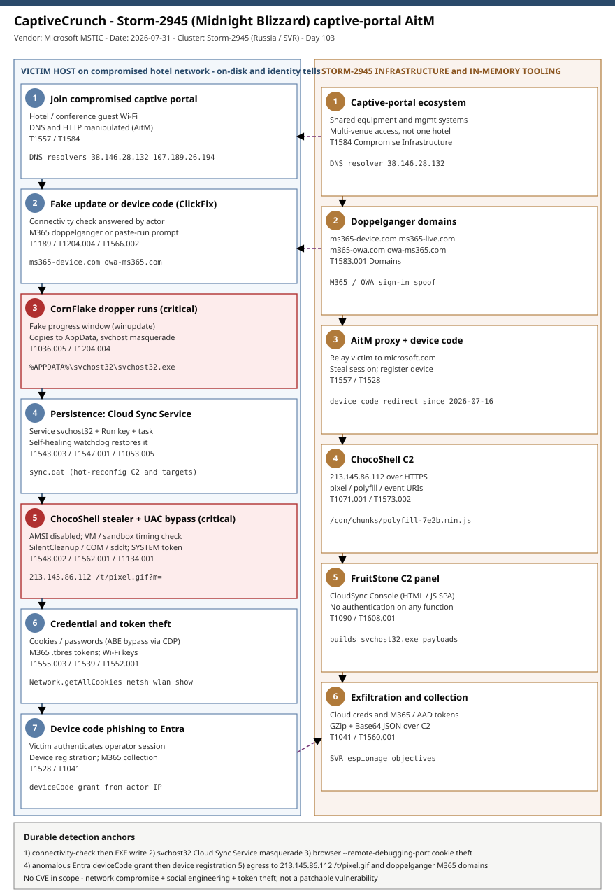

# CaptiveCrunch: Midnight Blizzard (Storm-2945) turns hotel captive portals into an AitM malware and credential-theft channel

## TL;DR
Microsoft Threat Intelligence disclosed **CaptiveCrunch** on 2026-07-31: a Russian SVR-nexus
operation in which **Storm-2945**, an operational sub-cluster of **Midnight Blizzard**, compromises
the **captive-portal networks** of hotels and conference venues and manipulates their **DNS and HTTP**
traffic to position itself adversary-in-the-middle against travelling employees. Victims joining the
Wi-Fi are steered down three paths: **Microsoft 365 phishing pages**, **Entra ID device code phishing**,
and **ClickFix fake "browser/OS update"** prompts that deliver the **CornFlake** Go RAT and the
**ChocoShell** in-memory PowerShell stealer. The espionage intent is classic Midnight Blizzard: harvest
cloud credentials, session cookies and M365/Azure AD tokens to reach victim cloud environments. The
device-code and OAuth phishing dates to February 2026; the captive-portal traffic manipulation has been
observed since early May 2026, making this a live, cross-border campaign against the hospitality supply
chain rather than a single-venue incident.

## Attribution and confidence
Microsoft attributes CaptiveCrunch to **Storm-2945**, assessed as an operational sub-cluster of
**Midnight Blizzard** (a.k.a. APT29 / Cozy Bear / NOBELIUM / the Dukes), the threat actor the US and UK
governments attribute to Russia's foreign intelligence service (**SVR**). Confidence in the campaign
clustering is **high** (first-party telemetry, malware samples, shared infrastructure); the actor
attribution to Midnight Blizzard is Microsoft's and is **medium-high**. Storm-2945 shares significant
victimology and tradecraft with **Storm-2372** (Midnight Blizzard device code phishing since August 2024).
Microsoft notes TTP similarities with the **Forest Blizzard** DNS-hijacking operation disclosed in April
2026 but keeps that as a separate GRU cluster. Independent corroboration comes from **ReliaQuest**
(2026-07-23, DNS poisoning expanding to hospitality) and **Volexity** (2025-02, Russian device code
authentication abuse).

| Overlap axis | Storm-2945 (CaptiveCrunch) | Related cluster | Assessment |
|---|---|---|---|
| Device code phishing | Entra device code redirect since 2026-07-16 | Storm-2372 (since Aug 2024) | Shared technique + victimology |
| DNS/HTTP manipulation | Captive-portal AitM since May 2026 | Forest Blizzard (Apr 2026) | Similar TTP, distinct cluster |
| Cloud credential focus | M365/Azure AD token theft | Midnight Blizzard core | Consistent parent tradecraft |

**Genealogy with previous repo cases.** This is the repo's first Russia/SVR Midnight Blizzard case. It
differs from the recent espionage entries by nexus and objective: the last three Monday espionage
primaries were China (UAT-7810/LapDogs ORB, 2026-07-13), Iran/APT42 (SpearSpecter, 2026-07-27) and China
(OctLurk/SilkLurk, 2026-08-03). The AitM device-code component is adjacent to the identity cases
(O-UNC-066, ARToken, OAuth-ClientID-Spoofing) but is delivered from compromised network infrastructure,
not a phishing lure alone. The ClickFix delivery is the same social-engineering primitive seen on Windows
(Woodgnat, 2026-07) and macOS (2026-08-07), here fused with a state actor's network position.

## Kill chain — summary table

| Stage | MITRE | Detail |
|---|---|---|
| Compromise captive-portal ecosystem | T1584 | Shared services / equipment across hotel & conference guest networks |
| Doppelganger domains + AitM proxy | T1583.001, T1557 | ms365-*/-ms365 domains; DNS/HTTP manipulation redirects victims |
| Connectivity check -> fake update (ClickFix) | T1189, T1204.004 | NCSI probe answered with a bogus browser/OS update prompt |
| CornFlake dropper + service masquerade | T1036.005, T1543.003 | Copies to %APPDATA%\svchost32\svchost32.exe; "Cloud Sync Service" |
| ChocoShell in-memory stealer + UAC bypass | T1059.001, T1548.002 | AMSI disabled; SilentCleanup/COM/sdclt UAC bypass; SYSTEM token |
| Credential & token theft | T1555.003, T1539, T1552.001 | Cookies, passwords, M365/Azure AD .tbres tokens, Wi-Fi keys |
| Device code phishing -> Entra registration | T1528, T1566.002 | Victim authenticates the operator's Entra session; M365 collection |
| C2 + exfiltration | T1071.001, T1041, T1560.001 | ChocoShell pixel/polyfill/event URIs; FruitStone panel; GZip+Base64 |



The diagram's left lane follows the victim on a compromised hotel network from Wi-Fi join through
ClickFix delivery, CornFlake persistence, ChocoShell credential theft and device-code phishing; the right
lane is the Storm-2945 infrastructure - the captive-portal foothold, doppelganger domains, the AitM proxy,
the ChocoShell C2 and the unauthenticated FruitStone operator panel. The durable detection anchors are the
connectivity-check-to-download sequence, the svchost32 "Cloud Sync Service" masquerade, the browser
remote-debugging cookie theft, and anomalous Entra device-code grants - none of which depend on the
rotating domains and IPs.

## Stage-by-stage detail

### 1. Captive-portal compromise and AitM positioning
Storm-2945 compromises the network equipment and management systems behind hotel/conference captive
portals. Microsoft notes commonalities across venues, suggesting access to **shared services within the
captive-portal ecosystem** rather than isolated venue break-ins. From that position the actor manipulates
**DNS and HTTP** to steer victim traffic through actor infrastructure (`T1557`, `T1584`). Two IOC IPs are
tagged as DNS resolvers used for this manipulation.

```text
DNS resolvers (traffic manipulation): 38.146.28.132, 107.189.26.194
AitM infrastructure: 31.57.243.154, 38.146.28.75, 104.194.159.150
```

### 2. Delivery: doppelganger pages, device code, and ClickFix
Redirected victims land on one of three experiences (`T1583.001`, `T1189`, `T1204.004`):
- **M365 sign-in doppelgangers** on `ms365-device.com`, `ms365-live.com`, `m365-owa.com`, `owa-ms365.com`.
- **Entra device code phishing** (since 2026-07-16): the actor starts an auth request and the victim is
  told to type an **actor-controlled device code** into the legitimate `microsoft.com` sign-in page,
  authenticating the operator's session (`T1528`, `T1566.002`).
- **ClickFix fake update** prompts telling the user to run a command / install an "update", delivering
  malware. ClickFix landings also carry **Android APK** instructions (no APK hash published).

### 3. CornFlake - Go Windows RAT
On first run CornFlake operates as a **dropper**: it shows a convincing fake progress window (options
include `winupdate`, `defender`, `directx`, `vcredist`), copies itself to
`%APPDATA%\svchost32\svchost32.exe` and establishes persistence (`T1036.005`, `T1543.003`, `T1547.001`,
`T1053.005`).

```text
Self-copy:   %APPDATA%\svchost32\svchost32.exe
Service:     svchost32  ->  DisplayName "Cloud Sync Service"
                            Description "Synchronizes files with the cloud storage provider"
Config:      sync.dat (hot reconfiguration of C2, watched dirs, TLS)
Local API:   127.0.0.1  /upload  /reload  /status
SHA-256:     918fa52ae45ed60ba7cc8bdc99c3cbe9ab92e0375ec31fc05d0d4513be11c593
```

CornFlake carries a broad collection toolkit gated by config flags: keylogging (`T1056.001`), clipboard
capture (`T1115`), screenshots (`T1113`), microphone (`T1123`) and webcam (`T1125`) capture, ChromeKatz-
derived browser credential theft, extension-scoped file exfiltration (`T1005`), USB monitoring (`T1025`)
and a remote shell. Its C2 uses an **ECDH P-256** ephemeral key exchange with a SHA-256-derived session
key and a custom JSON protocol (`T1573.002`, `T1071.001`); a persistence watchdog restores anything a
defender removes.

### 4. ChocoShell - in-memory PowerShell credential stealer
Where CornFlake is the foothold, ChocoShell is the smash-and-grab (`T1059.001`). It **disables AMSI** by
.NET reflection (`T1562.001`), runs timing-based VM/sandbox checks (`T1497.001`) and beacons to a
hardcoded C2.

```text
C2 beacon:   https://213.145.86.112/t/pixel.gif?m=<status>
2nd stage:   https://213.145.86.112/cdn/chunks/polyfill-7e2b.min.js  (Base64 -> ScriptBlock::Create)
Exfil:       POST https://213.145.86.112/t/event  (GZip + Base64 JSON)
SHA-256:     be99857449d2856dd5a84e21c8a3d5e0e01456adb44062ddec5a6b4970d8d42c
```

It escalates via three silent **UAC bypasses** in ordered fallback (`T1548.002`, `T1546.015`): a
SilentCleanup task hijack (`HKCU\Environment\windir`, cleaned after ~2s), a `wsreset.exe` COM hijack, and
an `sdclt.exe` folder hijack. For Chromium browsers it handles **App-Bound Encryption** by impersonating a
**SYSTEM token** from winlogon/wininit/services (`T1134.001`) to run SYSTEM-level DPAPI, or by launching
the browser with `--remote-debugging-port` and calling `Network.getAllCookies` over the DevTools protocol
to read cookies in plaintext (`T1539`). It also steals saved passwords (`T1555.003`), Firefox
`cookies.sqlite`, **M365/Azure AD tokens** from `.tbres` Token Broker files (`T1552.001`), and Wi-Fi keys
via `netsh wlan show profile key=clear`. Cleanup nulls variables, deletes VSS shadow copies and removes
the UAC-bypass registry values (`T1070.004`, `T1112`).

### 5. FruitStone - operator C2 panel
Storm-2945 runs the campaign from **FruitStone**, a single-page HTML/JS panel branded "CloudSync Console"
with **no authentication on any of its functions** (`T1090`). It provides an agent dashboard (SSE
live view, host telemetry, geo/subnet grouping), per-agent tasking (remote shell, file browser, collection,
config push, agent update/kill), a campaign builder (payload name default `svchost32.exe`, dropper types,
capability toggles, evasion options) and infrastructure management (proxy relays with TLS-cert tracking,
beacon profiles with `teams.microsoft.com` SNI spoofing, staging servers).

## Detection strategy

### Telemetry that matters
- **Endpoint (Sysmon / Defender XDR):** process creation (`DeviceProcessEvents` / EID 1) for svchost32
  and browser `--remote-debugging-port`; registry (`DeviceRegistryEvents` / EID 13) for the svchost32
  service and `HKCU\Environment\windir`; file events (`DeviceFileEvents`) for executable writes after a
  connectivity check; AMSI-tamper and UAC-bypass behavioural signals.
- **Network:** `DeviceNetworkEvents`, proxy/DNS logs for the doppelganger domains, ChocoShell C2 URIs and
  the actor IPs; TLS SNI for the M365 doppelgangers.
- **Identity (Entra / Sentinel):** `SigninLogs` device code authentications; `AuditLogs` device
  registration; `AADSignInEventsBeta`, `CloudAppEvents` for follow-on M365 collection.

### Detection coverage

| Engine | File | Logic |
|---|---|---|
| Sigma | sigma/proc_cornflake_svchost32_masquerade.yml | svchost32.exe image, or svchost.exe from AppData |
| Sigma | sigma/reg_cornflake_cloud_sync_service.yml | svchost32 service DisplayName/Description pair |
| Sigma | sigma/proc_chocoshell_browser_remote_debug_theft.yml | Chromium browser spawned with --remote-debugging-port |
| KQL | kql/captivecrunch_network_ioc.kql | Connectivity to doppelganger domains / actor IPs |
| KQL | kql/cornflake_service_and_dropper.kql | svchost32 process path + fake service registry writes |
| KQL | kql/device_code_phish_signin.kql | Entra deviceCode sign-ins from actor infrastructure |
| YARA | yara/captivecrunch.yar | CornFlake service/API strings; ChocoShell C2 URIs + CDP theft |
| Suricata | suricata/captivecrunch.rules | DNS/TLS doppelgangers; ChocoShell pixel/polyfill/event URIs |

### Threat hunting hypotheses
- **H1 - Connectivity-check then download** ([hunts/peak_h1_connectivity_check_then_download.md](./hunts/peak_h1_connectivity_check_then_download.md)):
  an executable/archive created within 2 minutes of an NCSI/captive-portal probe on a foreign network.
- **H2 - CornFlake persistence masquerade** ([hunts/peak_h2_cornflake_persistence_masquerade.md](./hunts/peak_h2_cornflake_persistence_masquerade.md)):
  svchost image outside System32, or the "Cloud Sync Service" metadata pair.
- **H3 - Anomalous device code / OAuth** ([hunts/peak_h3_device_code_oauth_anomaly.md](./hunts/peak_h3_device_code_oauth_anomaly.md)):
  deviceCode grants from actor IPs or foreign geo, followed by device registration.

## Incident response playbook

### First 60 minutes (triage)
1. Identify the host and the network it was on when compromised (hotel/conference SSID, timeframe).
2. Confirm CornFlake: check for `%APPDATA%\svchost32\svchost32.exe` and the svchost32 service.
3. Enumerate and disable **all** CornFlake persistence (service, Run keys, scheduled tasks) *before*
   touching credentials - the watchdog restores persistence, and the operator watches sessions live.
4. From Entra, list the user's recent **device code** sign-ins and any new **device registrations**.
5. Isolate the host; treat all cloud credentials used on it as compromised.

### Artifacts to collect

| Artifact | Path | Tool | Why |
|---|---|---|---|
| CornFlake binary | %APPDATA%\svchost32\svchost32.exe | EDR / manual | Sample + config for scoping |
| CornFlake config | sync.dat (same dir) | manual | C2 endpoints, watched dirs |
| Service definition | HKLM\...\Services\svchost32 | reg / autoruns | Persistence + masquerade proof |
| UAC-bypass residue | HKCU\Environment\windir | reg | ChocoShell escalation evidence |
| Entra sign-in logs | SigninLogs / AADSignInEventsBeta | Sentinel / XDR | Device code grant + IP |
| Token Broker cache | %LOCALAPPDATA%\...\*.tbres | manual | Which M365/AAD tokens exposed |

### IR queries and commands
```powershell
# Confirm CornFlake persistence
Get-CimInstance Win32_Service | Where-Object { $_.Name -eq 'svchost32' -or $_.DisplayName -eq 'Cloud Sync Service' }
Get-ChildItem "$env:APPDATA\svchost32" -ErrorAction SilentlyContinue
Get-ScheduledTask | Where-Object { $_.Actions.Execute -like '*svchost32*' }
# ChocoShell UAC-bypass residue
Get-ItemProperty 'HKCU:\Environment' -Name windir -ErrorAction SilentlyContinue
```
```bash
# Network scoping from proxy/DNS logs (adapt field names)
grep -E 'ms365-device\.com|ms365-live\.com|m365-owa\.com|owa-ms365\.com' proxy.log
grep -E '213\.145\.86\.112|107\.189\.26\.194' netflow.log
```
```kql
// Entra: successful device code grant then a device registration within 24h
SigninLogs
| where AuthenticationProtocol == "deviceCode" and ResultType == 0
| join kind=inner (AuditLogs | where OperationName has "Add device") on $left.UserId == $right.InitiatedBy
| project TimeGenerated, UserPrincipalName, IPAddress, OperationName
```

### Containment, eradication, recovery
- **Do NOT** rotate credentials or revoke tokens before removing persistence - the operator watches
  sessions live and can re-implant. Remove the service, Run keys, scheduled tasks and the AppData binary
  first, then revoke.
- Revoke all sessions and **refresh tokens** for affected users; remove attacker-registered Entra devices;
  audit OAuth app consents and new mailbox/inbox rules.
- Reset browser-stored passwords and any secrets that transited the host; rotate Wi-Fi keys captured.
- Exit criteria: no CornFlake artifacts on re-scan, no anomalous device code grants for 7 days, clean
  Entra device inventory.

### Recovery validation
Re-image where feasible. Validate by confirming the svchost32 service and AppData binary are gone across
reboots, that no new device code grants appear from unknown IPs, and that revoked tokens are not being
replayed against M365.

## IOCs

| Type | Value | Context | Confidence | Source |
|---|---|---|---|---|
| sha256 | 918fa52a...be11c593 | CornFlake Go RAT | high | Microsoft 2026-07-31 |
| sha256 | be998574...70d8d42c | ChocoShell PS stealer | high | Microsoft 2026-07-31 |
| domain | ms365-device.com | Device code redirect / M365 doppelganger | high | Microsoft 2026-07-31 |
| domain | ms365-live.com | Device code redirect / M365 doppelganger | high | Microsoft 2026-07-31 |
| domain | m365-owa.com | AitM (OWA doppelganger) | high | Microsoft 2026-07-31 |
| domain | owa-ms365.com | AitM (OWA doppelganger) | high | Microsoft 2026-07-31 |
| ipv4 | 213.145.86.112 | ChocoShell hardcoded C2 | high | Microsoft 2026-07-31 |
| ipv4 | 107.189.26.194 | ChocoShell C2 / DNS resolver | high | Microsoft 2026-07-31 |
| ipv4 | 38.146.28.132 | DNS resolver (traffic manipulation) | high | Microsoft 2026-07-31 |
| ipv4 | 31.57.243.154 | AitM infrastructure | high | Microsoft 2026-07-31 |
| ipv4 | 38.146.28.75 | AitM infrastructure | high | Microsoft 2026-07-31 |
| ipv4 | 104.194.159.150 | AitM infrastructure | high | Microsoft 2026-07-31 |
| url | /t/pixel.gif?m= | ChocoShell C2 beacon URI | high | Microsoft 2026-07-31 |
| url | /cdn/chunks/polyfill-7e2b.min.js | ChocoShell second-stage fetch | high | Microsoft 2026-07-31 |
| path | %APPDATA%\svchost32\svchost32.exe | CornFlake persistence binary | high | Microsoft 2026-07-31 |

No CVE is in scope: the initial captive-portal compromise vector is unconfirmed and the campaign abuses
the legitimate Entra **device code** OAuth flow plus DNS/HTTP traffic manipulation rather than a patchable
software vulnerability - so there is no CISA KEV cross-reference for this case. Full indicator set,
including registry keys and the exfil endpoint, in [iocs.csv](./iocs.csv).

## Secondary findings
- **The captive-portal ecosystem is a supply chain.** Microsoft's observation of shared equipment and
  management systems across venues means one compromise of a captive-portal service provider can expose
  many hotels at once - the blast radius follows the managed-Wi-Fi vendor, not the individual hotel.
- **AI-assisted malware authorship.** ChocoShell ships with developer comments naming specific Microsoft
  detection signatures and explaining the evasion reasoning, a style consistent with AI-assisted code
  generation; the broader operation "shows signs of AI assistance" per Microsoft.
- **Android in scope.** ClickFix landings include Android APK instructions, indicating the operator is
  extending the same captive-portal delivery to mobile targets even though no APK sample is yet public.

## Pedagogical anchors
- **Untrusted transit networks are an attack surface, not just an eavesdropping risk.** A hostile network
  position lets a state actor inject fake updates and device-code prompts - treat hotel/conference Wi-Fi as
  adversarial and prefer managed cellular for privileged work.
- **Remove persistence before you rotate credentials.** A live operator with a self-healing watchdog turns
  the reflexive "reset passwords first" into a trigger for re-implantation; enumerate and cut persistence,
  then revoke.
- **Device code phishing needs no malware.** The victim authenticates the attacker's session on a genuine
  Microsoft page; the only durable signal is the anomalous deviceCode grant and the device registration
  that follows.
- **App-Bound Encryption is not a cookie safe.** Storm-2945 bypasses ABE two ways (SYSTEM-token DPAPI and
  DevTools `Network.getAllCookies`); session-cookie theft, not password theft, is the cloud-access path.
- **Absence of a CVE is not absence of severity.** This is network compromise + social engineering + token
  theft - exactly the class a patch-centric program under-weights.

## What's in this folder

| File | Purpose | Link |
|---|---|---|
| README.md | This analysis. | [README.md](./README.md) |
| kill_chain.svg | Two-lane kill chain (victim vs Storm-2945 infrastructure). | [kill_chain.svg](./kill_chain.svg) |
| iocs.csv | Full indicator set (hashes, domains, IPs, URIs, paths, regkeys). | [iocs.csv](./iocs.csv) |
| sigma/proc_cornflake_svchost32_masquerade.yml | CornFlake svchost32 masquerade. | [link](./sigma/proc_cornflake_svchost32_masquerade.yml) |
| sigma/reg_cornflake_cloud_sync_service.yml | CornFlake fake service registration. | [link](./sigma/reg_cornflake_cloud_sync_service.yml) |
| sigma/proc_chocoshell_browser_remote_debug_theft.yml | ChocoShell CDP cookie theft. | [link](./sigma/proc_chocoshell_browser_remote_debug_theft.yml) |
| kql/captivecrunch_network_ioc.kql | Network IOC connectivity. | [link](./kql/captivecrunch_network_ioc.kql) |
| kql/cornflake_service_and_dropper.kql | CornFlake dropper + service. | [link](./kql/cornflake_service_and_dropper.kql) |
| kql/device_code_phish_signin.kql | Entra device code phishing. | [link](./kql/device_code_phish_signin.kql) |
| yara/captivecrunch.yar | CornFlake + ChocoShell YARA (2 rules). | [link](./yara/captivecrunch.yar) |
| suricata/captivecrunch.rules | DNS/TLS/HTTP network rules (9 sids). | [link](./suricata/captivecrunch.rules) |
| hunts/peak_h1_connectivity_check_then_download.md | Hunt: connectivity check -> download. | [link](./hunts/peak_h1_connectivity_check_then_download.md) |
| hunts/peak_h2_cornflake_persistence_masquerade.md | Hunt: svchost32 masquerade. | [link](./hunts/peak_h2_cornflake_persistence_masquerade.md) |
| hunts/peak_h3_device_code_oauth_anomaly.md | Hunt: anomalous device code. | [link](./hunts/peak_h3_device_code_oauth_anomaly.md) |

## Sources
- [CaptiveCrunch: Midnight Blizzard targets travelers worldwide (Microsoft Threat Intelligence, 2026-07-31)](https://www.microsoft.com/en-us/security/blog/2026/07/31/captivecrunch-midnight-blizzard-targets-travelers-worldwide-for-malware-delivery-and-credential-theft/)
- [Russian hackers abuse hotel Wi-Fi networks to steal Microsoft 365 credentials (Help Net Security, 2026-08-04)](https://www.helpnetsecurity.com/2026/08/04/midnight-blizzard-hotel-wi-fi-networks-hacking/)
- [Threat Spotlight: DNS poisoning tactics expand to hospitality (ReliaQuest, 2026-07-23)](https://reliaquest.com/blog/threat-spotlight-dns-poisoning-tactics-expand-to-hospitality/)
- [Russia-linked Midnight Blizzard hijacks hotel Wi-Fi with CaptiveCrunch (iTnews, 2026-08-04)](https://www.itnews.com.au/news/russia-linked-midnight-blizzard-group-hijacks-hotel-wi-fi-with-captivecrunch-627911)
- [Microsoft links hotel Wi-Fi hacks to Russian Midnight Blizzard hackers (CyberInsider, 2026-08)](https://cyberinsider.com/microsoft-links-hotel-wi-fi-hacks-to-russian-midnight-blizzard-hackers/)
- [Multiple Russian Threat Actors Targeting Microsoft Device Code Authentication (Volexity, 2025-02-13)](https://www.volexity.com/blog/2025/02/13/multiple-russian-threat-actors-targeting-microsoft-device-code-authentication)
