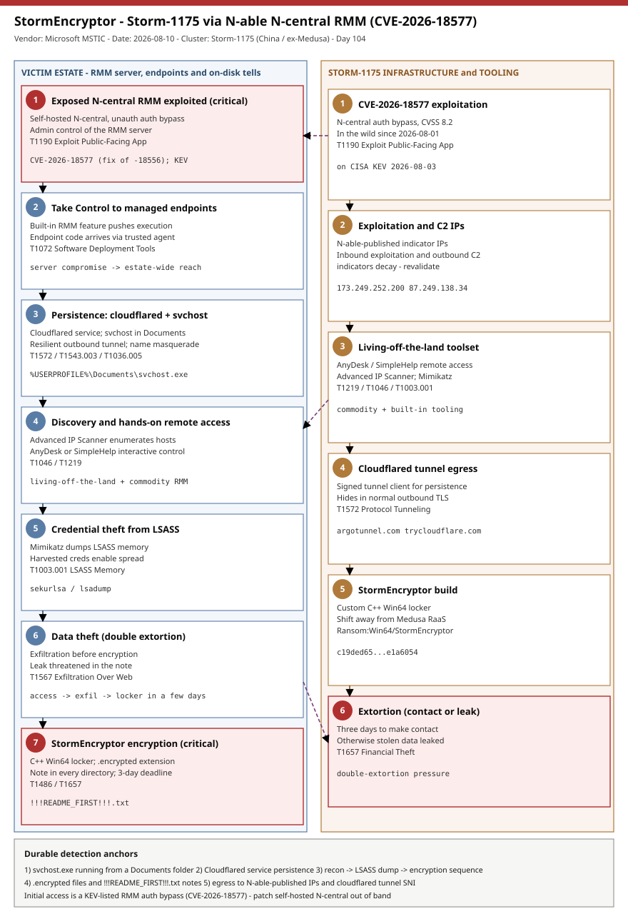

# StormEncryptor: Storm-1175 (former Medusa affiliate) pivots to a custom C++ locker via the N-able N-central RMM auth bypass

## TL;DR
On 2026-08-10 Microsoft Threat Intelligence detailed **StormEncryptor**, a previously undocumented
C++ ransomware deployed by **Storm-1175**, a China-based, financially motivated actor formerly known
for deploying **Medusa** ransomware. The intrusions were preceded by exploitation of an
**authentication-bypass flaw in N-able N-central** (**CVE-2026-18577**), a widely used RMM platform;
after taking over a self-hosted N-central server the actor used the built-in **Take Control** feature
to pivot into managed endpoints, planted a **svchost.exe in the user Documents folder**, and installed
**Cloudflare Tunnel (cloudflared)** for persistence. StormEncryptor appends **.encrypted** and drops
**!!!README_FIRST!!!.txt** with a three-day contact-or-leak deadline. This matters today because the
N-central flaw has been exploited in the wild since **2026-08-01**, was added to **CISA KEV on
2026-08-03**, and Storm-1175 moves from access to exfiltration and encryption within a few days -
making unpatched self-hosted N-central servers an active ransomware entry point.

## Attribution and confidence
Microsoft attributes the activity to **Storm-1175**, a financially motivated, **China-based** cluster
it previously linked to **Medusa** ransomware operations that exploited n-day and zero-day flaws in
internet-facing products (GoAnywhere MFT, SmarterTools SmarterMail, Microsoft Exchange, Ivanti Connect
Secure, JetBrains TeamCity). Microsoft's confidence in the **cluster** and the StormEncryptor family is
**high** (first-party telemetry plus a named sample); the **initial-access attribution** to
CVE-2026-18577 is stated as *likely* by Microsoft, so treat the exploit-to-locker linkage as
**medium**. StormEncryptor is described as the actor's first observed activity since **April 2026** and
a deliberate **move away from Medusa**.

| Overlap axis | Storm-1175 (StormEncryptor) | Prior Storm-1175 (Medusa) | Assessment |
|---|---|---|---|
| Initial access | N-central RMM auth bypass (CVE-2026-18577) | Web-facing n-day/zero-day (MFT, mail, VPN, CI) | Same "exploit exposed assets" playbook, new target class |
| Payload | Custom C++ StormEncryptor (.encrypted) | Medusa RaaS locker | Shift from affiliate RaaS to in-house locker |
| Tradecraft | AnyDesk/SimpleHelp, Advanced IP Scanner, Mimikatz | Same living-off-the-land RMM + LSASS dumping | Consistent hands-on-keyboard tooling |

**Genealogy with previous repo cases.** This is the repo's first **Storm-1175** case and its first
tie to the **Medusa** lineage as a primary (Medusa only appeared incidentally in the Akira-SonicWall
and GentleKiller entries). It differs from the recent Tuesday ransomware primary **ByteToCrypt**
(2026-08-04): that was a hand-written **Linux** locker delivered via leaked credentials with **no CVE**;
this is a **Windows** C++ locker whose initial access is a **KEV-listed RMM auth bypass**. The RMM-as-
initial-access angle is adjacent to, but distinct from, the repo's edge/appliance cases (ArcaneDoor,
NetScaler) - here the "appliance" is a management server whose legitimate agent channel is the pivot.

## Kill chain — summary table

| Stage | MITRE | Detail |
|---|---|---|
| Exploit N-central auth bypass | T1190 | CVE-2026-18577 - unauth bypass to admin control of a self-hosted N-central RMM server |
| Pivot to managed endpoints (Take Control) | T1072 | Built-in Take Control feature pushes remote execution to downstream endpoints |
| Cloudflared tunnel + svchost masquerade | T1572, T1543.003, T1036.005 | cloudflared service for persistence; svchost.exe planted in user Documents |
| Hands-on remote access | T1219 | AnyDesk or SimpleHelp for interactive control |
| Network discovery | T1046 | Advanced IP Scanner enumerates reachable hosts |
| Credential theft | T1003.001 | Mimikatz dumps credentials from LSASS |
| Data theft (double extortion) | T1567 | Exfiltration before encryption; leak threatened in the note |
| StormEncryptor deployment | T1486, T1657 | C++ locker appends .encrypted, drops !!!README_FIRST!!!.txt, 3-day deadline |



The diagram's left lane follows the victim estate from the exposed N-central server through the Take
Control pivot, cloudflared/svchost persistence, discovery, LSASS credential theft and finally
StormEncryptor encryption; the right lane is the Storm-1175 side - the CVE-2026-18577 exploitation, the
N-able-published exploitation/C2 IPs, the RMM tooling, and the extortion panel. The durable detection
anchors are the **svchost.exe-in-Documents** masquerade, the **Cloudflared** service, the recon-to-
credential-dump-to-encryption sequence, and the **.encrypted / !!!README_FIRST!!!.txt** on-disk impact -
none of which depend on the specific IPs.

## Stage-by-stage detail

### 1. Initial access - N-central authentication bypass (CVE-2026-18577)
N-able **N-central** is a Remote Monitoring and Management (RMM) platform used by MSPs and enterprise
IT to centrally administer servers, workstations and network devices, operating with broad
administrative privilege across customer estates. **CVE-2026-18577** is an authentication bypass
(CVSS 8.2) that lets a remote, unauthenticated attacker gain administrative control of a vulnerable
N-central server; it is the **incomplete-fix follow-on to CVE-2026-18556** (`T1190`). N-able observed
exploitation in the wild since **2026-08-01** and shipped a hotfix (**2026.3.1 Hotfix 1**, build
**2026.3.1.7**) on **2026-08-02**. Hosted N-central is patched automatically by the vendor; **on-premise
(self-hosted) deployments require manual remediation** and are the exposed population.

```text
Vuln:     CVE-2026-18577 (incomplete fix of CVE-2026-18556) - N-central auth bypass, CVSS 8.2
Fixed in: N-able N-central 2026.3.1 Hotfix 1 (build 2026.3.1.7), released 2026-08-02
Exploited in the wild since: 2026-08-01   Added to CISA KEV: 2026-08-03 (18577), 2026-08-04 (18556)
```

### 2. Pivot to managed endpoints via Take Control
With administrative control of the N-central server, the actor abused the platform's legitimate
**Take Control** remote-access feature to reach managed endpoints and execute code on them (`T1072`).
This is RMM-as-initial-access: the exploit noise stays on the server, while endpoint execution arrives
through the sanctioned agent channel, which many endpoint controls implicitly trust.

### 3. Persistence - Cloudflared tunnel and svchost masquerade
On reached endpoints, N-able's own indicators call out two host artifacts (`T1572`, `T1543.003`,
`T1036.005`):

```text
Service:  Cloudflared  (Cloudflare Tunnel client installed as a Windows service for remote access)
File:     %USERPROFILE%\Documents\svchost.exe  (svchost.exe never legitimately runs from Documents)
```

Cloudflared gives the operator a resilient outbound tunnel (egress to `*.argotunnel.com` /
`trycloudflare.com`) that survives reboots; the misplaced svchost.exe is a name-masquerade against the
legitimate Windows service host, which only ever runs from System32/SysWOW64.

### 4. Discovery, remote access and credential theft
Storm-1175 then operates hands-on-keyboard with living-off-the-land and commodity tools:

```text
Remote access:  AnyDesk  or  SimpleHelp            (T1219)
Discovery:      Advanced IP Scanner                (T1046)
Credential theft: Mimikatz -> LSASS memory dump    (T1003.001)
```

Microsoft stresses the **tempo**: the actor "rapidly moves from initial access to data exfiltration and
ransomware deployment, often within a few days," so the window between these steps and encryption is
short.

### 5. Exfiltration and StormEncryptor impact
Data is stolen before encryption to enable double extortion (`T1567`), then the **StormEncryptor**
C++ Win64 locker runs (`T1486`, `T1657`):

```text
Sample:    c19ded65e822bb43ad0381c58abf33b7c8890f7bcc7125058a0c849c7e1a6054
Detection: Ransom:Win64/StormEncryptor (Microsoft Defender Antivirus)
Extension: .encrypted (appended to encrypted files)
Note:      !!!README_FIRST!!!.txt (dropped into every scanned directory)
Demand:    3 days to make contact, otherwise stolen data is leaked online
```

## Detection strategy

### Telemetry that matters
- **Endpoint (Sysmon / Defender XDR):** process creation (`DeviceProcessEvents` / EID 1) for
  svchost.exe running from `\Documents\` and for `cloudflared.exe` with tunnel arguments; service/
  registry (`DeviceRegistryEvents` / EID 13) for a **Cloudflared** service; LSASS access (EID 10) for
  Mimikatz; file events (`DeviceFileEvents` / EID 11) for `.encrypted` and `!!!README_FIRST!!!.txt`.
- **RMM / server:** N-central authentication logs, **Take Control** session activity, admin account
  creation/modification, and Windows service installation on managed endpoints.
- **Network:** `DeviceNetworkEvents` / proxy for the N-able-published IPs and for cloudflared SNI
  (`argotunnel.com`, `trycloudflare.com`).

### Detection coverage

| Engine | File | Logic |
|---|---|---|
| Sigma | sigma/proc_svchost_masquerade_documents.yml | svchost.exe image path under a Documents folder |
| Sigma | sigma/proc_cloudflared_tunnel_run.yml | cloudflared.exe with tunnel run / --token / trycloudflare |
| Sigma | sigma/file_stormencryptor_note_and_extension.yml | !!!README_FIRST!!!.txt note or .encrypted rename |
| KQL | kql/ncentral_takecontrol_persistence.kql | svchost-in-Documents + cloudflared tunnel persistence |
| KQL | kql/stormencryptor_network_ioc.kql | Connectivity to N-able-published exploitation/C2 IPs |
| KQL | kql/stormencryptor_recon_creds_impact.kql | Recon/RMM tooling, LSASS dumping, and encryption burst |
| YARA | yara/stormencryptor.yar | StormEncryptor locker + broad note/extension artifact heuristic (2 rules) |
| Suricata | suricata/stormencryptor.rules | N-able-published IPs + cloudflared tunnel SNI/DNS (5 sids) |

### Threat hunting hypotheses
- **H1 - Take Control to endpoint execution** ([hunts/peak_h1_ncentral_takecontrol_to_endpoint_exec.md](./hunts/peak_h1_ncentral_takecontrol_to_endpoint_exec.md)):
  unattributed N-central Take Control sessions followed by anomalous child execution on endpoints.
- **H2 - Cloudflared + svchost-in-Documents persistence** ([hunts/peak_h2_cloudflared_svchost_documents_persistence.md](./hunts/peak_h2_cloudflared_svchost_documents_persistence.md)):
  a Cloudflared service or a svchost.exe running from a Documents folder.
- **H3 - Recon to cred-dump to encryption** ([hunts/peak_h3_recon_creddump_encryption_sequence.md](./hunts/peak_h3_recon_creddump_encryption_sequence.md)):
  the compressed Advanced IP Scanner -> AnyDesk/SimpleHelp -> Mimikatz -> .encrypted sequence.

## Incident response playbook

### First 60 minutes (triage)
1. Identify whether a **self-hosted N-central** server is (or was) exposed and its patch level; if
   below 2026.3.1 HF1 (build 2026.3.1.7), treat it as compromised until proven otherwise.
2. On the N-central server, review authentication, **Take Control** session activity and admin account
   changes since 2026-08-01 for unattributed access.
3. On managed endpoints, check for a **Cloudflared** service and a **svchost.exe in Documents**; these
   are the vendor-published compromise indicators.
4. Enumerate and disable **all** attacker persistence (Cloudflared service, the Documents svchost.exe,
   any scheduled tasks) *before* credential rotation, because a live operator can re-implant.
5. Isolate affected endpoints; assume all credentials used on them (and dumped via LSASS) are exposed.

### Artifacts to collect

| Artifact | Path | Tool | Why |
|---|---|---|---|
| Documents svchost.exe | %USERPROFILE%\Documents\svchost.exe | EDR / manual | Masquerade payload for sampling and scoping |
| Cloudflared service | HKLM\...\Services\Cloudflared | reg / autoruns | Persistence + tunnel account identification |
| N-central Take Control logs | N-central server | vendor console | Which endpoints were reached and when |
| LSASS access events | Sysmon EID 10 / DeviceEvents | EDR | Mimikatz credential-theft evidence |
| Ransom note + encrypted files | !!!README_FIRST!!!.txt, *.encrypted | manual | Confirm StormEncryptor and encryption scope |
| Egress records | proxy / netflow | SIEM | Connectivity to N-able IPs and cloudflared SNI |

### IR queries and commands
```powershell
# Cloudflared service and Documents svchost masquerade
Get-CimInstance Win32_Service | Where-Object { $_.Name -like '*Cloudflared*' -or $_.PathName -like '*cloudflared*' }
Get-ChildItem "$env:USERPROFILE\Documents\svchost.exe" -ErrorAction SilentlyContinue
Get-Process cloudflared -ErrorAction SilentlyContinue | Select-Object Id, Path
```
```bash
# Network scoping from proxy/netflow (adapt field names) - N-able-published IPs
grep -E '173\.249\.252\.200|87\.249\.138\.34|37\.19\.210\.32|37\.153\.90\.88|92\.118\.112\.181|68\.235\.46\.214' netflow.log
grep -Ei 'argotunnel\.com|trycloudflare\.com' proxy.log
```
```kql
// Endpoints reached from the N-central agent that then ran cloudflared or a Documents svchost
DeviceProcessEvents
| where (FileName =~ "cloudflared.exe" and ProcessCommandLine has_any ("tunnel run","--token","trycloudflare"))
    or (FileName =~ "svchost.exe" and FolderPath has @"\Documents\")
| project Timestamp, DeviceName, InitiatingProcessFileName, FileName, FolderPath, ProcessCommandLine
```

### Containment, eradication, recovery
- **Do NOT** rotate credentials or revoke sessions before removing persistence - remove the Cloudflared
  service, the Documents svchost.exe and any scheduled tasks first, then rotate.
- **Patch N-central to 2026.3.1 HF1 (2026.3.1.7) out of band**, upgrade N-central agents after the
  server hotfix, and contact N-able Support if compromise is confirmed.
- Rotate all credentials exposed on affected endpoints (including any dumped from LSASS) and any
  N-central service/admin accounts; review for attacker-created admin accounts.
- What NOT to do: do not restore from backups reachable by the same compromised RMM/credentials, and do
  not pay on the assumption the note's 3-day timer is the true constraint.
- Exit criteria: N-central patched and clean, no Cloudflared/Documents-svchost artifacts on re-scan, no
  connectivity to the IOC IPs, and validated backups.

### Recovery validation
Re-image encrypted or implanted endpoints where feasible. Validate by confirming the Cloudflared
service and Documents svchost.exe are gone across reboots, N-central reports the patched build, no new
Take Control sessions appear from unknown sources, and restored data comes from a backup proven to
predate the intrusion.

## IOCs

| Type | Value | Context | Confidence | Source |
|---|---|---|---|---|
| sha256 | c19ded65...e1a6054 | StormEncryptor C++ Win64 locker (Ransom:Win64/StormEncryptor) | high | Microsoft 2026-08-10 |
| cve | CVE-2026-18577 | N-central auth bypass - initial access; on CISA KEV | high | N-able / CISA KEV |
| cve | CVE-2026-18556 | Earlier N-central auth bypass (18577 is the incomplete fix); on CISA KEV | high | Rapid7 / CISA KEV |
| ipv4 | 173.249.252.200 | N-able-published exploitation / C2 IP | medium | N-able 2026-08-02 |
| ipv4 | 87.249.138.34 | N-able-published exploitation / C2 IP | medium | N-able 2026-08-02 |
| ipv4 | 37.19.210.32 | N-able-published exploitation / C2 IP | medium | N-able 2026-08-02 |
| ipv4 | 37.153.90.88 | N-able-published exploitation / C2 IP | medium | N-able 2026-08-02 |
| ipv4 | 92.118.112.181 | N-able-published exploitation / C2 IP | medium | N-able 2026-08-02 |
| ipv4 | 68.235.46.214 | N-able-published exploitation / C2 IP | medium | N-able 2026-08-02 |
| path | %USERPROFILE%\Documents\svchost.exe | svchost masquerade planted post-exploitation | high | N-able 2026-08-02 |
| regkey | HKLM\...\Services\Cloudflared | Cloudflare Tunnel persistence service | high | N-able 2026-08-02 |
| string | .encrypted | StormEncryptor encrypted-file extension | high | Microsoft 2026-08-10 |
| string | !!!README_FIRST!!!.txt | StormEncryptor ransom note filename | high | Microsoft 2026-08-10 |

**CISA KEV.** Both CVEs in scope are on CISA KEV: **CVE-2026-18577** was added **2026-08-03** and
**CVE-2026-18556** on **2026-08-04**, confirming active in-the-wild exploitation. These are patch-now
items with a federal remediation deadline; self-hosted N-central must be moved to 2026.3.1 HF1 out of
band. See [kev.md](./kev.md) for the exact KEV dates, remediation due dates and the ransomware-use flag.
Full indicator set, including tooling notes, in [iocs.csv](./iocs.csv).

## Secondary findings
- **RMM is initial access, not just management.** A single N-central compromise fans out to every
  managed endpoint through the trusted Take Control channel; the blast radius follows the RMM's
  administrative reach, which for an MSP means downstream customers, not one network.
- **In-house locker over RaaS.** Storm-1175's shift from the Medusa affiliate program to a custom C++
  StormEncryptor removes the affiliate paper-trail and the shared-tooling detections that came with
  Medusa, and signals a maturing operation willing to build its own payload.
- **Legitimate tunnels as persistence.** Cloudflared is signed and benign in isolation, so tunnel-based
  persistence hides in normal outbound TLS; detection has to lean on the service install and the
  unexpected host, not on a malicious binary.

## Pedagogical anchors
- **Patch exposed management planes first.** An RMM/monitoring server is a force multiplier for an
  attacker; a KEV-listed auth bypass on it is more urgent than the same CVSS on a single app, because
  one server compromise equals estate-wide execution.
- **Trust boundaries include your own tools.** Endpoint defenses that implicitly trust the RMM agent
  let attacker code arrive "from management"; hunt on what the agent spawns, not just on external
  binaries.
- **Remove persistence before rotating credentials.** A high-tempo, hands-on operator re-implants when
  you revoke first; cut the Cloudflared service and the Documents svchost.exe, then rotate.
- **KEV presence is a deadline, not a data point.** CVE-2026-18577 on KEV means confirmed exploitation
  and a mandated fix window - prioritise it over a longer backlog regardless of internal severity math.
- **The encrypted-file extension and note are the last, loudest signal.** By the time .encrypted and
  !!!README_FIRST!!!.txt appear, exfiltration is already done; the value is in catching the recon-to-
  cred-dump sequence upstream.

## What's in this folder

| File | Purpose | Link |
|---|---|---|
| README.md | This analysis. | [README.md](./README.md) |
| kill_chain.svg | Two-lane kill chain (victim estate vs Storm-1175 side). | [kill_chain.svg](./kill_chain.svg) |
| iocs.csv | Full indicator set (hash, CVEs, IPs, path, regkey, strings, tooling). | [iocs.csv](./iocs.csv) |
| kev.md | CISA KEV cross-reference for this case's CVEs. | [kev.md](./kev.md) |
| sigma/proc_svchost_masquerade_documents.yml | svchost.exe running from Documents. | [link](./sigma/proc_svchost_masquerade_documents.yml) |
| sigma/proc_cloudflared_tunnel_run.yml | Cloudflared tunnel execution. | [link](./sigma/proc_cloudflared_tunnel_run.yml) |
| sigma/file_stormencryptor_note_and_extension.yml | Ransom note / .encrypted impact. | [link](./sigma/file_stormencryptor_note_and_extension.yml) |
| kql/ncentral_takecontrol_persistence.kql | Persistence: svchost + cloudflared. | [link](./kql/ncentral_takecontrol_persistence.kql) |
| kql/stormencryptor_network_ioc.kql | Network IOC connectivity. | [link](./kql/stormencryptor_network_ioc.kql) |
| kql/stormencryptor_recon_creds_impact.kql | Recon, cred dump, encryption burst. | [link](./kql/stormencryptor_recon_creds_impact.kql) |
| yara/stormencryptor.yar | StormEncryptor locker + artifact heuristic (2 rules). | [link](./yara/stormencryptor.yar) |
| suricata/stormencryptor.rules | N-able IPs + cloudflared tunnel (5 sids). | [link](./suricata/stormencryptor.rules) |
| hunts/peak_h1_ncentral_takecontrol_to_endpoint_exec.md | Hunt: Take Control to endpoint execution. | [link](./hunts/peak_h1_ncentral_takecontrol_to_endpoint_exec.md) |
| hunts/peak_h2_cloudflared_svchost_documents_persistence.md | Hunt: cloudflared + svchost masquerade. | [link](./hunts/peak_h2_cloudflared_svchost_documents_persistence.md) |
| hunts/peak_h3_recon_creddump_encryption_sequence.md | Hunt: recon to cred-dump to encryption. | [link](./hunts/peak_h3_recon_creddump_encryption_sequence.md) |

## Sources
- [New StormEncryptor ransomware used by former Medusa affiliate (BleepingComputer, 2026-08-10)](https://www.bleepingcomputer.com/news/security/new-stormencryptor-ransomware-used-by-former-medusa-affiliate/)
- [China-Linked Hackers Deploy New StormEncryptor Ransomware, Likely via N-central Flaw (The Hacker News, 2026-08-10)](https://thehackernews.com/2026/08/china-linked-hackers-deploy-new.html)
- [CVE-2026-18577: N-able N-central Authentication Bypass Exploited in the Wild (Rapid7, 2026-08-04)](https://www.rapid7.com/blog/post/etr-cve-2026-18577-n-able-n-central-authentication-bypass-exploited-in-the-wild/)
- [Attackers exploit N-able N-central flaw to reach managed endpoints (Help Net Security, 2026-08-03)](https://www.helpnetsecurity.com/2026/08/03/cve-2026-18577-n-able-n-central-vulnerability/)
- [N-central 2026.3 Hotfix 1 - mitigation for CVE-2026-18577 (N-able advisory, 2026-08-02)](https://status.n-able.com/2026/08/02/n-central-2026-3-hotfix-1-mitigation-for-cve-2026-18577/)
- [CISA Adds One Known Exploited Vulnerability to Catalog (CISA, 2026-08-03)](https://www.cisa.gov/news-events/alerts/2026/08/03/cisa-adds-one-known-exploited-vulnerability-catalog)
- [Storm-1175 actor deploys new StormEncryptor ransomware after N-central vulnerability exploitation (SC Media, 2026-08)](https://www.scworld.com/brief/storm-1175-actor-deploys-new-stormencryptor-ransomware-after-n-central-vulnerability-exploitation)
- [Storm-1175 Launches StormEncryptor Ransomware Attacks Using N-able Security Flaw (GBHackers, 2026-08)](https://gbhackers.com/storm-1175-launches-stormencryptor-ransomware-attacks/)
