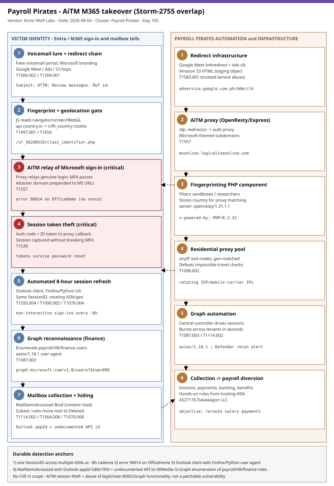

# Payroll Pirates: AiTM Microsoft 365 takeover with Graph reconnaissance and coordinated mailbox collection (Storm-2755 overlap)

## TL;DR
Arctic Wolf Labs published (2026-08-06) an active, widespread email-driven **adversary-in-the-middle (AiTM)** campaign that takes over **Microsoft 365** accounts to locate the people who run financial workflows and quietly read their mail. Voicemail-themed lures ride a six-stage redirect chain through Google and Amazon S3 to an AiTM reverse proxy that relays the genuine Microsoft sign-in and steals the resulting **session tokens even when MFA is enabled**. Post-compromise, centralized automation refreshes each stolen session about every **eight hours** from rotating **residential proxies**, uses **Microsoft Graph** to enumerate payroll/HR/finance users, and pulls their mail via a distinctive Outlook app + undocumented API pairing. The activity overlaps Microsoft's **Storm-2755** "Payroll Pirate" cluster (and the related **Storm-2657**), whose end goal is diverting salary payments; it is fresh this week, deliberately low-noise, and spans healthcare, education, manufacturing, government and professional services across the US, Canada and Europe.

## Attribution and confidence
Arctic Wolf tracks this as an **activity cluster** with significant technical and behavioral overlap with **Storm-2755** (the "Payroll Pirate" cluster Microsoft documented targeting Canadian employees in April 2026) and related reporting by **Security Risk Advisors**. The financially motivated goal - rerouting direct-deposit/salary payments - matches the broader Payroll Pirates campaigns that Microsoft has also tracked as **Storm-2657** since early 2025. National attribution is **unknown**; confidence in the *campaign clustering* is **medium** (first-party MDR telemetry, shared toolkit fingerprints, consistent tradecraft), while any link to a specific named actor is **low**. Arctic Wolf explicitly notes that shared Google Meet redirect infrastructure was also seen delivering other kits (EvilTokens, Sneaky 2FA, FlowerStorm), so delivery overlap does **not** establish a common operator.

| Overlap axis | This campaign (Arctic Wolf, Aug 2026) | Related cluster | Assessment |
|---|---|---|---|
| Payroll/HR mailbox targeting | Graph recon of finance roles + mail collection | Storm-2755 (Apr 2026) | Shared objective + technique |
| Salary/direct-deposit diversion | Financial-workflow personnel focus | Storm-2657 (since 2025) | Consistent monetization |
| AiTM session theft | OpenResty/Express reverse proxy, MFA relay | Generic AiTM PhaaS | Shared primitive, distinct kit |

**Genealogy with previous repo cases.** This is the repo's first case anchored on the **Payroll Pirates / Storm-2755** cluster and the first primary in **#6 SaaS abuse** since 2026-06-21. It is adjacent to but distinct from prior identity/BEC entries: **ARToken** (2026-07-22) and **Kali365** were **OAuth device-code** phishing with no credential form; **CodeOfConduct/Storm-1747** (2026-05-06) was AiTM token relay by a named actor with a different lure; **OAuth-ClientID-Spoofing** (2026-07-29) and **O-UNC-066** (2026-07-15) were identity-only techniques. What is novel here is the **post-compromise SaaS automation**: an 8-hour session-refresh cadence over rotating residential proxies, Graph reconnaissance for finance roles, and a high-fidelity Outlook app + undocumented API pairing for mailbox collection.

## Kill chain — summary table

| Stage | MITRE | Detail |
|---|---|---|
| Voicemail lure + multi-stage redirect | T1566.002, T1204.001, T1583.001 | Google Meet -> Google Ads /ddm/clk -> S3 -> AiTM proxy |
| Browser fingerprinting + geo gate | T1497.001, T1656 | class_identifier.php; api.country.is -> rcfh_country cookie |
| AiTM relay of Microsoft sign-in | T1557 | OpenResty/Express proxy; MFA relayed, tokens captured |
| Session token theft | T1539 | Authorization code + ID token intercepted at proxy callback |
| Automated session refresh | T1550.004, T1090.002, T1078.004 | 8h cadence, rotating residential proxies, same SessionID |
| Graph reconnaissance | T1087.003 | Enumerate payroll/HR/finance users; axios/1.18.1 |
| Coordinated mailbox collection | T1114.002 | MailItemsAccessed Bind; anomalous Outlook app + API ID |
| Selective inbox hiding (subset) | T1564.008, T1070.008 | Rules move mail to Deleted Items and mark read |



The left lane follows the victim identity from the voicemail lure through fingerprinting, AiTM sign-in and session-token theft; the right lane is the operator's automation - the redirect and proxy infrastructure, the residential-proxy session refresher, the Graph reconnaissance, and the coordinated mailbox collection. The durable detection anchors sit in identity and mailbox telemetry, not the rotating domains: the 8-hour SessionID-across-ASNs pattern, error 90014 on OfficeHome, and the unique MailItemsAccessed app/API pairing.

## Stage-by-stage detail

### 1. Delivery: voicemail lure and six-stage redirect
Emails impersonate an automated call-notification service with a Microsoft logo and fabricated caller ID, date and reference number, using a consistent subject pattern (`T1566.002`, `T1204.001`):

```text
Subject:  [Organization] :ATTN: Review messages. Ref id: [random string]
CTA:      "OPEN [Organization] VOICEMAIL PORTAL"
```

The link abuses trusted services to defeat reputation filtering (`T1583.001`):

```text
meet.google.com/linkredirect  ->  google.com/url  ->  adservice.google.com.ph/ddm/clk/...
   ->  s3.us-east-1.amazonaws.com/<bucket>/url  ->  AiTM proxy domain
```

DNS telemetry shows Google Ads domains (`ogads-pa.clients6.google.com`, `ep1/ep2.adtrafficquality.google`) resolving immediately before a newly registered phishing domain.

### 2. Fingerprinting and geolocation gate
On first visit an `idp.` redirector returns HTTP 302 to the proxy, which redirects once to a fingerprinting endpoint (`T1497.001`, `T1656`):

```text
Path:    /st_58200519/class_identifier.php
Headers: server: openresty/1.31.1.1 ; x-powered-by: PHP/8.2.32 (fingerprint) / Express (proxy root)
```

JavaScript enumerates `navigator`, `window`, `screen`, `document`, `location` and `console` (browser/OS, screen/window size, language, timezone, hardware concurrency, WebDriver status, WebGL vendor/renderer, cookie/API availability), serializes it into a hidden form field and POSTs it. The response then queries `api.country.is`, stores the country in a **`rcfh_country`** cookie (7-day expiry), waits 50 ms, and redirects to the proxied Microsoft OAuth authorization endpoint. The fingerprint filters sandboxes/researchers; the stored country later helps select a **geo-matched** residential proxy.

### 3. AiTM relay and session-token theft
The proxy relays Microsoft's genuine authentication flow rather than serving a static credential page (`T1557`, `T1539`). It prepends the attacker domain to real Microsoft endpoints, e.g.:

```text
https://msonline.logicalineonline.com/https://login.microsoftonline.com/common/GetCredentialType
https://msonline.logicalineonline.com/https://login.microsoftonline.com/common/SAS/BeginAuth
```

MFA completes on the real Microsoft page; Microsoft returns the authorization code and ID token to the proxy callback, letting the operator capture session material **without reproducing or bypassing MFA**. Many attempts produced error **90014** on the first-party **OfficeHome** app because the proxy initiated the flow without the nonce that binds an ID token to the session - a rare, high-signal artifact.

### 4. Automated session maintenance
Initial OfficeHome sign-ins from residential proxies (most commonly **anyIP**) begin within minutes, often as a burst from several proxy addresses, and report implausible combinations such as Mobile Safari or Chrome Mobile on Windows 10. Typically **11-24 hours later**, malicious sign-ins recur at **eight-hour intervals** from rotating residential proxies (`T1550.004`, `T1090.002`, `T1078.004`):

```text
Client app: Microsoft Outlook   (expected Edge)
User agents: Firefox/131.0, Firefox/151.0, occasionally Python Requests
SessionID:  constant while IP / ASN / geographic location rotate
```

The constant SessionID across changing ASNs is direct evidence of centralized automation refreshing each session independently.

### 5. Graph reconnaissance for finance roles
Consistent with Storm-2755, the operator uses **Microsoft Graph** to enumerate tenant users tied to payroll, HR, finance and administrative functions (`T1087.003`), generating Defender's "Suspicious Exchange Online Graph Reconnaissance Activity" alert, typically with an `axios/1.18.1` user agent:

```text
https://graph.microsoft.com/v1.0/users            (attribute searches: payroll/hr/finance)
https://graph.microsoft.com/v1.0/users?$top=999   (tenant-wide enumeration)
https://graph.microsoft.com/v1.0/me
```

### 6. Coordinated mailbox collection and selective hiding
The operator then reads messages about payroll, invoices, payments, banking and benefits (`T1114.002`). `MailItemsAccessed` **Bind** events confirm content retrieval, carrying a pairing with no known legitimate use:

```text
Operation:   MailItemsAccessed
ClientAppId: 5d661950-3475-41cd-a2c3-d671a3162bc1 (Microsoft Outlook)
API ID:      c999ed3e-27ae-4cb3-b3a2-46b056af63d3 (not documented publicly)
User-Agent:  Client=REST; ... Firefox/131.0
```

Collection across different tenants clusters into very short windows (e.g. 18 events across 3 tenants in 26 seconds), showing centralized coordination. In most intrusions the actor **avoided** MFA changes, device registration, credential edits, lateral phishing and forwarding rules to limit detection; in a **small subset**, interactive sign-ins (often from hosting ASN **AS27176 Datawagon LLC**) created inbox rules that move messages to **Deleted Items** and mark them read (`T1564.008`, `T1070.008`). A shared SessionID links the initial sign-in, token refresh, mail access and rule creation.

## Detection strategy

### Telemetry that matters
- **Identity (Entra / Sentinel):** `SigninLogs` and **`AADNonInteractiveUserSignInLogs`** (the token-refresh pattern is largely non-interactive - ingest it), fields `AppDisplayName`, `UserAgent`, `SessionId`, `AutonomousSystemNumber`, `Location`, `ResultType`.
- **SaaS / mailbox (Defender XDR / Sentinel):** `CloudAppEvents` and Exchange Online unified audit (`MailItemsAccessed`, `New-InboxRule`), Graph activity; Defender alert "Suspicious Exchange Online Graph Reconnaissance Activity".
- **Network (where TLS inspection exists) / DNS:** proxy and DNS logs for `api.country.is`, the fingerprint path, and the rotating redirector/proxy domains.

### Detection coverage

| Engine | File | Logic |
|---|---|---|
| Sigma | sigma/entra_outlook_nonedge_session_refresh.yml | Outlook client with Firefox/Python (not Edge) user agent |
| Sigma | sigma/entra_officehome_error_90014.yml | OfficeHome sign-in failing with error 90014 |
| Sigma | sigma/m365_mailitemsaccessed_anomalous_appid_pairing.yml | MailItemsAccessed with anomalous Outlook app + API ID |
| KQL | kql/entra_session_id_across_asns.kql | One SessionID across >= 3 ASNs (8h refresh) |
| KQL | kql/m365_mailitemsaccessed_anomalous_pairing.kql | Bind mail access with the unique app/API pairing |
| KQL | kql/graph_finance_role_reconnaissance.kql | Graph enumeration of finance/HR roles (axios UA) |
| YARA | yara/payroll_pirates_aitm_kit.yar | Captured fingerprint JS + proxied sign-in page (2 rules) |
| Suricata | suricata/payroll_pirates_aitm.rules | DNS/TLS/HTTP kit indicators (5 sids; TLS-inspection caveats) |

### Threat hunting hypotheses
- **H1 - Eight-hour session refresh** ([hunts/peak_h1_eight_hour_session_refresh.md](./hunts/peak_h1_eight_hour_session_refresh.md)): one SessionID across multiple ASNs, Outlook + non-Edge UA, ~8h cadence.
- **H2 - Graph finance reconnaissance** ([hunts/peak_h2_graph_finance_recon.md](./hunts/peak_h2_graph_finance_recon.md)): axios Graph enumeration filtered on payroll/HR/finance terms.
- **H3 - Coordinated collection + hiding** ([hunts/peak_h3_mailbox_collection_and_hiding.md](./hunts/peak_h3_mailbox_collection_and_hiding.md)): anomalous app/API Bind bursts; move-to-Deleted inbox rules.

## Incident response playbook

### First 60 minutes (triage)
1. Confirm the compromise: search for the anomalous `MailItemsAccessed` app/API pairing and for a single SessionID spanning multiple ASNs on the suspected account.
2. **Immediately revoke all active sessions** for the affected account(s) and enable Continuous Access Evaluation if not already on.
3. Rotate credentials and **re-register MFA** for affected users.
4. Audit **payroll/HR platform** activity (Workday, ADP, etc.) for the full suspected dwell window - direct-deposit changes are the actor's objective.
5. Hunt the 8-hour session-maintenance pattern across the rest of the tenant to find additional compromised accounts.

### Artifacts to collect

| Artifact | Path | Tool | Why |
|---|---|---|---|
| Entra sign-in logs | SigninLogs / AADNonInteractiveUserSignInLogs | Sentinel / XDR | 8h cadence, SessionID, ASN, UA, error 90014 |
| Mailbox audit | MailItemsAccessed (UAL) | Purview / XDR | Scope which mail was Bind-accessed via the app/API pairing |
| Inbox rules | New-InboxRule / Set-InboxRule (UAL) | Purview / EXO PowerShell | Move-to-Deleted hiding rules |
| Graph activity | CloudAppEvents | Defender XDR | Finance-role enumeration, axios UA |
| Payroll platform logs | Workday/ADP admin/audit | HR system | Direct-deposit change attempts |

### IR queries and commands
```powershell
# Exchange Online: find move-to-Deleted-Items / mark-as-read hiding rules
Get-InboxRule -Mailbox <upn> | Where-Object { $_.MoveToFolder -eq 'Deleted Items' -or $_.MarkAsRead -eq $true } |
  Format-List Name, Enabled, MoveToFolder, MarkAsRead, Description
# Revoke sessions for a compromised user
Revoke-MgUserSignInSession -UserId <upn>
```
```kql
// Scope mailbox collection by the unique app/API pairing (Defender XDR)
CloudAppEvents
| where ActionType == "MailItemsAccessed"
| extend Raw = parse_json(RawEventData)
| where tostring(Raw.ClientAppId) == "5d661950-3475-41cd-a2c3-d671a3162bc1"
      and tostring(Raw.AppId) == "c999ed3e-27ae-4cb3-b3a2-46b056af63d3"
| project Timestamp, AccountUpn, IPAddress, tostring(Raw.MailAccessType)
```

### Containment, eradication, recovery
- Revoke sessions and refresh tokens; require **phishing-resistant MFA** (FIDO2, Windows Hello for Business, certificate-based) - a token relay defeats push/OTP MFA but not phishing-resistant methods.
- Enforce **Conditional Access** requiring compliant/hybrid-joined devices so stolen sessions from unmanaged proxy infrastructure cannot be replayed; review legacy-auth and exclusion gaps.
- Remove any attacker inbox rules; confirm no device registrations were added.
- **What NOT to do:** do not close the case on a password reset alone - the stolen **session token** survives a password change until sessions are revoked and CAE re-evaluates.
- Exit criteria: no sign-ins with the 8h/SessionID pattern for 7 days, no anomalous app/API mail access, clean inbox-rule and payroll-platform audit.

### Recovery validation
Confirm revoked tokens are not replayed, that non-interactive sign-in ingestion is enabled, and that phishing-resistant MFA + device-bound Conditional Access are enforced for finance/HR staff.

## IOCs

| Type | Value | Context | Confidence | Source |
|---|---|---|---|---|
| domain | mslogin.milocaroline.com | AiTM authentication proxy | high | Arctic Wolf 2026-08-06 |
| domain | msonline.logicalineonline.com | AiTM authentication proxy | high | Arctic Wolf 2026-08-06 |
| domain | msauth.monlinelogicaline.com | AiTM authentication proxy | high | Arctic Wolf 2026-08-06 |
| domain | office.ofrecie.com | AiTM proxy (misspelled office. variant) | high | Arctic Wolf 2026-08-06 |
| domain | idp.keyreniao.com | AiTM redirector (302 to proxy) | high | Arctic Wolf 2026-08-06 |
| domain | api.country.is | Geolocation API abused by fingerprint stage | medium | Arctic Wolf 2026-08-06 |
| path | /st_58200519/class_identifier.php | Fingerprinting endpoint | high | Arctic Wolf 2026-08-06 |
| string | rcfh_country | Country cookie set by fingerprint stage | high | Arctic Wolf 2026-08-06 |
| string | 5d661950-3475-41cd-a2c3-d671a3162bc1 | MailItemsAccessed ClientAppId (Outlook) | high | Arctic Wolf 2026-08-06 |
| string | c999ed3e-27ae-4cb3-b3a2-46b056af63d3 | MailItemsAccessed API ID (undocumented) | high | Arctic Wolf 2026-08-06 |
| string | axios/1.18.1 | Graph reconnaissance user agent | medium | Arctic Wolf 2026-08-06 |
| string | Firefox/131.0 | Anomalous Outlook client UA (8h refresh) | medium | Arctic Wolf 2026-08-06 |
| string | openresty/1.31.1.1 | AiTM proxy server header | medium | Arctic Wolf 2026-08-06 |
| note | errorCode 90014 + OfficeHome | Rare Entra failure tied to the AiTM proxy | high | Arctic Wolf 2026-08-06 |
| note | AS27176 Datawagon LLC | Hosting ASN for hands-on inbox-rule sign-ins | medium | Arctic Wolf 2026-08-06 |

No CVE is in scope: this is AiTM credential/session relay plus abuse of legitimate Microsoft 365 and Graph functionality, not a patchable software vulnerability - so there is no CISA KEV cross-reference for this case. Network indicators (domains, proxy IPs) **decay** - domains are typically under 10 days old on Hostinger and residential-proxy IPs rotate; enrich with a newly-registered-domain feed before blocking. Full indicator set in [iocs.csv](./iocs.csv).

## Secondary findings
- **The novel signal is post-compromise, not the phishing.** The delay between initial access and the 8-hour automation, plus the deliberately restrained tradecraft (no MFA changes, no forwarding rules), is designed to decouple the intrusion from the phishing event and slip existing detections - which is why correlated identity + session + mailbox telemetry beats evaluating sign-ins in isolation.
- **Delivery infrastructure is shared across kits.** The Google Meet -> Google Ads -> S3 redirect chain also fed EvilTokens, Sneaky 2FA and FlowerStorm in public sandbox submissions; reused tracker IDs indicate shared or resold delivery infrastructure, not necessarily one operator.
- **An undocumented app/API pairing can be a durable IOC.** The Outlook ClientAppId + undocumented API ID combination for `MailItemsAccessed` had no legitimate instances in Arctic Wolf's global telemetry, giving defenders a high-fidelity hook that survives domain and proxy rotation.

## Pedagogical anchors
- **AiTM steals sessions, not passwords - so revoke sessions, not just credentials.** A password reset leaves the stolen token valid; only session revocation plus Continuous Access Evaluation closes the window, and phishing-resistant MFA plus device-bound Conditional Access prevents the relay in the first place.
- **Ingest non-interactive sign-ins.** The token-refresh cadence lives almost entirely in non-interactive Entra logs; teams that drop that telemetry are blind to the most durable signal of this campaign.
- **Correlate across identity, session and mailbox.** No single sign-in looks damning; the pattern - one SessionID across ASNs, error 90014, Graph finance recon, the app/API mail pairing - only emerges when the telemetry is joined.
- **Residential proxies erase the "impossible travel" tell.** Geo-matched residential exit nodes defeat IP-reputation and location-based controls, so behavioral and device-trust signals must carry the detection.
- **Absence of a CVE is not absence of severity.** This is identity/SaaS abuse and social engineering aimed at diverting payroll - exactly the class a patch-centric program under-weights.

## What's in this folder

| File | Purpose | Link |
|---|---|---|
| README.md | This analysis. | [README.md](./README.md) |
| kill_chain.svg | Two-lane kill chain (victim identity vs operator automation). | [kill_chain.svg](./kill_chain.svg) |
| iocs.csv | Full indicator set (domains, path, strings, notes). | [iocs.csv](./iocs.csv) |
| sigma/entra_outlook_nonedge_session_refresh.yml | Outlook client with non-Edge user agent. | [link](./sigma/entra_outlook_nonedge_session_refresh.yml) |
| sigma/entra_officehome_error_90014.yml | OfficeHome sign-in error 90014. | [link](./sigma/entra_officehome_error_90014.yml) |
| sigma/m365_mailitemsaccessed_anomalous_appid_pairing.yml | Anomalous Outlook app + API ID mail access. | [link](./sigma/m365_mailitemsaccessed_anomalous_appid_pairing.yml) |
| kql/entra_session_id_across_asns.kql | One SessionID across multiple ASNs. | [link](./kql/entra_session_id_across_asns.kql) |
| kql/m365_mailitemsaccessed_anomalous_pairing.kql | Bind mail access with unique app/API pairing. | [link](./kql/m365_mailitemsaccessed_anomalous_pairing.kql) |
| kql/graph_finance_role_reconnaissance.kql | Graph enumeration of finance/HR roles. | [link](./kql/graph_finance_role_reconnaissance.kql) |
| yara/payroll_pirates_aitm_kit.yar | Captured fingerprint JS + proxied page (2 rules). | [link](./yara/payroll_pirates_aitm_kit.yar) |
| suricata/payroll_pirates_aitm.rules | DNS/TLS/HTTP kit rules (5 sids). | [link](./suricata/payroll_pirates_aitm.rules) |
| hunts/peak_h1_eight_hour_session_refresh.md | Hunt: 8-hour session refresh. | [link](./hunts/peak_h1_eight_hour_session_refresh.md) |
| hunts/peak_h2_graph_finance_recon.md | Hunt: Graph finance reconnaissance. | [link](./hunts/peak_h2_graph_finance_recon.md) |
| hunts/peak_h3_mailbox_collection_and_hiding.md | Hunt: coordinated collection + hiding. | [link](./hunts/peak_h3_mailbox_collection_and_hiding.md) |

## Sources
- [Payroll Pirates: Strange New Tides in Business Email Compromise (Arctic Wolf Labs, 2026-08-06)](https://arcticwolf.com/resources/blog/payroll-pirates-strange-new-tides-in-business-email-compromise/)
- [Microsoft 365 AitM Phishing Hijacks Accounts to Collect Payroll and Finance Emails (The Hacker News, 2026-08-07)](https://thehackernews.com/2026/08/microsoft-365-aitm-phishing-hijacks.html)
- [Investigating Storm-2755 payroll pirate attacks targeting Canadian employees (Microsoft, 2026-04-09)](https://www.microsoft.com/en-us/security/blog/2026/04/09/investigating-storm-2755-payroll-pirate-attacks-targeting-canadian-employees/)
- [Payroll Pirate campaign: AiTM session hijacking and Microsoft Graph reconnaissance across multiple client environments (Security Risk Advisors)](https://sra.io/blog/payroll-pirate-campaign-aitm-session-hijacking-and-microsoft-graph-reconnaissance-across-multiple-client-environments/)
- [Microsoft warns of Payroll Pirates hijacking employee salaries (Storm-2657) (2025-10)](https://thehackernews.com/2025/10/microsoft-warns-of-payroll-pirates.html)
- [Entra ID sign-in error code reference (Microsoft Learn)](https://learn.microsoft.com/en-us/entra/identity-platform/reference-error-codes)
