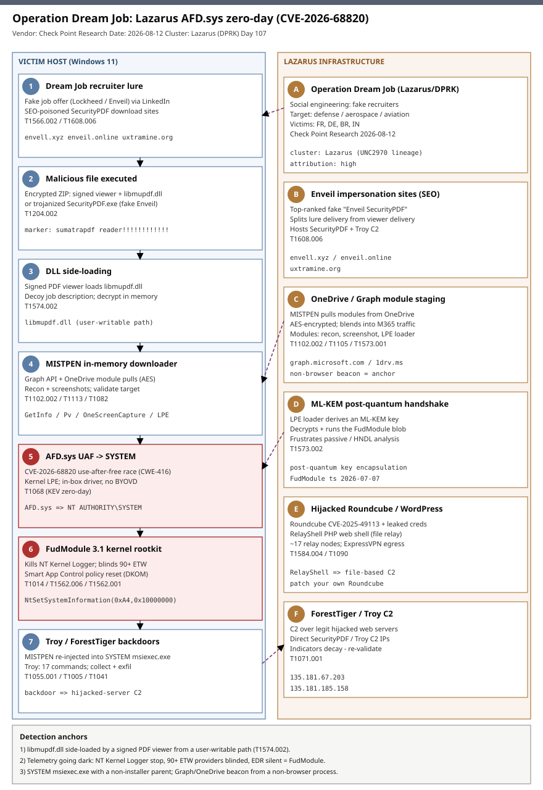

# Operation Dream Job: Lazarus AFD.sys zero-day (CVE-2026-68820) to SYSTEM, FudModule 3.1, and the Troy backdoor

## TL;DR

Check Point Research disclosed on 2026-08-12 that the North Korea-linked **Lazarus Group** exploited **CVE-2026-68820**, a use-after-free race condition in the Windows `AFD.sys` (Ancillary Function Driver for WinSock) kernel driver, as a **zero-day** to elevate to SYSTEM and launch an updated **FudModule 3.1** kernel-mode rootkit. The activity is a fresh wave of **Operation Dream Job** — fake recruiter lures aimed at defense, aerospace and aviation staff — with confirmed victims in France, Germany, Brazil and India. Microsoft patched the flaw on **2026-08-11** (August Patch Tuesday); CISA added it to the **KEV** catalog the same day with a federal remediation deadline of **2026-08-25**, and it was the only actively-exploited flaw in the release. This is a Friday (deep-dive) case on slot **#28 (memory corruption / exploit dev)** — a kernel UAF LPE walkthrough plus a DKOM rootkit and two novel implants (`Troy`, delivered alongside the long-known `ForestTiger`) — promoted as an active-exploitation zero-day; secondaries **#19 (malware RE)** and **#1 (APT state-nation)**.

## Attribution and confidence

Check Point Research attributes the campaign to **Lazarus Group** (aka Hidden Cobra, Diamond Sleet/Zinc lineage; DPRK-nexus) with **high** confidence, on the strength of the Dream Job social-engineering playbook, the reuse of the `FudModule` kernel rootkit that only Lazarus is publicly known to field, the `MISTPEN` downloader (first documented by Mandiant in 2024 and tracked to UNC2970, a Lazarus sub-cluster), and `ForestTiger`/ScoringMathTea, a long-attributed Lazarus backdoor. Check Point reported the vulnerability to Microsoft in late July 2026 but noted a working in-the-wild implementation from **early June 2026** (the compiled FudModule artifact carries a **2026-07-07** timestamp), i.e. roughly five weeks of zero-day use before the patch.

| Overlap dimension | Assessment | Confidence |
|---|---|---|
| Named cluster (Lazarus / DPRK) | Dream Job TTPs + FudModule + MISTPEN(UNC2970) + ForestTiger lineage | high |
| Zero-day exploitation of CVE-2026-68820 | Check Point telemetry + MSRC "exploitation detected" + CISA KEV | high |
| New backdoor `Troy` is Lazarus tooling | Delivered by the same chains as ForestTiger; RE by Check Point | medium-high |
| Post-quantum (ML-KEM) key exchange for FudModule delivery | Reported by Check Point / Infosecurity | medium |

**Genealogy with previous repo cases.** This is the repo's first case on `AFD.sys`, `CVE-2026-68820`, `FudModule`, `MISTPEN`, and the `Troy` backdoor. It is distinct from — but related to — the DPRK-overlap crypto case `dprk-linked-intrusion-set-quantstamp` (a financially-motivated Lazarus-adjacent cluster; here the motive is espionage against defense/aerospace). It shares the **kernel memory-safety-to-SYSTEM** theme with the Friday deep-dive `2026-07-24` kernel-LPE case (slot #28) but is a **UAF race in a networking driver used as a BYOVD-free native LPE**, not a third-party driver abuse. It shares the **DLL side-loading of a signed PDF viewer** initial-access shape seen across prior Lazarus reporting but pairs it with a second, marker-gated **trojanized viewer** chain. The Roundcube pivot (`CVE-2025-49113`) connects to the repo's edge/appliance and web-exploitation cases only thematically (compromise of internet-facing servers for C2 staging), not by shared infrastructure.

## Kill chain — summary table

| Stage | MITRE | Detail |
|---|---|---|
| Recruiter lure via LinkedIn / SEO-poisoned "Enveil SecurityPDF" sites | T1566.002 Spearphishing Link; T1608.006 SEO Poisoning | Fake job offers at Lockheed Martin / Enveil; top-ranked impersonation domains |
| Victim opens malicious PDF or installs trojanized viewer | T1204.002 User Execution: Malicious File | Encrypted ZIP (signed viewer + `libmupdf.dll` + `.pdf` payload) OR `SecurityPDF.exe` |
| DLL side-loading of `libmupdf.dll`; decoy job description shown | T1574.002 Hijack Execution Flow: DLL Side-Loading | Legit signed MuPDF viewer loads the malicious DLL; in-memory decrypt |
| `MISTPEN` in-memory downloader via Graph API / OneDrive | T1102.002 Web Service: Bidirectional Comm; T1105 Ingress Tool Transfer | AES-encrypted module pulls (GetInfoPlugin, PvPlugin, OneScreenCapture, LPE loader) |
| Host recon + screenshots; target validation | T1082 System Info Discovery; T1113 Screen Capture | Multi-monitor JPEG capture; profile string exfil before escalation |
| ML-KEM key handshake; AFD.sys UAF exploit to SYSTEM | T1573.002 Asymmetric Crypto; T1068 Exploitation for Privilege Escalation | CVE-2026-68820 UAF race in AFD.sys; SYSTEM token |
| FudModule 3.1 kernel rootkit blinds telemetry & Smart App Control | T1014 Rootkit; T1562.006 Indicator Blocking; T1562.001 Impair Defenses | Kills NT Kernel Logger, blinds 90+ ETW providers, resets SAC policy |
| MISTPEN re-injected into SYSTEM `msiexec.exe`; deploy ForestTiger/Troy | T1055.001 Process Injection: DLL Injection | Operate from a SYSTEM process; hand off to backdoors |
| C2 over hijacked Roundcube/WordPress relays (RelayShell) | T1071.001 Web Protocols; T1584.004 Compromise Infrastructure: Server | `CVE-2025-49113` Roundcube takeover; file-based command relay; ExpressVPN egress |
| Collection & exfiltration | T1005 Data from Local System; T1041 Exfil Over C2 | Troy: file enumeration/upload/download, shell, in-memory DLL injection |



The diagram is a two-lane view: the **left lane** follows the victim host from recruiter lure through side-loading, the in-memory `MISTPEN` stage, the `AFD.sys` UAF elevation, the `FudModule` kernel rootkit, and the `Troy`/`ForestTiger` backdoors; the **right lane** is Lazarus infrastructure — Dream Job social engineering, SEO-poisoned Enveil impersonation sites, OneDrive/Graph module staging, the ML-KEM handshake, and the hijacked-webmail relay network. The two red (critical) stages are the **kernel UAF elevation** and the **FudModule telemetry-blinding** step, because everything downstream runs SYSTEM and unobserved unless caught earlier at the side-load or Graph-beacon anchors.

## Stage-by-stage detail

### 1. Initial access — Dream Job lure and two delivery chains

Lazarus approaches targets as recruiters on LinkedIn offering roles at firms such as Lockheed Martin and the privacy-tech company Enveil, then steers them to a payload. Two parallel chains were observed:

- **DLL side-loading chain:** the victim downloads an encrypted ZIP containing a *legitimate, validly-signed* PDF viewer, a malicious `libmupdf.dll`, and an encrypted payload with a `.pdf` extension. Launching the signed viewer side-loads `libmupdf.dll` (`T1574.002`), which decrypts the payload **in memory** while displaying a decoy — in one case a fake Lockheed Martin job description — to preserve the illusion.
- **Trojanized viewer chain:** the victim is SEO-steered to a fake Enveil site and installs `SecurityPDF.exe`, a MuPDF-based viewer modified to monitor any opened PDF for the marker string `This document is encrypted with sumatrapdf reader!!!!!!!!!!!!`. When present, the app decrypts and launches an embedded payload that loads the `Troy` backdoor directly into memory.

```
Enveil impersonation domains (SecurityPDF + Troy C2):
  envell[.]xyz   enveil[.]online   uxtramine[.]org
Marker gating the trojanized viewer:
  "This document is encrypted with sumatrapdf reader!!!!!!!!!!!!"
```

MITRE: **T1566.002** (Spearphishing Link), **T1608.006** (Stage Capabilities: SEO Poisoning), **T1204.002** (User Execution: Malicious File), **T1574.002** (DLL Side-Loading).

### 2. In-memory staging — MISTPEN and its modules

Both chains converge on **MISTPEN**, a lightweight in-memory downloader (Mandiant, 2024; UNC2970). MISTPEN abuses the **Microsoft Graph API** and attacker-controlled **OneDrive** storage to pull modules, encrypting traffic with AES so the beacon blends into legitimate M365 traffic (`T1102.002`, `T1573.001`). It stages at least four modules:

```
Release_GetInfoPlugin_x64.dll  -> host profiling, exfil as one wide-char string
Release_PvPlugin_x64.dll       -> process + host recon
OneScreenCapture64.dll         -> all-monitor desktop screenshots as JPEG
LPE loader                     -> derives an ML-KEM (post-quantum) key, then
                                  decrypts and runs FudModule
```

Only after the recon modules validate the target does MISTPEN deliver the privilege-escalation loader — a deliberate design that keeps the kernel exploit off sandboxes and low-value hosts. MITRE: **T1105**, **T1082** (System Information Discovery), **T1057** (Process Discovery), **T1113** (Screen Capture), **T1573.002** (Asymmetric Cryptography — ML-KEM key encapsulation).

### 3. Privilege escalation — CVE-2026-68820, a UAF race in AFD.sys

`AFD.sys` (the Ancillary Function Driver for WinSock) is the kernel driver behind every Windows Sockets operation. **CVE-2026-68820** (CWE-416, CVSS 7.0) is a **use-after-free race condition**: concurrent socket-related IOCTL paths free an object that another thread still dereferences, giving an attacker who wins the race a controllable kernel free-and-reuse primitive and, ultimately, a SYSTEM token. Because the driver cannot be disabled without breaking all Winsock networking, **there is no configuration workaround — patching is the only fix.**

```
Vulnerable component : AFD.sys (Ancillary Function Driver for WinSock)
Class                : CWE-416 use-after-free (race condition)
Impact               : local privilege escalation -> NT AUTHORITY\SYSTEM
Affected             : Windows 11 (observed builds 26100 / 26200) and Server peers
Patched              : 2026-08-11 (August Patch Tuesday)
Lineage              : follows CVE-2024-38193, a prior AFD.sys UAF Lazarus used
                       to deliver FudModule in 2024 (HISTORICAL context, not this incident)
```

The pattern — a native, in-box kernel driver UAF used as the LPE instead of bringing a vulnerable third-party driver (BYOVD) — is the defining tradecraft point: no unsigned/vulnerable driver hits disk, so BYOVD-focused detections do not fire. MITRE: **T1068** (Exploitation for Privilege Escalation).

### 4. Kernel rootkit — FudModule 3.1

With SYSTEM, the LPE loader decrypts and runs **FudModule 3.1**, the newest iteration of Lazarus's data-only (DKOM) kernel rootkit. Check Point reports it:

- strips kernel **telemetry callbacks** and disables **minifilters**;
- **kills the NT Kernel Logger** and **blinds 90+ ETW providers** with a kill-list near-identical to prior versions (`T1562.006`);
- drops the earlier dedicated *Defender-disabling* routine in favour of a **generic security-suppression engine** (`T1562.001`);
- **tampers with Smart App Control (SAC):** inside a SYSTEM `msiexec.exe` child, a remote stub sets `VerifiedAndReputablePolicyState` to zero and invokes `NtSetSystemInformation` class `0xA4` with option `0x10000000`, triggering an in-place reload of the code-integrity policy so unvetted binaries run.

```
FudModule 3.1 sabotage (data-only kernel manipulation, no driver dropped):
  - telemetry callback removal + minifilter disable
  - NT Kernel Logger kill; ETW provider blinding (90+)
  - generic EDR/AV suppression engine (replaces the Defender-specific routine)
  - Smart App Control neutralisation via NtSetSystemInformation(0xA4, 0x10000000)
```

MITRE: **T1014** (Rootkit), **T1562.001** (Impair Defenses: Disable or Modify Tools), **T1562.006** (Indicator Blocking).

### 5. Operating from SYSTEM — MISTPEN re-injection and the backdoors

FudModule injects a fresh **MISTPEN** instance into a SYSTEM process (`T1055.001`) so the operator runs elevated and away from EDR, then deploys one of two backdoors:

- **ForestTiger** (aka ScoringMathTea) — a long-documented Lazarus RAT for remote access.
- **Troy** — a **newly identified 64-bit DLL implant loaded directly into memory** supporting **17 operator commands**: file enumeration, upload/download, archive-and-exfiltrate, interactive shell, process termination, in-memory DLL injection, and configuration update.

```
Troy backdoor (17 commands): enum / upload / download / archive+exfil /
  interactive shell / process kill / in-memory DLL injection / config update
```

MITRE: **T1055.001** (DLL Injection), **T1005** (Data from Local System), **T1041** (Exfiltration Over C2 Channel).

### 6. Command and control — living on hijacked infrastructure

Rather than standing up bespoke servers, Lazarus routes **ForestTiger/Troy C2** through **hijacked but legitimate** Roundcube webmail, WordPress and PrestaShop sites. Many Roundcube instances were vulnerable to **CVE-2025-49113** (a PHP object-deserialization RCE), which the group exploited using **credentials leaked on the dark web**. The compromised servers host **RelayShell**, a PHP web shell that relays operator commands via a **file-based messaging system** (writing/reading text files) rather than executing directly, so traffic blends into ordinary web activity. Check Point counted **~17** unique relay nodes and observed operator egress through **ExpressVPN**. In at least one case an already-breached France-based organisation was used to send phishing to fresh victims, defeating reputation-based email filtering.

```
Relay/C2 (hijacked, legitimate): Roundcube (CVE-2025-49113) / WordPress / PrestaShop
  RelayShell PHP web shell -> file-based command relay
  Direct SecurityPDF/Troy C2 IPs: 135.181.67[.]203 , 135.181.185[.]158
  Operator egress: ExpressVPN
```

MITRE: **T1584.004** (Compromise Infrastructure: Server), **T1071.001** (Application Layer Protocol: Web Protocols), **T1090** (Proxy).

## RE notes

| Component | SHA256 | Lang | Packer | Notes |
|---|---|---|---|---|
| MISTPEN downloader | 2db25ac41a66aa523c79e23e00443573530dd7bd82b8371bcc87bd7232e141eb | C/C++ (PE DLL) | none observed | In-memory; Graph API + OneDrive C2; AES traffic |
| FudModule 3.1 | 3b6378df8442e63a6ed7317075913e4720847a510d95022d4a8347b2637c245d | C/C++ | none (data-only kernel) | ETW blinding, SAC tamper; artifact ts 2026-07-07 |
| ForestTiger | 72dccae85e062f541fecad9ec7a18a3123e7ae5ac5d53c91709b53a46dbbd289 | C/C++ (PE) | none observed | ScoringMathTea; C2 on hijacked web servers |
| Troy backdoor | 590fb6ae19480d694e08ee85859cad8066f2f87e7e5abba2960c6d115e1615d6 | C/C++ (PE DLL) | none observed | 17-command modular implant; in-memory load |
| SecurityPDF.exe | 743172aab606974b054a64561534ae66baa3a840657f79d7c6fa18350e8d45d1 | C/C++ (MuPDF fork) | none | Marker-gated payload decrypt; impersonates Enveil |
| RelayShell | 21c3ad4838c4324bc5f081021da5fb2e9073d0c9304087811c21eb47c9e22762 | PHP | n/a | File-based command relay on hijacked servers |

**Anti-analysis / design:** the exploit is gated behind recon-module validation, so sandboxes rarely see the kernel component; the ML-KEM handshake protects the FudModule blob against passive capture and future "harvest-now, decrypt-later" analysis; the marker string gates the trojanized viewer so an inert PDF elsewhere never triggers it. Encryption is layered (AES for MISTPEN transport, ML-KEM for FudModule key material). Full hash set (40+ samples) in `iocs.csv`.

## Detection strategy

### Telemetry that matters

- **Sysmon**: EID 7 (image load — side-loaded `libmupdf.dll` under a signed PDF viewer from a user-writable path), EID 1 (process create — signed viewer / `SecurityPDF.exe`, and anomalous SYSTEM `msiexec.exe` children), EID 3/22 (network + DNS to Enveil-impersonation domains / C2 IPs; Graph/OneDrive beacons from non-browser processes), EID 8/10 (cross-process injection into `msiexec.exe`).
- **Defender XDR**: `DeviceImageLoadEvents`, `DeviceProcessEvents`, `DeviceNetworkEvents`; hunt for `msiexec.exe` running as SYSTEM with a non-installer parent, and unsigned/anomalous modules mapped into it.
- **Kernel-integrity signals**: sudden loss of ETW providers / NT Kernel Logger, EDR sensor "went quiet" on a host that is otherwise active, and Smart App Control policy state flipping to unenforced — treat any of these as post-exploitation, not noise.
- **Network**: outbound to `graph.microsoft.com`/OneDrive from processes that are not browsers or Office; connections to the C2 IPs; DNS for `envell.xyz`, `enveil.online`, `uxtramine.org`; and defensive scrutiny of your **own** internet-facing Roundcube/WordPress for RelayShell.

### Detection coverage

| Engine | File | Logic |
|---|---|---|
| Sigma | sigma/img_pdfviewer_sideload_libmupdf.yml | Signed PDF/MuPDF viewer loading `libmupdf.dll` from a user-writable path (side-load) |
| Sigma | sigma/proc_system_msiexec_anomalous_parent.yml | `msiexec.exe` running as SYSTEM with a non-installer parent (FudModule injection target) |
| Sigma | sigma/net_lazarus_dreamjob_c2.yml | Connection/DNS to Dream Job Enveil-impersonation domains / C2 IPs |
| KQL | kql/pdfviewer_sideload_libmupdf.kql | DeviceImageLoadEvents: `libmupdf.dll` loaded by a PDF viewer from a non-standard dir |
| KQL | kql/system_msiexec_injection_target.kql | DeviceProcessEvents: SYSTEM `msiexec.exe` with anomalous parent / recent module load |
| KQL | kql/lazarus_dreamjob_c2_indicators.kql | DeviceNetworkEvents: hunt the C2 domains/IPs and Graph/OneDrive beacons from odd processes |
| YARA | yara/lazarus_dreamjob_troy_securitypdf.yar | SecurityPDF marker string; embedded Enveil-impersonation C2 domains |
| Suricata | suricata/lazarus_dreamjob_afdsys_dreamjob.rules | DNS/TLS to Enveil-impersonation domains and Troy C2 IPs |

### Threat hunting hypotheses

- **H1 (side-load foothold):** If Lazarus landed via the Dream Job chain, then a signed PDF/MuPDF viewer will have loaded `libmupdf.dll` from a user-writable path, or `SecurityPDF.exe` will be present. Hunt image-loads and file writes of `libmupdf.dll` outside install directories. See `hunts/peak_h1_pdf_sideload_foothold.md`.
- **H2 (kernel-integrity tamper post-LPE):** If CVE-2026-68820 succeeded, then telemetry will degrade — ETW providers/NT Kernel Logger dropping, EDR going silent, Smart App Control policy flipping — around a SYSTEM `msiexec.exe` with an odd parent. Hunt those integrity signals as a correlated cluster. See `hunts/peak_h2_kernel_integrity_tamper.md`.
- **H3 (C2 on hijacked infrastructure):** If C2 is live, then hosts will beacon to Graph/OneDrive from non-browser processes and/or to the Enveil-impersonation domains and C2 IPs, and your own internet-facing Roundcube/WordPress may host RelayShell. Hunt both the client beacons and server-side web shells. See `hunts/peak_h3_hijacked_c2_relays.md`.

## Incident response playbook

### First 60 minutes (triage)

1. Confirm patch state for **CVE-2026-68820** across Windows 11 (26100/26200) and Server peers; where unpatched, prioritise emergency deployment (KEV due **2026-08-25**).
2. Sweep for `libmupdf.dll` loaded by signed PDF viewers from user-writable paths and for `SecurityPDF.exe` on disk.
3. Query for **SYSTEM `msiexec.exe`** processes with a non-installer parent, and for injected/anomalous modules within them.
4. Check EDR/ETW health per host: any host where the sensor recently "went quiet" while the host stayed active is a candidate compromise.
5. Block/monitor the C2 domains and IPs; hunt Graph/OneDrive beacons from non-browser processes.
6. Inventory internet-facing Roundcube (patch **CVE-2025-49113**), WordPress and PrestaShop for RelayShell web shells.

### Artifacts to collect

| Artifact | Path | Tool | Why |
|---|---|---|---|
| Side-loaded DLL + viewer | user Downloads / temp / install dir | EDR / MFT | Confirms initial access and side-load |
| Process tree + module loads | Sysmon EID 1/7/8/10; DeviceProcessEvents | Sysmon / MDE | SYSTEM msiexec anomaly, injection |
| ETW/EDR health timeline | sensor logs, ETW session list | EDR console | Detect FudModule blinding window |
| Memory image | live host | WinPMEM / AVML | In-memory MISTPEN/Troy; kernel rootkit traces |
| Network + DNS logs | proxy / firewall / DNS | SIEM | C2 to domains/IPs; Graph/OneDrive abuse |
| Web server files | Roundcube/WordPress webroot | forensic copy | RelayShell PHP web shell |

### IR queries and commands

```powershell
# SYSTEM msiexec.exe with a non-installer parent (FudModule injection target)
Get-CimInstance Win32_Process -Filter "Name='msiexec.exe'" |
  ForEach-Object {
    $p = Get-CimInstance Win32_Process -Filter "ProcessId=$($_.ParentProcessId)"
    [pscustomobject]@{ PID=$_.ProcessId; Parent=$p.Name; Cmd=$_.CommandLine }
  } | Where-Object { $_.Parent -notin @('services.exe','explorer.exe','svchost.exe') }
```

```powershell
# Hunt side-loaded libmupdf.dll outside install directories
Get-ChildItem -Path C:\Users -Recurse -Filter libmupdf.dll -ErrorAction SilentlyContinue |
  Select-Object FullName, LastWriteTime,
    @{n='Signed';e={(Get-AuthenticodeSignature $_.FullName).Status}}
```

```kql
// Graph/OneDrive beacons from non-browser, non-Office processes (MISTPEN)
DeviceNetworkEvents
| where RemoteUrl has_any ("graph.microsoft.com","onedrive.live.com","1drv.ms")
| where InitiatingProcessFileName !in~ ("msedge.exe","chrome.exe","firefox.exe","onedrive.exe","teams.exe","olk.exe","outlook.exe")
| project Timestamp, DeviceName, InitiatingProcessFileName, InitiatingProcessFolderPath, RemoteUrl
```

### Containment, eradication, recovery

- **Isolate** confirmed hosts at the network layer; do not merely kill processes — a SYSTEM-level kernel rootkit can survive user-mode remediation.
- **Rebuild, don't clean**, any host where FudModule/kernel tamper is confirmed: reimage from known-good media, then patch before re-onboarding. Exit criterion: host reimaged, CVE-2026-68820 patched, EDR/ETW health restored and stable.
- **Rotate** credentials and tokens (including any M365/Graph app tokens on affected identities) and revoke sessions.
- **Do NOT** trust EDR "all clear" from a host that showed a blinding window; validate out-of-band (memory, disk, network).
- **Patch** internet-facing Roundcube (CVE-2025-49113) and remove RelayShell; rotate any credentials that touched those servers.

### Recovery validation

Confirm CVE-2026-68820 patched fleet-wide; verify ETW providers and NT Kernel Logger are back and stable; confirm no SYSTEM `msiexec.exe` anomalies recur; confirm no beacons to the C2 domains/IPs or anomalous Graph/OneDrive egress; confirm web servers are clean of RelayShell and Roundcube is patched.

## IOCs

| Type | Value | Context | Confidence | Source |
|---|---|---|---|---|
| cve | CVE-2026-68820 | AFD.sys UAF LPE to SYSTEM; zero-day; on KEV | high | Check Point / CISA KEV |
| cve | CVE-2025-49113 | Roundcube deserialization RCE; C2-server takeover; on KEV | high | Check Point |
| domain | envell.xyz | SecurityPDF site + Troy C2 | high | Check Point |
| domain | enveil.online | SecurityPDF distribution + Troy C2 | high | Check Point |
| domain | uxtramine.org | SecurityPDF impersonation + Troy C2 | high | Check Point |
| ipv4 | 135.181.67.203 | SecurityPDF/Troy C2 (decays) | medium | Check Point |
| ipv4 | 135.181.185.158 | SecurityPDF/Troy C2 (decays) | medium | Check Point |
| path | libmupdf.dll | Side-loaded DLL under a signed PDF viewer | high | Check Point |
| path | SecurityPDF.exe | Trojanized MuPDF viewer (fake Enveil) | high | Check Point |
| string | This document is encrypted with sumatrapdf reader!!!!!!!!!!!! | Marker gating the trojanized viewer payload | high | Check Point |
| sha256 | 3b6378df8442e63a6ed7317075913e4720847a510d95022d4a8347b2637c245d | FudModule 3.1 (ts 2026-07-07) | high | Check Point |
| sha256 | 590fb6ae19480d694e08ee85859cad8066f2f87e7e5abba2960c6d115e1615d6 | Troy backdoor | high | Check Point |
| sha256 | 2db25ac41a66aa523c79e23e00443573530dd7bd82b8371bcc87bd7232e141eb | MISTPEN downloader | high | Check Point |
| sha256 | 72dccae85e062f541fecad9ec7a18a3123e7ae5ac5d53c91709b53a46dbbd289 | ForestTiger backdoor | high | Check Point |
| sha256 | 743172aab606974b054a64561534ae66baa3a840657f79d7c6fa18350e8d45d1 | SecurityPDF.exe | high | Check Point |

**CISA KEV.** `CVE-2026-68820` is on the CISA KEV catalog: **added 2026-08-11**, federal **remediation due 2026-08-25** (BOD 26-04), ransomware use **unknown** — it was the only actively-exploited flaw in the August 2026 Patch Tuesday and there is no workaround short of patching. `CVE-2025-49113` (Roundcube) is also KEV-listed and is the pivot Lazarus used to build its C2 relay network. Treat both as patch-now. Full cross-reference in `kev.md`. The full 40+ hash set is in `iocs.csv`.

## Secondary findings

- **Native kernel UAF beats BYOVD detections.** By exploiting an in-box driver (`AFD.sys`) instead of dropping a vulnerable third-party driver, Lazarus sidesteps the entire BYOVD detection surface (no unsigned/known-vulnerable driver hits disk). This is the second AFD.sys UAF (after CVE-2024-38193) Lazarus has weaponised to deliver FudModule, so AFD.sys memory-safety bugs should be treated as a recurring Lazarus escalation primitive.
- **Trust is the payload.** The campaign counterfeits trust at every layer — real signed viewers, real vendor branding (Enveil), top search rankings, and already-compromised legitimate organisations sending the phishing and hosting the C2. "Spot the phishing link" fails when the site, the download and the recruiter all look authentic; verification must move to official-channel software provenance and zero-trust egress.
- **Post-quantum crypto is now in offensive tooling.** The ML-KEM key-encapsulation step protecting FudModule delivery is an early sighting of post-quantum key exchange used defensively *by an attacker* — to frustrate passive capture and harvest-now-decrypt-later analysis of the kernel payload.

## Pedagogical anchors

- A **use-after-free race** turns a timing window into a kernel primitive; the durable lesson is that memory-safety bugs in ubiquitous in-box drivers (like the WinSock AFD) are strategic LPE assets, and that "no vulnerable driver on disk" does not mean "no kernel exploit."
- **Data-only (DKOM) rootkits** like FudModule manipulate kernel structures without loading a driver; detection shifts from "find the bad driver" to "notice the telemetry going dark" — treat ETW/EDR silence as an alert, not an absence.
- **Gate your kernel exploit behind recon** is a deliberate anti-analysis pattern; defenders should assume sandboxes under-observe the most dangerous stage and lean on production host telemetry and memory forensics.
- **Living on hijacked legitimate infrastructure** (compromised Roundcube/WordPress) defeats reputation and allow-listing; egress anomaly detection (who is beaconing, from which process) beats domain reputation here.
- **Patch-velocity is the control that matters** for KEV zero-days with no workaround: the five-week zero-day window closed only with the 2026-08-11 patch, and CISA's 2026-08-25 deadline exists precisely because there is nothing else to turn off.

## What's in this folder

| File | Purpose | Link |
|---|---|---|
| README.md | This analysis. | [README.md](./README.md) |
| kill_chain.svg | Two-lane kill-chain diagram (victim host vs Lazarus infrastructure). | [kill_chain.svg](./kill_chain.svg) |
| iocs.csv | Full indicator set (40+ hashes, domains, IPs, CVEs, strings). | [iocs.csv](./iocs.csv) |
| kev.md | CISA KEV cross-reference for this case's CVEs. | [kev.md](./kev.md) |
| sigma/img_pdfviewer_sideload_libmupdf.yml | Side-load of libmupdf.dll by a signed PDF viewer. | [file](./sigma/img_pdfviewer_sideload_libmupdf.yml) |
| sigma/proc_system_msiexec_anomalous_parent.yml | SYSTEM msiexec.exe with a non-installer parent. | [file](./sigma/proc_system_msiexec_anomalous_parent.yml) |
| sigma/net_lazarus_dreamjob_c2.yml | Connection/DNS to Dream Job C2 domains/IPs. | [file](./sigma/net_lazarus_dreamjob_c2.yml) |
| kql/pdfviewer_sideload_libmupdf.kql | Defender XDR side-load hunt. | [file](./kql/pdfviewer_sideload_libmupdf.kql) |
| kql/system_msiexec_injection_target.kql | SYSTEM msiexec injection-target hunt. | [file](./kql/system_msiexec_injection_target.kql) |
| kql/lazarus_dreamjob_c2_indicators.kql | C2 domain/IP and Graph/OneDrive beacon hunt. | [file](./kql/lazarus_dreamjob_c2_indicators.kql) |
| yara/lazarus_dreamjob_troy_securitypdf.yar | SecurityPDF marker + embedded C2-domain signatures. | [file](./yara/lazarus_dreamjob_troy_securitypdf.yar) |
| suricata/lazarus_dreamjob_afdsys_dreamjob.rules | DNS/TLS to C2 domains and Troy C2 IPs. | [file](./suricata/lazarus_dreamjob_afdsys_dreamjob.rules) |
| hunts/peak_h1_pdf_sideload_foothold.md | PEAK hunt: side-load foothold. | [file](./hunts/peak_h1_pdf_sideload_foothold.md) |
| hunts/peak_h2_kernel_integrity_tamper.md | PEAK hunt: kernel-integrity tamper post-LPE. | [file](./hunts/peak_h2_kernel_integrity_tamper.md) |
| hunts/peak_h3_hijacked_c2_relays.md | PEAK hunt: C2 on hijacked infrastructure. | [file](./hunts/peak_h3_hijacked_c2_relays.md) |

## Sources

- [Check Point Research — Shattering the Dream: When a Job Offer Becomes a Zero-Day Attack](https://research.checkpoint.com/2026/shattering-the-dream-when-a-job-offer-becomes-a-zero-day-attack/)
- [The Hacker News — Lazarus Exploits Windows Zero-Day to Gain SYSTEM Access and Deploy Backdoor](https://thehackernews.com/2026/08/lazarus-exploits-windows-zero-day-to.html)
- [Cyber Security News — Windows AFD.sys 0-Day Actively Exploited by Lazarus (IOCs)](https://cybersecuritynews.com/windows-afd-sys-zero-day-exploited/)
- [BleepingComputer — Lazarus hackers exploited Windows zero-day to target defense firms](https://www.bleepingcomputer.com/news/security/lazarus-hackers-exploited-windows-zero-day-to-target-defense-firms/)
- [SecurityWeek — Fresh Windows Zero-Day Exploited in North Korean Cyberattacks](https://www.securityweek.com/fresh-windows-zero-day-exploited-in-north-korean-cyberattacks/)
- [Infosecurity Magazine — Lazarus Used Post-Quantum Key Exchange to Deliver Zero-Day](https://www.infosecurity-magazine.com/news/lazarus-post-quantum-key-dream-job/)
- [MSRC — CVE-2026-68820 (Windows AFD.sys Elevation of Privilege)](https://msrc.microsoft.com/update-guide/vulnerability/CVE-2026-68820)
- [SOC Prime — CVE-2026-68820: Actively Exploited Windows AFD.sys Zero-Day](https://socprime.com/blog/cve-2026-68820-actively-exploited-windows/)
