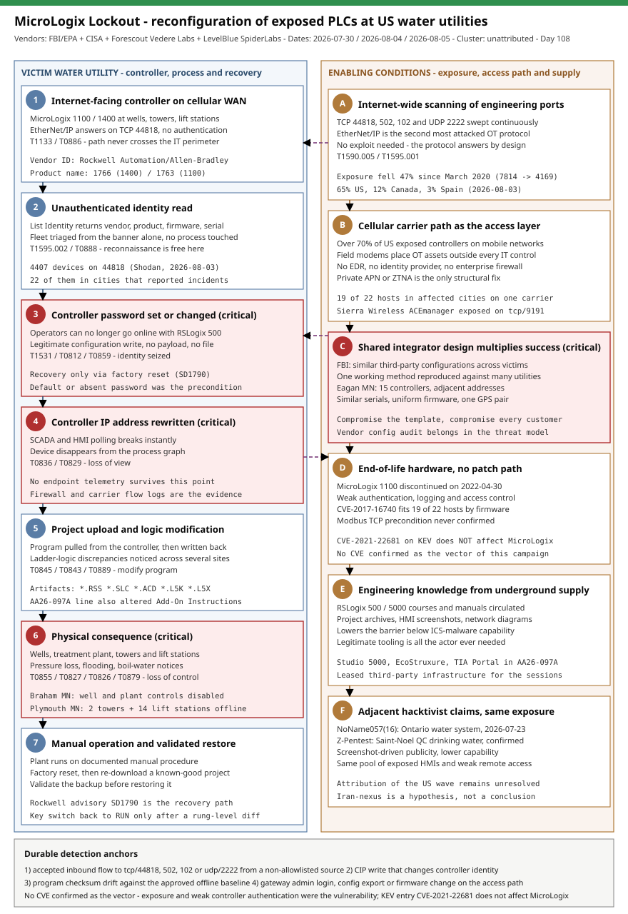

# MicroLogix Lockout: coordinated reconfiguration of internet-exposed Rockwell PLCs at US water utilities

## TL;DR

Between 26 and 27 July 2026 an unattributed actor reconfigured internet-facing Rockwell Automation / Allen-Bradley MicroLogix 1100 and 1400 controllers at more than 30 Minnesota community water systems, and the same pattern was then reported by water and wastewater utilities in at least twelve US states. The technique was not ICS malware and not a zero-day: the actor reached controllers that answered EtherNet/IP on TCP 44818 over cellular WAN links, set or changed the controller password, changed the controller IP address, and at one victim modified the PLC project file until ladder-logic discrepancies were noticed across several sites. The operational result was loss of view and in several cases loss of control -- disabled well and treatment-plant controls in Braham (MN), broken cellular telemetry to two water towers and fourteen lift stations in Plymouth (MN), plus pressure loss, flooding, boil-water notices and extended manual operation across the wider campaign. It matters today because the exposure that enabled it is still measurable: Forescout counted 4,407 controllers answering on port 44818 on 3 August 2026, 65% of them in the US and over 70% of the US devices sitting behind mobile carrier networks, with 22 of them inside cities that reported incidents. This case is the repo's first look at cyber-physical manipulation achieved purely through legitimate engineering protocols and identity primitives on an end-of-life controller.

## Attribution and confidence

**Confidence: low** for actor attribution, **high** for the technical description of the activity.

No US agency has publicly attributed the July 2026 water-sector wave. The FBI/EPA public service announcement of 30 July 2026 and the CISA alert of the same day describe the activity without naming a cluster; Minnesota IT Services described the attacks as "coordinated" but did not establish that a single actor was responsible for every incident. The correct analytic label for this repo is therefore an unattributed cluster with a credible Iran-nexus hypothesis, not a confirmed CyberAv3ngers operation.

| Candidate | Aliases | Basis for the link | Assessment |
|---|---|---|---|
| Iran-affiliated PLC campaign (AA26-097A) | CyberAv3ngers, Shahid Kaveh Group, IRGC-CEC affiliated | Joint advisory updated 2026-07-22, four days before the Minnesota wave; same sector, same "reach an exposed controller and manipulate logic" tradecraft | Plausible but unconfirmed. AA26-097A names CompactLogix, Micro850, Modicon M340 / BMX P34 and Siemens S7-1200 -- **not** MicroLogix 1100/1400 -- so the July wave is either an expansion of targeting, a different actor copying the method, or opportunistic scanning |
| Pro-Russia hacktivists | Z-Pentest / Z-Alliance, NoName057(16) / DDoSia | Both claimed water-sector OT access in Canada on 2026-07-23; the Saint-Noel (QC) drinking-water station incident was officially confirmed by the municipality | Adjacent, not the same campaign. Demonstrates that exposed HMIs and weak remote access attract more than one class of actor |
| Opportunistic / unaffiliated actors | -- | Underground circulation of MicroLogix/RSLogix training material, engineering software and project archives lowers the barrier to entry | Cannot be excluded; the observed actions need no proprietary capability |

**Genealogy with previous repo cases.** The repo already covers the attributed Iranian line in `2026-05-03_BAUXITE-CyberAvengers-AA26-097A` (Unitronics-era ladder-logic replacement and the AA26-097A advisory) and an AI-assisted OT intrusion in `2026-05-10_Mexico-Water-AI-Assisted-OT`. This case is different on three axes: the hardware family is MicroLogix 1100/1400 (the 1100 discontinued on 30 April 2022, so no further patches), the primitive is identity and addressing manipulation of the controller itself rather than malware or logic implants, and the access path is a cellular WAN link that never crosses the utility's conventional IT perimeter. It is also the repo's first case where the reported impact is hydraulic -- pressure loss and flooding -- rather than data or availability of an IT estate.

## Kill chain — summary table

| Stage | MITRE | Detail |
|---|---|---|
| Reconnaissance | T1590.005, T1595.001 | Internet-wide enumeration of TCP 44818; EtherNet/IP List Identity banners expose Vendor ID, product name (1763 = MicroLogix 1100, 1766 = MicroLogix 1400), firmware and serial |
| Target selection | T1595.002, T0888 | Fleet triage by product family and firmware; 4,407 exposed controllers on 2026-08-03, 22 of them in cities that later reported incidents |
| Initial access | T1133, T0886 | Direct EtherNet/IP session to the controller over a cellular carrier network; no VPN, no jump host, no authentication on the engineering protocol |
| Credential access | T1078.001, T0812, T0859 | Default, absent or weak controller passwords; in several cases the actor set a password where none existed |
| Discovery | T1046, T0846, T0888 | Controller identity, mode, fault and program metadata read over CIP |
| Collection | T0845 | Project file upload from the controller (program extraction) |
| Impact -- identity | T1531, T0836 | Controller password changed and IP address rewritten, locking operators out of their own device |
| Impact -- logic | T0843, T0889, T0873 | Project file downloaded back with modified ladder logic; discrepancies detected across several sites at one victim |
| Impact -- process | T0855, T0829, T0827, T0826, T0879 | Loss of view and control of wells, towers, lift stations; pressure loss, flooding, boil-water notices, extended manual operation |



The diagram keeps the victim water utility in the left lane -- from an exposed controller through lockout to hydraulic consequence and recovery -- and the actor-side enabling conditions in the right lane: internet-wide scanning, banner-based fleet triage, reuse of the same third-party network design across utilities, exposed cellular gateway management planes, and the underground circulation of engineering knowledge. The two cross-lane arrows mark the only two moments a detection can fire early: the unauthenticated EtherNet/IP session arriving from an external address, and the CIP write that changes controller identity or program. Everything below those two points is already a process event, which is why the footer anchors recovery on Rockwell advisory SD1790 rather than on any endpoint control.

## Stage-by-stage detail

### 1. Exposure: an engineering protocol on the public internet

Both controller families named in the FBI/EPA advisory speak EtherNet/IP on TCP 44818. That protocol has no meaningful authentication: depending on device configuration an unauthenticated peer can read identity data and, in many deployments, write configuration. Forescout's Shodan-based census on 3 August 2026 returned 4,407 devices exposing 44818, of which 2,844 (65%) were in the United States, 513 in Canada and 146 in Spain. Product mix: MicroLogix 1400 at 50%, CompactLogix 1769 at 22%, MicroLogix 1100 at 8%, ControlLogix 5590 at 8%.

```text
# Public census queries used by Forescout Vedere Labs (Shodan), 2026-08-03
"Vendor ID: Rockwell Automation/Allen-Bradley"   -> 4,407 results
"Product name: 1766"   # MicroLogix 1400          -> 2,224 results
"Product name: 1763"   # MicroLogix 1100          ->   349 results
```

Over 70% of the US-based devices sat in large mobile carrier networks -- that is, behind cellular routers used for field telemetry, exactly the architecture the FBI advisory calls out. MITRE: **T1590.005 (Gather Victim Network Information: IP Addresses)**, **T1595.001 (Active Scanning: Scanning IP Blocks)**.

### 2. Fleet triage from the banner

An EtherNet/IP List Identity response is enough to select targets without touching the process: vendor, product code, product name, revision and serial number come back unauthenticated. Nineteen of the 22 controllers Forescout located in affected cities were on the same mobile carrier network, and fifteen of them in Eagan shared adjacent addresses, similar serial numbers, largely uniform firmware and one identical GPS coordinate pair -- the signature of a single fleet provisioned by one integrator. MITRE: **T1595.002 (Vulnerability Scanning)**, ICS **T0888 (Remote System Information Discovery)**.

### 3. Initial access without an exploit

Public reporting identifies no CVE as the access vector. The FBI, CISA and LevelBlue all describe internet-accessible PLCs, insufficiently protected cellular modems, weak or absent authentication and misconfigured remote-access paths. The actor used the protocol as designed. ICS **T0886 (Remote Services)**, Enterprise **T1133 (External Remote Services)**.

This is the point of the case: exposure was the vulnerability. Forescout's own note is the honest framing -- only one Rockwell controller CVE is known to be exploited in the wild (CVE-2021-22681, added to CISA KEV on 2026-03-05) and it does **not** affect MicroLogix. Nineteen of the 22 hosts in affected cities were susceptible to CVE-2017-16740 by firmware version, but exploitation requires Modbus TCP to be enabled and that was never confirmed.

### 4. Controller identity seized

The two actions the FBI describes are deceptively small:

```text
# Effect observed by victims (reconstructed from FBI/EPA PSA 2026-07-30)
1. Controller password set or changed   -> operators can no longer go online with RSLogix 500
2. Controller IP address changed        -> SCADA/HMI polling breaks; the device vanishes from the process graph
```

Both are legitimate configuration writes. Together they are a denial-of-view and denial-of-control primitive that needs no payload and leaves no file on any host. Enterprise **T1531 (Account Access Removal)** is the closest analogue; ICS **T0836 (Modify Parameter)**, **T0812 (Default Credentials)**, **T0859 (Valid Accounts)**.

### 5. Program upload and logic modification

At least one organisation reported modified PLC project files after noticing ladder-logic discrepancies across several sites. In the attributed AA26-097A activity the equivalent step is explicit: actors used Studio 5000 Logix Designer, EcoStruxure Control Expert and Siemens TIA Portal from leased third-party infrastructure to pull project files, then modified or deleted control logic including Rockwell Add-On Instructions, and in one case left logic that preserved the appearance of normal downstream operation while overriding the instructions that maintained safe operating parameters. ICS **T0845 (Program Upload)**, **T0843 (Program Download)**, **T0889 (Modify Program)**.

### 6. Hydraulic consequence

| Utility | Reported effect |
|---|---|
| Braham, MN | Computerised operating controls for the municipal well and water-treatment plant disabled; city ran on water already stored in its tower and asked residents to reduce consumption |
| Plymouth, MN | Cellular communications lost to two water towers and multiple wastewater lift stations; equipment disconnected, manual procedures used, communications restored the following afternoon |
| South St. Paul, MN | Automated water-utility controls affected; contingency procedures maintained water and wastewater service |
| Maple Plain, MN | Confirmed incident in the water environment, limited technical disclosure, service and quality unaffected |
| Michigan (9 systems) | Activity identified by 2026-08-01; all nine continued operating safely |

Across the wider campaign the FBI reported pressure loss and flooding. Pressure loss is the consequential one: a drop in distribution pressure can let untreated groundwater into damaged or poorly sealed pipes, which converts an availability incident into a public-health one. No public reporting indicates an attempt to manipulate chemical dosing. ICS **T0855 (Unauthorized Command Message)**, **T0829 (Loss of View)**, **T0827 (Loss of Control)**, **T0826 (Loss of Availability)**, **T0879 (Damage to Property)**.

### 7. Recovery under lockout

Rockwell published advisory SD1790 specifically for operators locked out by an attacker-set password: reset the MicroLogix 1400 or 1100 to factory defaults and re-download a known-good project file. That is the whole recovery path -- which is why the offline copy of the program is the single most valuable artifact a water utility owns.

## Detection strategy

### Telemetry that matters

- **Network / OT tap:** EtherNet/IP (TCP 44818, UDP 2222), Modbus TCP (502), S7comm (102). Session initiation from an address outside the engineering allowlist is the highest-value single event in this case.
- **Firewall and cellular carrier logs:** accepted inbound flows to 44818/502/9191 from the public internet; ACEmanager (Sierra Wireless AirLink) and Cradlepoint management-plane authentication events, config exports and firmware changes.
- **Engineering workstation (Windows):** Sysmon EID 1 (process creation) for `RSLogix500.exe`, `RSLogix5000.exe`, `LogixDesigner.exe`, `RSLinx.exe`, `RSLinxNG.exe`; Sysmon EID 3 (network connection) for those images reaching 44818; Sysmon EID 11 (file create) for `.RSS`, `.SLC`, `.ACD`, `.APB`, `.L5K`, `.L5X` project artifacts written outside the approved repository.
- **Defender XDR tables:** `DeviceProcessEvents`, `DeviceNetworkEvents`, `DeviceFileEvents`. **Sentinel tables:** `Syslog` (firewall, OT gateway), `SecurityEvent` (engineering workstation logons).
- **Process historian:** pump, valve, pressure, tank and alarm series -- unexplained state changes, missing telemetry and alarm suppression are the only telemetry that survives when the controller itself is lost.

### Detection coverage

| Engine | File | Logic |
|---|---|---|
| Sigma | [sigma/01_engineering_software_execution_outside_ews.yml](./sigma/01_engineering_software_execution_outside_ews.yml) | Rockwell engineering software (`RSLogix500.exe`, `RSLogix5000.exe`, `LogixDesigner.exe`, `RSLinx*.exe`) launched on any host, for baselining against the approved engineering-workstation inventory |
| Sigma | [sigma/02_ot_engineering_protocol_connection.yml](./sigma/02_ot_engineering_protocol_connection.yml) | Outbound network connection to TCP 44818 / 502 / 102 from a process that is not the approved engineering client |
| Sigma | [sigma/03_plc_project_file_written_outside_repository.yml](./sigma/03_plc_project_file_written_outside_repository.yml) | Creation of Rockwell project artifacts (`.RSS`, `.SLC`, `.ACD`, `.L5K`, `.L5X`) outside the sanctioned project repository, including user temp and download paths |
| KQL | [kql/k1_ethernetip_sessions_from_unexpected_sources.kql](./kql/k1_ethernetip_sessions_from_unexpected_sources.kql) | `DeviceNetworkEvents` sessions to OT engineering ports from devices outside the engineering asset group |
| KQL | [kql/k2_engineering_software_and_project_file_activity.kql](./kql/k2_engineering_software_and_project_file_activity.kql) | Join of `DeviceProcessEvents` (engineering client launch) with `DeviceFileEvents` (project artifact write) inside a 30-minute window, with off-hours weighting |
| KQL | [kql/k3_ot_gateway_syslog_exposure_and_config_change.kql](./kql/k3_ot_gateway_syslog_exposure_and_config_change.kql) | `Syslog` from firewalls and cellular gateways: accepted inbound to 44818/502/9191 from public sources, plus gateway admin logins and configuration exports |
| YARA | [yara/rockwell_plc_project_and_ot_recon.yar](./yara/rockwell_plc_project_and_ot_recon.yar) | Two rules: Rockwell SLC-500 / MicroLogix project artifacts staged outside the repository, and generic EtherNet/IP-CIP reconnaissance tooling |
| Suricata | [suricata/micrologix_lockout.rules](./suricata/micrologix_lockout.rules) | Six sids: external List Identity, external CIP session registration, CIP write/Set_Attribute to a controller, external Modbus write function codes, ACEmanager management plane exposed to the internet, and repeated 44818 scanning |

### Threat hunting hypotheses

- **H1** -- If an external actor reached our controllers, at least one EtherNet/IP or Modbus session exists in firewall/flow data whose source is not in the engineering allowlist. See [hunts/peak_h1_external_ot_protocol_sessions.md](./hunts/peak_h1_external_ot_protocol_sessions.md).
- **H2** -- If controller identity was manipulated, the running configuration diverges from the last approved engineering baseline: password state, IP address, mode switch position, fault history and program checksum. See [hunts/peak_h2_controller_state_drift_vs_baseline.md](./hunts/peak_h2_controller_state_drift_vs_baseline.md).
- **H3** -- If the same integrator design was reused across sites, the exposure is a fleet property, not a site property: identical firmware, adjacent addressing, shared credentials and one carrier APN across multiple utilities. See [hunts/peak_h3_shared_integrator_fleet_exposure.md](./hunts/peak_h3_shared_integrator_fleet_exposure.md).

## Incident response playbook

### First 60 minutes (triage)

1. Confirm process safety first. Establish whether wells, pumps, valves, dosing and lift stations are under automatic or manual control, and place the plant on documented manual operation if view or control is uncertain.
2. Do not reboot or factory-reset the controller yet. Capture what is still readable: controller mode, fault codes, program checksum, IP configuration, and the carrier/gateway session logs.
3. Pull firewall, cellular carrier, gateway and VPN logs for the 30 days before the first anomaly, filtered on TCP 44818, 502, 102, 2222, 9191 and 22.
4. Compare the running program against the last approved offline copy for every controller in the fleet, not only the one that failed.
5. Inventory every path that reaches the controller: cellular modem, integrator VPN, vendor maintenance account, SCADA server, engineering workstation. Assume the same design exists at sister sites.
6. Notify the FBI field office / IC3 and CISA, and coordinate with the state primacy agency and EPA -- the campaign is being tracked federally and cross-victim correlation is what produced the third-party configuration finding.

### Artifacts to collect

| Artifact | Path | Tool | Why |
|---|---|---|---|
| Controller running program | Upload from device | RSLogix 500 / RSLinx (read-only session) | Only way to prove ladder-logic modification against baseline |
| Approved offline project | `\\<file-server>\OT\projects\<site>\*.RSS` | File copy + hash | The known-good reference for the diff and for recovery |
| Controller identity and mode | Device front panel / CIP identity object | RSLinx Classic, `plcscan`-class read-only enumeration | Records the attacker-set IP, password state and key-switch position |
| Firewall / carrier flow logs | Firewall syslog, carrier portal export | SIEM export | Establishes the external source address and first-touch timestamp |
| Cellular gateway config and logs | ACEmanager / Cradlepoint NetCloud export | Vendor console | Admin logins, config exports and firmware changes on the access path |
| Engineering workstation triage | `C:\Users\*\AppData\Local\Temp`, `C:\Users\*\Downloads`, Sysmon EVTX | KAPE, EZ Tools | Detects a rogue engineering client or a staged project file |
| Historian series | Historian archive | Vendor export | Pressure, flow, pump-start and alarm data for the physical timeline |

### IR queries and commands

```powershell
# Engineering-workstation triage: which Rockwell engineering clients ran, and when
Get-WinEvent -FilterHashtable @{LogName='Microsoft-Windows-Sysmon/Operational'; Id=1} |
  Where-Object { $_.Message -match 'RSLogix|LogixDesigner|RSLinx' } |
  Select-Object TimeCreated, @{n='Msg';e={$_.Message.Split("`n")[0..6] -join ' '}} |
  Sort-Object TimeCreated
```

```powershell
# Project artifacts written outside the sanctioned repository in the last 45 days
Get-ChildItem -Path C:\Users -Recurse -Include *.RSS,*.SLC,*.ACD,*.L5K,*.L5X -ErrorAction SilentlyContinue |
  Where-Object { $_.LastWriteTime -gt (Get-Date).AddDays(-45) } |
  Select-Object FullName, LastWriteTime, Length,
    @{n='SHA256';e={(Get-FileHash $_.FullName -Algorithm SHA256).Hash}}
```

```bash
# Which external addresses touched OT engineering ports (firewall syslog on disk)
grep -E 'dpt=(44818|502|102|2222|9191)' /var/log/firewall.log \
  | grep -vE 'src=(10\.|192\.168\.|172\.(1[6-9]|2[0-9]|3[01])\.)' \
  | awk '{for(i=1;i<=NF;i++) if($i ~ /^(src|dpt|dst)=/) printf "%s ", $i; print ""}' \
  | sort | uniq -c | sort -rn | head -50
```

```kql
// Defender XDR: any device talking to an OT engineering port, ranked by rarity
DeviceNetworkEvents
| where Timestamp > ago(30d)
| where RemotePort in (44818, 502, 102, 2222)
| summarize Sessions = count(), Devices = dcount(DeviceId), FirstSeen = min(Timestamp), LastSeen = max(Timestamp)
    by RemoteIP, RemotePort, InitiatingProcessFileName
| order by Devices asc, Sessions asc
```

### Containment, eradication, recovery

- **Contain:** cut direct internet reachability to 44818, 502, 102 and 2222 at the firewall and at the carrier (private APN or VPN-only routing). Disable public administration of every cellular gateway. Do this before touching the controller, otherwise recovery is undone within hours.
- **Eradicate:** follow Rockwell advisory SD1790 for locked-out MicroLogix 1100/1400 -- factory reset, then re-download a validated known-good project. Validate the backup **before** restoring it; a backup taken after the intrusion can carry the modified logic.
- **Recover:** return the key switch to RUN once the running logic is verified. Rotate every credential on the access path (gateway, VPN, integrator, SCADA), issue individual accounts, and enforce MFA at the gateway because the controller cannot enforce it itself.
- **Exit criteria:** no external source in flow data for OT ports over a 14-day observation window; every controller program matches an approved baseline hash; every remote-access path is mediated by a gateway with per-user authentication and logging; manual-operation procedure exercised and documented.
- **What NOT to do:** do not reboot or reset a controller before capturing its state; do not restore an unvalidated backup; do not treat "no CVE was exploited" as "nothing to fix"; do not scope the investigation to the one utility that noticed -- the FBI's third-party configuration finding means sister sites of the same integrator are in scope by default.

### Recovery validation

Diff each restored program against the approved baseline (ladder logic, Add-On Instructions, function blocks, alarms, shutdown logic, I/O configuration, network settings). Confirm the key switch is in RUN. Re-run the exposure check from the outside -- an external scan of your own public ranges for 44818/502/9191 should return nothing. Then run a loss-of-SCADA drill: operators must be able to run wells, pumps and lift stations manually with telemetry unavailable.

## IOCs

This campaign is deliberately IOC-poor: no malware, no C2, no attacker infrastructure has been published. The indicators below are exposure and configuration signals, not network atoms. Full list in [iocs.csv](./iocs.csv).

| Type | Value | Context | Confidence | Source |
|---|---|---|---|---|
| note | Controller password set or changed by an external party | Primary lockout primitive; operators lose the ability to go online with the controller | high | FBI/EPA PSA 2026-07-30 |
| note | Controller IP address changed by an external party | Breaks SCADA/HMI polling; produces loss of view | high | FBI/EPA PSA 2026-07-30 |
| note | PLC project file modified; ladder-logic discrepancies across several sites | Reported by at least one victim organisation | high | FBI/EPA PSA 2026-07-30 |
| string | Vendor ID: Rockwell Automation/Allen-Bradley | EtherNet/IP List Identity banner used for internet-wide fleet enumeration | high | Forescout Vedere Labs 2026-08-05 |
| string | Product name: 1766 | MicroLogix 1400 banner; 2,224 exposed devices on 2026-08-03 | high | Forescout Vedere Labs 2026-08-05 |
| string | Product name: 1763 | MicroLogix 1100 banner; 349 exposed devices; family discontinued 2022-04-30 | high | Forescout Vedere Labs 2026-08-05 |
| string | tcp/44818 | EtherNet/IP engineering port; 4,407 devices exposed on 2026-08-03 | high | Forescout Vedere Labs 2026-08-05 |
| string | tcp/502 | Modbus TCP; precondition for CVE-2017-16740 exploitation, never confirmed in this campaign | medium | Forescout Vedere Labs 2026-08-05 |
| string | tcp/9191 | Sierra Wireless AirLink ACEmanager management interface found exposed on the access path | medium | Forescout Vedere Labs 2026-08-05 |
| string | udp/2222 | EtherNet/IP implicit (I/O) messaging; hunt scope per Forescout guidance | medium | Forescout Vedere Labs 2026-08-05 |
| cve | CVE-2017-16740 | Stack-based overflow via Modbus TCP in MicroLogix 1400 Series B/C, firmware 21.002 and earlier; 19 of 22 hosts in affected cities susceptible by firmware version; exploitation not confirmed | medium | Forescout Vedere Labs 2026-08-05 |
| cve | CVE-2016-5645 | Hardcoded SNMP read-write community strings on MicroLogix 1400 allow unauthorised configuration change | medium | Forescout Vedere Labs 2026-08-05 |
| cve | CVE-2021-22681 | Rockwell Logix controller authentication bypass; the only Rockwell controller CVE known exploited in the wild; does NOT affect MicroLogix | high | Forescout Vedere Labs 2026-08-05 / CISA KEV |
| note | Rockwell advisory SD1790 | Vendor recovery procedure for MicroLogix 1100/1400 locked out by an attacker-set password | high | Rockwell Automation SD1790 |
| note | 30+ Minnesota community water systems, 26-27 July 2026 | Coordinated wave; Michigan added nine systems by 2026-08-01; at least twelve states reported similar incidents | high | MNIT 2026-07-28 / FBI-EPA 2026-07-30 / Forescout 2026-08-05 |

**CISA KEV status.** One of the three CVEs referenced by this case is on the CISA KEV catalog: CVE-2021-22681 (Rockwell multiple products, insufficiently protected credential) was added on 2026-03-05 with a federal remediation due date of 2026-03-26 and no known ransomware use; CVE-2017-16740 and CVE-2016-5645 are not listed. Full cross-reference in [kev.md](./kev.md). Treat the KEV entry as a patch-now signal for Logix-family controllers, but note the honest caveat: the KEV-listed CVE does **not** affect the MicroLogix devices actually attacked here, and absence from KEV for CVE-2017-16740 and CVE-2016-5645 is not evidence that they are safe -- neither has any role confirmed in this campaign, and the campaign needed no CVE at all.

## Secondary findings

- **Third-party configuration reuse turns one design flaw into a fleet-wide one.** The FBI observed similar network configurations supplied by third-party providers across several victims, and Forescout independently found fifteen controllers in one city with adjacent addresses, similar serials, uniform firmware and a single GPS coordinate pair. When an integrator repeats an exposed cellular design across customers, compromising the design compromises every customer of that design. Vendor and integrator configuration audits belong in the threat model, not in procurement.
- **The access path bypasses the IT perimeter entirely.** Over 70% of exposed US controllers sit in mobile carrier networks. A cellular modem on a lift station is an internet-facing asset that no enterprise firewall, EDR or identity provider ever sees. Private APNs, ZTNA or site-to-site VPN move that asset back inside a monitored boundary; nothing else does.
- **Hacktivists are working the same exposure with lower capability and higher publicity.** On 2026-07-23 NoName057(16) claimed access to an Ontario water system and Z-Pentest claimed the Saint-Noel (QC) drinking-water station, the latter confirmed by the municipality with a several-minute access window and no water-quality impact. Screenshot-driven claims inflate perceived capability, but they are drawn from the same pool of exposed HMIs and weak remote access, so exposure reduction defends against both classes at once.

## Pedagogical anchors

- **Exposure is the vulnerability.** No zero-day, no ICS malware and no custom implant were needed. When an unauthenticated engineering protocol answers on the public internet, "the protocol working as designed" is the exploit, and CVE-centric vulnerability management will report the asset as clean.
- **Availability primitives are cheap; hydraulic consequences are not.** Changing a password and an IP address is two configuration writes. Downstream it becomes loss of view, loss of control, pressure loss and -- through negative pressure in a distribution system -- a potential public-health event. Rank OT detections by process consequence, not by technical sophistication.
- **Detection has to move upstream of the controller.** Once identity is seized the controller stops being a telemetry source. Everything useful lives before that point: firewall and carrier flow records, gateway management logs, engineering-workstation process and file events, and the historian. Build the baseline while the plant is healthy.
- **End-of-life field devices are a security decision, not a budget line.** The MicroLogix 1100 was discontinued in April 2022; no patch will ever change its authentication model. Compensating controls -- isolation, gateway-mediated access, allowlisting, monitoring -- must be funded with a written retirement date, or the device silently becomes permanent.
- **Attribute slowly.** Timing and target overlap with an Iran-affiliated campaign are a hypothesis, not a conclusion; the hardware families in AA26-097A do not match the ones attacked here. Writing "CyberAv3ngers" in an incident report because it feels right is how a defensible timeline becomes an indefensible one.

## What's in this folder

| File | Purpose | Link |
|---|---|---|
| README.md | This analysis: kill chain, detection strategy, IR playbook and sourcing. | [README.md](./README.md) |
| kill_chain.svg | Two-lane kill-chain diagram (victim utility vs actor-side enabling conditions). | [kill_chain.svg](./kill_chain.svg) |
| iocs.csv | Exposure and configuration indicators, CVEs and campaign notes in machine-readable form. | [iocs.csv](./iocs.csv) |
| kev.md | CISA KEV cross-reference for this case's CVEs. | [kev.md](./kev.md) |
| sigma/01_engineering_software_execution_outside_ews.yml | Baselines Rockwell engineering client execution across the estate. | [01_engineering_software_execution_outside_ews.yml](./sigma/01_engineering_software_execution_outside_ews.yml) |
| sigma/02_ot_engineering_protocol_connection.yml | Flags connections to OT engineering ports from non-approved processes. | [02_ot_engineering_protocol_connection.yml](./sigma/02_ot_engineering_protocol_connection.yml) |
| sigma/03_plc_project_file_written_outside_repository.yml | Flags PLC project artifacts staged outside the sanctioned repository. | [03_plc_project_file_written_outside_repository.yml](./sigma/03_plc_project_file_written_outside_repository.yml) |
| kql/k1_ethernetip_sessions_from_unexpected_sources.kql | Defender XDR hunt for OT engineering sessions from unexpected devices. | [k1_ethernetip_sessions_from_unexpected_sources.kql](./kql/k1_ethernetip_sessions_from_unexpected_sources.kql) |
| kql/k2_engineering_software_and_project_file_activity.kql | Correlates engineering client launch with project artifact writes. | [k2_engineering_software_and_project_file_activity.kql](./kql/k2_engineering_software_and_project_file_activity.kql) |
| kql/k3_ot_gateway_syslog_exposure_and_config_change.kql | Sentinel hunt over firewall and cellular gateway syslog. | [k3_ot_gateway_syslog_exposure_and_config_change.kql](./kql/k3_ot_gateway_syslog_exposure_and_config_change.kql) |
| yara/rockwell_plc_project_and_ot_recon.yar | Two rules for staged Rockwell project artifacts and EtherNet/IP recon tooling. | [rockwell_plc_project_and_ot_recon.yar](./yara/rockwell_plc_project_and_ot_recon.yar) |
| suricata/micrologix_lockout.rules | Six sids covering external EtherNet/IP, CIP writes, Modbus writes and gateway exposure. | [micrologix_lockout.rules](./suricata/micrologix_lockout.rules) |
| hunts/peak_h1_external_ot_protocol_sessions.md | PEAK hunt H1: external sessions on OT engineering ports. | [peak_h1_external_ot_protocol_sessions.md](./hunts/peak_h1_external_ot_protocol_sessions.md) |
| hunts/peak_h2_controller_state_drift_vs_baseline.md | PEAK hunt H2: controller state drift against the engineering baseline. | [peak_h2_controller_state_drift_vs_baseline.md](./hunts/peak_h2_controller_state_drift_vs_baseline.md) |
| hunts/peak_h3_shared_integrator_fleet_exposure.md | PEAK hunt H3: shared integrator design as a fleet-wide exposure. | [peak_h3_shared_integrator_fleet_exposure.md](./hunts/peak_h3_shared_integrator_fleet_exposure.md) |

## Sources

- [FBI/EPA PSA: Malicious Cyber Actors Targeting Water and Wastewater Sector Internet-Facing Programmable Logic Controllers, Causing Operational Disruptions (2026-07-30)](https://www.fbi.gov/investigate/cyber/alerts/2026/malicious-cyber-actors-targeting-water-and-wastewater-sector-internet--facing-programmable-logic-controllers-causing-operational-disruptions)
- [CISA Alert: Urges Water and Wastewater Systems Sector to Protect OT Against Activity Targeting PLCs (2026-07-30)](https://www.cisa.gov/news-events/alerts/2026/07/30/cisa-urges-water-and-wastewater-systems-sector-protect-ot-against-activity-targeting-plcs)
- [Forescout Vedere Labs: OT Security Analysis -- Exposed Devices Attacked in US Water Systems (2026-08-05)](https://www.forescout.com/blog/ot-security-analysis-exposed-devices-attacked-in-us-water-systems/)
- [LevelBlue SpiderLabs: Review of the July 2026 Cyberattacks Against U.S. Water and Wastewater Systems (2026-08-04)](https://www.levelblue.com/blogs/spiderlabs-blog/review-of-the-july-2026-cyberattacks-against-u.s.-water-and-wastewater-systems)
- [CISA Joint Advisory AA26-097A: Iran-affiliated threat actors targeting PLCs (updated 2026-07-22)](https://www.cisa.gov/news-events/cybersecurity-advisories/aa26-097a)
- [Rockwell Automation Security Advisory SD1790: restoring access to MicroLogix controllers after an attacker-set password](https://www.rockwellautomation.com/en-nl/trust-center/security-advisories/advisory.SD1790.html)
- [The Hacker News: Over 4,400 Rockwell PLCs Exposed Online, 22 Found in Water Attack Cities](https://thehackernews.com/2026/08/over-4400-rockwell-plcs-exposed-online.html)
- [BleepingComputer: CISA warns of cyberattacks disrupting U.S. water utilities](https://www.bleepingcomputer.com/news/security/cisa-warns-of-cyberattacks-disrupting-us-water-utilities/)
- [Minnesota IT Services: coordinated cyberattack on Minnesota water systems (2026-07-28)](https://mn.gov/mnit/media/blog/?id=38-761869)
