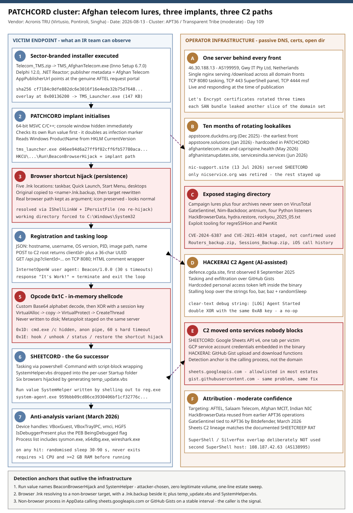

# PATCHCORD: three implants, three C2 transports and one Afghan telecom cover story

## TL;DR

Acronis Threat Research Unit published on 2026-08-13 an analysis of an active espionage cluster aimed at Afghan telecom
providers and South Asian critical infrastructure, built around a previously undocumented C/C++ backdoor called **PATCHCORD**.
Delivery is a sector-branded Inno Setup installer - `TMS_AfghanTelecom.exe` impersonating Afghan Telecom's internal Transport
Management System, `AFTEL_VPN_Setup.exe` impersonating the operator's VPN client, and an energy-sector variant themed as an NHPC
fuel-conservation client. Infrastructure pivoting on a single C2 server, `46.30.188.13`, surfaced two further implants that share
PATCHCORD's persistence idea but replace its transport: **SHEETCORD**, a Go implant tasked through Google Sheets API v4 with a
hardcoded GCP service account, and the **HACKERAI C2 Agent**, an AI-assisted implant tasked through GitHub Gists with a hardcoded
personal access token. TRU attributes the cluster to APT36 (Transparent Tribe) with **moderate** confidence on targeting, tooling
overlap and infrastructure; the campaign spans at least September 2025 to the publication date and the infrastructure was still
live when the report went out.

## Attribution and confidence

**Primary cluster:** APT36. **Aliases:** Transparent Tribe, Mythic Leopard, Earth Karkaddan, APT-C-56, ProjectM, Copper Fieldstone.
**Nexus:** Pakistan. **Vendor and date:** Acronis Threat Research Unit, 2026-08-13 (Darrel Virtusio, Santiago Pontiroli,
Subhajeet Singha). **Confidence: medium** - this is Acronis's own stated assessment ("moderate confidence... overlaps with the
broader APT36 cluster or a closely related Pakistan-linked threat actor"), and this repository does not upgrade it.

Four evidence strands support the overlap, and one deliberately does not:

| Strand | Observation | Weight |
|---|---|---|
| Targeting | Sustained focus on Afghan telecom (AFTEL, Salaam Telecom) and Afghanistan's Ministry of Communications and IT, plus Indian government, defence and energy; purpose-registered lookalike domains for each | Consistent with APT36's documented regional focus |
| Shared tooling | `HackBrowserData` on the staging server - the same browser credential stealer used in APT36 operations against Indian Air Force targets via Sukhoi-30 MKI procurement lures | Strong, but the tool is open source |
| Framework overlap | `GateSentinel-C2-Rat-Hvnc/` and a `Nim-Backdoor/` directory co-located with campaign files; GateSentinel was independently tied to APT36's toolkit by Bitdefender in March 2026 | Strong - co-location with campaign lures is the linking fact |
| Implant lineage | SHEETCORD's Google Sheets C2 closely resembles the SHEETCREEP RAT documented by Zscaler ThreatLabz against Indian government targets; both embed GCP service-account credentials and create per-victim tabs | Strong |
| Non-strand | The staging server also ran SuperShell v2.0.0 (Chinese-language panel), and a second SuperShell host, `108.187.42.63`, was documented by Kaspersky as a ValleyRAT C2 for SilverFox's ABCDoor campaign | **Explicitly not used for attribution** - shared open-source tooling and a common fingerprint, no evidence of operational coordination |

**Genealogy with previous repository cases.** This is the first case in the diary on APT36 / Transparent Tribe and the first with
a Pakistan nexus, so there is no prior actor folder to extend. The nearest neighbours are thematic, not genealogical. The
2026-05-22 Red Lamassu case also ended on an Afghan ISP, but that was a China-nexus operator entering through an Outlook server
with a long-dwell backdoor, where this operator enters through a socially engineered installer on an employee desktop. The
2026-08-03 OctLurk / SilkLurk case covered Central Asian telecom and government targets with in-memory backdoors from a
Chinese-speaking operator; the regional overlap is real, the tradecraft is not. The 2026-08-14 Lazarus deep-dive shared this
case's "state-nexus espionage against defence targets" framing but sat at the opposite end of the sophistication scale - a kernel
zero-day and a data-only rootkit, against this operator's `.lnk` rewriting and hardcoded cloud tokens. That contrast is the
pedagogical point of publishing both inside a week.

## Kill chain — summary table

| Stage | MITRE | Detail |
|---|---|---|
| Resource development | T1583.001, T1588.002 | Ten-month domain build-out on one server: `appstoore[.]duckdns[.]org` (Dec 2025), `appstoore[.]solutions` (Jan 2026), then lookalikes for Afghan Telecom, Afghan government updates, India's NIC and a Delhi clinic; open-source toolkit staged (SuperShell, Metasploit, GateSentinel, HackBrowserData, hydra) |
| Initial access | T1566.002, T1190 | Sector-branded ZIP or installer served from `/download` on every domain front; separately, `CVE-2024-6387` (regreSSHion) tooling and a password list staged for internet-facing SSH |
| Execution | T1204.002 | Victim runs an Inno Setup 6.7.0 installer whose publisher metadata names Afghan Telecom and whose publisher URL points at the real AFTEL portal; `TMS_Launcher.exe` is extracted and run |
| Persistence | T1547.001, T1547.009, T1059.005 | HKCU Run value `BeaconBrowserHijack` (PATCHCORD) or `SystemHelper` (SHEETCORD); every browser `.lnk` in five locations rewritten to launch the implant with the real browser path as an argument, original saved as `.lnk.backup` |
| Defense evasion | T1497.001, T1622, T1027 | Later variant checks VirtualBox and VMware device handles, CPU count, RAM, `IsDebuggerPresent`, the PEB `BeingDebugged` flag, TCP ports used by Burp and Fiddler, and a process list including `sysmon.exe`; on a hit it sleeps 30-90 s at random to burn sandbox time |
| Discovery | T1082, T1033, T1057 | Hostname, username, Windows `ProductName` from the registry, PID, image path and process name marshalled into a JSON registration blob; opcode `0x1B` returns a full process list |
| Command and control | T1071.001, T1571, T1102.002 | POST to the C2 root returns a 36-character `clientId` UUID; the implant then polls `/api.jsp?clientId=...` on TCP 8080 with User-Agent `Beacon/1.0.0`, stripping an HTML comment wrapper from each task. SHEETCORD uses Google Sheets tabs; HACKERAI uses GitHub Gists |
| Execution of tasking | T1620, T1059.003, T1059.001 | Opcode `0x1C` decodes a custom-alphabet Base64 blob, XOR-decrypts it, `VirtualAlloc` / `VirtualProtect` to `PAGE_EXECUTE_READ`, runs it via `CreateThread` - never touching disk; opcode `0x1D` runs `cmd.exe /c` hidden with a 60-second cap, SHEETCORD uses `powershell -Command` |
| Collection and exfiltration | T1555.003, T1041, T1567 | Command output Base64-encoded back over the tasking channel; `Routers_backup.zip`, `Sessions_Backup.zip` and an iOS call-history record file on the staging server point at network devices and mobile targets as well |



The diagram keeps the victim endpoint on the left and the operator's single-server infrastructure on the right. Read the left
lane as the sequence an incident responder can actually observe on a host - installer, implant, two persistence writes, a
browser launched by the wrong parent, then tasking - and the right lane as the parts that only passive DNS, certificate
transparency and an exposed directory listing revealed. The three red badges mark the anchors worth building detections on: the
shortcut rewrite, the in-memory shellcode opcode, and the migration of C2 onto services no one can block.

## Stage-by-stage detail

### Delivery: an installer that knows the victim's internal systems

The entry artefact is a ZIP named `Telecom_TMS`, first seen on VirusTotal in June 2026, containing a 32-bit Inno Setup 6.7.0
installer built with Embarcadero Delphi 12.0 and wrapped in .NET Reactor. The metadata is the interesting part:

```
CompanyName     : Afghan Telecom
FileDescription : TMS Afghan Telecom Setup
ProductName     : TMS Afghan Telecom
FileVersion     : 1.0.24
AppPublisher    : Afghan Telecom
AppPublisherUrl : hxxps[:]//tms[.]afghantelecom[.]af      <- the real AFTEL request portal
```

TMS is Afghan Telecom's internal Transport Management System for corporate vehicle and transport requests. Knowing that the
system exists, what it is called internally, and what its real portal URL is, is reconnaissance work that a generic phishing kit
does not do. The installer overlay sits at offset `0x00136200` and holds one embedded executable, `TMS_Launcher.exe` (147 KB).
Sibling lures in the same cluster follow the pattern: `AFTEL_VPN_Setup.exe`, `Bonus_Salaam_telecom.zip`,
`Ministry of Communication & Information Technology.msi` with an `MCIT.pdf` decoy, `MDEB_Update_Setup.exe` (a Ministry of Defence
employee benefits update), `MOFA_Employee_Benefits.exe`, and an NHPC fuel-conservation client for the Indian energy wave.
MITRE: T1566.002 (Spearphishing Link), T1204.002 (User Execution: Malicious File).

### PATCHCORD: initialisation and the browser shortcut hijack

`TMS_Launcher.exe` is a 64-bit MSVC-compiled implant. It hides its console window, then reads
`HKCU\Software\Microsoft\Windows\CurrentVersion\Run\BeaconBrowserHijack`. That value doubles as an infection marker: if it is
present the implant skips the hijack phase entirely, if not it writes its own image path there with `RegSetValueExW` and proceeds.

The hijack itself is the durable artefact. `FindAndHijackBrowserShortcut` walks five locations - taskbar pinned folder, Quick
Launch, Start Menu, user Desktop and public Desktop - enumerating `%s\*.lnk` and matching filenames against Microsoft Edge,
Google Chrome and Mozilla Firefox. For each match it resolves the real target through `IShellLinkW` and `IPersistFile` to confirm
the shortcut still points at a genuine browser (which prevents re-hijacking something it already owns), copies the original with
`.backup` appended, then rewrites it:

```
Target           : <implant path>
Arguments        : "C:\Program Files\Google\Chrome\Application\chrome.exe"
Working directory: C:\Windows\System32
Icon             : original browser icon, preserved via SetIconLocation
```

The user clicks Chrome, the implant runs, `ShellExecuteW` launches the real Chrome from the argument, and nothing looks wrong.
MITRE: T1547.001 (Registry Run Keys / Startup Folder), T1547.009 (Shortcut Modification).

### Fingerprinting and registration

The implant reads `HKLM\SOFTWARE\Microsoft\Windows NT\CurrentVersion` `ProductName` for the Windows edition string, then builds a
JSON blob containing hostname, username, OS version, process ID, executable path and process name. It opens its HTTP session with
`InternetOpenW` and the user agent `Beacon/1.0.0`, with connect, send and receive timeouts all set to 30 seconds, and POSTs the
blob to the root path of `appstoore[.]solutions` on TCP 8080. The server replies with `clientId=` and a 36-character UUID, which
the implant appends to `/api.jsp` to form its per-session tasking URL. MITRE: T1082, T1033, T1071.001, T1571.

### The tasking loop and its five opcodes

The implant GETs the tasking URL on a loop. A response of `It's Work!` is a termination signal and ends the loop. Anything else
is passed through a routine that strips an `<!-- ... -->` HTML comment wrapper before dispatch.

| Opcode | Capability | Notes for defenders |
|---|---|---|
| `0x1A` (26) | Beacon interval adjustment | Defeats fixed-interval beacon analytics; hunt on interval *stability*, not on a specific value |
| `0x1B` (27) | Process enumeration | `CreateToolhelp32Snapshot`, JSON of name/PID/path, custom-alphabet Base64 to C2 |
| `0x1C` (28) | In-memory shellcode execution | Custom Base64 decode, XOR decrypt with a session-derived key, `VirtualAlloc` -> copy -> `VirtualProtect(PAGE_EXECUTE_READ)` -> `CreateThread`, then free. Nothing on disk |
| `0x1D` (29) | Remote shell | `cmd.exe /c <cmd>` via `CreateProcessA` with `CREATE_NO_WINDOW`, stdout and stderr into an anonymous pipe, 60-second timeout then forced kill |
| `0x1E` (30) | Hijack control | `all`, `edge`, `chrome`, a comma-separated browser list, `restore` to revert, and `status` for a JSON report of every hijacked shortcut |

The `restore` verb matters for IR: an operator who has been in the environment can un-hijack shortcuts on demand, so the absence
of rewritten `.lnk` files does not clear a host that has the Run value or the `.backup` residue. MITRE: T1620 (Reflective Code
Loading), T1059.003 (Windows Command Shell), T1057 (Process Discovery), T1132.001 (Standard Encoding).

### The anti-analysis variant (Indian energy wave, March 2026)

The NHPC-themed variant is functionally the same implant plus a sandbox-evasion suite: device handles for `VBoxGuest`,
`VBoxTrayIPC`, `vmci` and `HGFS`; a requirement of more than one processor and at least 2 GB of RAM; `IsDebuggerPresent` and the
PEB `BeingDebugged` flag; a scan of active TCP connections for ports associated with Burp Suite and Fiddler; a process-name list
including `wireshark.exe`, `x64dbg.exe`, `ida.exe`, `processhacker.exe`, `sysmon.exe` and `burpsuite.exe`; and cursor-movement
monitoring for automation. On any hit it enters a randomised 30-90 second sleep loop - designed to run out a sandbox's clock
rather than exit, because exiting is itself a detectable behaviour. Note that `sysmon.exe` on that list means the implant knows
when it is on an instrumented host. MITRE: T1497.001, T1622.

### SHEETCORD: same idea, cloud transport

Served from `nic-support[.]site` inside `MDEB_Update_Setup.exe`, SHEETCORD is Go and reuses the family's concepts with different
mechanics. `main.executeShellCommand` runs tasking through `powershell -Command` with script-block wrapping instead of `cmd.exe`.
`main.getHostInfo` collects only the hostname - markedly less fingerprinting than PATCHCORD. `main.installStartupEntry` drops
`SystemHelper.vbs` into `%APPDATA%\Microsoft\Windows\Start Menu\Programs\Startup\`, which launches the implant hidden via
`WScript.Shell` at every logon, and then adds the Run value `SystemHelper` by shelling out to `reg.exe` rather than calling the
API. Shortcut hijacking expands from three browsers to six (Chrome, Firefox, Edge, Brave, Opera, Vivaldi) and is implemented by
generating a temporary `temp_update.vbs` executed through `wscript` instead of driving COM.

Command and control runs over Google Sheets API v4 authenticated with a GCP service account hardcoded in the binary, with one
spreadsheet tab created per victim for bidirectional traffic - the same design as the SHEETCREEP RAT documented by Zscaler.
MITRE: T1059.001, T1059.005, T1102.002, T1567.

### HACKERAI C2 Agent: the AI-assisted third variant

Historical TLS certificate data on the same address surfaced `defence[.]cgda[.]site` (spelled `defence[.]cdga[.]site` in the same
report's IOC list - both spellings are worth tracking), first observed 2025-09-08 and impersonating India's Controller General of
Defence Accounts. It distributed a framework Acronis tracks as HACKERAI C2 Agent: the same fingerprinting, shell execution and
shortcut hijacking, but tasking and exfiltration through **GitHub Gists** with a hardcoded personal access token. Its evasion is
thin by comparison: a `performJunkOperations` function that loops over the placeholder strings `foo`, `bar` and `baz` calling
`randomSleep` between iterations, plus a recursive Fibonacci calculator. The AI-assisted-development tells Acronis lists are
AI-style comments, clear-text debug output such as `[LOG] Agent Started`, leftover test code, and a redundant double-XOR routine
using the same `0xAB` key twice - which is a no-op, and precisely the kind of mistake a generated-and-not-reviewed implementation
produces. MITRE: T1102.002, T1027.

### Infrastructure: one server, rotating fronts

Every domain in the cluster resolved to `46.30.188.13` (AS199959, Gwy IT Pty Ltd, Netherlands) and redirected visitors to a
`/download` path served by the same nginx instance. Let's Encrypt certificates were rotated three times, each bundling a different
domain set as Subject Alternative Names - which is how the historical domains became recoverable. Only `nicservice[.]org` was
retired (last resolution 2026-06-16); as of 2026-07-16 everything else was still resolving. Ports observed: 8080 for PATCHCORD
tasking, 443 for the SuperShell panel, 4444 for Metasploit. MITRE: T1583.001, T1584.004.

### The exposed staging directory

An open directory listing on the operator's staging server is where most of the campaign context comes from: campaign files
(`TMS_AfghanTelecom.exe`, `Bonus_Salaam_telecom.zip`, the MCIT installer and decoy PDF), undistributed archives never seen on
VirusTotal (`system_update.zip`, `chrome.zip`, `inf.zip`), an `antnium/` Go C2, `GateSentinel-C2-Rat-Hvnc/`, `Nim-Backdoor/`,
`.msf4/` and `msfinstall`, `HackBrowserData/`, exploit tooling for `CVE-2024-6387` and `CVE-2021-4034`, `hydra.restore` and
`rockyou_2025_05.txt`, a `chm_da_content/` directory suggesting CHM delivery, four Python C2 listeners, and - most consequentially
- `Routers_backup.zip`, `Sessions_Backup.zip` and `kCallingHistoryCallStateV1RecordType_record.json`, whose name follows an iOS
call-history database record schema. Those last three imply collection from network devices and mobile handsets, not only Windows
endpoints. MITRE: T1588.002, T1190, T1555.003.

## Detection strategy

### Telemetry that matters

- **Sysmon EID 13 / 14 (registry value set and rename)** on `HKCU\...\CurrentVersion\Run` - the two named values are zero-volume in a healthy estate.
- **Sysmon EID 11 (file create)** for `*.lnk`, `*.lnk.backup` and `*.vbs`. Many deployments filter `.lnk` writes as noise; that filter is the blind spot this cluster lives in.
- **Sysmon EID 1 / Defender `DeviceProcessEvents`** with full command lines and `ParentImage` - the hijack is only visible as a parent-child anomaly (browser launched by a binary in `AppData`).
- **Defender XDR:** `DeviceRegistryEvents`, `DeviceFileEvents`, `DeviceProcessEvents`, `DeviceNetworkEvents` with process attribution on TLS.
- **Network:** egress on TCP 8080 with a `Beacon/1.0.0` user agent; DNS and TLS SNI for the domain set; and, for the Sheets and Gist transports, the *calling process* rather than the destination.
- **Linux edge:** `sshd` at `LogLevel VERBOSE` to capture the pre-auth handshake volume that regreSSHion exploitation generates, plus `auditd` around `pkexec`.

### Detection coverage

| Engine | File | Logic |
|---|---|---|
| Sigma | [01_patchcord_cluster_run_key_persistence.yml](./sigma/01_patchcord_cluster_run_key_persistence.yml) | HKCU Run values `BeaconBrowserHijack` and `SystemHelper`, plus Run data pointing at the named implants or at user-writable staging paths |
| Sigma | [02_browser_shortcut_hijack_artifacts.yml](./sigma/02_browser_shortcut_hijack_artifacts.yml) | `<browser>.lnk.backup` residue, `temp_update.vbs` / `SystemHelper.vbs`, and any `.vbs` dropped into the per-user Startup folder |
| Sigma | [03_shortcut_launched_implant_spawns_shell.yml](./sigma/03_shortcut_launched_implant_spawns_shell.yml) | Non-browser image in a user-writable directory whose command line embeds a browser path; `reg.exe` writing `SystemHelper`; `wscript` running the helper scripts; the named implant and dropper filenames |
| KQL | [k1_patchcord_persistence_registry_and_startup.kql](./kql/k1_patchcord_persistence_registry_and_startup.kql) | Unions registry and file persistence and flags hosts showing both classes |
| KQL | [k2_browser_launched_by_untrusted_parent.kql](./kql/k2_browser_launched_by_untrusted_parent.kql) | Browser started by an untrusted parent, joined to hidden `cmd` / `powershell` / `reg` / `wscript` from the same path within ten minutes |
| KQL | [k3_patchcord_c2_and_webservice_channels.kql](./kql/k3_patchcord_c2_and_webservice_channels.kql) | Atomic infrastructure branch plus a Sheets / Gists branch scoped to non-browser callers running from user-writable paths |
| YARA | [patchcord_cluster.yar](./yara/patchcord_cluster.yar) | Three rules: PATCHCORD (`BeaconBrowserHijack`, `Beacon/1.0.0`, `/api.jsp`, `It's Work!`), SHEETCORD (Go symbols, Sheets API, `SystemHelper.vbs`), HACKERAI (`performJunkOperations`, `[LOG] Agent Started`, Gist endpoints) |
| Suricata | [patchcord_cluster.rules](./suricata/patchcord_cluster.rules) | 5 sids: `Beacon/1.0.0` user agent; `/api.jsp` with `clientId=`; JSON fingerprint POST to the C2 root; `appstoore` DNS; direct contact with the two C2 addresses |

No SPL is emitted; convert the Sigma rules with `sigma convert -t splunk -p sysmon <rule>.yml` if a Splunk estate needs them.

### Threat hunting hypotheses

- **H1** - [peak_h1_browser_shortcut_integrity.md](./hunts/peak_h1_browser_shortcut_integrity.md): if any endpoint is affected, a browser `.lnk` now resolves to a non-browser target and a `.backup` copy sits beside it. Persistence survives domain rotation and implant updates.
- **H2** - [peak_h2_webservice_c2_by_nonbrowser_processes.md](./hunts/peak_h2_webservice_c2_by_nonbrowser_processes.md): if SHEETCORD or HACKERAI is present, a non-browser, non-toolchain process running from a user-writable path is talking to Google Sheets or GitHub Gists on a regular interval. The anomaly is the caller, never the destination.
- **H3** - [peak_h3_sector_lure_installers_and_edge_ssh.md](./hunts/peak_h3_sector_lure_installers_and_edge_ssh.md): either a sector-branded Inno Setup installer executed here in the last twelve months, or our internet-facing OpenSSH was worked with the regreSSHion tooling staged on the same server.

## Incident response playbook

### First 60 minutes (triage)

1. Query the estate for the two Run value names. They are attacker-chosen strings with no vendor owner - a hit is a confirmed compromise, not a lead.
2. Sweep for `*.lnk.backup`, `SystemHelper.vbs` and `temp_update.vbs`. Collect, do not delete: the rewritten shortcut's argument string preserves the original browser path and is timeline evidence.
3. Resolve every browser shortcut on the suspect host and record targets before touching anything.
4. Pull the process tree for the last 30 days filtered to browsers launched by a parent under `AppData`, `Temp` or `Users\Public`.
5. Search proxy and DNS for the domain set and for `46.30.188.13`; search endpoint network telemetry for TCP 8080 with `Beacon/1.0.0`.
6. Identify the delivery vector: look in `%TEMP%` for the Inno Setup extraction directory and in browser download history for the ZIP or EXE, then find everyone else who received the same lure.
7. If the host is a telecom or edge-adjacent asset, check `sshd` logs for pre-authentication timeout bursts and confirm the OpenSSH version.
8. Assume mobile and network-device collection is in scope - the staging server held router configs, session backups and an iOS call-history record.

### Artifacts to collect

| Artifact | Path | Tool | Why |
|---|---|---|---|
| Run key values | `HKCU\Software\Microsoft\Windows\CurrentVersion\Run` | `reg export`, RECmd | Names the family (`BeaconBrowserHijack` = PATCHCORD, `SystemHelper` = SHEETCORD) and gives the implant path |
| Browser shortcuts and backups | Desktop, Start Menu, Quick Launch, `...\User Pinned\TaskBar` | LECmd | Target, arguments and working directory prove the hijack; MAC times bracket the infection |
| Startup VBScript | `%APPDATA%\Microsoft\Windows\Start Menu\Programs\Startup\SystemHelper.vbs` | file copy | Second persistence path; content names the implant binary |
| Implant binary | path from the Run value | file copy, hash | YARA classification and family confirmation |
| Inno Setup extraction remnants | `%TEMP%\is-*.tmp` | file copy | Ties the running implant back to the specific lure |
| Prefetch | `C:\Windows\Prefetch` | PECmd | First and last execution of the dropper and implant, plus run counts |
| Amcache / Shimcache | `C:\Windows\AppCompat\Programs\Amcache.hve` | AmcacheParser | Execution evidence that survives implant deletion |
| Browser download history | per-profile SQLite | browser forensic tooling | Recovers the delivery URL and therefore the domain front used |
| Network telemetry | proxy, DNS, firewall, EDR | SIEM | Beacon cadence, `clientId` UUID, and any Sheets or Gist traffic from the implant path |
| sshd logs | `/var/log/auth.log`, `/var/log/secure` | grep, journalctl | Perimeter half of the access path |

### IR queries and commands

```powershell
# Author: Jarmi
# 1. Both persistence writes, in one pass, for the current user.
'BeaconBrowserHijack','SystemHelper' | ForEach-Object {
  Get-ItemProperty -Path 'HKCU:\Software\Microsoft\Windows\CurrentVersion\Run' -Name $_ -ErrorAction SilentlyContinue |
    Select-Object @{n='Value';e={$_.PSChildName}}, $_
}
Test-Path (Join-Path $env:APPDATA 'Microsoft\Windows\Start Menu\Programs\Startup\SystemHelper.vbs')
```

```powershell
# Author: Jarmi
# 2. Every hijacked shortcut on the host, with the original browser path recovered from the argument string.
$shell = New-Object -ComObject WScript.Shell
Get-ChildItem -Path $env:APPDATA, ([Environment]::GetFolderPath('Desktop')) -Filter *.lnk -Recurse -Force -ErrorAction SilentlyContinue |
  ForEach-Object {
    $l = $shell.CreateShortcut($_.FullName)
    if ($l.Arguments -match '\.exe' -and $l.TargetPath -notmatch 'Program Files') {
      [pscustomobject]@{ Shortcut=$_.FullName; Implant=$l.TargetPath; OriginalBrowser=$l.Arguments; WorkDir=$l.WorkingDirectory }
    }
  }
```

```bash
# Author: Jarmi
# 3. Perimeter half - regreSSHion probing volume and the running OpenSSH version.
grep -c 'Timeout before authentication' /var/log/auth.log
grep 'Timeout before authentication' /var/log/auth.log | grep -oE '([0-9]{1,3}\.){3}[0-9]{1,3}' | sort | uniq -c | sort -rn | head
ssh -V 2>&1
```

```kql
// 4. Scope the intrusion: every host that touched the cluster infrastructure, with the process that did it.
let c2 = dynamic(["46.30.188.13","108.187.42.63"]);
let doms = dynamic(["appstoore.solutions","appstoore.duckdns.org","afghantelecom.site","afghanistanupdates.site",
                    "caprispine.health","servicesindia.services","zala-aer.info","nicservice.org","nic-support.site"]);
DeviceNetworkEvents
| where Timestamp > ago(365d)
| where RemoteIP in (c2) or RemoteUrl has_any (doms)
| summarize First = min(Timestamp), Last = max(Timestamp), Hits = count(),
            Procs = make_set(InitiatingProcessFolderPath, 10) by DeviceName, AccountName = InitiatingProcessAccountName
| sort by First asc
```

### Containment, eradication, recovery

**Do first.** Remove persistence before rotating credentials, and remove *both* persistence paths on any host where either is
found - a Run value removed while `SystemHelper.vbs` remains in Startup buys nothing. Restore each hijacked shortcut from its
`.backup` copy after collecting it, or delete and recreate the shortcut from the browser installation.

**Do not.** Do not simply delete the `.lnk.backup` files as clean-up: they are the only record of the original shortcut state.
Do not treat a host with the Run value but no rewritten shortcuts as a false positive - the `0x1E` opcode's `restore` verb lets
the operator revert the hijack on demand. Do not rely on blocking the C2 domains as containment when two of the three implants
in this cluster task over Google and GitHub. Do not assume the endpoint is the whole story on a telecom asset: router configs and
session backups on the staging server say otherwise.

**Exit criteria.** No Run value or Startup script for either family across the estate; every browser shortcut resolves to a
signed browser binary in its expected location; no egress to the domain or address set for 14 days; OpenSSH on every
internet-facing host confirmed outside the `CVE-2024-6387` range and `pkexec` patched or de-privileged; credentials for any user
who ran a lure rotated *after* persistence removal; and browser-stored credentials for those users treated as compromised given
`HackBrowserData` in the toolkit.

### Recovery validation

Re-run H1 across the estate seven and fourteen days after eradication and confirm zero hijacked shortcuts. Keep the three Sigma
rules and the Suricata behavioural sids (6260001-6260003) enabled as standing detections rather than a time-boxed sweep - the
domains rotate roughly monthly, so only the behavioural half will still be true next quarter. Validate that `.lnk` file-create
events are actually reaching the SIEM by planting a benign `test.lnk.backup` and confirming it appears. Finally, confirm with
Google and GitHub whether the hardcoded service account and personal access token have been revoked; if the operator's own
credentials still work, the transport is still live for every other victim.

## IOCs

Full set in [iocs.csv](./iocs.csv) (57 entries). Top selection:

| Type | Value | Context | Confidence | Source |
|---|---|---|---|---|
| sha256 | `cf7184c0dfe882dc6e3016f16e4ede32b75d7648f83d6f4f87eb6a703be7b8d6` | `TMS_AfghanTelecom.exe` Inno Setup dropper | high | Acronis TRU 2026-08-13 |
| sha256 | `d46ee94d6a27ff9f02cff6fb57780acac2833ce48c95e63042a6274e24a040bb` | `tms_launcher.exe` - PATCHCORD implant | high | Acronis TRU 2026-08-13 |
| sha256 | `959bbb09cd86ce3930406bf1cf32776ca477dfefe3fd63e90bf0017fccd90587` | `system-agent.exe` - SHEETCORD | high | Acronis TRU 2026-08-13 |
| sha256 | `74d347785dc47f8cda3876826cdd3fb3935ac55dc8e9e0c0f96d5ef4e00089a2` | `Agent.exe` - HACKERAI C2 Agent | high | Acronis TRU 2026-08-13 |
| sha256 | `378484112b4e837d3850b5b0802fc509202c232bb124d6944a59fe66525ba668` | `MDEB_Update_Setup.exe` - SHEETCORD dropper | high | Acronis TRU 2026-08-13 |
| ipv4 | `46.30.188.13` | Single C2 server, AS199959 Gwy IT Pty Ltd (NL); 8080 tasking, 443 SuperShell, 4444 Metasploit | high | Acronis TRU 2026-08-13 |
| ipv4 | `108.187.42.63` | Second SuperShell host; documented by Kaspersky as SilverFox ValleyRAT C2 - overlap only | medium | Acronis TRU 2026-08-13 |
| domain | `appstoore[.]solutions` | Primary C2 hardcoded in PATCHCORD, live since 2026-01-27 | high | Acronis TRU 2026-08-13 |
| domain | `afghantelecom[.]site` | Afghan Telecom lookalike; `vpn01` subdomain matched the VPN lure | high | Acronis TRU 2026-08-13 |
| domain | `nic-support[.]site` | NIC lookalike serving SHEETCORD, first seen 2026-07-13 | high | Acronis TRU 2026-08-13 |
| domain | `caprispine[.]health` | Delhi clinic lookalike used as a phishing front | high | Acronis TRU 2026-08-13 |
| regkey | `HKCU\...\CurrentVersion\Run\BeaconBrowserHijack` | PATCHCORD persistence and infection marker | high | Acronis TRU 2026-08-13 |
| regkey | `HKCU\...\CurrentVersion\Run\SystemHelper` | SHEETCORD persistence, written via `reg.exe` | high | Acronis TRU 2026-08-13 |
| path | `%APPDATA%\...\Startup\SystemHelper.vbs` | SHEETCORD logon persistence | high | Acronis TRU 2026-08-13 |
| string | `Beacon/1.0.0` | PATCHCORD hardcoded User-Agent | high | Acronis TRU 2026-08-13 |
| cve | `CVE-2024-6387` | regreSSHion tooling staged on the operator's server | medium | Acronis TRU 2026-08-13 |

**KEV status.** Two CVEs are in scope, both as exploit tooling found on the operator's staging server rather than as confirmed
exploitation of a victim here. Per the generated [kev.md](./kev.md) (catalog version 2026.08.14), **1 of 2 is on the CISA KEV
list**: `CVE-2021-4034` (PwnKit, Red Hat polkit out-of-bounds read and write) was added on 2022-06-27 with a federal remediation
due date of 2022-07-18 and is flagged as **known ransomware use** - a four-year-old mandated patch that this operator still
bothers to carry, which says something about the estates they expect to land in. `CVE-2024-6387` (regreSSHion) is **not** on KEV;
that is not a statement that it is unexploited, only that CISA has not added it, and the tooling for it was sitting on the
operator's server alongside a password list.

**Decay warning.** The domain and address set was live at publication and has been rotating roughly monthly for ten months.
Treat the atomic indicators as a starting point with a short half-life; the behavioural anchors (shortcut hijack, `Beacon/1.0.0`,
`/api.jsp?clientId=`, non-browser processes calling Sheets or Gists) are the parts that will still be true in three months.

## Secondary findings

- **Three C2 transports in one cluster is a coverage argument, not a trivia point.** The same operator ran a custom HTTP server on port 8080 (blockable), Google Sheets API v4 (not blockable in most estates) and GitHub Gists (likewise) across ten months. A detection programme that stops at "block the C2" covers one of three. The transferable control is process attribution on TLS egress, which is a telemetry funding decision rather than a rule.
- **Hardcoded operator credentials are a takedown lever.** SHEETCORD embeds a GCP service account and HACKERAI embeds a GitHub personal access token. Any defender who recovers a sample holds the operator's own credential, and reporting it to Google or GitHub kills the channel for every victim at once - a rare case where one organisation's IR materially helps the rest of the target set.
- **The AI-assisted implant is the weakest of the three, and that is the finding.** Acronis's tells - AI-style comments, clear-text `[LOG] Agent Started`, leftover test code, a redundant double-XOR with the same `0xAB` key that cancels itself out - describe generated code that was never reviewed. LLM assistance shortened the path to a *working* implant, not to a *good* one. The junk-operation stalling is trivially signature-able compared with the hand-written variant's device-handle and debugger checks.

## Pedagogical anchors

- **Persistence that impersonates a user habit beats persistence that impersonates a system component.** A rewritten browser shortcut needs no service, no scheduled task, no DLL search-order trick and no elevation, and it fires exactly when a human clicks something they click every day. It is also invisible to any estate that filters `.lnk` writes out of telemetry as noise - which is most of them.
- **An infection marker is a gift.** PATCHCORD checks `BeaconBrowserHijack` before hijacking so it does not double-persist. That same value is a single-event, zero-false-positive detection and a one-line estate-wide sweep. Malware that needs to recognise its own work leaves defenders a name to search for.
- **Attribution language is a technical control.** Acronis says *moderate confidence* and *"or a closely related Pakistan-linked threat actor"*, and explicitly refuses to attribute on the SuperShell and SilverFox infrastructure overlap. Copying that hedge forward matters: shared open-source C2 frameworks and a common hosting fingerprint are the two most common sources of bad public attribution.
- **Impersonation quality is reconnaissance evidence.** Naming a real internal system (Afghan Telecom's TMS), pointing `AppPublisherUrl` at the genuine portal, and matching a `vpn01` subdomain to a VPN-installer lure are not generic phishing. When a lure is that specific, the incident scope includes "how did they learn this", and the answer is usually earlier access somewhere else.
- **The absence of an exploit is not the absence of a threat.** Two of the three implants here are ordinary user-mode code with no zero-day anywhere in the chain, published three days after this diary covered a Lazarus kernel zero-day. The espionage outcome - a decade-old telecom operator's internal comms - is the same. Programmes that rank threats by exploit sophistication misallocate against exactly this operator.

## What's in this folder

| File | Purpose | Link |
|---|---|---|
| README.md | This analysis: kill chain, detection strategy, IR playbook and IOCs. | [README.md](./README.md) |
| kill_chain.svg | Two-lane kill chain diagram (template A, espionage accent) with victim endpoint and operator infrastructure. | [kill_chain.svg](./kill_chain.svg) |
| iocs.csv | Full indicator set: hashes, domains, addresses, registry values, paths, strings, CVEs and analyst notes. | [iocs.csv](./iocs.csv) |
| kev.md | CISA KEV cross-reference for this case's CVEs. | [kev.md](./kev.md) |
| sigma/01_patchcord_cluster_run_key_persistence.yml | Run key persistence value names used by PATCHCORD and SHEETCORD. | [01_patchcord_cluster_run_key_persistence.yml](./sigma/01_patchcord_cluster_run_key_persistence.yml) |
| sigma/02_browser_shortcut_hijack_artifacts.yml | File residue of the browser shortcut hijack and the VBScript helpers. | [02_browser_shortcut_hijack_artifacts.yml](./sigma/02_browser_shortcut_hijack_artifacts.yml) |
| sigma/03_shortcut_launched_implant_spawns_shell.yml | Process shape of a shortcut-launched implant and its hidden tasking shells. | [03_shortcut_launched_implant_spawns_shell.yml](./sigma/03_shortcut_launched_implant_spawns_shell.yml) |
| kql/k1_patchcord_persistence_registry_and_startup.kql | Defender XDR union of registry and file persistence, flagging hosts with both. | [k1_patchcord_persistence_registry_and_startup.kql](./kql/k1_patchcord_persistence_registry_and_startup.kql) |
| kql/k2_browser_launched_by_untrusted_parent.kql | Browsers launched by untrusted parents, joined to hidden shell activity. | [k2_browser_launched_by_untrusted_parent.kql](./kql/k2_browser_launched_by_untrusted_parent.kql) |
| kql/k3_patchcord_c2_and_webservice_channels.kql | Atomic C2 infrastructure plus Sheets and Gists tasking by non-browser callers. | [k3_patchcord_c2_and_webservice_channels.kql](./kql/k3_patchcord_c2_and_webservice_channels.kql) |
| yara/patchcord_cluster.yar | Three rules covering PATCHCORD, SHEETCORD and the HACKERAI C2 Agent. | [patchcord_cluster.yar](./yara/patchcord_cluster.yar) |
| suricata/patchcord_cluster.rules | Five sids: beacon user agent, tasking URI, registration POST, DNS, and C2 address contact. | [patchcord_cluster.rules](./suricata/patchcord_cluster.rules) |
| hunts/peak_h1_browser_shortcut_integrity.md | PEAK hunt H1 - estate-wide browser shortcut integrity check. | [peak_h1_browser_shortcut_integrity.md](./hunts/peak_h1_browser_shortcut_integrity.md) |
| hunts/peak_h2_webservice_c2_by_nonbrowser_processes.md | PEAK hunt H2 - cloud services used as C2 by processes that have no business there. | [peak_h2_webservice_c2_by_nonbrowser_processes.md](./hunts/peak_h2_webservice_c2_by_nonbrowser_processes.md) |
| hunts/peak_h3_sector_lure_installers_and_edge_ssh.md | PEAK hunt H3 - sector-themed installers and the internet-facing SSH access path. | [peak_h3_sector_lure_installers_and_edge_ssh.md](./hunts/peak_h3_sector_lure_installers_and_edge_ssh.md) |

## Sources

- [PATCHCORD: New malware cluster targets Afghan telecom and South Asian critical infrastructure - Acronis TRU, 2026-08-13](https://www.acronis.com/en/tru/posts/patchcord-new-malware-cluster-targets-afghan-telecom-and-south-asian-critical-infrastructure/)
- [New PATCHCORD Backdoor Targets Afghan Telecom and Indian Critical Infrastructure - The Hacker News](https://thehackernews.com/2026/08/new-patchcord-backdoor-targets-afghan.html)
- [APT36 Suspected in PATCHCORD Espionage Campaign Using Google Sheets C2 - Security Affairs](https://securityaffairs.com/197266/intelligence/apt36-suspected-in-patchcord-espionage-campaign-using-google-sheets-c2.html)
- [PATCHCORD Infrastructure Hosts SuperShell C2 for Remote Commands and Webshell Management - GBHackers](https://gbhackers.com/patchcord-infrastructure-hosts-supershell/)
- [APT attacks target Indian government using SHEETCREEP, FIREPOWER and more - Zscaler ThreatLabz](https://www.zscaler.com/blogs/security-research/apt-attacks-target-indian-government-using-sheetcreep-firepower-and)
- [APT36: Nightmare Vibeware - Bitdefender, March 2026](https://www.bitdefender.com/en-us/blog/businessinsights/apt36-nightmare-vibeware)
- [Silver Fox tax notification campaign (ABCDoor / ValleyRAT) - Kaspersky Securelist](https://securelist.com/tr/silver-fox-tax-notification-campaign/120038/)
- [MITRE ATT&CK T1547.009 - Boot or Logon Autostart Execution: Shortcut Modification](https://attack.mitre.org/techniques/T1547/009/)
- [MITRE ATT&CK T1102.002 - Web Service: Bidirectional Communication](https://attack.mitre.org/techniques/T1102/002/)
