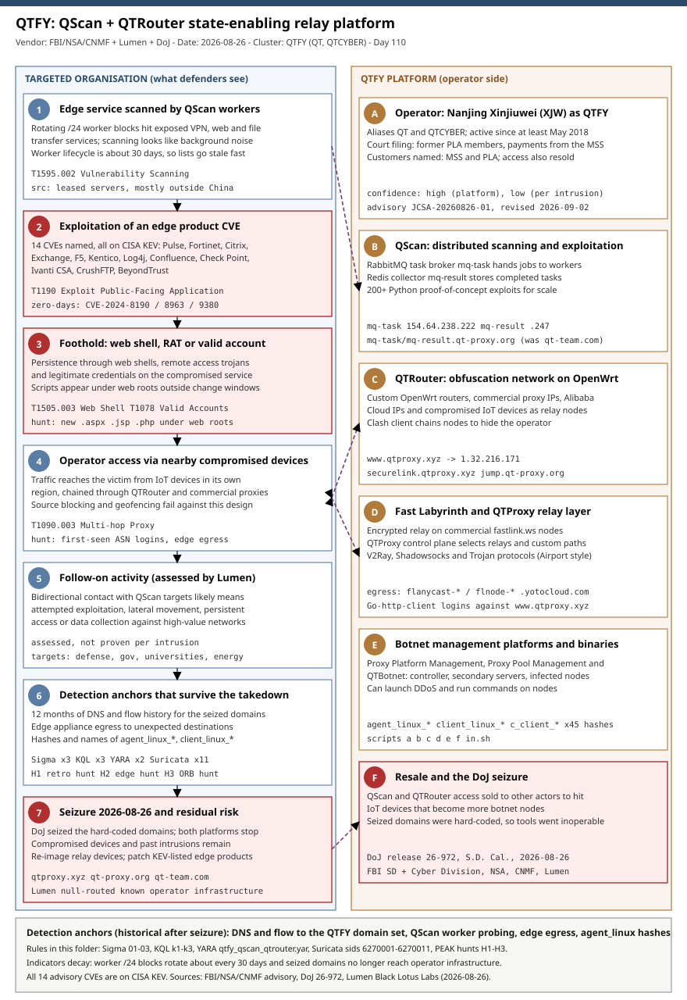

# QTFY: the FBI and DoJ seize the QScan and QTRouter platforms behind a Chinese state-enabling relay model

## TL;DR

On **2026-08-26** the US Department of Justice announced court-authorised seizures of the domains behind **QScan**, a distributed
vulnerability-scanning and exploitation platform, and **QTRouter**, an obfuscation network built from compromised IoT devices, commercial
proxy nodes and leased servers. The FBI, NSA and Cyber National Mission Force published advisory **JCSA-20260826-01** the same day, and
Lumen's Black Lotus Labs published its parallel analysis of the relay layer it calls **Fast Labyrinth**. The operator, tracked as **QTFY**
(also QT and QTCYBER), is described by the DoJ as employed by the Nanjing company Xinjiuwei Network Technology, with the PRC Ministry of
State Security and the People's Liberation Army named as customers. Because the seized domains were hard-coded into both products, the
platforms stopped working when the domains were taken, but the compromised devices and the intrusions already carried out through them
remain. The advisory covers activity from May 2018 to June 2026; the defender's job today is a look back through the logs, not a block list.

## Attribution and confidence

**Primary cluster:** QTFY. **Aliases:** QT, QTCYBER. **Operating company (per DoJ and the FBI/NSA advisory):** Nanjing Xinjiuwei Network
Technology Company (XJW), established in 2018. **Nexus:** PRC state-enabling contractor. **Vendors and dates:** FBI, NSA and Cyber National
Mission Force advisory published 2026-08-26 and revised 2026-09-02; DoJ press release 26-972 of 2026-08-26, updated 2026-08-28; Lumen Black
Lotus Labs, 2026-08-26 (Damon Rouse and Steve Rudd).
**Confidence: high** that QTFY built and operated QScan, QTRouter and the associated botnet management platforms, because a US government
assessment backed by court-authorised seizures is corroborated by independent Lumen tracking of the same infrastructure. **Confidence: low**
for attributing any single intrusion to a particular PRC end user, because the platforms were also sold or rented to other actors.

| Strand | Observation | Weight |
|---|---|---|
| Court and government attribution | DoJ says QTFY is employed by Nanjing Xinjiuwei, includes former PLA members, and received payments from the Ministry of State Security | Strong for the enabler, silent on individual intrusions |
| Independent infrastructure tracking | Lumen tracked the infrastructure for about a year with the FBI and links QScan targets to later contact through Fast Labyrinth | Strong, and the one source that connects reconnaissance to follow-up |
| Lumen's own wording | Lumen calls the operator a private technical quartermaster that may originate from Nanjing and does not name the company | Consistent, but more cautious than the DoJ |
| Admin access geolocation | Administrative check-ins to the QTProxy host came from China Telecom and China Unicom address space assigned to Nanjing; Lumen notes IP geolocation cannot establish a physical location | Weak on its own |
| Business relationships | The advisory lists relationships between XJW and other entities in the PRC enabler ecosystem as of June 2026; the table was corrected on 2026-09-02 | Context only, the advisory does not say each entity conducted intrusions |

**Genealogy with previous repository cases.** The closest case is **2026-07-13 UAT-7810 and the LapDogs ORB**, where Cisco Talos described a
China-nexus builder of relay networks from compromised SOHO devices that secondary APTs rent. QTFY is the same economic model at larger
scale and with a documented corporate owner and a documented customer list. The **2026-06-28 RoboVPN / Vo1d / Popa** case showed the
commercial residential-proxy side of the same market; QTFY's use of premium nodes from a commercial proxy service sits between the two. The
**2026-08-17 PATCHCORD / APT36** case is not related by actor, but it shares the lesson that the infrastructure, not the implant, is what lasts.
This is the first repository case where the primary evidence is a law-enforcement seizure of the platform itself.

## Kill chain — summary table

| Stage | MITRE | Detail |
|---|---|---|
| Platform build | T1583.001, T1583.003, T1587 | QTFY registers domains, leases servers outside China and develops QScan, QTRouter and the botnet management software |
| Reconnaissance | T1595.002 | A RabbitMQ broker (`mq-task`) hands scan tasks to rotating worker nodes; results return to a Redis collector (`mq-result`) |
| Initial access | T1190 | Zero-day and n-day exploits against edge products; the advisory names 14 CVEs, all on the CISA KEV catalog |
| Persistence | T1505.003, T1078 | Remote access trojans, web shells and legitimate credentials |
| Relay and obfuscation | T1090.003, T1584.008, T1572 | Operator traffic is chained through QTRouter nodes, commercial proxy nodes and compromised IoT devices near the victim |
| Follow-on activity | assessed | Lumen assesses bidirectional connections to QScan targets likely represent attempted exploitation, lateral movement, persistent access or data collection |
| Botnet and resale | T1584.005 | Proxy Platform Management, Proxy Pool Management System and QTBotnet manage compromised devices; access to QScan and QTRouter was sold to other actors |
| Disruption | n/a | 2026-08-26 seizure of `qtproxy.xyz`, `qt-proxy.org` and `qt-team.com` makes the platforms inoperable |



The left lane follows what a targeted organisation sees, from an exposed edge service being scanned through to the seizure and the residual
risk; the right lane shows the QTFY platform components that produce each step. The purple dashed arrows tie scanning, relaying and seizure
to the victim-side stage they explain. Detection anchors in the footer are the artefacts that survive the takedown: historical DNS and flow
records, edge-device egress, and the file names and hashes of the management binaries.

## Stage-by-stage detail

### Platform build: a contractor, not a crew

The advisory's central point is organisational. QTFY is a technical enabler: it builds platforms and infrastructure and supplies them to
operators, rather than running every intrusion itself. The DoJ names the PRC Ministry of State Security and the People's Liberation Army as
customers of Nanjing Xinjiuwei, and the advisory's business-activity table lists relationships with other entities in the PRC enabler
ecosystem (the table was corrected on 2026-09-02). The same group appears under the names QT and QTCYBER, and the advisory dates
associated indicators back to 2017 and targeting to May 2018.

- Technique: Acquire Infrastructure: Domains (**T1583.001**), Virtual Private Server (**T1583.003**), Develop Capabilities (**T1587**).
- Domains the DoJ seized: `qtproxy.xyz`, `qt-proxy.org`, `qt-team.com`. The advisory CSV lists dozens more, with `qtcyber.com` as the group-branded one.

### QScan: scanning as a queueing problem

QScan is a distributed system for internet-scale scanning and exploitation. The advisory describes a RabbitMQ message queue on the
`mq-task` host that assigns tasks to worker nodes, and a Redis store on the `mq-result` host that collects completed tasks. Task queues
cover web scraping, TLS certificate collection, subdomain enumeration and penetration testing, and the penetration-testing component
holds a database of more than 200 Python proof-of-concept exploits designed for large-scale use. Lumen adds that the broker uses Celery,
that scanners rotate across /24 blocks on a 30-day lifecycle, and that results go to a Redis cluster.

```text
mq-task.qt-proxy.org     (earlier: mq-task.qt-team.com)      RabbitMQ task broker      154.64.238.222
mq-result.qt-proxy.org   (earlier: mq-result.qt-team.com)    Redis result collector    154.64.238.247
workers: leased servers, mostly outside China, rotating /24 blocks, roughly 30 days each
```

The worker addresses are the part defenders see: they appear in perimeter logs as scanners. In the advisory CSV, 97 addresses carry the
role `qscan worker`; this entry keeps the 44 whose `last_seen` falls in 2026. Because the blocks rotate monthly, a worker list is a
description of past scanning, not a block list for next month.

- Technique: Active Scanning: Vulnerability Scanning (**T1595.002**).
- Caveat: Lumen prints the broker names as `mq-task-qt-team.com` and `mq-result-qt-team.com`, while the advisory CSV lists `mq-task.qt-team.com` and `mq-result.qt-team.com`. This entry follows the advisory CSV.

### Initial access: 14 CVEs, all on the KEV catalog

The advisory states that QTFY exploits zero-day and n-day vulnerabilities to gain initial access, and it dates specific uses:

| Date in advisory | CVE | Product | Note in advisory |
|---|---|---|---|
| August 2019 | CVE-2019-11510 | Pulse Secure VPN | Used against a US Department of Justice network |
| October 2019 | CVE-2018-13379 | Fortinet FortiOS SSL VPN | Attempted |
| January 2020 | CVE-2019-19781 | Citrix ADC and Gateway | Numerous US targets |
| March 2021 | CVE-2021-26855 | Microsoft Exchange (ProxyLogon) | Used |
| July-August 2021 | CVE-2020-5902 | F5 BIG-IP | US state government and a large US retailer |
| August 2021 | CVE-2019-10068 | Kentico CMS | US telecommunications company |
| December 2021 | CVE-2021-44228 | Apache Log4j (Log4Shell) | Used |
| October 2023 | CVE-2023-22515 | Atlassian Confluence | Used |
| May 2024 | CVE-2024-24919 | Check Point Quantum Gateway | Combined with QScan against US power and telecom companies |
| September 2024 | CVE-2024-8190, CVE-2024-8963, CVE-2024-9380 | Ivanti Cloud Services Appliance | The only CVEs the advisory labels as zero-days |
| April 2025 | CVE-2025-31161 | CrushFTP | US biotechnology company |
| February 2026 | CVE-2026-1731 | BeyondTrust Remote Support | QScan-assisted, US state government |

The list reads as a history of the edge-device news cycle since 2019, which is the point: QScan's exploit database is a delivery mechanism
for whatever is currently exploitable. Persistence then uses remote access trojans, web shells and legitimate credentials (reported by
The Hacker News from the advisory).

- Technique: Exploit Public-Facing Application (**T1190**), Server Software Component: Web Shell (**T1505.003**), Valid Accounts (**T1078**).

### QTRouter and Fast Labyrinth: the relay layer

QTRouter is the obfuscation network. The advisory describes devices such as routers running custom OpenWrt software, plus commercial
proxy IPs, Alibaba Cloud IPs and compromised IoT devices. It uses the open-source **Clash** client to establish proxy connections and
lets an operator view available nodes and chain them together. Administration is through `www.qtproxy.xyz` and `securelink.qtproxy.xyz`,
with a jump server at `jump.qt-proxy.org`.

Lumen describes the layer above it. **Fast Labyrinth** is an encrypted relay network that adds commercial proxy infrastructure, notably
premium nodes from the Chinese service `fastlink.ws`, alongside QTRouter; **QTProxy** is the control plane for selecting relays and
building custom paths. The commercial side uses the "Airport" ecosystem protocols V2Ray, Shadowsocks and Trojan. Egress nodes resolve to
subdomains of `yotocloud.com` named `flanycast-*` and `flnode-*`. The point of the design is that traffic into a victim can come from
a compromised device in the victim's own region, so source-based blocking and geofencing fail.

```text
QTRouter admin plane   www.qtproxy.xyz -> 1.32.216.171   securelink.qtproxy.xyz   jump.qt-proxy.org -> 8.148.149.147
Fast Labyrinth egress  flanycast-us / -us-bak / -hk / -hk-bak / -jp / -tw / -sg    flnode-ulus / flnode-dl   (under yotocloud.com)
Observed by Lumen      Go-http-client logins against www.qtproxy.xyz
```

- Technique: Proxy: Multi-hop Proxy (**T1090.003**), Compromise Infrastructure: Network Devices (**T1584.008**), Protocol Tunneling (**T1572**).

### Botnet management platforms and the binaries

The advisory lists three management platforms: Proxy Platform Management, Proxy Pool Management System and QTBotnet. QTBotnet has a
controller server, secondary control servers that relay between the controller and compromised devices, and the devices themselves; the
control server can launch DDoS attacks and run commands on infected nodes. QTFY sold access to QScan and QTRouter to other actors to scan
and exploit vulnerable IoT devices that could be added as botnet nodes.

The advisory's file CSV holds 45 SHA-256 values: 13 `agent_linux_*` binaries, 14 `client_linux_*` binaries, 11 `c_client_*` binaries and
7 shell scripts (`a`, `b`, `c`, `d`, `e`, `f` and `in.sh`). The binaries cover 386, amd64, arm, arm64, armhf, the mips, mipsle, mips64 and
mips64le builds, powerpc (ppc64le for `c_client_*`), riscv32, riscv64, s390x and, for `client_linux_*` only, arc700. No public reverse engineering of these binaries was available
when this entry was written, so this entry does not describe their internals.

- Technique: Compromise Infrastructure: Botnet (**T1584.005**).

### Disruption and what remains

The DoJ obtained court-authorised seizures of the domains, which were hard-coded into both products for communication and
authentication; the seizures made QScan and QTRouter inoperable. Lumen separately null-routed traffic to known operator infrastructure and
shared intelligence with US agencies. Neither action cleans a compromised device. Lumen's warning is the operational point: static blocking
is unlikely to work against traffic that passes through dynamically rotating commercial proxies, so the durable defences are patching,
egress monitoring on edge devices and behaviour-based access baselines.

The reporting on the DoJ action says the FBI linked attacks as recent as June 2026 to targeting of a US election system (reported by The
Hacker News); that detail was not in the advisory text reviewed for this entry.

## Detection strategy

### Telemetry that matters

- **DNS and resolver logs** with at least 12 months of retention: the single most useful source, because the domains were seized and only history can show contact. Sysmon Event ID 22 on Windows, resolver query logs, Defender `DnsQueryResponse` events.
- **Perimeter firewall and VPN gateway logs** (Sentinel `CommonSecurityLog`): inbound scanning from worker addresses, successful logins from first-seen ASNs, and egress from edge appliances.
- **Defender XDR tables**: `DeviceNetworkEvents`, `DeviceEvents`, `DeviceProcessEvents`, `DeviceFileEvents`, `DeviceTvmSoftwareVulnerabilities`.
- **Linux process creation** (Sysmon for Linux Event ID 1 with hashes, or auditd `execve`): the management binaries and a Clash client in a temporary directory.
- **Sign-in logs** (`SigninLogs` with `AutonomousSystemNumber`): the behavioural defence against traffic that arrives from nearby compromised devices.
- **Web server and appliance logs**: requests that create scripts under web roots, which is where a web shell first appears.

### Detection coverage

| Engine | File | Logic |
|---|---|---|
| Sigma | [01_qtfy_infrastructure_domain_resolution.yml](./sigma/01_qtfy_infrastructure_domain_resolution.yml) | DNS query for the 13 registrable domains the advisory lists with 2026 activity, exact and subdomain |
| Sigma | [02_qtfy_proxy_platform_binaries_and_staged_clash.yml](./sigma/02_qtfy_proxy_platform_binaries_and_staged_clash.yml) | Linux process names or SHA-256 hashes of the management binaries, or Clash run from a world-writable directory |
| Sigma | [03_qtfy_outbound_to_qscan_and_actor_hosts.yml](./sigma/03_qtfy_outbound_to_qscan_and_actor_hosts.yml) | Outbound connection to the QScan servers and actor-controlled addresses active in 2026 |
| KQL | [k1_qtfy_infrastructure_contact_dns_and_network.kql](./kql/k1_qtfy_infrastructure_contact_dns_and_network.kql) | 365-day union of network and DNS events per device against the domain and address sets |
| KQL | [k2_qtfy_qscan_worker_inbound_probing.kql](./kql/k2_qtfy_qscan_worker_inbound_probing.kql) | Perimeter log summary of probing from the QScan worker addresses |
| KQL | [k3_qtfy_ppm_binaries_and_staged_clash_linux.kql](./kql/k3_qtfy_ppm_binaries_and_staged_clash_linux.kql) | Advisory hashes, binary-name pattern and staged Clash on Linux endpoints |
| YARA | [qtfy_qscan_qtrouter.yar](./yara/qtfy_qscan_qtrouter.yar) | 2 rules: hard-coded QTFY domains in Linux ELF files, and downloader shell scripts that reference them (derived from the DoJ statement, not from a reversed sample) |
| Suricata | [qtfy_qscan_qtrouter.rules](./suricata/qtfy_qscan_qtrouter.rules) | 11 sids: DNS, TLS SNI, Go-http-client to the admin host, IP contact, inbound worker probe, yotocloud egress names |

The domain rules decay by design: after the seizure they detect past contact only. The two behavioural pieces that survive are the
Go-http-client login pattern against the admin host and the Clash-in-a-temp-directory heuristic, and the second is a heuristic and not an
advisory indicator.

### Threat hunting hypotheses

- **H1** - If QTFY ever touched us, history shows DNS, proxy or flow contact with its infrastructure. See [peak_h1_retro_hunt_qtfy_infrastructure.md](./hunts/peak_h1_retro_hunt_qtfy_infrastructure.md).
- **H2** - If a QScan customer got in, the entry was one of the advisory CVEs or a product like them, and left an unpatched version, a web shell or abnormal egress from the appliance. See [peak_h2_edge_exposure_and_post_exploitation.md](./hunts/peak_h2_edge_exposure_and_post_exploitation.md).
- **H3** - If an operator reaches us through nearby compromised devices, access arrives from first-seen ASNs, and some of our own small devices may already be relay nodes. See [peak_h3_orb_aware_access_and_own_device_abuse.md](./hunts/peak_h3_orb_aware_access_and_own_device_abuse.md).

## Incident response playbook

### First 60 minutes (triage)

1. Build the asset-to-CVE table for the 14 advisory CVEs and mark every instance that is internet-facing; any unpatched one is a patch-now item whatever else you find.
2. Run the domain and address half of H1 across 12 months of DNS, proxy and firewall data and list every internal host that appears.
3. For each hit, determine the device class first: a router, appliance or IoT device that resolved a QTFY domain is a relay candidate; a workstation is more likely research or a lookalike.
4. On Linux hosts and appliances with a shell, search for the file names `agent_linux_*`, `client_linux_*`, `c_client_*` and for a Clash binary outside its package path, then hash anything found.
5. Search web roots of Exchange, IIS, Confluence, CrushFTP and Kentico hosts for scripts written in the last 90 days and compare against change records.
6. Capture connection tables and running configuration of any suspect appliance before rebooting it.
7. Pull the last 90 days of VPN and SSO sign-ins and rank accounts by first-seen ASN; check whether any such source also appears among scanners in the perimeter logs.
8. Open a case with the FBI (the advisory asks for reports) if a compromised host shows evidence of use as a relay or a web shell.

### Artifacts to collect

| Artifact | Path | Tool | Why |
|---|---|---|---|
| DNS and proxy history | resolver and gateway log stores | SIEM, `zgrep` | Only record of contact with seized domains |
| Perimeter and VPN logs | firewall and gateway exports | SIEM | Scanning from worker addresses and egress from appliances |
| Appliance configuration and connection table | device CLI or management export | vendor tooling | Shows relay behaviour and unexpected listeners; volatile |
| Web roots | `C:\inetpub\wwwroot`, Exchange `FrontEnd\HttpProxy`, `/var/www`, Confluence and CrushFTP install directories | PowerShell, `find` | Candidate web shells with creation times |
| Suspect binaries | path from process telemetry | `sha256sum`, YARA | Match against the 45 advisory hashes and the ELF rule |
| Linux process and auth logs | `/var/log/auth.log`, `/var/log/secure`, auditd | `grep`, `ausearch` | Execution of the management binaries and service-account activity |
| Router or IoT flash image | device storage | vendor dump or `dd` over serial | Evidence of custom firmware or proxy packages; needed because in-place clean-up is unreliable |
| Sign-in logs | Entra ID, VPN, SSO | KQL | First-seen ASN logins and session scope |

### IR queries and commands

```powershell
# Author: Jarmi
# 1. Scripts and binaries written to common web roots in the last 90 days (Windows web servers).
$roots = 'C:\inetpub\wwwroot','C:\Program Files\Microsoft\Exchange Server\V15\FrontEnd\HttpProxy','C:\Program Files\CrushFTP'
Get-ChildItem -Path $roots -Include *.aspx,*.ashx,*.asmx,*.jsp,*.jspx,*.php,*.dll -Recurse -Force -ErrorAction SilentlyContinue |
  Where-Object { $_.LastWriteTimeUtc -gt (Get-Date).AddDays(-90) } |
  Select-Object FullName, Length, CreationTimeUtc, LastWriteTimeUtc | Sort-Object CreationTimeUtc -Descending
```

```bash
# Author: Jarmi
# 2. Hash every file whose name matches the advisory pattern and compare to the published SHA-256 list.
find / -xdev -type f \( -name 'agent_linux_*' -o -name 'client_linux_*' -o -name 'c_client_*' \) -exec sha256sum {} + 2>/dev/null | tee /tmp/qtfy_candidates.txt
grep -F -f <(cut -d, -f2 iocs.csv | grep -E '^[0-9a-f]{64}$') /tmp/qtfy_candidates.txt
```

```bash
# Author: Jarmi
# 3. Listeners that match Clash defaults (a lead, not proof: these are tool defaults) and packages that proxy.
ss -ltnp 2>/dev/null | grep -E ':(7890|7891|9090)\b'
opkg list-installed 2>/dev/null | grep -iE 'clash|v2ray|shadowsocks|trojan'
```

```kql
// 4. Hosts that touched the QTFY domain set in the last year, with the initiating process.
let qtfy = dynamic(["qt-proxy.org","qt-team.com","qtproxy.xyz","qtcyber.com","instantmessagehub.tech","fastsecurey.info"]);
DeviceNetworkEvents
| where Timestamp > ago(365d)
| where RemoteUrl has_any (qtfy)
| summarize First = min(Timestamp), Last = max(Timestamp), Hits = count(), Procs = make_set(InitiatingProcessFolderPath, 10) by DeviceName
| sort by First asc
```

### Containment, eradication, recovery

**Do first.** Isolate any edge appliance or small device that shows relay behaviour or a Clash-style listener, capture volatile state, then
re-image from a vendor image. For a server with a web shell, preserve the shell and the request that created it, remove it, and rotate
every credential the service account could read. Patch the advisory CVEs on every instance, starting with those that face the internet.

**Do not.** Do not rely on blocking the listed IP addresses: they are leased and rotate on roughly 30-day cycles, and Lumen's own
assessment is that blocking is unlikely to be effective against rotating commercial proxies. Do not read a clean DNS history as proof of
safety: traffic from nearby compromised devices never touches the published infrastructure. Do not attempt in-place clean-up of a
compromised embedded device; the recovery path is a re-flash from a trusted image. Do not treat a patched appliance as clean if it was
exposed during the exploitation window.

**Exit criteria.** All 14 advisory CVEs patched or the product retired on every instance; no unexplained script in any web root; no
appliance with outbound sessions outside its vendor allow-list for 14 days; every small device either inventoried and monitored or
removed from the network; credentials reachable by any compromised service rotated after the web shell or relay was removed; and a
12-month DNS and flow review completed with the retention window recorded.

### Recovery validation

Re-run H1 and H2 after remediation and confirm zero hits. Confirm each previously affected appliance runs a vendor-signed firmware
version and that its configuration matches a known-good export. Check that the first-seen ASN review shows no remaining unexplained
successful logins.

## IOCs

The full set is in [iocs.csv](./iocs.csv): 149 rows covering the 45 advisory hashes, the actor-controlled and QScan infrastructure active in 2026,
the Lumen-sourced relay names and the 14 CVEs. The advisory CSV itself holds roughly 390 infrastructure rows; this entry keeps the
subset that was live in 2026. **Read dates carefully:** a `last_seen` in the future in the advisory is a registration expiry date, not an
activity date, and a few rows show `last_seen` earlier than `first_seen`. The seized domains no longer reach operator infrastructure.

| Type | Value | Context | Confidence | Source |
|---|---|---|---|---|
| domain | qtproxy.xyz | QTProxy admin domain, seized by the DoJ | high | ic3.gov advisory CSV |
| domain | securelink.qtproxy.xyz | QTRouter administration server, only domain listed as Present | high | ic3.gov advisory CSV |
| domain | qt-proxy.org | QScan task domain root, seized | high | ic3.gov advisory CSV |
| domain | qt-team.com | Earlier QScan task domain root, seized | high | ic3.gov advisory CSV |
| domain | mq-task.qt-proxy.org | RabbitMQ task broker hostname | high | ic3.gov advisory CSV |
| domain | mq-result.qt-proxy.org | Redis result collector hostname | high | ic3.gov advisory CSV |
| ipv4 | 154.64.238.222 | mq-task server, QScan task broker, listed Present | high | ic3.gov advisory CSV |
| ipv4 | 154.64.238.247 | mq-result server, QScan result collector, listed Present | high | ic3.gov advisory CSV |
| ipv4 | 1.32.216.171 | QTRouter admin plane, www.qtproxy.xyz resolved here, listed Present | high | ic3.gov advisory CSV, Lumen |
| ipv4 | 23.95.220.192 | Proxy Platform Management server, listed Present | high | ic3.gov advisory CSV |
| ipv4 | 206.119.167.207 | Proxy Pool Management System server, listed Present (value taken from the advisory CSV) | high | ic3.gov advisory CSV |
| ipv4 | 103.201.131.121 | Proxy Platform Management server, last seen 2026-05-16 | high | ic3.gov advisory CSV |
| sha256 | 7a4c87677d7892b66c30c82ea72893bd29cfe793fade45222b4cf853b877d300 | agent_linux_amd64, Proxy Platform Management agent | high | ic3.gov file CSV |
| sha256 | ba20494fe5a12955a408f076c3677bf8ae600c890554b9906049b8cd07206cfb | client_linux_amd64, Proxy Platform Management client | high | ic3.gov file CSV |
| sha256 | 0cf8ed7064d3d4827f841451c661d788d4cf7d067901e35a7a019f1c9d5ef656 | in.sh, staging script from the advisory file table | high | ic3.gov file CSV |

**KEV status:** all 14 CVEs in this case are on the CISA KEV catalog. The earliest were added on 2021-11-03 with a due date of 2022-05-03
(Pulse Connect Secure, Fortinet FortiOS, Citrix ADC, Exchange, F5 BIG-IP); the most recent is CVE-2026-1731 (BeyondTrust Remote Support),
added 2026-02-13 with a due date of 2026-02-16. Ten are marked as used in ransomware campaigns; the four Ivanti CSA and Kentico entries are
marked unknown. Status is from catalog version 2026.10.16; see [kev.md](./kev.md).

## Secondary findings

- **Gitea CVE-2026-60004 (code injection through the diffpatch API, CVSS 9.8) was added to CISA KEV on 2026-08-25 with a due date of 2026-08-28.** Triskele Labs describes an authenticated write-access request that plants an executable Git hook and runs commands as the Gitea service account; self-registration is on by default, so an unauthenticated attacker may be able to obtain the required access. Fixed in 1.27.1; the bulletin dates public technical details to 2026-07-29 and a public exploit tool to 2026-08-10. Another source-code-hosting server to add to the edge-exposure inventory in H2.
- **A UK small-scale energy generator was reportedly offline for four days in July 2026, with suspected Iranian involvement.** The report originates from The Telegraph's anonymous sources, reached the UK NCSC, and the minister described the affected site as a small-scale energy generator with no noticeable effect on supply. Whether IT or OT was hit, the access path and the attribution are all unconfirmed; treat as a signal to watch, not as a finding.
- **Advisory data quality is itself a finding.** The QTFY advisory was revised on 2026-09-02 to correct the business-activity table and two infrastructure tables, and its CSV contains rows with `last_seen` before `first_seen` and future dates that are expiry dates. Pin indicators to an advisory revision and store the revision date next to each imported indicator.

## Pedagogical anchors

- **Hunt the enabler, not the intrusion set.** QTFY sold tools to many customers, so the same relay infrastructure fronts operations attributed to different units. Detection anchored on the platform covers all of them, while attribution anchored on the platform does not.
- **A takedown makes indicators historical the same day.** After a seizure, domain and address blocks protect nothing, but the logs are now an evidence archive; the right question is "who contacted this before it went dark".
- **Source-based blocking loses to relay networks built from nearby devices.** When the attacker's egress is a compromised router in your own region, the defence is behavioural: first-seen ASN, impossible baselines and egress allow-lists on edge appliances.
- **Your small devices are part of someone's network until proven otherwise.** Routers, cameras and NAS units that cannot run an EDR agent are exactly what an ORB operator recruits; inventory them and watch their flows.
- **Exploit lists age into a patching history.** All 14 CVEs are on KEV, several for years; unpatched legacy edge products are still the cheapest way in.

## What's in this folder

| File | Purpose | Link |
|---|---|---|
| README.md | This analysis. | [README.md](./README.md) |
| kill_chain.svg | Two-lane kill chain diagram (Template A) with detection anchors. | [kill_chain.svg](./kill_chain.svg) |
| iocs.csv | 149 indicators: hashes, infrastructure, relay names and CVEs with context and confidence. | [iocs.csv](./iocs.csv) |
| kev.md | CISA KEV cross-reference for this case's CVEs. | [kev.md](./kev.md) |
| sigma/01_qtfy_infrastructure_domain_resolution.yml | DNS resolution of advisory-listed domains. | [sigma/01_qtfy_infrastructure_domain_resolution.yml](./sigma/01_qtfy_infrastructure_domain_resolution.yml) |
| sigma/02_qtfy_proxy_platform_binaries_and_staged_clash.yml | Management binaries by name or hash, and staged Clash. | [sigma/02_qtfy_proxy_platform_binaries_and_staged_clash.yml](./sigma/02_qtfy_proxy_platform_binaries_and_staged_clash.yml) |
| sigma/03_qtfy_outbound_to_qscan_and_actor_hosts.yml | Outbound connections to QScan servers and actor-controlled hosts. | [sigma/03_qtfy_outbound_to_qscan_and_actor_hosts.yml](./sigma/03_qtfy_outbound_to_qscan_and_actor_hosts.yml) |
| kql/k1_qtfy_infrastructure_contact_dns_and_network.kql | Per-device contact with the domain and address sets over 365 days. | [kql/k1_qtfy_infrastructure_contact_dns_and_network.kql](./kql/k1_qtfy_infrastructure_contact_dns_and_network.kql) |
| kql/k2_qtfy_qscan_worker_inbound_probing.kql | Perimeter probing from QScan worker addresses. | [kql/k2_qtfy_qscan_worker_inbound_probing.kql](./kql/k2_qtfy_qscan_worker_inbound_probing.kql) |
| kql/k3_qtfy_ppm_binaries_and_staged_clash_linux.kql | Advisory hashes, file-name pattern and staged Clash on Linux. | [kql/k3_qtfy_ppm_binaries_and_staged_clash_linux.kql](./kql/k3_qtfy_ppm_binaries_and_staged_clash_linux.kql) |
| yara/qtfy_qscan_qtrouter.yar | Two rules for hard-coded domains in ELF files and downloader scripts. | [yara/qtfy_qscan_qtrouter.yar](./yara/qtfy_qscan_qtrouter.yar) |
| suricata/qtfy_qscan_qtrouter.rules | 11 network rules (sids 6270001-6270011). | [suricata/qtfy_qscan_qtrouter.rules](./suricata/qtfy_qscan_qtrouter.rules) |
| hunts/peak_h1_retro_hunt_qtfy_infrastructure.md | Retrospective hunt through DNS, proxy and flow data. | [hunts/peak_h1_retro_hunt_qtfy_infrastructure.md](./hunts/peak_h1_retro_hunt_qtfy_infrastructure.md) |
| hunts/peak_h2_edge_exposure_and_post_exploitation.md | Edge product exposure and post-exploitation hunt. | [hunts/peak_h2_edge_exposure_and_post_exploitation.md](./hunts/peak_h2_edge_exposure_and_post_exploitation.md) |
| hunts/peak_h3_orb_aware_access_and_own_device_abuse.md | ORB-aware access baselining and own-device abuse hunt. | [hunts/peak_h3_orb_aware_access_and_own_device_abuse.md](./hunts/peak_h3_orb_aware_access_and_own_device_abuse.md) |

## Sources

- [FBI, NSA and CNMF advisory JCSA-20260826-01, China-Linked Hacking Group QTFY Targets Military and Critical Infrastructure with Malicious Distributed Systems (published 2026-08-26, revised 2026-09-02)](https://www.ic3.gov/CSA/2026/260826.pdf)
- [Advisory IOC file table (QTFY_IOC_Files.csv)](https://www.ic3.gov/CSA/2026/QTFY_IOC_Files.csv)
- [Advisory IOC infrastructure table (QTFY_IOC_Infrastructure.csv)](https://www.ic3.gov/CSA/2026/QTFY_IOC_Infrastructure.csv)
- [Lumen Black Lotus Labs, The Infrastructure Quartermaster: Inside a China-Nexus State Enablement Model](https://www.lumen.com/blog/en-us/the-infrastructure-quartermaster-inside-a-china-nexus-state-enablement-model)
- [US Department of Justice, Justice Department and FBI Seize Platforms Operated and Used by China State-Sponsored Hackers (press release 26-972, 2026-08-26, updated 2026-08-28)](https://www.justice.gov/opa/pr/justice-department-and-fbi-seize-platforms-operated-and-used-china-state-sponsored-hackers)
- [The Hacker News, FBI Disrupts China-Linked QTFY](https://thehackernews.com/2026/08/fbi-disrupts-china-linked-qtfy.html)
- [BleepingComputer, FBI disrupts proxy network enabling Chinese espionage operations](https://www.bleepingcomputer.com/news/security/fbi-disrupts-proxy-network-enabling-chinese-espionage-operations/)
- [Help Net Security, FBI disrupts China-linked hacking network (2026-08-27)](https://www.helpnetsecurity.com/2026/08/27/fbi-disrupts-china-linked-hacking-network/)
- [Triskele Labs, Remote code execution in Gitea (CVE-2026-60004)](https://www.triskelelabs.com/resources/remote-code-execution-in-gitea-cve-2026-60004)
- [Help Net Security, UK power plant cyberattack (2026-08-24)](https://www.helpnetsecurity.com/2026/08/24/uk-power-plant-cyberattack/)
- [CISA Known Exploited Vulnerabilities catalog](https://www.cisa.gov/known-exploited-vulnerabilities-catalog)
