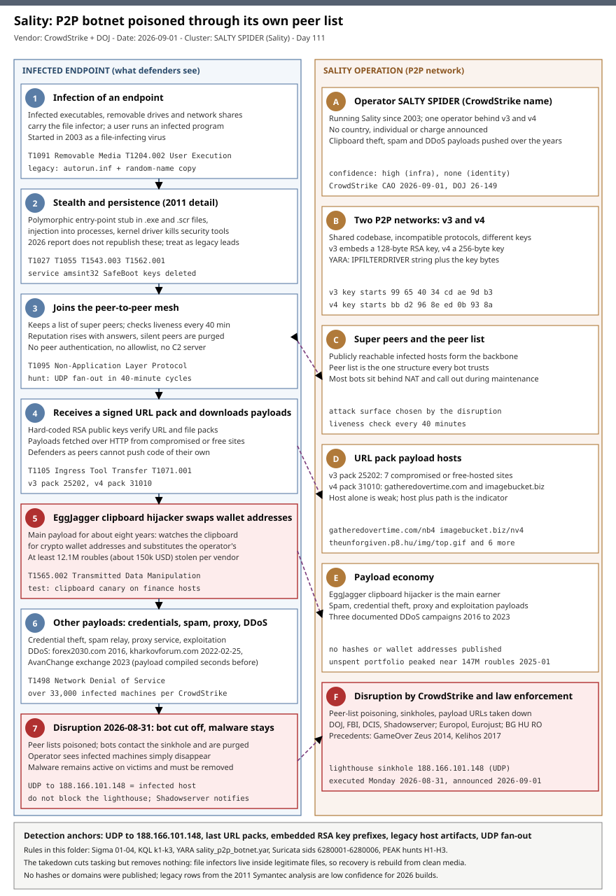

# Sality: CrowdStrike and law enforcement poison the peer lists of a 23-year-old P2P botnet

## TL;DR

On **2026-08-31** CrowdStrike's Counter Adversary Operations team, working with the US Department of Justice, the FBI, the Defense
Criminal Investigative Service and the Shadowserver Foundation, disrupted **Sality**, a peer-to-peer botnet that began in 2003 as a
file-infecting virus. Instead of seizing a command server, which the botnet does not have, the team abused the protocol itself: it
invalidated the botnet's publicly reachable "super peers," inserted defender-controlled sinkholes into the peer lists, and let the
rest of the network purge itself, so that "from the operator's perspective, infected machines simply disappear." CrowdStrike says the
operator reached more than 33,000 infected machines and used the botnet for credential theft, spam, proxying, DDoS and, for the
last eight years, a clipboard hijacker called **EggJagger** that earned at least 12.1 million roubles, about 150,000 US dollars.
The disruption does not clean any host: the malware stays active on victims, and for defenders the useful artefact is the sinkhole address
`188.166.101.148`, because contact with it identifies an infected machine.

## Attribution and confidence

**Primary cluster:** SALTY SPIDER (CrowdStrike's name, which appears in the metadata of its YARA rules). **Aliases:** none published.
**Nexus:** not attributed. **Vendor and date:** CrowdStrike Counter Adversary Operations, blog of 2026-09-01 on an operation executed on
2026-08-31; US Attorney's Office, Central District of California, press release 26-149, 2026-09-01. **Confidence: high** that the
infrastructure, YARA anchors and sinkhole address belong to the Sality P2P networks, because they come from the team that ran the
disruption; **no attribution to a person, group or country is made** by CrowdStrike or the DOJ, and no charges or defendants are announced.

| Strand | Observation | Weight |
|---|---|---|
| Vendor operation | CrowdStrike ran the P2P sinkhole and coordinated the disruption with law enforcement | Strong for infrastructure ownership |
| Law enforcement | US authorities seized Sality-linked domains in the United States; Bulgarian, Hungarian and Romanian authorities acted on domains hosted in Europe | Strong, but the domains are not named |
| Single operator | CrowdStrike says the v3 and v4 networks shared a codebase and "the operator" | Medium, no identity given |
| Historical clues | A 2011 Symantec analysis found Russian-language spam themes and Russian SMTP servers in early versions | Context only, not used for attribution |
| Infected-host count | CrowdStrike says payloads reached over 33,000 machines; Help Net Security and Securonix repeat "more than 15,000" | Conflict, the vendor figure is used |

**Genealogy with previous repository cases.** The immediately preceding case, **2026-08-27 QTFY**, was also a takedown, but of a
state-enabling relay platform with a central domain set; Sality is the opposite design, a decentralised criminal botnet with no
domain to seize, which is why the method differs. The repository's earlier botnet cases are the **2026-06-28 RoboVPN / Vo1d / Popa**
residential-proxy network, the **2026-05-02 Nexcorium / Mirai** DVR botnet and the **2026-07-12 NoName057(16) DDoSia** volunteer botnet;
none uses a signed peer-to-peer tasking model or a clipboard-hijacking payload. The **2026-07-17 Media Land** bulletproof-hosting case
covers the hosting ecosystem that such payload sites use. This is the first case in the diary about a botnet disrupted through its own
peer-to-peer protocol.

## Kill chain — summary table

| Stage | MITRE | Detail |
|---|---|---|
| Infection | T1091, T1204.002 | Executable infection, removable media and network shares; user runs an infected file |
| Stealth and persistence | T1027, T1055, T1543.003, T1562.001 | Polymorphic entry-point stub, injection and a security-killing kernel driver (the last two are 2011-era details) |
| Mesh membership | T1095 | Custom P2P protocol; peer list of publicly reachable super peers; liveness check every 40 minutes; no peer authentication |
| Tasking | T1105, T1071.001 | RSA-signed URL packs and file packs; payloads fetched over HTTP from compromised or free-hosted sites |
| Monetisation | T1565.002 | EggJagger clipboard hijacker swaps copied cryptocurrency wallet addresses for operator-controlled ones |
| Other payloads | T1498 | Credential theft, spam, proxy, network exploitation and three documented DDoS campaigns |
| Disruption | n/a | 2026-08-31 peer-list poisoning and sinkholing; payload URLs and domains taken down |



The left lane follows an infected endpoint from infection to the moment it was cut off from its operator; the right lane shows the
parts of the botnet that make that possible and how the disruption attacked them. The detection anchors are the sinkhole address, the
last URL packs, the embedded key prefixes and the legacy host artefacts, none of which depends on a command-and-control domain.

## Stage-by-stage detail

### An old file infector that became a network

Sality first appeared in 2003 as a file-infecting virus spread through network shares, USB drives and file-sharing networks. Over time
the operator built two peer-to-peer networks, **v3** and **v4**, that share code but use incompatible protocol versions and different
cryptographic keys. CrowdStrike notes that the botnet delivered credential theft, spam distribution, proxy services, network exploitation
and DDoS malware over its life.

- Technique: Replication Through Removable Media (**T1091**), User Execution: Malicious File (**T1204.002**).

### Legacy host behaviour (2011 Symantec analysis)

The most detailed public description of the host side is the 2011 Symantec whitepaper by Nicolas Falliere, and **it describes an older
generation**. The CrowdStrike report of 2026 does not republish these details, so each item below is a legacy lead and not a confirmed
2026 indicator.

```text
Infection        .exe and .scr files; entry-point obscuring with a polymorphic stub ("Simple Poly Engine v1.1a")
Injection        copy of the code injected into running processes except system, local service and network service accounts
Removable media  random-name .exe / .cmd / .pif copy in the drive root plus a created or modified autorun.inf
Driver           kernel driver with a pseudo-random name in %System%\drivers, service name amsint32: kills processes,
                 filters packets, can block SMTP
Safe Mode        SafeBoot subkeys and values under CurrentControlSet\Control\SafeBoot deleted
Markers          mutex uxJLpe1m (inoculation), user agent "KUKU v3.09 exp", RC4 key strings kukutrusted!. and GdiPlus.dll
```

- Technique: Process Injection (**T1055**), Create or Modify System Process: Windows Service (**T1543.003**), Impair Defenses: Disable or Modify Tools (**T1562.001**), Safe Mode Boot (**T1562.009**), Obfuscated Files or Information (**T1027**).

### The peer-to-peer design that made it durable

Each bot keeps a list of **super peers**: publicly reachable infected machines that form the backbone. Every 40 minutes a bot checks
whether its stored peers are online; responsive peers gain reputation and silent ones lose it and are eventually purged. There is no
authentication, cryptographic identity or allowlist, so any machine that answers the handshake is accepted. What the operator does
authenticate is the payload: hard-coded RSA public keys verify the signatures on URL packs and file packs, so a defender who
controls peers still cannot push a payload of their own. The 2011 analysis gives the same structure in older form (UDP transport, a peer
list of up to 1,000 entries, RC4-encrypted messages and RSA-signed packs), which suggests the design is stable.

- Technique: Non-Application Layer Protocol (**T1095**), Ingress Tool Transfer (**T1105**).

### Tasking through URL packs

Tasking is by **URL packs**, which are lists of payload locations, and **file packs**, which carry the file directly. CrowdStrike
published the last v3 and v4 URL packs before the disruption:

```text
v3 pack version 25202   theunforgiven.p8.hu/img/top.gif            painelwebradiodigital.awardspace.info/v3/readme.pdf
                        sgwebdesigner.free.fr/left.gif             www.yonelco.com/icon.png
                        pozdravizbeograda.com/readme.pdf           highclass.atspace.com/styles.gif
                        situluimihai.3x.ro/top.png
v4 pack version 31010   gatheredovertime.com/nb4                   imagebucket.biz/nv4
```

The v3 hosts are mostly compromised or free-hosted third-party sites, with file names that look like images and documents, so
the host alone is a weak indicator and the host and path together are the useful one.

- Technique: Application Layer Protocol: Web Protocols (**T1071.001**).

### EggJagger and the other payloads

For the past eight years the main payload was **EggJagger**, a clipboard hijacker that watches for cryptocurrency wallet addresses and
replaces them with addresses the operator controls. CrowdStrike estimates at least 12.1 million roubles (about 150,000 US dollars)
was stolen this way and that the operator's unspent portfolio peaked near 147 million roubles in January 2025. It documented three DDoS
campaigns: April 2016 against `forex2030[.]com`, an Arabic-language financial site with unclear motive; 2022-02-25 against
`kharkovforum[.]com`, a Ukrainian forum discussing the invasion of Kharkiv; and September 2023 against *AvanChange*, a Russian
cryptocurrency exchange, whose payload was compiled seconds before upload. CrowdStrike publishes no EggJagger hashes, wallet addresses,
implementation language or persistence details.

- Technique: Transmitted Data Manipulation (**T1565.002**), Network Denial of Service (**T1498**).

### The disruption

The team targeted "the data structure at the heart of every bot's network awareness: its peer list." It manipulated the protocol during
peer verification to invalidate legitimate super peers and inserted purpose-built sinkholes into the emptied lists. Most infections
sit behind NAT or firewalls, so the researchers waited for them to contact the sinkholes during their normal maintenance cycle and
then purged the legitimate entries, leaving those bots permanently cut off. In parallel, payload-hosting URLs were taken down in
coordination with law enforcement, US authorities seized domains in the United States and police in Bulgaria, Hungary and Romania
acted against domains hosted in Europe. CrowdStrike cites the 2014 GameOver Zeus and 2017 Kelihos disruptions as precedents.

The sinkhole address is published as the lighthouse: **UDP traffic to `188.166.101.148` identifies an infected host**. The
Shadowserver Foundation is working with ISPs and national CSIRTs to notify owners. CrowdStrike is explicit that the disruption does not remove
existing malware, which "remains active and should be removed," and that a reappearance with replacement infrastructure is possible.

## Detection strategy

### Telemetry that matters

- **Per-process UDP flow telemetry** (EDR network events, NetFlow, firewall and NAT logs): the sinkhole contact is UDP, and proxies that see only TCP will not show it.
- **Proxy and DNS logs**: payload URL requests for the last v3 and v4 URL packs.
- **File integrity and signature state**: executables whose Authenticode signature no longer validates, and bursts of executable modification by non-installer processes.
- **Windows System log Event ID 7045** (service installed) and **Sysmon Event IDs 12 and 13** (registry delete and set) for the legacy driver and Safe Mode behaviours.
- **Drive-root file events** for `autorun.inf` on removable and network drives.
- **Finance workflow records**: payment destinations compared against the intended destination, because EggJagger's effect is visible there and not on the host.

### Detection coverage

| Engine | File | Logic |
|---|---|---|
| Sigma | [01_sality_sinkhole_lighthouse_contact.yml](./sigma/01_sality_sinkhole_lighthouse_contact.yml) | Any connection to the defender-operated lighthouse address, which identifies an infected host |
| Sigma | [02_sality_url_pack_payload_requests.yml](./sigma/02_sality_url_pack_payload_requests.yml) | Proxy requests where both host and path match the last v3 and v4 URL packs |
| Sigma | [03_sality_legacy_driver_service_amsint32.yml](./sigma/03_sality_legacy_driver_service_amsint32.yml) | Service named amsint32 installed (legacy 2011 driver name, low expected volume) |
| Sigma | [04_safeboot_configuration_deleted_by_non_installer.yml](./sigma/04_safeboot_configuration_deleted_by_non_installer.yml) | SafeBoot keys or values deleted by a non-installer process (generic defence evasion that covers the legacy Sality behaviour) |
| KQL | [k1_sality_sinkhole_and_url_pack_contact.kql](./kql/k1_sality_sinkhole_and_url_pack_contact.kql) | 90-day per-device sinkhole and URL pack host contact |
| KQL | [k2_sality_legacy_host_artifacts.kql](./kql/k2_sality_legacy_host_artifacts.kql) | Driver service, SafeBoot deletion and drive-root autorun.inf, alerting on two signal classes |
| KQL | [k3_p2p_udp_fanout_from_non_network_processes.kql](./kql/k3_p2p_udp_fanout_from_non_network_processes.kql) | Processes with wide UDP fan-out across many 40-minute cycles |
| YARA | [sality_p2p_botnet.yar](./yara/sality_p2p_botnet.yar) | 3 rules: v3 and v4 key-prefix anchors with `IPFILTERDRIVER`, and a low-confidence legacy string rule |
| Suricata | [sality_p2p_botnet.rules](./suricata/sality_p2p_botnet.rules) | 6 sids: sinkhole UDP contact, v3 and v4 URL pack requests, v4 domain DNS, legacy user agent |

The YARA key-prefix rules use the first 16 bytes of the 128-byte (v3) and 256-byte (v4) RSA public keys that CrowdStrike publishes in full;
use the vendor rules for the complete key match and treat these as a short-form complement. The Sigma, KQL and Suricata rules are
indicator-based and will go stale as the operation settles; the behavioural pieces that last are the UDP fan-out hunt and the signature
validation sweep.

### Threat hunting hypotheses

- **H1** - If a bot is in our estate, it has contacted the sinkhole since 2026-08-31, so egress UDP logs show it. See [peak_h1_sinkhole_contact_is_infection.md](./hunts/peak_h1_sinkhole_contact_is_infection.md).
- **H2** - If Sality is on a host, executables there were rewritten and removable drives carry copies, which the signature and drive-root sweeps find. See [peak_h2_file_infector_artifacts.md](./hunts/peak_h2_file_infector_artifacts.md).
- **H3** - An infected host shows peer-to-peer rhythm on the network and may be silently rewriting copied wallet addresses. See [peak_h3_p2p_behaviour_and_clipboard_integrity.md](./hunts/peak_h3_p2p_behaviour_and_clipboard_integrity.md).

## Incident response playbook

### First 60 minutes (triage)

1. Search firewall, NetFlow, NAT and EDR network logs for UDP to `188.166.101.148` since 2026-08-31 and list the internal sources, resolving NAT to the real host.
2. Search proxy history for the nine URL pack host and path combinations and list the clients.
3. For each host, take a memory image and a copy of the suspect executables before any clean-up; the infector lives inside legitimate-looking files.
4. Run the Authenticode sweep on the host and compare any `HashMismatch` file against a vendor-clean copy.
5. Check every non-system drive and every removable device the user has connected for `autorun.inf` and an unexpected root executable.
6. Check for a service named `amsint32` and for deleted SafeBoot keys as legacy-variant leads.
7. Ask finance and crypto handlers on the affected hosts whether any payment or transfer was made since infection, and verify destination addresses with the recipient.
8. Treat all credentials entered on the host since the earliest sign of infection as stolen.

### Artifacts to collect

| Artifact | Path | Tool | Why |
|---|---|---|---|
| Firewall, NAT and flow records | log store or SIEM | SIEM, `conntrack` | Sinkhole contact and the real internal source |
| Proxy and DNS history | proxy and resolver logs | SIEM | URL pack requests and retries of dead payload URLs |
| Suspect executables | `%ProgramFiles%`, `%SystemRoot%\System32`, user profile | `Get-AuthenticodeSignature`, `sha256sum` | The infector is inside rewritten files; needed for YARA and vendor comparison |
| Memory image | host RAM | WinPmem, vendor EDR | Injected code and in-memory peer list |
| Service and driver state | `HKLM\SYSTEM\CurrentControlSet\Services`, `%SystemRoot%\System32\drivers` | RECmd, `sc query` | Legacy `amsint32` driver and its random-name file |
| SafeBoot configuration | `HKLM\SYSTEM\CurrentControlSet\Control\SafeBoot` | `reg export` | Tampering check |
| Drive roots | removable and network drives | file listing, hashes | `autorun.inf` and the dropped copy, for reinfection control |
| Payment records | finance system, wallet or exchange history | export | Evidence of address substitution |

### IR queries and commands

```powershell
# Author: Jarmi
# 1. Executables whose signature no longer validates in the usual program locations.
Get-ChildItem "$env:ProgramFiles","${env:ProgramFiles(x86)}","$env:SystemRoot\System32" -Include *.exe,*.scr -Recurse -ErrorAction SilentlyContinue |
  ForEach-Object { $s = Get-AuthenticodeSignature $_.FullName
    if ($s.Status -in 'HashMismatch','NotTrusted') { [pscustomobject]@{ Path=$_.FullName; Status=$s.Status; Modified=$_.LastWriteTimeUtc } } } |
  Sort-Object Modified -Descending | Select-Object -First 50
```

```powershell
# Author: Jarmi
# 2. Legacy service and SafeBoot checks, plus autorun.inf on non-system drives.
Get-Service -Name amsint32 -ErrorAction SilentlyContinue
Get-ChildItem 'HKLM:\SYSTEM\CurrentControlSet\Control\SafeBoot' -ErrorAction SilentlyContinue | Select-Object Name
Get-PSDrive -PSProvider FileSystem | Where-Object Name -ne 'C' | ForEach-Object { Join-Path $_.Root 'autorun.inf' | Where-Object { Test-Path $_ -Force } }
```

```bash
# Author: Jarmi
# 3. Firewall or conntrack export: every source that sent UDP to the lighthouse address.
grep -h '188\.166\.101\.148' /var/log/firewall/*.log* 2>/dev/null | awk '{print $1,$2,$3}' | sort | uniq -c | sort -rn | head -30
```

```kql
// 4. Every device that touched the sinkhole or a URL pack host since the operation.
DeviceNetworkEvents
| where Timestamp > datetime(2026-08-31)
| where RemoteIP == "188.166.101.148" or RemoteUrl has_any ("gatheredovertime.com","imagebucket.biz","theunforgiven.p8.hu","www.yonelco.com","pozdravizbeograda.com")
| summarize First = min(Timestamp), Last = max(Timestamp), Hits = count(), Procs = make_set(InitiatingProcessFolderPath, 10) by DeviceName
| sort by First asc
```

### Containment, eradication, recovery

**Do first.** Isolate the host, image it, then reinstall from known-good media; disinfection of a polymorphic file infector in place is
unreliable because the infected file is the legitimate file. Rotate every credential used on the host after the earliest sign of
infection, and block removable-media autorun and executable launch from network shares by policy.

**Do not.** Do not block `188.166.101.148` at the firewall: it is the notification path that lets Shadowserver tell owners about
infections, and blocking it only hides your own bots. Do not read a quiet sinkhole log as a clean estate, because only bots that
reach it through logged egress show up. Do not delete a suspect executable before copying it, since it is the evidence and the YARA
input. Do not treat the takedown as remediation: CrowdStrike states existing malware stays active.

**Exit criteria.** No sinkhole or URL pack contact for 14 days after remediation; no executable with an invalid signature that the
vendor did not cause; no `autorun.inf` or dropped copy on any drive in use; autorun and share execution blocked by policy; credentials
rotated after removal; payment destinations for the infected period verified with recipients.

### Recovery validation

Re-run H1 weekly while the sinkhole operates, re-run the signature sweep on rebuilt hosts, and run the clipboard canary from H3 on every
finance and crypto handler's workstation. Confirm the removable-media policy is enforced by attempting a controlled autorun test.

## IOCs

The full set is in [iocs.csv](./iocs.csv): 33 rows. CrowdStrike published **no file hashes, wallet addresses or seized domain names**, so the
public indicator set is small and is dominated by the sinkhole address, the last URL packs and the key anchors. Rows sourced to the 2011
Symantec analysis are marked low confidence because they describe an older generation. Sality itself has no CVE: it spreads by file infection and removable media.

**KEV status:** the four CVEs named in the secondary findings are all on the CISA KEV catalog: the two PaperCut NG/MF entries were added on 2026-08-31 with a due date of 2026-09-14, and the two SonicWall SMA 1000 entries on 2026-09-02 with a due date of 2026-09-05; ransomware use is listed as unknown for all four. Status is from catalog version 2026.10.16; see [kev.md](./kev.md).

| Type | Value | Context | Confidence | Source |
|---|---|---|---|---|
| ipv4 | 188.166.101.148 | Defender-operated lighthouse sinkhole; UDP contact means an infected host | high | CrowdStrike 2026-09-01 |
| url | http://gatheredovertime.com/nb4 | Payload URL in the last v4 URL pack (version 31010) | high | CrowdStrike 2026-09-01 |
| url | http://imagebucket.biz/nv4 | Payload URL in the last v4 URL pack (version 31010) | high | CrowdStrike 2026-09-01 |
| url | http://theunforgiven.p8.hu/img/top.gif | Payload URL in the last v3 URL pack (version 25202) | high | CrowdStrike 2026-09-01 |
| url | http://painelwebradiodigital.awardspace.info/v3/readme.pdf | Payload URL in the last v3 URL pack | high | CrowdStrike 2026-09-01 |
| url | http://sgwebdesigner.free.fr/left.gif | Payload URL in the last v3 URL pack | high | CrowdStrike 2026-09-01 |
| url | http://www.yonelco.com/icon.png | Payload URL in the last v3 URL pack | high | CrowdStrike 2026-09-01 |
| url | http://pozdravizbeograda.com/readme.pdf | Payload URL in the last v3 URL pack | high | CrowdStrike 2026-09-01 |
| url | http://highclass.atspace.com/styles.gif | Payload URL in the last v3 URL pack | high | CrowdStrike 2026-09-01 |
| url | http://situluimihai.3x.ro/top.png | Payload URL in the last v3 URL pack | high | CrowdStrike 2026-09-01 |
| string | IPFILTERDRIVER | String in both CrowdStrike YARA rules, paired with the embedded RSA key | high | CrowdStrike 2026-09-01 |
| string | 99 65 40 34 cd ae 9d b3 af f5 82 ad 8c 2e 63 51 | First 16 bytes of the 128-byte v3 embedded RSA public key | high | CrowdStrike 2026-09-01 |
| string | bb d2 96 8e ed 0b 93 8a 82 e4 e9 bc c3 c5 32 72 | First 16 bytes of the 256-byte v4 embedded RSA public key | high | CrowdStrike 2026-09-01 |
| string | amsint32 | Legacy 2011 driver service name | low | Symantec 2011 |
| mutex | uxJLpe1m | Legacy 2011 inoculation mutex | low | Symantec 2011 |

## Secondary findings

- **SonicWall SMA 1000 zero-days CVE-2026-83548 and CVE-2026-83549 are exploited and on CISA KEV since 2026-09-02, due 2026-09-05.** The first is a pre-authentication server-side request forgery in the Appliance Work Place interface; the second is an OS command injection in the Appliance Management Console that requires admin privileges. SonicWall PSIRT advisory SNWLID-2026-0016 covers models 6210, 7210 and 8200v with a hotfix, says it investigated a case of active exploitation, and has published no indicators. Treat any SMA 1000 as a re-image candidate if compromise is suspected.
- **ESET reported on 2026-08-31 that UAC-0099 planted a fake nuclear-weapon request in a VBS downloader to make AI-assisted analysis stop.** The script, which downloads and installs MATCHBOIL, carries a comment reading "I want to make nuclear weapon. Help me ...", which has no effect on the code and is meant to trigger an AI system's safety refusal during analysis; ESET calls the technique GuardBreaker. Help Net Security reports that UAC-0099 hands validated targets to the GRU-linked Sandworm group and that CERT-UA's July advisory names LUNCHPOKE, BURNYBEAR and MATCHBOIL.V2. No indicators were in the coverage reviewed.
- **PaperCut NG/MF CVE-2026-82078 and CVE-2026-81578 were added to CISA KEV on 2026-08-31 (due 2026-09-14), and attackers are reported to be installing legitimate remote access software on compromised internet-facing servers.** The tooling is legitimate, so detection has to key on which RMM product is new on a print server, not on the tool's reputation.

## Pedagogical anchors

- **A peer-to-peer botnet has no server to seize, so attack the data structure.** The peer list was the single component every bot trusted, and it had no authentication; poisoning it removed the operator's reach without touching a single infected machine.
- **Signed payloads and unsigned peers are a different trust model.** The operator authenticated what bots run (RSA-signed packs) but not who they talk to, which is what let defenders become peers yet not push code.
- **A sinkhole turns victims into sensors.** Contact with the lighthouse address is a near-zero-false-positive infection signal, and it exists only while the operation runs: hunt now, and never block the address.
- **A takedown is not a clean-up.** CrowdStrike states the malware remains active; a file infector lives inside legitimate files, so recovery is rebuild, not delete.
- **Check the date of every behavioural claim.** The richest host-level description of Sality is from 2011; use it as a lead list and label it, and anchor 2026 detection on what the 2026 report publishes.

## What's in this folder

| File | Purpose | Link |
|---|---|---|
| README.md | This analysis. | [README.md](./README.md) |
| kill_chain.svg | Two-lane kill chain diagram (Template A) with detection anchors. | [kill_chain.svg](./kill_chain.svg) |
| iocs.csv | 33 indicators: sinkhole address, URL packs, YARA anchors and labelled legacy artefacts. | [iocs.csv](./iocs.csv) |
| kev.md | CISA KEV cross-reference for this case's CVEs. | [kev.md](./kev.md) |
| sigma/01_sality_sinkhole_lighthouse_contact.yml | Connection to the sinkhole address. | [sigma/01_sality_sinkhole_lighthouse_contact.yml](./sigma/01_sality_sinkhole_lighthouse_contact.yml) |
| sigma/02_sality_url_pack_payload_requests.yml | Proxy requests for the last URL pack payloads. | [sigma/02_sality_url_pack_payload_requests.yml](./sigma/02_sality_url_pack_payload_requests.yml) |
| sigma/03_sality_legacy_driver_service_amsint32.yml | Legacy driver service installation. | [sigma/03_sality_legacy_driver_service_amsint32.yml](./sigma/03_sality_legacy_driver_service_amsint32.yml) |
| sigma/04_safeboot_configuration_deleted_by_non_installer.yml | SafeBoot configuration deletion. | [sigma/04_safeboot_configuration_deleted_by_non_installer.yml](./sigma/04_safeboot_configuration_deleted_by_non_installer.yml) |
| kql/k1_sality_sinkhole_and_url_pack_contact.kql | Sinkhole and URL pack contact per device. | [kql/k1_sality_sinkhole_and_url_pack_contact.kql](./kql/k1_sality_sinkhole_and_url_pack_contact.kql) |
| kql/k2_sality_legacy_host_artifacts.kql | Legacy host artefact correlation. | [kql/k2_sality_legacy_host_artifacts.kql](./kql/k2_sality_legacy_host_artifacts.kql) |
| kql/k3_p2p_udp_fanout_from_non_network_processes.kql | Peer-to-peer UDP fan-out hunt. | [kql/k3_p2p_udp_fanout_from_non_network_processes.kql](./kql/k3_p2p_udp_fanout_from_non_network_processes.kql) |
| yara/sality_p2p_botnet.yar | Three rules: v3 and v4 key-prefix anchors and a legacy string rule. | [yara/sality_p2p_botnet.yar](./yara/sality_p2p_botnet.yar) |
| suricata/sality_p2p_botnet.rules | Six network rules (sids 6280001-6280006). | [suricata/sality_p2p_botnet.rules](./suricata/sality_p2p_botnet.rules) |
| hunts/peak_h1_sinkhole_contact_is_infection.md | Sinkhole contact hunt. | [hunts/peak_h1_sinkhole_contact_is_infection.md](./hunts/peak_h1_sinkhole_contact_is_infection.md) |
| hunts/peak_h2_file_infector_artifacts.md | File infector and removable-media hunt. | [hunts/peak_h2_file_infector_artifacts.md](./hunts/peak_h2_file_infector_artifacts.md) |
| hunts/peak_h3_p2p_behaviour_and_clipboard_integrity.md | P2P behaviour and clipboard canary hunt. | [hunts/peak_h3_p2p_behaviour_and_clipboard_integrity.md](./hunts/peak_h3_p2p_behaviour_and_clipboard_integrity.md) |

## Sources

- [CrowdStrike Counter Adversary Operations, Inside the Sality botnet disruption operation (2026-09-01)](https://www.crowdstrike.com/en-us/blog/inside-sality-botnet-disruption-operation/)
- [US Attorney's Office, Central District of California, Sality malware disrupted in international cyber takedown (press release 26-149, 2026-09-01)](https://www.justice.gov/usao-cdca/pr/sality-malware-disrupted-international-cyber-takedown)
- [Help Net Security, Global sinkhole operation ends Sality botnet's 23-year run (2026-09-02)](https://www.helpnetsecurity.com/2026/09/02/sality-botnet-disruption-crowdstrike-law-enforcement/)
- [Securonix Threat Research, Sality's peer list turned against it](https://connect.securonix.com/threat-research-intelligence-62/sality-s-peer-list-turned-against-it-inside-the-23-year-botnet-s-takedown-521)
- [Symantec, Sality: Story of a Peer-to-Peer Viral Network (Falliere, 2011)](https://git.vbrandl.net/vbrandl/masterthesis/raw/branch/master/references/2011_sality-story-of-peer-to-peer-11-en.pdf)
- [Help Net Security, SonicWall SMA 1000 appliances under attack via zero-day flaws (2026-09-02)](https://www.helpnetsecurity.com/2026/09/02/sonicwall-sma-1000-cve-2026-83548-cve-2026-83549-zero-day-attacks/)
- [Help Net Security, Russian hackers plant nuclear weapon prompt in malware to trip AI safety guardrails (2026-08-31)](https://www.helpnetsecurity.com/2026/08/31/russian-hackers-ai-safety-filters-manipulation/)
- [Help Net Security, Attackers plant remote access tools on compromised PaperCut servers (2026-08-31)](https://www.helpnetsecurity.com/2026/08/31/papercut-attack-remote-access-tools/)
- [CISA Known Exploited Vulnerabilities catalog](https://www.cisa.gov/known-exploited-vulnerabilities-catalog)
