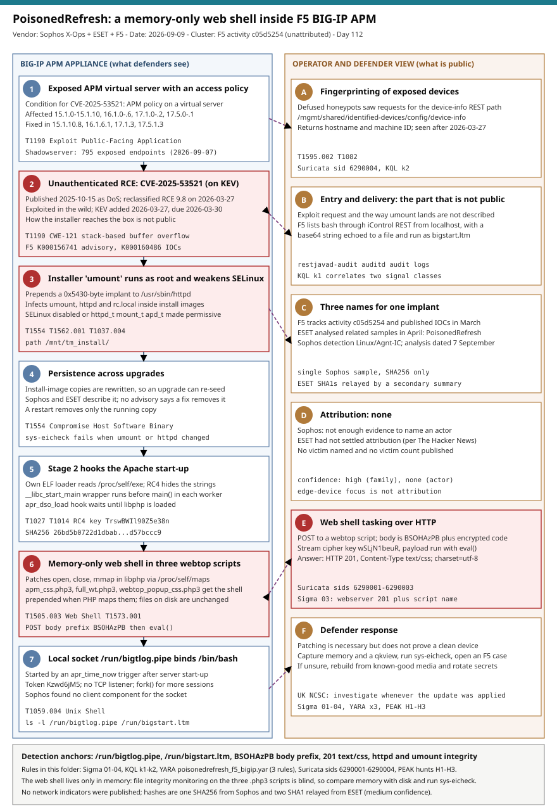

# PoisonedRefresh: a memory-only web shell hidden inside F5 BIG-IP APM

## TL;DR

On **2026-09-07** Sophos X-Ops published the analysis of a Linux implant that sits inside the Apache web server of F5 **BIG-IP Access Policy Manager (APM)**
appliances, which Sophos detects as **Linux/Agnt-IC**, ESET calls **PoisonedRefresh** and F5 tracks as activity **c05d5254**. It is the post-exploitation stage
that follows the unauthenticated remote code execution **CVE-2025-53521**, which F5 reclassified from denial of service to RCE on 2026-03-27 and CISA put on
the KEV catalog the same day. The implant never writes its web shell to disk: it patches the PHP module in memory so that three stock webtop scripts carry the shell
while the files on disk stay unchanged, answers the operator with an HTTP 201 that pretends to be a stylesheet, and rewrites `httpd`, `umount` and `rc.local` inside the
BIG-IP install images so that an upgrade can bring it back. Nobody is named: Sophos says it has no evidence to attribute the sample, no victim is public, and the
way the installer reaches the appliance is not described. The lesson for defenders is that file integrity monitoring on the web root is blind to this design.

## Attribution and confidence

**Primary cluster:** none. **Names for the implant:** Sophos **Linux/Agnt-IC**, ESET **PoisonedRefresh**, F5 **c05d5254** (F5 first published its indicators in March 2026,
article K000160486). **Vendor and date:** Sophos X-Ops (analysis dated 2026-09-07 by The Hacker News; the blog page itself carries no date), ESET Research (related samples analysed in April,
per The Hacker News), F5 advisories K000156741 and K000160486. **Confidence: high** that the three names describe the same implant family, because Sophos itself
cites the F5 identifier and the artefacts overlap (`/run/bigtlog.pipe` appears in both the Sophos and the F5 material); **no confidence in any actor**, because none is named.

| Strand | Observation | Weight |
|---|---|---|
| Sophos statement | "We do not have sufficient evidence to attribute this malware to a specific threat actor" | Strong: the analyst of the sample declines |
| ESET | Analysed related samples in April and named the family; had not settled attribution (per The Hacker News) | Medium: relayed, not read in the original |
| F5 | Tracks the activity as c05d5254 and ties the compromise indicators to CVE-2025-53521 | Strong for the vulnerability link |
| Target profile | Internet-facing BIG-IP APM appliances | Weak: edge appliances are targeted by many operators |
| Victimology | No victim organisation, sector or country is public | None |

**Genealogy with previous repository cases.** This is the first case in the diary about F5 BIG-IP. It belongs to the same edge-appliance family as the **2026-05-16 Cisco SD-WAN
vHub authentication bypass (UAT-8616)** and the **2026-07-09 CitrixBleed Infinity NetScaler** case, and it is the Linux-appliance counterpart of the **2026-06-12 LinkPro eBPF rootkit**: all of them
hide in places that endpoint agents do not cover. The **2026-08-27 QTFY** case describes an enabling platform that scans edge devices; no link between QTFY and this implant is claimed.
Two secondary findings below (Cisco FMC and PaperCut) continue the edge and appliance thread of the same week.

## Kill chain — summary table

| Stage | MITRE | Detail |
|---|---|---|
| Exposure | T1190 | BIG-IP APM virtual server with an access policy; Shadowserver counted 795 exposed vulnerable endpoints on 2026-09-07 |
| Initial access | T1190 | CVE-2025-53521, unauthenticated RCE; delivery of the installer is not public |
| Installer | T1554, T1562.001 | A sample named `umount` runs as root, weakens SELinux and prepends a 0x5430-byte implant to `/usr/sbin/httpd` |
| Persistence | T1554, T1037.004 | Install-image copies of `umount`, `httpd` and `rc.local` are rewritten so an upgrade can re-seed the implant |
| Stage 2 | T1027, T1014 | Own ELF loader, RC4-obscured strings, `__libc_start_main` wrapper, `apr_dso_load` hook waiting for `libphp` |
| Web shell | T1505.003, T1573.001 | Memory-only PHP shell prepended to three webtop scripts; encrypted POST body, answer HTTP 201 `text/css` |
| Local access | T1059.004 | UNIX socket `/run/bigtlog.pipe`, token-protected, binds `/bin/bash`; no TCP listener |



The left lane follows the appliance from the exposed virtual server to the local shell; the right lane lists what is publicly known about the operator side and what is not, and ends with the defender
response. The detection anchors are the two files under `/run`, the `BSOHAzPB` request prefix, the 201 answer with a stylesheet content type, and the integrity of `httpd` and `umount`.

## Stage-by-stage detail

### Exposure and initial access: CVE-2025-53521

CVE-2025-53521 affects BIG-IP APM when an access policy is configured on a virtual server. It was published on 2025-10-15 as a denial of service (CVSS 7.5 at that point, per Dark Reading) and was
reclassified on 2026-03-27 as an unauthenticated remote code execution with CVSS 3.1 9.8 after F5 obtained "new information" and confirmed exploitation. CISA added it to KEV on 2026-03-27 with a federal due date of 2026-03-30.
Affected releases are 15.1.0 to 15.1.10, 16.1.0 to 16.1.6, 17.1.0 to 17.1.2 and 17.5.0 to 17.5.1, fixed in 15.1.10.8, 16.1.6.1, 17.1.3 and 17.5.1.3; Dark Reading adds that appliance mode remains vulnerable.
Defused reported that its honeypots saw the actor request `/mgmt/shared/identified-devices/config/device-info`, a REST path that returns hostname and machine ID, after the reclassification.

**MITRE:** T1190 Exploit Public-Facing Application, T1595.002 Vulnerability Scanning. How the exploit reaches the appliance and how the installer is delivered is **not described** in the public material.

### Installer: `umount` runs as root and prepares `httpd`

The first stage is a sample named `umount` that runs as root against the install image path `/mnt/tm_install/`. It prepends the implant to `/usr/sbin/httpd` (a prefix of `0x5430` bytes, which Sophos says matches the
payload embedded in the `umount` sample) and weakens SELinux. The published summaries differ on the mechanism: ESET, as relayed by The Hacker News, says SELinux is turned off, BleepingComputer says SELinux
configuration was modified, and a summary of F5's article lists the domains `httpd_t`, `mount_t` and `apd_t` as made permissive. The detection therefore covers both `setenforce 0` and `semanage permissive`.

```bash
# Author: Jarmi
# What F5 and Sophos tell you to compare, on a suspect appliance (read-only).
ls -l /usr/sbin/httpd /usr/bin/umount
sha256sum /usr/sbin/httpd /usr/bin/umount    # compare with a clean copy of the same release or hotfix
getenforce; semanage permissive -l | grep -E 'httpd_t|mount_t|apd_t'
```

**MITRE:** T1554 Compromise Host Software Binary, T1562.001 Impair Defenses: Disable or Modify Tools.

### Persistence: the install images

The installer also infects `umount`, `httpd` and `rc.local` inside the BIG-IP install images so that an upgrade can restore the implant. Sophos and ESET describe this design; no F5 advisory states whether upgrading
to a fixed release removes an existing implant, and UK NCSC advises investigating "regardless of when the system was updated". A restart removes only the running copy.

**MITRE:** T1037.004 RC Scripts, T1554 Compromise Host Software Binary.

### Stage 2: hooks at Apache start-up

The second stage is a standalone ELF with its own loader that reads its own image through `/proc/self/exe`. Operational strings are RC4-encrypted with the key `TrswBWIl90Z5e38n` and decrypted only when needed. A wrapper
around `__libc_start_main` runs the implant before `main()` in each Apache worker, and a hook on `apr_dso_load` waits until `libphp` is loaded.

**MITRE:** T1027 Obfuscated Files or Information, T1014 Rootkit.

### The memory-only web shell

Once `libphp` is loaded, the implant reads `/proc/self/maps`, makes the module's pages writable for a moment, redirects the file `open`, `close`, `mmap` and `__fxstat` call targets and restores permissions. When PHP maps one of
`apm_css.php3`, `full_wt.php3` or `webtop_popup_css.php3`, the implant returns the original script with the web shell prepended; the file on disk is unchanged. The shell reads the raw request body from `php://input`, looks for the
prefix `BSOHAzPB`, decrypts the rest with a small stream cipher keyed `wSLjN1beuR` (Sophos does not name the cipher) and runs it with `eval()`. It answers with **HTTP 201** and `Content-Type: text/css; charset=utf-8`.

```text
POST /<webtop path>/apm_css.php3 HTTP/1.1          <- one of three script names
<body> BSOHAzPB<encrypted PHP>                      <- prefix, then stream-cipher payload
HTTP/1.1 201 ...  Content-Type: text/css; charset=utf-8
```

**MITRE:** T1505.003 Web Shell, T1573.001 Symmetric Cryptography, T1001 Data Obfuscation, T1071.001 Web Protocols.

### The local socket

An `apr_time_now` trigger lets a worker thread start after the server is fully up. It creates the UNIX socket `/run/bigtlog.pipe`, expects the token `Kzwd6jM5`, binds the shell's input, output and error to the socket and starts `/bin/bash`;
`fork()` provides more sessions. There is no TCP listener, so an operator needs another foothold to reach it, and **Sophos did not find the component that talks to the socket** and cannot say whether the web shell does.

**MITRE:** T1059.004 Unix Shell.

## RE notes

| Component | SHA256 | Lang | Packer | Notes |
|---|---|---|---|---|
| Second-stage implant (Sophos Linux/Agnt-IC) | `26bd5b0722d1dbab5db749a063c49bc8638653ac2addfead7a9cb3d6d57bccc9` | ELF, native code (language not stated) | None reported; strings RC4-encrypted | Custom loader via `/proc/self/exe`; hooks `__libc_start_main`, `apr_dso_load`, `apr_time_now`; patches `open`, `close`, `mmap`, `__fxstat` in `libphp`; socket code uses `socketcall` |
| Installer `umount` | not published | ELF | not stated | Prepends 0x5430 bytes to `/usr/sbin/httpd`, infects install images |
| Infected `httpd` | not published | ELF | not stated | Compare with a clean copy of the same release; F5 notes sizes and hashes differ between releases and hotfixes |

Sophos published no YARA rules and no byte sequences. The three YARA rules in this folder are built only from the published key material and paths: the RC4 key rule is medium confidence for files, and the other two are for memory images,
where the decrypted strings and the patched-in shell constants exist.

## Detection strategy

### Telemetry that matters

- **Appliance audit trail:** `/var/log/restjavad-audit`, `/var/log/auditd` and `/var/log/audit`, forwarded off the box; `getenforce` and `semanage permissive -l` as point checks.
- **Appliance request log or reverse proxy or WAF in front of the APM virtual server:** method, URI, response status and response content type for the three webtop scripts.
- **Process and file telemetry** (auditd execve and file events): `httpd` spawning a shell; files under `/run`.
- **F5 tooling:** `sys-eicheck`, `qkview`, and memory capture arranged with F5 support.
- **Exposure data:** Shadowserver reports and your own inventory of APM versions.

### Detection coverage

| Engine | File | Logic |
|---|---|---|
| Sigma | [sigma/01_httpd_worker_spawning_shell_on_bigip.yml](./sigma/01_httpd_worker_spawning_shell_on_bigip.yml) | Apache `httpd` parent starting `bash` or `sh` |
| Sigma | [sigma/02_bigip_compromise_files_under_run.yml](./sigma/02_bigip_compromise_files_under_run.yml) | Creation of `/run/bigtlog.pipe` or `/run/bigstart.ltm` |
| Sigma | [sigma/03_http_201_css_from_webtop_php_script.yml](./sigma/03_http_201_css_from_webtop_php_script.yml) | Webserver log: HTTP 201 from one of the three webtop scripts |
| Sigma | [sigma/04_selinux_set_permissive_or_disabled_by_command.yml](./sigma/04_selinux_set_permissive_or_disabled_by_command.yml) | `setenforce 0` or `semanage permissive` for `httpd_t`, `mount_t`, `apd_t` |
| KQL | [kql/k1_bigip_audit_log_bash_and_selinux_changes.kql](./kql/k1_bigip_audit_log_bash_and_selinux_changes.kql) | Forwarded syslog: two signal classes per appliance, or any `bigstart.ltm` or `bigtlog.pipe` reference |
| KQL | [kql/k2_apm_webtop_script_requests_and_recon.kql](./kql/k2_apm_webtop_script_requests_and_recon.kql) | CEF logs: POST to webtop scripts and device-info reconnaissance, by source |
| YARA | [yara/poisonedrefresh_f5_bigip.yar](./yara/poisonedrefresh_f5_bigip.yar) | RC4 key in an ELF; shell constants and socket or token strings in memory |
| Suricata | [suricata/poisonedrefresh_f5_bigip.rules](./suricata/poisonedrefresh_f5_bigip.rules) | POST to webtop scripts, `BSOHAzPB` body prefix, 201 `text/css`, device-info request (sids 6290001-6290004) |

The Suricata rules need decrypted HTTP; on encrypted-only taps use the appliance request log and Sigma 03.

### Threat hunting hypotheses

- **H1** - If an appliance is compromised, the PHP the workers execute differs from the disk and the audit and file checks show the implant's artefacts. See [peak_h1_memory_versus_disk_on_apm_workers.md](./hunts/peak_h1_memory_versus_disk_on_apm_workers.md).
- **H2** - If the shell is in use, POSTs to webtop scripts and 201 answers with a stylesheet type appear in the web layer. See [peak_h2_web_layer_apm_webtop_scripts.md](./hunts/peak_h2_web_layer_apm_webtop_scripts.md).
- **H3** - If the installer ran, the control-plane audit trail shows bash through iControl REST, the run-file execution and SELinux changes. See [peak_h3_control_plane_audit_trail.md](./hunts/peak_h3_control_plane_audit_trail.md).

## Incident response playbook

### First 60 minutes (triage)

1. Build the list of BIG-IP APM appliances and the highest release each ran since 2026-03-27 or earlier; any that was below a fixed release at any time is in scope, whatever it runs now.
2. Check each in-scope appliance for `/run/bigtlog.pipe` and `/run/bigstart.ltm` and run `sys-eicheck`.
3. **Do not restart `httpd` or reboot** before volatile evidence is captured; the running implant exists only in memory.
4. Collect a `qkview` and open an F5 support case; F5 can check the qkview for compromise.
5. Compare `/usr/sbin/httpd` and `/usr/bin/umount` against a known-good copy of the same release or hotfix.
6. Check SELinux state and permissive domains, and pull the audit entries for bash through iControl REST.
7. Search web logs for POSTs to the three webtop scripts and for 201 answers since 2026-03-27.
8. Record the management interface exposure; the `/mgmt/` REST surface must not be reachable from the internet.

### Artifacts to collect

| Artifact | Path | Tool | Why |
|---|---|---|---|
| Memory of Apache workers | process memory of `httpd` | approved capture with F5 support | The shell and decrypted strings exist only in memory |
| qkview | appliance | `qkview` | Vendor-side compromise check |
| Integrity check | appliance | `sys-eicheck` | Fails when `umount` or `httpd` changed |
| Indicator files | `/run/bigtlog.pipe`, `/run/bigstart.ltm` | `ls -l`, `lsof -n` | F5 compromise indicators |
| Audit logs | `/var/log/restjavad-audit`, `/var/log/auditd`, `/var/log/audit` | copy, SIEM | bash through iControl REST, SELinux changes |
| Binaries | `/usr/sbin/httpd`, `/usr/bin/umount` | `sha256sum` | Compare with the same release |
| Web request logs | reverse proxy, WAF, appliance | SIEM | POSTs to webtop scripts, 201 answers |

### IR queries and commands

```bash
# Author: Jarmi
# 1. Indicator files and open handles (read-only).
ls -l /run/bigtlog.pipe /run/bigstart.ltm 2>&1
lsof -n 2>/dev/null | grep -E 'bigtlog|bigstart'
```

```bash
# Author: Jarmi
# 2. SELinux state and integrity.
getenforce
semanage permissive -l 2>/dev/null | grep -E 'httpd_t|mount_t|apd_t'
sys-eicheck 2>&1 | tail -20
```

```bash
# Author: Jarmi
# 3. How libphp is mapped in each Apache worker (lead for a memory capture, not a verdict).
for pid in $(pgrep -x httpd); do echo "== $pid"; grep libphp /proc/$pid/maps | head -8; done
```

```kql
// 4. Forwarded syslog: appliances with run-file, socket or SELinux signals (see kql/k1 for the full query).
Syslog
| where TimeGenerated > ago(90d)
| where SyslogMessage has_any ("bigstart.ltm", "bigtlog.pipe", "setenforce 0", "semanage")
| project TimeGenerated, Computer, ProcessName, SyslogMessage
| sort by TimeGenerated asc
```

### Containment, eradication, recovery

**Do first.** Capture volatile evidence and a qkview, then decide with F5 support whether to remove the appliance from service. If a full investigation is not possible, the UK NCSC advice relayed by The Hacker News is to isolate and rebuild,
which can cause an outage. Treat a confirmed device as fully compromised: rebuild from known-good media (not from the existing install images), and rotate every credential, key and certificate the device handled, including APM-related secrets.

**Do not.** Do not restart `httpd` or reboot before capturing memory. Do not read an unchanged `.php3` file as clean: the shell lives in memory. Do not treat a fixed release as proof of a clean appliance, because the implant is designed to survive upgrade images.
Do not apply generic Apache or PHP hardening to an APM appliance without F5 guidance, as Sophos cautions.

**Exit criteria.** `sys-eicheck` passes on a rebuilt device; no indicator files; SELinux enforcing with no permissive domains for `httpd_t`, `mount_t` and `apd_t`; running a fixed release; management interface not reachable from the internet;
credentials, keys and certificates rotated; no POST or 201 pattern from the webtop scripts for 14 days.

### Recovery validation

Re-run H1 after the rebuild, keep Sigma 02 and 03 live, and put "compare memory with disk" into the playbook for critical web servers, as Sophos recommends.

## IOCs

The full set is in [iocs.csv](./iocs.csv): 29 rows. **No IP address or domain for this implant has been published**, so the indicator set is made of one SHA256 from Sophos, two SHA1 hashes that a secondary summary relays from ESET (not checked against the ESET post;
a third SHA1 in that summary was truncated and was not recorded), key material and file paths.

**KEV status:** all five CVEs in this case are on the CISA KEV catalog. **CVE-2025-53521**, the entry point, was added on 2026-03-27 with a due date of 2026-03-30 and ransomware use listed as unknown; the secondary-finding CVEs are CVE-2026-20079 (added 2026-09-09, due 2026-09-12), CVE-2026-20316 (added 2026-07-29, due 2026-08-01, ransomware use **known**) and the two PaperCut entries CVE-2026-81578 and CVE-2026-82078 (added 2026-08-31, due 2026-09-14). Status is from the cached KEV catalog, catalogVersion 2026.10.16, so [kev.md](./kev.md) reflects that version and not the state on 2026-09-09.

| Type | Value | Context | Confidence | Source |
|---|---|---|---|---|
| sha256 | 26bd5b0722d1dbab5db749a063c49bc8638653ac2addfead7a9cb3d6d57bccc9 | Second-stage implant analysed by Sophos (Linux/Agnt-IC) | high | Sophos X-Ops |
| sha1 | e5066c2490197ffbe0e916bc232114a61cb09a16 | ESET sample, relayed by a secondary summary | medium | ESET via Ampcus Cyber |
| sha1 | 7a2fc3510b502d8fdc2548f907af08308840851c | ESET sample, relayed by a secondary summary | medium | ESET via Ampcus Cyber |
| string | TrswBWIl90Z5e38n | RC4 key for string obfuscation | high | Sophos X-Ops |
| string | BSOHAzPB | Web shell request body prefix | high | Sophos X-Ops |
| string | wSLjN1beuR | Web shell cipher key | high | Sophos X-Ops |
| string | Kzwd6jM5 | Local socket authentication token | high | Sophos X-Ops |
| path | /run/bigtlog.pipe | Local UNIX socket created by the implant | high | Sophos, F5 |
| path | /run/bigstart.ltm | File written by bash through iControl REST, then executed | high | F5 K000160486 |
| path | /usr/sbin/httpd | Apache binary rewritten by the installer | high | Sophos X-Ops |
| path | /usr/bin/umount | Installer sample name and rewritten binary | high | Sophos, F5 |
| path | /mnt/tm_install/ | Install-image path searched for persistence | high | Sophos X-Ops |
| path | apm_css.php3 | Webtop script that receives the shell in memory | high | Sophos X-Ops |
| path | full_wt.php3 | Webtop script that receives the shell in memory | high | Sophos X-Ops |
| path | webtop_popup_css.php3 | Webtop script that receives the shell in memory | high | Sophos X-Ops |

## Secondary findings

- **Cisco Talos confirmed on 2026-09-09 that CVE-2026-20079 and CVE-2026-20316 in Cisco Secure Firewall Management Center are exploited.** CVE-2026-20079 is an unauthenticated authentication bypass, CVE-2026-20316 uses a hard-coded low-privilege credential and was added to KEV on 2026-07-29 according to Help Net Security.
  Talos describes three clusters: an unnamed one that drops a web shell and a malicious JAR in the CSM Tomcat webroot, a cluster "believed to be" the Russian state-sponsored group Sandworm, and a cluster "suspected to be" a Qilin ransomware operator. Talos published indicators in its GitHub repository; a Cisco hardening release is expected the week of 2026-09-16.
- **GreyNoise reported a campaign that used hundreds of AI agents to exploit PaperCut NG/MF CVE-2026-81578 and CVE-2026-82078 against at least 395 organisations in 48 countries from 2026-08-31.** From an empty workspace to a first RCE took under four hours, and in one US high-school case initial access to domain admin took seven minutes; the actor is described as likely Russian-speaking, about half of the victims were in education, and the objective could not be determined.
  The tooling named was Ligolo-ng, Mimikatz, Certipy, BloodHound, Rubeus, Impacket, NetExec and custom Rust credential collectors, with noPac and DCSync for domain takeover.
- **Barracuda reported on 2026-09-09 a phishing technique whose page is built in the victim's browser from a blob URL.** A DocuSign-themed email with a calendar invite sends the victim through a Microsoft OAuth endpoint and Microsoft Teams, which loads a resource from `cdn.bloom[.]io`, and the page is then rendered locally with a service worker and a sandboxed iframe, so a URL scanner never sees a server-hosted phishing page.
  The only published indicator is that domain, which may be a legitimate service being abused.

## Pedagogical anchors

- **File integrity monitoring answers the question "did the file change", not "does the process run the code on disk".** This implant keeps three scripts byte-identical on disk and changes what PHP maps in memory.
- **A patch removes the door, not the intruder.** F5 reclassified the flaw in March, yet the implant is built to be re-seeded from install images; exposure review is by "ever below a fixed release", not by current version.
- **Appliances need an out-of-band integrity story.** `sys-eicheck`, a qkview and F5 support are the equivalent of a clean-room comparison; EDR does not run on the box.
- **State what is unknown.** Delivery of the installer, the socket client, the victims and the actor are all unknown; a report that says so is more useful than one that fills the gaps.
- **Disguise is a detection feature.** Answering with a 201 and a CSS content type creates a response pattern that stock stylesheet traffic never produces.

## What's in this folder

| File | Purpose | Link |
|---|---|---|
| README.md | This analysis. | [README.md](./README.md) |
| kill_chain.svg | Two-lane kill chain diagram (Template A) with detection anchors. | [kill_chain.svg](./kill_chain.svg) |
| iocs.csv | 29 indicators: hash, key material, paths, log artefacts and secondary-finding CVEs. | [iocs.csv](./iocs.csv) |
| kev.md | CISA KEV cross-reference for this case's CVEs. | [kev.md](./kev.md) |
| sigma/01_httpd_worker_spawning_shell_on_bigip.yml | Apache parent starting a shell. | [sigma/01_httpd_worker_spawning_shell_on_bigip.yml](./sigma/01_httpd_worker_spawning_shell_on_bigip.yml) |
| sigma/02_bigip_compromise_files_under_run.yml | F5 indicator files under `/run`. | [sigma/02_bigip_compromise_files_under_run.yml](./sigma/02_bigip_compromise_files_under_run.yml) |
| sigma/03_http_201_css_from_webtop_php_script.yml | 201 answers from the webtop scripts. | [sigma/03_http_201_css_from_webtop_php_script.yml](./sigma/03_http_201_css_from_webtop_php_script.yml) |
| sigma/04_selinux_set_permissive_or_disabled_by_command.yml | SELinux weakening commands. | [sigma/04_selinux_set_permissive_or_disabled_by_command.yml](./sigma/04_selinux_set_permissive_or_disabled_by_command.yml) |
| kql/k1_bigip_audit_log_bash_and_selinux_changes.kql | Forwarded syslog correlation. | [kql/k1_bigip_audit_log_bash_and_selinux_changes.kql](./kql/k1_bigip_audit_log_bash_and_selinux_changes.kql) |
| kql/k2_apm_webtop_script_requests_and_recon.kql | Webtop POSTs and device-info reconnaissance. | [kql/k2_apm_webtop_script_requests_and_recon.kql](./kql/k2_apm_webtop_script_requests_and_recon.kql) |
| yara/poisonedrefresh_f5_bigip.yar | Three rules: ELF key rule and two memory rules. | [yara/poisonedrefresh_f5_bigip.yar](./yara/poisonedrefresh_f5_bigip.yar) |
| suricata/poisonedrefresh_f5_bigip.rules | Four web-layer rules (sids 6290001-6290004). | [suricata/poisonedrefresh_f5_bigip.rules](./suricata/poisonedrefresh_f5_bigip.rules) |
| hunts/peak_h1_memory_versus_disk_on_apm_workers.md | Memory versus disk hunt. | [hunts/peak_h1_memory_versus_disk_on_apm_workers.md](./hunts/peak_h1_memory_versus_disk_on_apm_workers.md) |
| hunts/peak_h2_web_layer_apm_webtop_scripts.md | Web-layer hunt. | [hunts/peak_h2_web_layer_apm_webtop_scripts.md](./hunts/peak_h2_web_layer_apm_webtop_scripts.md) |
| hunts/peak_h3_control_plane_audit_trail.md | Control-plane audit trail hunt. | [hunts/peak_h3_control_plane_audit_trail.md](./hunts/peak_h3_control_plane_audit_trail.md) |

## Sources

- [Sophos X-Ops, Dissecting a PHP web server rootkit (analysis dated 2026-09-07 by The Hacker News)](https://www.sophos.com/en-us/blog/dissecting-a-php-web-server-rootkit)
- [BleepingComputer, Hackers breach F5 BIG-IP APM devices to deploy Linux rootkit (2026-09-08)](https://www.bleepingcomputer.com/news/security/hackers-breach-f5-big-ip-apm-devices-to-deploy-linux-rootkit/)
- [The Hacker News, F5 BIG-IP APM malware injects PHP web shell into memory (2026-09)](https://thehackernews.com/2026/09/f5-big-ip-apm-malware-injects-php-web.html)
- [Security Affairs, PoisonedRefresh: a fileless Linux rootkit that injects PHP web shells into F5 BIG-IP APM server memory (2026-09-09)](https://securityaffairs.com/198746/malware/poisonedrefresh-a-fileless-linux-rootkit-that-injects-php-web-shells-into-f5-big-ip-apm-server-memory.html)
- [Ampcus Cyber, PoisonedRefresh rootkit backdoors F5 BIG-IP APM via CVE-2025-53521 (2026-09-15)](https://www.ampcuscyber.com/shadowopsintel/poisonedrefresh-rootkit-backdoors-f5-big-ip-apm-via-cve-2025-53521/)
- [Dark Reading, F5 BIG-IP vulnerability reclassified as RCE, under exploitation (2026-03-30)](https://www.darkreading.com/application-security/f5-big-ip-vulnerability-reclassified-rce-exploitation)
- [F5, K000156741 CVE-2025-53521 advisory](https://my.f5.com/manage/s/article/K000156741) and [F5, K000160486 indicators of compromise](https://my.f5.com/manage/s/article/K000160486), as referenced by the CISA KEV entry
- [Help Net Security, Cisco FMC bugs exploited by nation-state and ransomware actors (2026-09-10)](https://helpnetsecurity.com/2026/09/10/cisco-fmc-exploited-cve-2026-20079-cve-2026-20316)
- [BleepingComputer, AI-powered attack exploited PaperCut flaws to hack 395 organizations (2026-09-10)](https://www.bleepingcomputer.com/news/security/ai-powered-attack-exploited-papercut-flaws-to-hack-395-organizations/)
- [Help Net Security, Cybercriminals are building phishing pages that exist only inside victims' browsers (2026-09-10)](https://www.helpnetsecurity.com/2026/09/10/browser-based-phishing-blob-urls-microsoft-oauth/)
