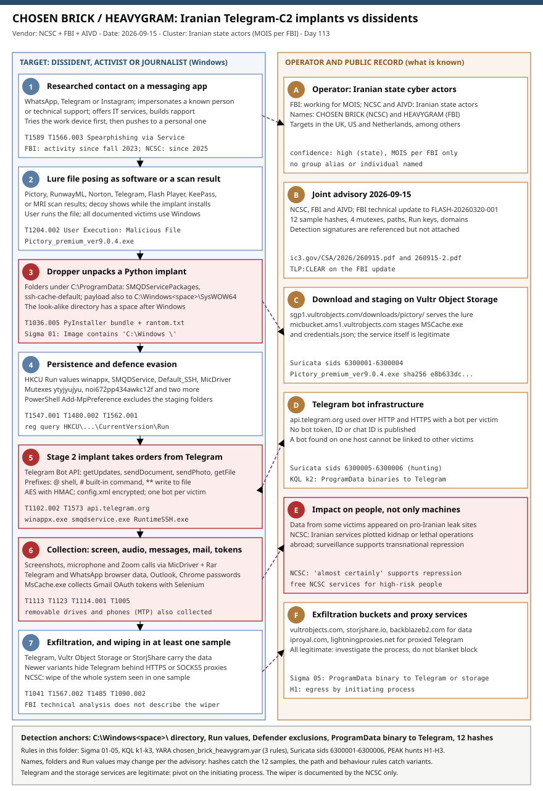

# CHOSEN BRICK / HEAVYGRAM: Iranian state actors steer Windows implants through Telegram bots against dissidents and journalists

## TL;DR

On **2026-09-15** the UK NCSC, the US FBI and the Dutch AIVD published a joint advisory on **CHOSEN BRICK**, a Windows malware family that Iranian state cyber actors have used since at least 2025 against dissidents, activists and
journalists in the UK, US and Netherlands, and the FBI published a technical update under its own name for the same malware, **HEAVYGRAM**, with **12 sample hashes, four mutexes, paths and Run keys** and the statement that the actors work for Iran's Ministry of
Intelligence and Security (MOIS) and have used it since the fall of 2023. The contact starts on WhatsApp, Telegram or Instagram, with a researched approach by someone the target knows or by "technical support", and ends in a Python implant that takes orders through the Telegram Bot API, with one bot per victim. It records the screen and the microphone,
copies Telegram and WhatsApp browser data and Gmail OAuth tokens, exfiltrates through Telegram, Vultr Object Storage or StorjShare and, in at least one sample, can wipe the system. The advisory says data from some victims has appeared on pro-Iranian leak sites and that some operations have involved plots to kidnap or kill abroad.
The detection value is high for known samples (hashes, mutexes, folders) and moderate for variants, because the advisory warns that names and paths may change; the one design feature that is hard to change is the Telegram Bot API control channel.

## Attribution and confidence

**Primary cluster:** Iranian state cyber actors; no group alias is published. **Names for the malware:** **CHOSEN BRICK** (NCSC, AIVD) and **HEAVYGRAM** (FBI); the two documents overlap on mutexes (`ytyjyujyu`, `noi672pp434awkc12f`),
Run values (`winappx`, `SMQDService`), folders and the Telegram control channel, so they describe the same family. **Vendor and date:** NCSC, FBI and AIVD joint advisory "Iranian Cyber Targeting of Dissidents, Activists and Journalists", version 1, 2026-09-15; FBI technical update "Update on Government of Iran Cyber Actors' Deployment of Telegram C2 to Push Malware to Identified Targets", TLP:CLEAR, which
updates FLASH-20260320-001 and whose text carries no date (the NCSC page links it and its file name carries 260915). **Confidence: high** that Iranian state actors are behind it (three government agencies); **medium** for the MOIS label, which only the FBI document uses.

| Strand | Observation | Weight |
|---|---|---|
| Government attribution | NCSC, FBI and AIVD attribute the campaign to Iranian state cyber actors; the NCSC says Iran "almost certainly" uses cyber activity to support repression of individuals | Strong |
| MOIS | The FBI says the actors work for MOIS; the NCSC and AIVD text does not name an agency | Medium: one agency |
| Targeting | Dissidents, activists and journalists in the UK, US and Netherlands, among other countries | Strong: consistent in all three documents |
| Collateral evidence | Personal data of some victims later appeared on pro-Iranian leak sites | Medium: described, not documented |
| First use | FBI: since the fall of 2023; NCSC: in use since at least 2025 | Conflict on dates; the earlier one is the FBI's |

**Gaps and discrepancies recorded rather than resolved.** The NCSC advisory says newer variants hide Telegram behind HTTPS or SOCKS5 proxies and that at least one sample can wipe the system; the FBI technical update describes neither. The FBI indicator table labels the MD5 of a second, unnamed PE32+ file as "RuntimeSSH.exe", which conflicts
with its own hash section, so that sample is marked medium. The FBI lists Instagram as a contact channel, the NCSC and press summaries only WhatsApp and Telegram. The NCSC writes the persistence path as `C:\Users\All Users\MicrosoftDistribution\sysmain\winappx.exe` and the FBI as `C:\ProgramData\MicrosoftDistribution\sysmain\winappx.exe`,
which is the same location because `C:\Users\All Users` is the compatibility alias of `C:\ProgramData`. The advisory refers to "detection signatures" that are not attached to either document.

**Genealogy with previous repository cases.** The closest case is the **2026-07-10 Cavern Manticore** analysis (an Iranian MOIS-nexus .NET command-and-control framework used against government and managed-service targets): same ministry per vendor attribution, but enterprise intrusion tooling and a different control channel.
The **2026-06-19 ATG fuel monitor** and **2026-05-31 BlackShadow** cases are Iran-nexus operations against infrastructure and recovery layers, not surveillance of individuals. This is the first case in the diary about **transnational repression** and about a Telegram Bot API control channel as the main design feature; the **2026-08-17 PATCHCORD** case also embedded a Google Cloud service account in its SHEETCORD tool, with a different actor and objective.

## Kill chain — summary table

| Stage | MITRE | Detail |
|---|---|---|
| Contact | T1589, T1566.003 | Researched approach on WhatsApp, Telegram or Instagram; impersonation of a known person or technical support; work device first, personal device if that fails |
| Lure | T1204.002 | Pictory, RunwayML, Norton Antivirus, a Telegram authenticator, Flash Player, KeePass or MRI scan results; the decoy displays while the implant installs |
| Drop | T1036.005 | PyInstaller bundles unpacked under `C:\ProgramData`; payload also dropped into `C:\Windows \SysWOW64` (space after "Windows") |
| Persistence and evasion | T1547.001, T1480.002, T1562.001 | HKCU Run values, mutexes, Microsoft Defender exclusions for the staging folders; one implant signed with a certificate the FBI says was revoked |
| Control | T1102.002 | Telegram Bot API (`getUpdates`, `sendDocument`, `sendPhoto`, `getFile`), one bot per victim; AES with HMAC for configuration |
| Collection | T1113, T1123, T1114.001, T1005, T1528 | Screenshots, microphone and Zoom calls, messaging data from browsers, Outlook, Chrome passwords, removable and phone files, Gmail OAuth tokens |
| Exfiltration and impact | T1041, T1567.002, T1090.002, T1485 | Telegram, Vultr Object Storage, StorjShare; proxies in newer variants (NCSC); system wipe in at least one sample (NCSC) |



The left lane follows a target's Windows machine from the first message to exfiltration; the right lane shows the operator, the advisory, the legitimate cloud services the malware abuses and the human impact. The detection anchors are the look-alike `C:\Windows \` directory, the Run values with
staging-folder paths, the Defender exclusions, ProgramData binaries that talk to Telegram or object storage, and the twelve published hashes.

## Stage-by-stage detail

### Contact: a researched approach in a chat app

The advisory describes "extensive victim research" followed by messages on WhatsApp or Telegram (the FBI adds Instagram and offers of IT services) in which the operator impersonates a contact of the target or technical support and builds rapport before sending a file.
If the first attempt on a work device fails or looks risky, the operator pushes the target to a personal device. Lures named in the advisory are fake Pictory (AI video), RunwayML, Norton Antivirus, Telegram, Adobe Flash Player and KeePass installers, and files posing as MRI scan results.

**MITRE:** T1589 Gather Victim Identity Information, T1566.003 Phishing: Spearphishing via Service, T1204.002 User Execution: Malicious File.

### Stage 1: droppers that look like software

Three droppers are described. **`Pictory_premium_ver9.0.4.exe`** (a fake Pictory tool, downloaded from `sgp1.vultrobjects.com`) writes `config.xml` under `%APPDATA%\SMQDService\`, a base64-encoded zip `downloaded_file26.txt` and `File26.zip`, unpacks to
`C:\ProgramData\SMQDServicePackages\488ht1-8ww648q\` and adds antivirus exclusions for `%ProgramData%\MicrosoftDistribution\sysmain`, that folder and the Telegram Desktop downloads folder. **`Telegram_Authenticator.exe`** writes to `C:\ProgramData\ssh-cache-default\{8bda3848-495e-43f4-8d10-7d37a67f1604}` when the user clicks into the code field.
**`KeePass.exe`** behaves like a persistent implant and writes plaintext logs. The FBI also lists a `C:\ProgramData\ZlibDate` folder with Settings and CachedFiles subfolders. The decoy content displays normally while the implant installs.

```text
C:\ProgramData\SMQDServicePackages\488ht1-8ww648q\   .pyd files, rantom.txt, smqdservice.exe
C:\ProgramData\ssh-cache-default\{8bda3848-495e-43f4-8d10-7d37a67f1604}\   RuntimeSSH.exe, base_library.zip, rantom.txt
C:\Windows \SysWOW64\   (note the space)   most common payload drop location named by the advisory
```

**MITRE:** T1204.002, T1036.005 Masquerading: Match Legitimate Name or Location, T1547.001.

### Stage 2: Python implants and their persistence

The persistent implants are Python programs packed with PyInstaller: **`winappx.exe`** (largest feature set, signed with an SSL.com certificate that the FBI says was revoked), **`smqdservice.exe`** (a variant of RuntimeSSH with a health beacon) and **`RuntimeSSH.exe`**
(the core implant, with a `place_dll` function that drops files into `C:\Windows` and SysWOW64). Each uses a mutex for single instance (`euyrsmnszb85sf4444s` for winappx, `nih6723443489kcvrf` for smqdservice, `ytyjyujyu` for RuntimeSSH, `noi672pp434awkc12f` for KeePass.exe), runs PowerShell
`Add-MpPreference` for its staging directories and persists through `HKCU\Software\Microsoft\Windows\CurrentVersion\Run` values named `winappx`, `SMQDService`, `Default_SSH` and `MicDriver`. The advisory states that names, directories and value names may change.

```cmd
:: The advisory's own check, plus a listing of the look-alike directory.
reg query HKCU\Software\Microsoft\Windows\CurrentVersion\Run
dir /a "C:\Windows \"
```

**MITRE:** T1547.001 Registry Run Keys, T1480.002 Execution Guardrails: Mutual Exclusion, T1562.001 Impair Defenses: Disable or Modify Tools (the advisory maps this to T1685 in its newer numbering).

### Control through the Telegram Bot API

The implants poll `getUpdates`, return results with `sendDocument` and `sendPhoto` and fetch files with `getFile`. Command prefixes are `@` for shell commands, `#` for built-in commands and `**` to write messages to a file. Built-in commands list processes and system information, take screenshots, steal browser and Telegram data, extract Outlook data and Chrome passwords,
enumerate start-up entries, change the bot token and chat ID, and run arbitrary files; they also collect files from removable drives and phones over MTP. Configuration files such as `config.xml` are encrypted with AES and HMAC (two IVs, SHA-256 key stretching of 8,192 rounds, code stored in `rantom.txt`). **Each victim gets a separate bot**, so a bot found on one host cannot be linked to others.
Newer variants route Telegram through HTTPS or SOCKS5 proxies (NCSC).

**MITRE:** T1102.002 Web Service: Bidirectional Communication, T1573 Encrypted Channel, T1090.002 External Proxy, T1057 Process Discovery, T1082 System Information Discovery.

### Collection tooling

**`MsCache.exe`** harvests Gmail OAuth tokens with Selenium and a legitimate `chromedriver.exe` and sends them to Telegram; it is fetched from `micbucket.ams1.vultrobjects.com`. **`MicDriver.exe`**, `MicDriver.dll`, `MDll.dll` and `Rar.exe` record the screen and audio, including Zoom calls, and compress the output with RAR using a hard-coded password.
The actors ship legitimate tools (`chromedriver.exe`, `Rar.exe`, `createdump.exe`) to blend in, so hash and name checks need context.

**MITRE:** T1113 Screen Capture, T1123 Audio Capture, T1114.001 Local Email Collection, T1528 Steal Application Access Token, T1005 Data from Local System, T1560.001 Archive via Utility.

### Exfiltration and wiping

Data leaves through Telegram, Vultr Object Storage (S3-compatible; `ams1.vultrobjects.com`) or StorjShare. The NCSC says at least one analysed sample can wipe the whole system and that the malware can download further malware, which could enable lateral movement; no lateral movement has been observed and infections have stayed on single devices.
The FBI lists a hard-coded email account and password among the strings of the Pictory sample; they are not reproduced here.

**MITRE:** T1041 Exfiltration Over C2 Channel, T1567.002 Exfiltration to Cloud Storage, T1485 Data Destruction.

## RE notes

The FBI analysed seven samples and published hashes for twelve files (all three hash types; SHA-256 below). Languages and packers are stated only for the stage-2 implants (Python, PyInstaller).

| Component | SHA256 | Lang | Packer | Notes |
|---|---|---|---|---|
| Pictory_premium_ver9.0.4.exe | `e8b633dcad173eb41ef02686b46779a4a0e53df7f6c63039a798f2db5eb83afc` | not stated | not stated | Stage-1 dropper; creates config.xml, downloaded_file26.txt, File26.zip; unpacks to SMQDServicePackages\488ht1-8ww648q\; adds Defender exclusions |
| Telegram_Authenticator.exe | `9014fe4f16f01c0439b261ade4cf980f460e0dae46b1ec5f58fd9bc0af26e531` | not stated | not stated | Stage-1 dropper; writes to ssh-cache-default\{8bda3848-...} when the user clicks the code field |
| winappx.exe | `8b595258cff63c4f0ef9648adb54c6ab050bb1d27933ecb3d687d31b51b7ba0c` | Python (PyInstaller) | PyInstaller | Largest feature set; code-signed with an SSL.com certificate the FBI says was revoked; mutex euyrsmnszb85sf4444s |
| smqdservice.exe | `4a3b003994112b4dd24ac8b9cc4757f4a12576b57b3cc8f5028d85fbceb7c405` | Python (PyInstaller) | PyInstaller | Variant of RuntimeSSH with a health beacon and extra start-up logic; mutex nih6723443489kcvrf |
| MsCache.exe | `4908c0bc11a933d83c83935d9468ba8d08bc23529e5ff4d4344d4f0787b84bb6` | not stated | not stated | Gmail OAuth token harvester using Selenium and chromedriver.exe; sends tokens to Telegram |
| RuntimeSSH.exe | `0d74156089292eee308017c8e8a7550739ecb6149ff379810f7c54b1dbaabc91` | Python (PyInstaller) | PyInstaller | Core implant with a place_dll function that drops files into C:\Windows and SysWOW64; mutex ytyjyujyu |
| unnamed PE32+ in the RuntimeSSH area | `97c9e2cbe728153a350a280caca6ed38f650014f6d1821b7764aff4704fe12d9` | not stated | not stated | Second PE32+ in the RuntimeSSH area; the FBI indicator table labels its MD5 as RuntimeSSH.exe (conflict, medium confidence) |
| KeePass.exe | `c2dd678511373dc07e73ef1a580fc3332e640f15ff0d4c1044d4b9f305b6f503` | not stated | not stated | Persistent implant behaviour with plaintext logs; mutex noi672pp434awkc12f |
| MicDriver.exe | `5d6ad895c126191fa202c412b08fe0dd8b75a72928b1e5e34986a040938384c6` | not stated | not stated | Screen and audio recorder, includes Zoom calls; output compressed with Rar.exe using a hard-coded password |
| MicDriver.dll | `168a487f0e44ffee975ecd27d3f4000c750e711963a61d6ce244fa390dd17441` | not stated | not stated | Recorder component |
| MicDriver.zip | `ffeae7c9ed3edabf3646376f50b738b4fbca442154cbfb6252b3aa5845f3d793` | not stated | not stated | Recorder archive |
| MDll.dll | `16162647ce3cc5b9043bf114f94e626e84188da10fbf4882960a7ede8ede0868` | not stated | not stated | Recorder component |

Other files listed by the FBI with MD5 only (no SHA-256): three `rantom.txt` variants, `File26.zip`, `downloaded_file26.txt` and `config.xml`; legitimate tools shipped by the actors (`chromedriver.exe`, `Rar.exe`, `createdump.exe`, `silent.wav`) have hashes in the FBI report and are deliberately not in `iocs.csv`, because blocking them by hash would hit legitimate software.
The SHA-256, SHA-1 and MD5 values for the twelve rows were extracted three times from the FBI PDF, in different order, with identical results.

## Detection strategy

### Telemetry that matters

- **Endpoint process, file and registry telemetry** (Sysmon EID 1, 11, 12-14 or Defender XDR): image paths, Run values with data, PowerShell command lines.
- **Defender configuration:** `Get-MpPreference` exclusions and the Defender operational log.
- **Network telemetry with the initiating process:** which binary talks to `api.telegram.org`, `vultrobjects.com`, `storjshare.io` or `backblazeb2.com`.
- **DNS and TLS SNI logs** for the actor-specific bucket `micbucket.ams1.vultrobjects.com`.
- **Account-side logs** for people at risk: sign-in history, devices and third-party access for mail and messaging accounts.

### Detection coverage

| Engine | File | Logic |
|---|---|---|
| Sigma | [sigma/01_process_launched_from_windows_space_directory.yml](./sigma/01_process_launched_from_windows_space_directory.yml) | Process image under `C:\Windows \` |
| Sigma | [sigma/02_run_key_value_names_and_paths_of_chosen_brick.yml](./sigma/02_run_key_value_names_and_paths_of_chosen_brick.yml) | HKCU Run value name plus staging path in the data |
| Sigma | [sigma/03_defender_exclusions_for_chosen_brick_staging_folders.yml](./sigma/03_defender_exclusions_for_chosen_brick_staging_folders.yml) | `Add-MpPreference` exclusion naming a staging folder |
| Sigma | [sigma/04_file_creation_in_chosen_brick_staging_folders.yml](./sigma/04_file_creation_in_chosen_brick_staging_folders.yml) | File creation in the listed ProgramData folders |
| Sigma | [sigma/05_telegram_bot_api_or_object_storage_from_programdata_binary.yml](./sigma/05_telegram_bot_api_or_object_storage_from_programdata_binary.yml) | ProgramData binary connecting to Telegram or object storage |
| KQL | [kql/k1_chosen_brick_persistence_and_defender_exclusions.kql](./kql/k1_chosen_brick_persistence_and_defender_exclusions.kql) | Run keys, exclusions and look-alike directory per device |
| KQL | [kql/k2_telegram_bot_api_and_object_storage_from_programdata.kql](./kql/k2_telegram_bot_api_and_object_storage_from_programdata.kql) | Egress to the services by initiating process path |
| KQL | [kql/k3_chosen_brick_known_samples_and_collection_tooling.kql](./kql/k3_chosen_brick_known_samples_and_collection_tooling.kql) | Twelve known SHA-256 values and collection tooling in the listed folders |
| YARA | [yara/chosen_brick_heavygram.yar](./yara/chosen_brick_heavygram.yar) | Mutexes plus Telegram API names in memory; dropper names; staging folder references |
| Suricata | [suricata/chosen_brick_heavygram.rules](./suricata/chosen_brick_heavygram.rules) | DNS and SNI for the actor bucket, Pictory download, bucket fragment, two hunting rules (sids 6300001-6300006) |

The FBI and NCSC documents refer to detection signatures but do not include them; none of these rules reproduces an official signature, and the YARA rules are medium or low confidence because the stage-2 strings live inside PyInstaller archives.

### Threat hunting hypotheses

- **H1** - If a host is infected, a ProgramData binary talks to the Telegram Bot API or to object storage. See [peak_h1_telegram_bot_and_object_storage_egress.md](./hunts/peak_h1_telegram_bot_and_object_storage_egress.md).
- **H2** - If a known sample ran, the host holds the look-alike directory, the Run values, Defender exclusions and the ProgramData folders. See [peak_h2_host_artifacts_windows_space_run_keys.md](./hunts/peak_h2_host_artifacts_windows_space_run_keys.md).
- **H3** - For people at risk, the evidence is in personal devices and accounts, so the hunt is a guided check of messaging contact, device and token state. See [peak_h3_at_risk_people_personal_devices_and_account_tokens.md](./hunts/peak_h3_at_risk_people_personal_devices_and_account_tokens.md).

## Incident response playbook

### First 60 minutes (triage)

1. Talk to the person first, in person or on a channel believed clean: this is a safety matter as well as an IT one, and the contact itself may be hostile.
2. On the machine, check the Run key (`reg query HKCU\Software\Microsoft\Windows\CurrentVersion\Run`) and list `C:\` for a directory named `Windows ` with a trailing space.
3. Check `C:\ProgramData` for `SMQDServicePackages`, `ssh-cache-default`, `MicrosoftDistribution\sysmain` and `Drivers\MicDriver`, and Defender exclusions with `(Get-MpPreference).ExclusionPath`.
4. Search endpoint and proxy telemetry for ProgramData processes connecting to `api.telegram.org`, `vultrobjects.com` or `storjshare.io`.
5. Hash any suspect file and compare it with the twelve published values; take a memory image before anything is changed.
6. Isolate the device from the network without powering it off, if the person agrees and safety allows.
7. From a clean device, review sign-ins, devices and third-party access for mail, Telegram and WhatsApp accounts; revoke tokens.
8. Report: UK `report.ncsc.gov.uk`, US FBI IC3, Netherlands AIVD or local police.

### Artifacts to collect

| Artifact | Path | Tool | Why |
|---|---|---|---|
| Memory image | host RAM | WinPmem, vendor EDR | Bot tokens and decrypted configuration exist in memory; none are published |
| Run key values | `HKCU\Software\Microsoft\Windows\CurrentVersion\Run` | `reg query`, RECmd | Persistence and the implant path |
| Staging folders | `C:\ProgramData\SMQDServicePackages\`, `ssh-cache-default\`, `MicrosoftDistribution\sysmain\`, `Drivers\` | file copy, `sha256sum` | Samples, `rantom.txt`, `config.xml` |
| Look-alike directory | `C:\Windows \SysWOW64\` | `dir /a "C:\Windows \"` | Most common payload location |
| Defender state | `Get-MpPreference`, Defender operational log | PowerShell | Exclusion paths and when they were added |
| Browser data | profile folders | triage collection | What was exposed: Telegram, WhatsApp web data, Gmail tokens |
| Account logs | mail and messaging provider security pages | provider tools | Token theft, new devices |

### IR queries and commands

```powershell
# Author: Jarmi
# 1. Staging folders, Run values and exclusions on a suspect Windows host.
Get-ChildItem 'C:\' -Force | Where-Object { $_.Name -like 'Windows *' } | Select-Object FullName, CreationTimeUtc
Get-ChildItem 'C:\ProgramData' -Force -ErrorAction SilentlyContinue |
  Where-Object { $_.Name -in 'SMQDServicePackages','ssh-cache-default','MicrosoftDistribution','Drivers','ZlibDate' } | Select-Object FullName, CreationTimeUtc
Get-ItemProperty 'HKCU:\Software\Microsoft\Windows\CurrentVersion\Run' | Select-Object winappx, SMQDService, Default_SSH, MicDriver
(Get-MpPreference).ExclusionPath
```

```powershell
# Author: Jarmi
# 2. Hash everything in the staging folders for comparison with iocs.csv.
Get-ChildItem 'C:\ProgramData\SMQDServicePackages','C:\ProgramData\ssh-cache-default','C:\ProgramData\MicrosoftDistribution','C:\ProgramData\Drivers' -Recurse -File -ErrorAction SilentlyContinue |
  Get-FileHash -Algorithm SHA256 | Select-Object Hash, Path
```

```kql
// 3. Devices with a Run value, exclusion or look-alike directory signal (see kql/k1 for the full query).
DeviceRegistryEvents
| where Timestamp > ago(90d) and ActionType == "RegistryValueSet"
| where RegistryKey has @"\CurrentVersion\Run" and RegistryValueName in~ ("winappx","SMQDService","Default_SSH","MicDriver")
| project Timestamp, DeviceName, RegistryValueName, RegistryValueData
```

```kql
// 4. ProgramData binaries talking to Telegram or object storage (see kql/k2).
DeviceNetworkEvents
| where Timestamp > ago(30d) and RemoteUrl has_any ("api.telegram.org","vultrobjects.com","storjshare.io")
| where InitiatingProcessFolderPath startswith @"C:\ProgramData\"
| summarize Connections = count() by DeviceName, InitiatingProcessFolderPath, InitiatingProcessSHA256
```

### Containment, eradication, recovery

**Do first.** Image the device, then reinstall the operating system from known-good media: the implants download further malware and one sample can wipe the machine, so cleaning in place is unreliable. Rotate every credential used on the device from a clean machine, revoke mail OAuth tokens and third-party access, and re-enrol multi-factor authentication
with phishing-resistant methods. For people at risk, use the NCSC's guidance and services for high-risk individuals and the national reporting route.

**Do not.** Do not block `api.telegram.org` or the storage services estate-wide as a response; the advisory says they are legitimate and should be investigated. Do not contact the person through the channel the operator used, and do not tell them to simply delete the file. Do not treat a clean H2 sweep as clearance: names and paths may change.
Do not publish or forward the victim's data; some of it has already appeared on leak sites.

**Exit criteria.** No Run value, staging folder, look-alike directory or Defender exclusion from this case; no ProgramData binary talking to Telegram or object storage for 30 days; account tokens and sessions revoked and credentials rotated from a clean device; the person has been told what was and was not checked and has a route to report.

### Recovery validation

Re-run H1 and H2 monthly for the people concerned, review sign-in and device lists quarterly, and keep a safe channel agreed in advance for the next contact attempt.

## IOCs

The full set is in [iocs.csv](./iocs.csv): 74 rows. It holds 12 SHA-256, 12 SHA-1 and 12 MD5 values from the FBI update, four mutexes, four Run values, folders and file paths, the actor-specific bucket and download URLs, and notes. **Telegram, the object-storage hosts and the proxy services are recorded as notes, not as blocklist domains,** because the advisory says they are legitimate.
No bot identifier is published, and the hard-coded email account in the FBI strings is deliberately omitted.

**KEV status:** CHOSEN BRICK exploits no vulnerability (it relies on social engineering). The two CVEs in the secondary findings are both on the CISA KEV catalog: **CVE-2026-76460** (Cisco ISE) and **CVE-2026-87886** (Acronis Backup plugin) were added on 2026-09-16 with a due date of 2026-09-19, and ransomware use is listed as unknown for both. Status is from the cached KEV catalog, catalogVersion 2026.10.16, so [kev.md](./kev.md) reflects that version and not the state on 2026-09-15.

| Type | Value | Context | Confidence | Source |
|---|---|---|---|---|
| sha256 | e8b633dcad173eb41ef02686b46779a4a0e53df7f6c63039a798f2db5eb83afc | Pictory_premium_ver9.0.4.exe dropper | high | FBI FLASH update |
| sha256 | 9014fe4f16f01c0439b261ade4cf980f460e0dae46b1ec5f58fd9bc0af26e531 | Telegram_Authenticator.exe dropper | high | FBI FLASH update |
| sha256 | 8b595258cff63c4f0ef9648adb54c6ab050bb1d27933ecb3d687d31b51b7ba0c | winappx.exe implant | high | FBI FLASH update |
| sha256 | 4a3b003994112b4dd24ac8b9cc4757f4a12576b57b3cc8f5028d85fbceb7c405 | smqdservice.exe implant | high | FBI FLASH update |
| sha256 | 0d74156089292eee308017c8e8a7550739ecb6149ff379810f7c54b1dbaabc91 | RuntimeSSH.exe core implant | high | FBI FLASH update |
| sha256 | 4908c0bc11a933d83c83935d9468ba8d08bc23529e5ff4d4344d4f0787b84bb6 | MsCache.exe Gmail OAuth token harvester | high | FBI FLASH update |
| mutex | ytyjyujyu | RuntimeSSH.exe mutex | high | FBI, NCSC |
| mutex | noi672pp434awkc12f | KeePass.exe mutex | high | FBI, NCSC |
| regkey | HKCU\Software\Microsoft\Windows\CurrentVersion\Run\winappx | Run value for winappx.exe | high | FBI, NCSC |
| regkey | HKCU\Software\Microsoft\Windows\CurrentVersion\Run\SMQDService | Run value for smqdservice.exe | high | FBI, NCSC |
| path | C:\Windows \SysWOW64 | Payload drop location with a space after "Windows" | high | NCSC |
| path | C:\ProgramData\SMQDServicePackages\488ht1-8ww648q\ | Pictory dropper unpack folder | high | FBI |
| path | C:\ProgramData\ssh-cache-default\{8bda3848-495e-43f4-8d10-7d37a67f1604}\ | Telegram_Authenticator unpack folder | high | FBI |
| domain | micbucket.ams1.vultrobjects.com | Actor bucket for tool staging | high | FBI |
| url | https://sgp1.vultrobjects.com/downloads/pictory/Pictory_premium_ver9.0.4.exe | Download of the fake Pictory installer | high | FBI |

## Secondary findings

- **The FBI seized the domains of NightmareStresser, one of the longest-running DDoS-for-hire (booter) services, on 2026-09-17 (Help Net Security).** The seizure warrant affidavit says the service was used for hundreds of thousands of actual or attempted attacks worldwide since 2022; the FBI Anchorage field office led with the RCMP as part of Operation PowerOFF. The article names neither the domains nor an operator and reports no arrests for this action.
- **Acronis advisory SEC-10986 (2026-09-16 coverage) reports exploitation of CVE-2026-87886, a Linux privilege escalation caused by insecure file permissions in the Acronis Backup extensions for cPanel and WHM and for Plesk.** Acronis calls the exploitation "limited, targeted attacks" against cPanel and WHM deployments; fixes are cPanel and WHM plugin 1.9.3 HF3 and Plesk extension 1.8.11. No attacker, post-exploitation detail or indicator is public.
- **Cisco confirmed active exploitation of CVE-2026-76460, an authentication bypass on an API endpoint of Cisco ISE and ISE-PIC releases 3.0 to 3.5 that gives a remote unauthenticated attacker the web management interface (2026-09-17).** Fixes are 3.1 Patch 12, 3.2 Patch 11, 3.3 Patch 12, 3.4 Patch 7 and 3.5 Patch 4, with no workaround; Cisco published indicators, and defenders are told to check `access.log` for suspicious usernames and to re-image if compromise is suspected.

## Pedagogical anchors

- **A legitimate service is a command channel when the process is wrong.** Telegram and object storage cannot be blocked for ordinary users; the signal is which binary, from which folder, talks to them.
- **A look-alike directory is a cheap trick with a cheap detection.** `C:\Windows \` with a space defeats a glance and a loose path allowlist, and it is a one-line Sigma rule.
- **Per-victim bots remove the pivot.** One bot per victim means a bot identifier on one host does not lead to the others; defenders must collect from each host.
- **Treat the human as part of the incident.** The first contact, the device switch and the leak sites show that the target's accounts and safety are the scope, not just the endpoint.
- **Read the agency naming, then the artefacts.** CHOSEN BRICK and HEAVYGRAM are one family; the overlap in mutexes and paths, not the label, is what proves it.

## What's in this folder

| File | Purpose | Link |
|---|---|---|
| README.md | This analysis. | [README.md](./README.md) |
| kill_chain.svg | Two-lane kill chain diagram (Template A) with detection anchors. | [kill_chain.svg](./kill_chain.svg) |
| iocs.csv | 74 indicators: 36 hashes, mutexes, Run values, paths, bucket, URLs and notes. | [iocs.csv](./iocs.csv) |
| kev.md | CISA KEV cross-reference for this case's CVEs. | [kev.md](./kev.md) |
| sigma/01_process_launched_from_windows_space_directory.yml | Process under `C:\Windows \`. | [sigma/01_process_launched_from_windows_space_directory.yml](./sigma/01_process_launched_from_windows_space_directory.yml) |
| sigma/02_run_key_value_names_and_paths_of_chosen_brick.yml | Run value plus staging path. | [sigma/02_run_key_value_names_and_paths_of_chosen_brick.yml](./sigma/02_run_key_value_names_and_paths_of_chosen_brick.yml) |
| sigma/03_defender_exclusions_for_chosen_brick_staging_folders.yml | Defender exclusion for staging folders. | [sigma/03_defender_exclusions_for_chosen_brick_staging_folders.yml](./sigma/03_defender_exclusions_for_chosen_brick_staging_folders.yml) |
| sigma/04_file_creation_in_chosen_brick_staging_folders.yml | File creation in staging folders. | [sigma/04_file_creation_in_chosen_brick_staging_folders.yml](./sigma/04_file_creation_in_chosen_brick_staging_folders.yml) |
| sigma/05_telegram_bot_api_or_object_storage_from_programdata_binary.yml | ProgramData binary to Telegram or storage. | [sigma/05_telegram_bot_api_or_object_storage_from_programdata_binary.yml](./sigma/05_telegram_bot_api_or_object_storage_from_programdata_binary.yml) |
| kql/k1_chosen_brick_persistence_and_defender_exclusions.kql | Run keys, exclusions, look-alike directory. | [kql/k1_chosen_brick_persistence_and_defender_exclusions.kql](./kql/k1_chosen_brick_persistence_and_defender_exclusions.kql) |
| kql/k2_telegram_bot_api_and_object_storage_from_programdata.kql | Egress by initiating process. | [kql/k2_telegram_bot_api_and_object_storage_from_programdata.kql](./kql/k2_telegram_bot_api_and_object_storage_from_programdata.kql) |
| kql/k3_chosen_brick_known_samples_and_collection_tooling.kql | Known hashes and collection tooling. | [kql/k3_chosen_brick_known_samples_and_collection_tooling.kql](./kql/k3_chosen_brick_known_samples_and_collection_tooling.kql) |
| yara/chosen_brick_heavygram.yar | Three rules built from published strings. | [yara/chosen_brick_heavygram.yar](./yara/chosen_brick_heavygram.yar) |
| suricata/chosen_brick_heavygram.rules | Six network rules (sids 6300001-6300006). | [suricata/chosen_brick_heavygram.rules](./suricata/chosen_brick_heavygram.rules) |
| hunts/peak_h1_telegram_bot_and_object_storage_egress.md | Egress hunt. | [hunts/peak_h1_telegram_bot_and_object_storage_egress.md](./hunts/peak_h1_telegram_bot_and_object_storage_egress.md) |
| hunts/peak_h2_host_artifacts_windows_space_run_keys.md | Host artefact hunt. | [hunts/peak_h2_host_artifacts_windows_space_run_keys.md](./hunts/peak_h2_host_artifacts_windows_space_run_keys.md) |
| hunts/peak_h3_at_risk_people_personal_devices_and_account_tokens.md | At-risk people hunt. | [hunts/peak_h3_at_risk_people_personal_devices_and_account_tokens.md](./hunts/peak_h3_at_risk_people_personal_devices_and_account_tokens.md) |

## Sources

- [FBI, Update on Government of Iran Cyber Actors' Deployment of Telegram C2 to Push Malware to Identified Targets (FLASH update, TLP:CLEAR)](https://www.ic3.gov/CSA/2026/260915.pdf)
- [NCSC, FBI and AIVD, Iranian Cyber Targeting of Dissidents, Activists and Journalists (2026-09-15)](https://www.ic3.gov/CSA/2026/260915-2.pdf)
- [NCSC, UK and allies expose spyware used by Iranian state actors to target dissidents, activists and journalists](https://www.ncsc.gov.uk/news/uk-allies-expose-spyware-iranian-state-actors-target-dissidents-activists-journalists)
- [Help Net Security, Iranian hackers use CHOSEN BRICK data-stealing malware to spy on dissidents and journalists (2026-09-16)](https://www.helpnetsecurity.com/2026/09/16/iranian-hackers-chosen-brick-malware-dissidents-journalists/)
- [CyberInsider, Iranian malware steals Telegram and WhatsApp data from targets (2026-09-16)](https://cyberinsider.com/iranian-malware-steals-telegram-and-whatsapp-data-from-targets/)
- [Computing, UK and allies expose Iranian spyware campaign (2026-09-16)](https://www.computing.co.uk/news/2026/security/uk-and-allies-expose-iranian-spyware-campaign)
- [Help Net Security, FBI takes down one of the longest-running DDoS-for-hire services (2026-09-17)](https://www.helpnetsecurity.com/2026/09/17/fbi-nightmarestresser-ddos-for-hire-service-seized/)
- [Help Net Security, Acronis backup plugin flaw exploited in targeted attacks (2026-09-16)](https://helpnetsecurity.com/2026/09/16/acronis-backup-plugin-vulnerability-exploited-cve-2026-87886)
- [Help Net Security, Unauthenticated attackers are bypassing Cisco ISE's management interface (2026-09-17)](https://www.helpnetsecurity.com/2026/09/17/cisco-ise-vulnerability-exploited-cve-2026-76460/)
