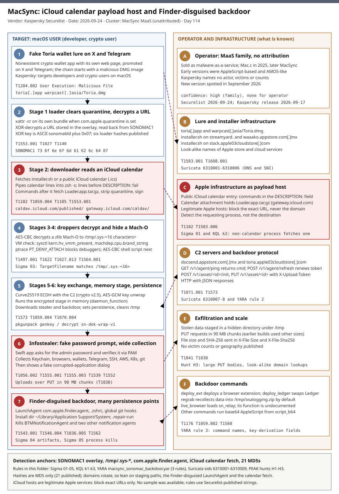

# MacSync: a six-stage macOS dropper chain that hides its commands in a public iCloud calendar and ends in a Finder-disguised backdoor

## TL;DR

Kaspersky (Securelist, Sergey Puzan, published 2026-09-24) analysed a new version of **MacSync**, a macOS information stealer sold as malware-as-a-service that first appeared as "Mac.c" in 2025 and gained a backdoor later. The version spotted in September 2026 is built around a fake crypto wallet called **Toria** and runs a chain of six stages: an app loader that clears the quarantine attribute, a downloader that reads a **public iCloud calendar entry and pipes its lines into `zsh`**, two anti-analysis droppers, and two scripts that fetch a Swift infostealer and an Objective-C backdoor disguised as Finder. The stealer asks for the administrator password, verifies it through the PAM API and collects Keychain, browser, wallet, Telegram and developer-tool data; the backdoor persists through a LaunchAgent, `.zshrc` and global git hooks and can replace the Ledger app. Kaspersky says the family primarily targets developers and crypto users and names no actor, victim count or geography. The case matters today because payload hosting on a legitimate Apple service defeats destination reputation, so detection has to key on which process talks to the service and on the artifacts each stage leaves behind.

## Attribution and confidence

**Cluster:** MacSync operator (malware-as-a-service, unattributed). **Aliases:** Mac.c (earlier name). **Vendor and date:** Kaspersky Securelist 2026-09-24; Kaspersky press release 2026-09-17 (details deferred to the Securelist post). **Confidence:** **high** for family identification and technique, **none** for operator identity, **not stated** for victimology.

| Overlap or alias | Basis | Confidence |
|---|---|---|
| Mac.c | Securelist and The Hacker News (Dec 2025): MacSync is the renamed Mac.c, first advertised in 2025 | high |
| Atomic Stealer (AMOS) lineage | Securelist: early AppleScript-based versions resembled AMOS | medium (resemblance, not a shared operator) |
| Pam Stealer | Securelist: the PAM-API password check was first seen in the wild in July 2026 in the Pam Stealer family | low (technique overlap only) |
| December 2025 MacSync campaign | Jamf (via The Hacker News): signed and notarized Swift dropper in a zk-call-messenger DMG, later SEO-poisoned ClickFix pages | medium (same family, different campaign and infrastructure) |

**Source conflict, documented and not resolved.** BleepingComputer's summary mentions ClickFix lures next to the Toria wallet, while Help Net Security's summary of the same report says the new version did not use ClickFix and that earlier versions did. The Securelist text describes the chain as starting from malicious DMG images and one fake application. This write-up therefore treats ClickFix as earlier-version tradecraft and does not claim it for the Toria chain.

**Genealogy with previous repo cases.** The [2026-08-07 macOS ClickFix gate case](../../08/2026-08-07_macOS-ClickFix-TDS-Fingerprinting-Gate-AMOS/README.md) saw AMOS or MacSync as the final payload of a ClickFix distribution system; this case is the payload side, with a new delivery chain and a new backdoor. The [2026-07-25 CrashStealer case](../../07/2026-07-25_CrashStealer-Werkbit-macOS-Notarized-Gatekeeper-Bypass/README.md) is another notarized-DMG macOS stealer, and the December 2025 MacSync dropper also used signing and notarization.

## Kill chain — summary table

| Stage | MITRE | Detail |
|---|---|---|
| 0. Lure | T1204.002, T1583.001 | Fake Toria crypto wallet with its own web page, promoted on X and Telegram; the chain begins with malicious DMG images |
| 1. App loader | T1553.001, T1027, T1140 | `.APP` runs `xattr -cr` on its bundle, XOR-decrypts a URL from its overlay (magic `SONOMAC1`) |
| 2. Downloader | T1102, T1105, T1059.004 | Fetches `installer.sh` or a public iCloud calendar; calendar lines are piped into `zsh -s` until the payload after `DESCRIPTION:` runs |
| 3. Dropper | T1027.013, T1564.001 | AES-CBC decrypts a zlib-compressed Mach-O and writes it to `/tmp/.sys-<16 characters>` |
| 4. Dropper | T1497.001, T1622 | VM check through `sysctl`, `ptrace(PT_DENY_ATTACH)`, then an AES-CBC shell script |
| 5. Script | T1573, T1059.004 | Fetches an AES-CBC encrypted stage from the C2 and runs it in memory (`daemon_function`) |
| 6. Script | T1543.001, T1546.004, T1070.004 | Downloads the stealer and backdoor, installs persistence, uploads data with PUT in 90 MB chunks, cleans up |
| 7. Stealer and backdoor | T1056.002, T1555.001, T1555.003, T1539, T1552, T1005, T1041, T1030, T1036.005, T1562, T1176 | Fake password prompt, collection, Finder-disguised backdoor with `deploy_ext`, `deploy_ledger`, `regrab`, `live_browser` |



The left lane follows the macOS victim from the Toria lure to the Finder-disguised backdoor; the right lane holds the operator, the lure and installer domains, the Apple infrastructure abused as a payload host, the C2 protocol, the exfiltration and the backdoor commands. Red stages are the places where defenders get the strongest signal: the calendar fetch, the stealer's password prompt and the persistence set. Detection anchors are the `SONOMAC1` overlay, the hidden `/tmp/.sys-*` file, the `com.apple.finder.agent` LaunchAgent and a non-calendar process talking to iCloud CalDAV hosts.

## Stage-by-stage detail

### Stage 0: the Toria lure

Toria is described by Kaspersky as a nonexistent crypto wallet application. The operators built a dedicated web page for it and promoted it on X and Telegram, and the IOC list includes `hxxps://toria[.]app/` and `hxxps://warpcast[.]asia/Toria.dmg`. The Securelist body does not state that the Toria DMG carries the stage 1 loader, and it gives no victim counts, dates inside September 2026 or geography. A second delivery path is described by Help Net Security from the same report: a DMG whose payload is a **compiled JXA script** that decodes a shell script and passes it to the interpreter without writing it to disk; in the other path the same script shows up late in a chain of droppers (T1059.007).

### Stage 1: the `.APP` loader

On launch the bundle checks for the `com.apple.quarantine` attribute and clears it with `xattr -cr` on itself, which stops Gatekeeper from prompting for the files that follow (T1553.001). It then decrypts a URL stored in its overlay: the data is read backwards from the magic word `SONOMAC1`, with an 8-byte length field before it, and XOR-decrypted with the ten bytes below.

```text
magic word  : SONOMAC1
XOR key     : 73 6f 6e 6f 6d 61 62 6c 64 07      (ASCII "sonomabld" followed by 0x07)
```

Securelist publishes six MD5 hashes for this stage and does not state the loader's code-signing status or the DMG file name.

### Stage 2: the downloader and the iCloud calendar

The downloader fetches either a script hosted on an attacker domain (`installer.sh` on `streamyard.appstore.com.mx`, `waaako.appstore.com.mx` or `slack.apple03cloudstore.com`) or a **public iCloud calendar** (T1102). In the calendar case it reads the calendar line by line and feeds each line into `zsh -s` through an anonymous pipe. Lines that are not valid commands simply fail, and execution continues until the payload that follows the `DESCRIPTION:` field is reached. That payload downloads a `.tar.gz` containing an `.APP` from an iCloud calendar attachment, removes the quarantine attribute, **signs it ad hoc** and runs it.

```text
# Schematic only: Securelist publishes the calendar's MD5, not its content.
BEGIN:VCALENDAR            -> not a command, zsh reports an error and continues
...                        -> same for the other iCalendar header lines
DESCRIPTION:<commands>     -> the payload that follows this field is executed
```

```text
hxxps://caldav.icloud[.]com/published/2/<public calendar id>
hxxps://gateway.icloud[.]com/caldav/<id>/attach/<id>/Loader.app.tar.gz/<id>
```

Securelist states that the content of scripts on the attacker's own server is unknown but very likely matches the calendar description. The full URLs, including the identifiers, are in `iocs.csv`; both hosts are legitimate Apple services, so block the exact URLs only.

### Stages 3 and 4: the droppers

Stage 3 decrypts a zlib-compressed Mach-O with AES-CBC and writes it to `/tmp/.sys-<16-digit random value>`. Stage 4 checks whether it runs in a virtual machine through `sysctl` queries for `kern.hv_vmm_present` and `machdep.cpu.brand_string`, sets `PT_DENY_ATTACH` through `ptrace` so that debuggers cannot attach, and decrypts an AES-CBC shell script (T1497.001, T1622). Kaspersky does not say what the malware does when it detects a VM or a debugger. The published AES-CBC parameters follow; they can rotate between builds.

| Stage | AES-CBC key (hex) | IV (hex) |
|---|---|---|
| 3 | `cb09ff86cabde4f8cee2d3cdec370c623bfa6c2b72ae9750fc9a7b299c65d7ca` | `3a1af2b397c6958e6c3ba3c75912d60e` |
| 4 | `3744f975113dfc552df982dcae699f9154a448e05a743bdfb641a463352bc13a` | `8d371f8a7a6dcc2655544ae13cbca03d` |
| 5 | `ff664112d3215c5d184689fc836e0dc6c1a47e42c34e70b2c3d356864bc4cb4c` | `09425f72de8bba18893dcd6f04115891` |

### Stages 5 and 6: key exchange, in-memory stage and persistence

Stage 5 fetches an AES-CBC encrypted stage from the C2 and runs it in memory; its main function is `daemon_function`. Stage 6 downloads and decrypts the infostealer and the backdoor, sets persistence and uploads stolen data with `PUT` in 90 MB chunks (earlier versions used other sizes). The server-supplied key material uses a small utility called `pkgunpack` with the commands `genkey` and `decrypt`.

```text
Curve25519 ECDH (curve25519_donna)
server returns : dek_wrap_b64, build_pub_b64, crypto = "v2.5"
shared secret  : concatenated with "sn-dek-wrap-v1", then hashed with SHA-256
dek_wrap_b64   : 5-byte AAD | 12-byte IV | ciphertext   (AES-GCM)
```

Temporary files and `*.lock` files live in `/tmp`; logs and traces are removed when the work is done. Binaries are fat Mach-O files for Apple Silicon and Intel.

### Stage 7a: the infostealer

The stealer is a Swift `.APP`. It shows a fake administrator password prompt, then a fake "corrupted application" dialog that suggests moving the app to the Bin (T1056.002). The password is verified through the **PAM API instead of `dscl`**, which Kaspersky calls uncommon and says was first seen in the wild in July 2026 in the Pam Stealer family. Strings are XOR-encrypted with per-sample keys derived from the ciphertext length. The collection covers:

- browser history, cookies, saved logins, wallet extension data and `Local State` files (T1555.003, T1539);
- crypto wallet applications and Telegram data;
- the Keychain file and login credentials (T1555.001);
- system information (applications, processes, model, UUID) and the user's profile picture;
- SSH, ZSH, AWS, Kubernetes and Git configuration files and the ZSH and Bash history (T1552);
- a hidden staging directory in `/tmp`, uploaded by `PUT`, with `/tmp/osalogging.zip` as the default `regrab` archive (T1560, T1041, T1030).

A **disabled** feature, `KcHelper`, looks for `<app_path>/Contents/Resources/Helpers/KcHelper`; without it the stealer falls back to `_kc_grab_storage_item`, which runs `security set-generic-password-partition-list` to change keychain partition IDs for the Chrome Safe Storage (Team ID `EQHXZ8M8AV`) and Brave Safe Storage (Team ID `KL8N8XSYF4`) items. Securelist says the feature is turned off in all known samples and would still show a confirmation prompt.

### Stage 7b: the Finder-disguised backdoor

The backdoor is an Objective-C fat Mach-O with a `--persist-status` mode. Its configuration sits in the overlay, XOR-encrypted and null-separated: the validation marker `AGNT1`, the C2 URL, an access token and the build number (`BLD-150` in the analysed sample). `LAUNCHER_DEBUG` turns on extended logging, and the log file is `$HOME/Library/Logs/.sysnotif-agent.log`.

| Method | Path | Purpose |
|---|---|---|
| GET | `/v1/agent/ping` | Receive a command in the `cmd` field; parameters `tag` and `build`; a 403 triggers a token refresh |
| POST | `/v1/agent/refresh` | Get a new token (`upload_token`) for `old_token` |
| POST | `/v1/asset/<upload_id>/init` | Create an upload; headers `X-File-Size` and `X-File-Sha256` |
| PUT | `/v1/asset/<upload_id>` | Upload the file in parts |
| POST | `/v1/agent/<command_status>` | Telemetry: `tag`, `upload_id`, `phase`, `message`, `active` |

Authentication uses the `X-Upload-Token` header; Kaspersky observed two 64-hex-character tokens (in `iocs.csv`). Communication is HTTP with JSON responses. Named commands are `deploy_ext` (deploy a browser extension), `deploy_ledger` (replace the Ledger wallet application), `regrab` (recollect data and archive it) and `live_browser` (no AppleScript; loads `sn_relay`, which Kaspersky assumes may enable interception of browser traffic and which is otherwise undocumented). Other commands run base64 AppleScript from the `script_b64` field.

**Persistence (T1543.001, T1546.004, T1036.005):**

```text
$HOME/Library/Application Support/System     install directory, not a default macOS directory
LaunchAgent label  com.apple.finder.agent      the backdoor is disguised as Finder
.zshrc                                         a command is injected
global git hooks pre-commit and post-checkout  a similar command is injected
.repair-run                                    backup and restore script
Login Items helper                             used on macOS versions older than 13.0 (CoreServices.framework)
```

A helper also kills `BTMNotificationAgent`, `NotificationCenter` and `BackgroundTaskManagementAgent` (T1562); Help Net Security's summary of the report says this suppresses user alerts. Stolen data is staged in a hidden directory under `/tmp`.

## RE notes

Everything in this section is taken from the Securelist analysis; no sample was available for this entry and nothing was re-analysed. Securelist publishes **MD5 only** (21 hashes); SHA-256 values are not published, so the column below is MD5.

| Component | MD5 (SHA-256 not published) | Lang | Packer | Notes |
|---|---|---|---|---|
| Stage 1 loader | 6 hashes, e.g. `26a0f7cdb9f7dc5ace9a40af825b1538` | Mach-O app | XOR overlay | `xattr -cr`; URL decrypted from the `SONOMAC1` overlay |
| Stage 2 calendar | `3ded1d71a822b53b12c3b67bcaf633f5` | iCalendar text | none | Public iCloud calendar read line by line into `zsh -s` |
| Stage 3 dropper | 6 hashes, e.g. `781ce50001d4b449600afa347c9b0208` | Mach-O | AES-CBC, zlib | Writes `/tmp/.sys-<16 characters>` |
| Stage 4 dropper | `3deeed48fd38f22e369f5c3092bd68a1` | Mach-O | AES-CBC | VM check, `PT_DENY_ATTACH`, encrypted shell script |
| Stage 5 script | `f97d24212fa6a21be0c4d211e10f044c` | shell | AES-CBC | `daemon_function`, runs the C2 stage in memory |
| Stage 6 script | `00d12d842596bf5ee1805effb4571d30`, `9a0043d900a9ac78c886c59c9a328fd0` | shell | AES-GCM key wrap | Installs persistence, uploads with PUT |
| `.repair-run` | `7212229c85852c3bffaf9740002b2f39` | shell | none stated | Backup and restore script |
| Infostealer | `c53d0ea45dbc622afb7f16ea3eec78bc` | Swift | XOR strings | PAM password check, fake prompts |
| Backdoor | `fc3ba5ed282d77127efd0b0f2403531b` | Objective-C | XOR overlay config | Fat Mach-O, build `BLD-150` |
| Autorun tool | `8dc8561349d144d4661bc66f2ec49f9f` | not stated | not stated | Login Items helper for macOS older than 13.0 |

**Anti-analysis:** VM detection by `sysctl`, anti-debugging by `ptrace(PT_DENY_ATTACH)`, per-stage encryption, in-memory execution of the stage 5 script and cleanup of temporary files and logs. **Not documented:** the contents of the stage 5 and 6 scripts, of `sn_relay` and of the `KcHelper` file (absent from all samples).

## Detection strategy

### Telemetry that matters

- **macOS Endpoint Security events** (or an EDR built on them): process exec with parent path and full command line, file create and modify with the writing process, and extended-attribute changes. `xattr -cr` by an app bundle and the `/tmp/.sys-*` write are the first two visible steps.
- **Defender XDR on macOS:** `DeviceProcessEvents`, `DeviceFileEvents` and `DeviceNetworkEvents`. The KQL files here say where they assume URL paths are recorded.
- **Disk state through MDM or Jamf-style inventory:** user LaunchAgents, `~/Library/Application Support/System`, `.zshrc` and the git hooks path. This is the only view that works after the stage files are deleted.
- **DNS, TLS SNI and proxy logs:** the look-alike domains, the calendar fetch and large `PUT` bodies. The `/v1/...` paths need TLS inspection.

### Detection coverage

| Engine | File | Logic |
|---|---|---|
| Sigma | [01_macos_process_fetching_public_icloud_calendar.yml](./sigma/01_macos_process_fetching_public_icloud_calendar.yml) | Command line with a published iCloud calendar or calendar attachment URL |
| Sigma | [02_macos_xattr_clear_quarantine_from_app_bundle.yml](./sigma/02_macos_xattr_clear_quarantine_from_app_bundle.yml) | `xattr -cr` launched from an app bundle or a mounted volume |
| Sigma | [03_macos_macsync_tmp_staging_files.yml](./sigma/03_macos_macsync_tmp_staging_files.yml) | `/tmp/.sys-<16 characters>` and `/tmp/osalogging.zip` file creation |
| Sigma | [04_macos_macsync_backdoor_persistence_artifacts.yml](./sigma/04_macos_macsync_backdoor_persistence_artifacts.yml) | Finder-disguised LaunchAgent, install directory, `.repair-run`, backdoor log |
| Sigma | [05_macos_kill_of_background_task_notification_agents.yml](./sigma/05_macos_kill_of_background_task_notification_agents.yml) | `killall` or `pkill` against `BTMNotificationAgent` or `BackgroundTaskManagementAgent` |
| KQL | [k1_macos_macsync_persistence_and_staging_files.kql](./kql/k1_macos_macsync_persistence_and_staging_files.kql) | Artifact files plus non-allow-listed writes to `.zshrc` and git hooks |
| KQL | [k2_macos_icloud_calendar_fetched_by_non_calendar_process.kql](./kql/k2_macos_icloud_calendar_fetched_by_non_calendar_process.kql) | Non-calendar process talking to iCloud CalDAV hosts or naming the URLs |
| KQL | [k3_macos_macsync_c2_domains_and_backdoor_paths.kql](./kql/k3_macos_macsync_c2_domains_and_backdoor_paths.kql) | Published domains and backdoor URL paths |
| YARA | [macsync_sonomac_backdoor.yar](./yara/macsync_sonomac_backdoor.yar) | Three rules: stage 1 overlay markers, backdoor C2 protocol strings, command names and key-derivation fields |
| Suricata | [macsync_icloud_calendar_chain.rules](./suricata/macsync_icloud_calendar_chain.rules) | Nine sids: DNS and SNI for the published domains, backdoor paths and header, cleartext calendar fetch (hunting) |

No sample was available, so the YARA rules use only strings that Kaspersky publishes and do not match encrypted stage content; Sigma 01, 02 and 05 depend on how your sensor records command lines.

### Threat hunting hypotheses

- **H1** — a bundle clears quarantine, a shell reads from standard input and a hidden Mach-O appears in `/tmp` within minutes: [peak_h1_xattr_clear_to_tmp_staging_chain.md](./hunts/peak_h1_xattr_clear_to_tmp_staging_chain.md).
- **H2** — the backdoor's persistence set exists on disk (LaunchAgent, install directory, `.zshrc`, git hooks): [peak_h2_finder_disguised_persistence_sweep.md](./hunts/peak_h2_finder_disguised_persistence_sweep.md).
- **H3** — calendar fetches by non-calendar processes, look-alike domains and 90 MB `PUT` uploads: [peak_h3_icloud_calendar_fetch_and_chunked_exfiltration.md](./hunts/peak_h3_icloud_calendar_fetch_and_chunked_exfiltration.md).

## Incident response playbook

### First 60 minutes (triage)

1. Treat any host that shows the Finder-disguised LaunchAgent, the `.sys-*` file or a look-alike domain lookup as compromised and isolate it from the network without powering it off.
2. Identify the user and what they hold: developers and crypto users are the stated targets, so assume Keychain items, browser sessions, SSH keys, AWS, Kubernetes and git credentials and wallet data are exposed.
3. Preserve volatile state before cleanup: `ps`, `launchctl list`, network connections and `/tmp`, because most stages delete their temporary files.
4. Check the chain order with H1 and the persistence set with H2 on the same host.
5. Start credential rotation for the user in parallel; the stealer asked for and verified the macOS password.
6. If a Ledger application is installed, treat it as untrusted until its signature and source are verified (`deploy_ledger` replaces it).

### Artifacts to collect

| Artifact | Path | Tool | Why |
|---|---|---|---|
| LaunchAgent plist and target binary | `~/Library/LaunchAgents/*.plist`, program path inside it | `plutil -p`, `codesign -dv --verbose=2`, copy | Backdoor persistence and the binary to hash |
| Install directory | `~/Library/Application Support/System/` | copy, `shasum` | Backdoor, helpers and the `.repair-run` backup script |
| Backdoor log | `~/Library/Logs/.sysnotif-agent.log` | copy | Command and upload history |
| Staging files | `/tmp/.sys-*`, `/tmp/osalogging.zip`, hidden directories in `/tmp` | copy, `file` | Stage 3 Mach-O and the data the operator collected |
| Shell configuration | `~/.zshrc` | copy, `diff` against a known copy | Injected persistence command |
| Git hooks | the directory named by `git config --global core.hooksPath`, `init.templateDir` | copy | `pre-commit` and `post-checkout` injection |
| Loader bundle and disk image | `~/Downloads`, `/Volumes/*` | copy, `codesign`, `xattr -l` | Stage 1 sample and its origin |
| Shell history | `~/.zsh_history`, `~/.bash_history` | copy | Commands run through the calendar pipe |
| Network records | proxy, DNS and TLS logs | export | Domains, URL paths and PUT volume |

### IR queries and commands

```bash
# Author: Jarmi
# Live host, read-only: persistence, staging and the loader's origin.
launchctl list | grep -i finder
for p in "$HOME"/Library/LaunchAgents/*.plist; do echo "== $p"; plutil -p "$p" | grep -E '"Label"|"Program'; done
ls -la "$HOME/Library/Application Support/System" "$HOME/Library/Logs/.sysnotif-agent.log" 2>/dev/null
ls -la /tmp /private/tmp 2>/dev/null | grep -E '\.sys-|osalogging'
grep -nE 'curl|osascript|base64|/tmp/|Application Support/System' "$HOME/.zshrc"
git config --global --get core.hooksPath; git config --global --get init.templateDir
```

```bash
# Author: Jarmi
# Hash local candidates against the published MD5 list in iocs.csv (SHA-256 is not published).
awk -F, '$1=="md5"{print $2}' iocs.csv | sort > /tmp/macsync_md5.txt
find "$HOME" /tmp /private/tmp -type f -size +20k 2>/dev/null | while read -r f; do md5 -q "$f"; done | sort | comm -12 - /tmp/macsync_md5.txt
```

```kql
// Defender XDR: every device that talked to a published MacSync domain in the last 90 days.
DeviceNetworkEvents
| where Timestamp > ago(90d)
| where RemoteUrl has_any ("toria.app", "warpcast.asia", "docsend.appstore.com.mx", "streamyard.appstore.com.mx", "waaako.appstore.com.mx", "apple03cloudstore.com")
| summarize First = min(Timestamp), Last = max(Timestamp) by DeviceName, InitiatingProcessFileName, RemoteUrl
```

### Containment, eradication, recovery

**Exit criteria:** every persistence point removed and re-verified clean after a reboot, no MacSync domain lookups or `/v1/agent/ping` traffic from the host for 7 days, and all credentials that the host held rotated.

**Order of eradication.** Kaspersky describes `.repair-run` as a backup and restore script, so remove it, the `.zshrc` line and the git hook content before unloading the LaunchAgent and deleting the backdoor, then reboot and sweep again.

**What NOT to do:**

- Do not block `icloud.com`, `caldav.icloud.com` or `gateway.icloud.com`; block the two exact URLs in `iocs.csv` and alert on new published-calendar URLs requested by scripts.
- Do not rely on resetting the macOS password alone; browser sessions, SSH keys, cloud keys and wallet seeds were all on the collection list.
- Do not trust a Ledger application on a compromised host; reinstall from the vendor and verify its signature.
- Do not treat a clean hash sweep as clearance; builds change and Securelist published MD5 only.

### Recovery validation

Re-run H1 to H3 for 30 days after rebuilding the host, compare the new `.zshrc` and git hook files against a known-good copy, confirm that the user's wallet addresses show no unexpected transfers, and check that all rotated credentials show no sign-ins from unfamiliar locations.

## IOCs

No vulnerability is involved: the chain relies on the user running a fake application, so no CVE is listed and no `kev.md` was generated. The full list (74 rows, including notes) is in [iocs.csv](./iocs.csv). The two `icloud.com` URLs point to legitimate Apple hosts: block the exact URL only.

| Type | Value | Context | Confidence | Source |
|---|---|---|---|---|
| domain | `docsend.appstore.com[.]mx` | C2 and `stage2.enc` host | high | Securelist 2026-09-24 |
| domain | `toria.apple03cloudstore[.]com` | C2 and `stage2.enc` host | high | Securelist 2026-09-24 |
| domain | `slack.apple03cloudstore[.]com` | `installer.sh` host | high | Securelist 2026-09-24 |
| domain | `streamyard.appstore.com[.]mx` | `installer.sh` host | high | Securelist 2026-09-24 |
| domain | `waaako.appstore.com[.]mx` | `installer.sh` host | high | Securelist 2026-09-24 |
| domain | `toria[.]app` | Fake Toria wallet web page | high | Securelist 2026-09-24 |
| domain | `warpcast[.]asia` | Hosts `Toria.dmg` | high | Securelist 2026-09-24 |
| md5 | `26a0f7cdb9f7dc5ace9a40af825b1538` | Stage 1 loader (one of six) | high | Securelist 2026-09-24 |
| md5 | `781ce50001d4b449600afa347c9b0208` | Stage 3 dropper (one of six) | high | Securelist 2026-09-24 |
| md5 | `c53d0ea45dbc622afb7f16ea3eec78bc` | Infostealer | high | Securelist 2026-09-24 |
| md5 | `fc3ba5ed282d77127efd0b0f2403531b` | Backdoor | high | Securelist 2026-09-24 |
| string | `SONOMAC1` | Stage 1 overlay magic word | high | Securelist 2026-09-24 |
| path | `com.apple.finder.agent` | Backdoor LaunchAgent label | high | Securelist 2026-09-24 |
| path | `/tmp/.sys-<16 random characters>` | Stage 3 decrypted Mach-O | high | Securelist 2026-09-24 |
| string | `/v1/agent/ping` | Backdoor tasking endpoint | high | Securelist 2026-09-24 |

Historical rows for the December 2025 MacSync campaign (`zkcall[.]net`, `macclouddrive[.]com`) are in the CSV with a HISTORICAL label and medium confidence; they are not part of the September 2026 chain.

## Secondary findings

- **Microsoft-led EvilTokens disruption (2026-09-22, reported 2026-09-23).** Per Help Net Security's summary of Microsoft's announcement, a coalition including Cloudflare, Coinbase and Health-ISAC, backed by a US court order from the Eastern District of Virginia, seized 50 websites and disabled more than 150 domains of the device-code phishing service. London's Metropolitan Police arrested two men (aged 32 and 38) on 2026-09-11. The same report cites more than 12,000 inboxes at more than 10,000 organizations compromised, and a service sold through Telegram for a $1,500 initiation fee plus a recurring $500 subscription, with an AI assistant for finding payment conversations. Operator identity is not confirmed. The service is covered technically in the [2026-07-22 ARToken / EvilTokens case](../../07/2026-07-22_ARToken-EvilTokens-BEC-DeviceCode-InboxRule-PhaaS/README.md); the mitigation Microsoft stresses is revoking sessions and tokens, not only resetting passwords.
- **PAM-based password verification is spreading in macOS stealers.** Securelist says validating a stolen password through the PAM API instead of `dscl` was first seen in the wild in July 2026 in the Pam Stealer family and may become more common. Securelist says most macOS malware uses `dscl` for this check, so a detection that only watches for `dscl` would miss a PAM-based check; key password-prompt detections on the prompt and the process lineage as well.
- **MacSync already used signing and notarization in December 2025.** Jamf's analysis, as reported by The Hacker News on 2025-12-24, found a code-signed and notarized Swift dropper in a DMG named `zk-call-messenger-installer-3.9.2-lts.dmg` hosted on `zkcall[.]net`, with Apple later revoking the certificate. The September 2026 chain instead relies on ad-hoc signing of a downloaded app, which shows the operators switching trust-subversion methods between campaigns.

## Pedagogical anchors

- **A legitimate service as payload host defeats reputation.** `caldav.icloud.com` is used by every Apple calendar client, so destination blocking fails; the useful pair is process plus destination, here a non-calendar process fetching a published calendar.
- **Error-tolerant execution is a design choice.** Feeding a whole text file to a shell and letting invalid lines fail means the carrier can be any format with a free-text field; calendars, tickets and wiki pages are all candidates. Hunt for shells that read standard input from a network fetch.
- **Every stage leaves a different artifact.** Quarantine clearing, a hidden `/tmp` Mach-O, a user LaunchAgent with an Apple-looking label and a modified `.zshrc` are four separate detection points for one infection, so a hash set that expires with the next build is the weakest of them.
- **Redundant persistence means ordered cleanup.** With a LaunchAgent, a shell profile, git hooks and a restore script, deleting the visible one is a partial fix; remove the restorer first and verify after a reboot.
- **Developer machines hold the keys to everything else.** SSH, AWS, Kubernetes and git configuration files are on the collection list, so one stolen laptop can become a cloud or supply-chain incident.

## What's in this folder

| File | Purpose | Link |
|---|---|---|
| README.md | This case write-up. | [README.md](./README.md) |
| kill_chain.svg | Two-lane kill chain diagram (Template A). | [kill_chain.svg](./kill_chain.svg) |
| iocs.csv | 74 indicator rows: 21 MD5, domains, URLs, strings, paths, notes. | [iocs.csv](./iocs.csv) |
| sigma/ | Five Sigma rules for macOS process and file telemetry. | [sigma](./sigma/) |
| kql/ | Three Defender XDR hunting queries. | [kql](./kql/) |
| yara/ | Three YARA rules built from Securelist-published strings. | [macsync_sonomac_backdoor.yar](./yara/macsync_sonomac_backdoor.yar) |
| suricata/ | Nine Suricata sids for DNS, SNI and backdoor HTTP. | [macsync_icloud_calendar_chain.rules](./suricata/macsync_icloud_calendar_chain.rules) |
| hunts/ | Three PEAK hunts H1 to H3. | [hunts](./hunts/) |

## Sources

- [MacSync under the microscope: new delivery methods and a new payload — Securelist, Sergey Puzan, 2026-09-24](https://securelist.com/macsync-new-version/121383/)
- [Kaspersky discovers a new version of MacSync malware — Kaspersky press release, 2026-09-17](https://www.kaspersky.com/about/press-releases/kaspersky-discovers-a-new-version-of-macsync-malware-stealing-credentials-and-crypto-from-macos-users)
- [MacSync info-stealing malware hides malicious commands in an iCloud calendar — Help Net Security, 2026-09-25](https://www.helpnetsecurity.com/2026/09/25/macsync-info-stealing-malware-for-macos/)
- [MacSync malware uses public iCloud calendars to deliver new payloads — BleepingComputer](https://www.bleepingcomputer.com/news/security/macsync-malware-uses-public-icloud-calendars-to-deliver-new-payloads/)
- [New MacSync macOS stealer uses signed app to bypass Gatekeeper — The Hacker News, 2025-12-24](https://thehackernews.com/2025/12/new-macsync-macos-stealer-uses-signed.html)
- [Microsoft EvilTokens phishing service disrupted — Help Net Security, 2026-09-23](https://www.helpnetsecurity.com/2026/09/23/microsoft-eviltokens-phishing-service-disrupted/)
