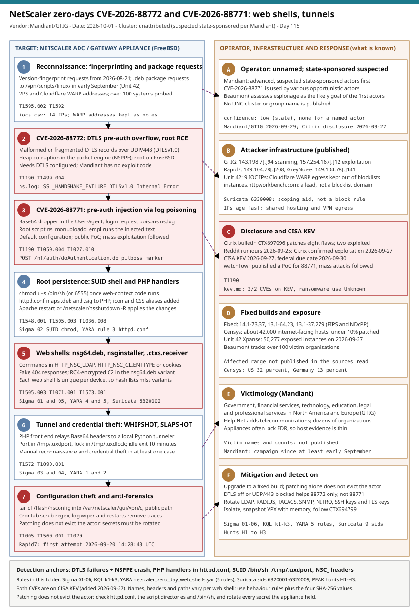

# NetScaler zero-days CVE-2026-88772 and CVE-2026-88771: a DTLS overflow, log poisoning and web shells that a patch does not remove

## TL;DR

On 2026-09-27 Citrix confirmed that two critical flaws in NetScaler ADC and NetScaler Gateway, **CVE-2026-88772** (a pre-authentication DTLS memory overflow that needs DTLS configured) and **CVE-2026-88771** (a pre-authentication command injection in the default configuration), were already being exploited, and CISA added both to its KEV catalog the same day. Mandiant and Google Threat Intelligence Group (GTIG, 2026-09-29) tie the first intrusions to **CVE-2026-88772**, say the actors are advanced and suspected state-sponsored, and describe a campaign running since at least early September against government, finance, technology, education and legal and professional services in North America and Europe; they leave root web shells, a SUID shell and two new tools, **WHIPSHOT** and **SLAPSHOT**. CVE-2026-88771 then went to mass exploitation after a public proof of concept. The case matters today because a patch removes the bug, not the web shell or the stolen secrets, and because an appliance often runs no EDR, so the evidence lives in `httpd.conf`, a script directory, the mode of `/bin/sh` and a few log lines.

## Attribution and confidence

**Cluster:** unattributed NetScaler zero-day operators. **Aliases:** none published; Mandiant writes only "the threat actor", and some researchers call the pair "PitScaler" (BleepingComputer). **Vendor and date:** Mandiant and GTIG, 2026-09-29; Citrix disclosure 2026-09-27. **Confidence:** **low** that the first actors are state-sponsored (Mandiant's wording is "suspected"), **none** for a named actor, **high** for the vulnerability and post-exploitation technique.

| Overlap or alias | Basis | Confidence |
|---|---|---|
| Advanced, suspected state-sponsored actors | Mandiant CTO Charles Carmakal, relayed by Help Net Security, for the initial CVE-2026-88772 intrusions | low |
| Opportunistic "spray and pray" actors | Help Net Security: CVE-2026-88771 is used by various actors after the public PoC; Rapid7 saw only two organizations compromised in its data | medium |
| Espionage as the first actors' goal | Kevin Beaumont's assessment, relayed by Help Net Security; an analyst opinion, not a vendor finding | low |
| Historical NetScaler actor mix | Tenable (Satnam Narang) cites roughly two thirds APT and one third ransomware in past NetScaler exploitation; no link to this campaign | context only |

**Source conflicts and gaps, documented and not resolved.**

- GTIG ties its observed intrusions and log artifacts to CVE-2026-88772 only and says it does not possess exploit code; for CVE-2026-88771 it only cites vendor disclosures. Unit 42 describes web shell paths for both CVEs and a three-stage CVE-2026-88771 chain observed on 2026-09-21; Rapid7 saw the first CVE-2026-88771 attempt on 2026-09-20.
- Two source addresses sit in the same /24 but are different hosts: `149.104.78.141` (GreyNoise, 2026-09-24, relayed by BleepingComputer) and `149.104.78.208` (Rapid7, 2026-09-20).
- Unit 42's IOC list contains two Cloudflare-range addresses (`104.28.215.137`, `104.28.247.136`); its narrative describes Cloudflare WARP addresses. They are kept as notes in `iocs.csv`, not as blocklist entries.
- The Help Net Security piece links a Censys advisory whose slug names a different CVE (`CVE-2026-10747`); the exposure figure (about 42,000 internet-facing hosts) is quoted as reported and not verified.
- No source read gives the affected version range. Fixed builds are relayed from Help Net Security and Rapid7, not from Citrix's bulletin (CTX697096), which was not fetched.
- The watchTowr, GreyNoise and CERT-EU primary pages could not be fetched in this environment, so their content is cited only through Help Net Security, Picus, Unit 42, Rapid7 and BleepingComputer. The Unit 42 and Rapid7 pages carry later revisions; the facts used here are dated inside the text.

**Genealogy with previous repo cases.** [CitrixBleed Infinity (2026-07-09)](../../07/2026-07-09_CitrixBleed-Infinity-NetScaler-SAML-Overread-CVE-2026-8451/README.md) was a different NetScaler memory-disclosure flaw (CVE-2026-8451); [PoisonedRefresh (2026-09-09)](../../09/2026-09-09_PoisonedRefresh-F5-BIGIP-APM-Rootkit/README.md) is the same pattern on another edge vendor: an implant that lives where no agent runs and survives the patch. The [Kemp LoadMaster case (2026-08-13)](../../08/2026-08-13_KempLoadMaster-EscapeQuotes-PreAuth-RCE-CVE-2026-8037/README.md) is a third pre-auth appliance RCE.

## Kill chain — summary table

| Stage | MITRE | Detail |
|---|---|---|
| 1. Reconnaissance | T1595.002, T1592 | Version-fingerprint requests from 2026-08-21 and `.deb` package requests under `/vpn/scripts/linux/` in September |
| 2. CVE-2026-88772 | T1190, T1499.004 | Malformed DTLS records over UDP/443 corrupt the heap of the packet engine (NSPPE) and run shellcode as root on FreeBSD |
| 3. CVE-2026-88771 | T1190, T1059.004, T1027.010 | Base64 dropper in the User-Agent, a login request poisons `ns.log`, and the root script `ns_monuploadd_err.pl` runs the injected text |
| 4. Root persistence | T1548.001, T1505.003, T1036.008 | `chmod u+s /bin/sh`, PHP handlers for `.deb` and `.sig` in `httpd.conf`, icon and CSS aliases, Apache restart or reboot |
| 5. Web shells | T1505.003, T1071.001, T1573.001 | `nsginstaller`, `nsgclient`, `nsg64.deb`, `.ctxs.receiver` and `e6ee7c85.sig`; Base64 or RC4 commands; fake 404 answers |
| 6. Tunnel | T1572, T1090.001, T1059.006 | WHIPSHOT PHP front end relays to SLAPSHOT, a Python TCP tunneler on a local port |
| 7. Theft and cleanup | T1005, T1560.001, T1070 | Archive of `/flash/nsconfig` in a public path; crontab and log scrubbing |



The left lane follows the appliance from reconnaissance through the two zero-day paths to persistence, web shells, the tunnel and configuration theft; the right lane holds the operator, the published infrastructure, the disclosure and KEV timeline, fixed builds and exposure, victimology and mitigation. Red stages are the places with the strongest evidence: the DTLS exploit and its log pair, the log-poisoning injection, the web shells and the configuration archive. Detection anchors are `NSPPE` crash lines after DTLS handshake failures, PHP handlers in `httpd.conf`, a SUID `/bin/sh`, `/tmp/.uxdport` and the `NSC_` request headers.

## Stage-by-stage detail

### Stage 1: reconnaissance and staging

Unit 42 reconstructs the pre-disclosure activity from its telemetry. The dates below are Unit 42's; addresses are in `iocs.csv`.

| Date (2026) | Activity |
|---|---|
| 08-21 and 08-22 | Two hosts requested version-fingerprinting files on a US NetScaler Gateway; with a third host, similar requests reached over 100 systems |
| 09-04 to 09-08 | Four VPS hosts requested `.deb` client packages from `/vpn/scripts/linux/` |
| 09-09 to 09-11 | Three Cloudflare WARP addresses requested `.deb` files |
| 09-10 to 09-27 | Continuous requests to `/logon/LogonPoint/Authentication/GetUserName` from WARP addresses and two others (Unit 42 calls this anomalous) |
| 09-15 to 09-24 | One address requested `nsgbuild.deb` daily; last web shell request seen on 09-24 |
| 09-21 | A three-stage CVE-2026-88771 chain against a US-based target |

### Stage 2: CVE-2026-88772, the DTLS overflow

Exploitation happens during the pre-authentication DTLS handshake over **UDP/443 using DTLSv1.0**. GTIG states that it does not hold exploit code and infers from telemetry that malformed or fragmented record headers corrupt heap memory in the packet engine, divert control flow to shellcode and give root on the underlying FreeBSD platform; it bypasses authentication and ends in an unhandled termination of NSPPE. The flaw needs DTLS to be configured, and Help Net Security's summary of the Citrix bulletin says DTLS is on by default for virtual VPN servers. Two log patterns from GTIG are the only exploit-time evidence:

```text
0-PPE-0 : default SSLLOG SSL_HANDSHAKE_FAILURE 0 : SPCBId - ClientIP - ClientPort - VserverServiceIP - VserverServicePort 443 - ClientVersion DTLSv1.0 - CipherSuite "TLS1-AES-256-CBC-SHA" - Session New - Reason "Handshake failure-Internal Error"
qat0: Process <PID> NSPPE-<##> exit with orphan rings 5:500
pitboss[<##>]: pitboss <DATETIME> NOT restarting NSPPE-<##> (<PID>)
```

### Stage 3: CVE-2026-88771, the pre-authentication command injection

The flaw is a command injection in a root Perl maintenance script, `/netscaler/ns_monuploadd_err.pl`, which searches the logs for `pitboss` crash messages and puts text from the matching line into a backtick shell command without checking it (Picus, from watchTowr's analysis). Attacker text that reaches the log through any pre-authentication field can therefore carry a command separated by a semicolon. Unit 42 describes the observed three-stage chain:

1. a dropper command encoded as Base64 text in the `User-Agent` string, which the appliance writes to its access log;
2. a login request (a POST to `/nf/auth/doAuthentication.do` with the payload in `username`) that is logged as a failure message in `/var/log/ns.log`;
3. `ns_monuploadd_err.pl -WR` processes the poisoned entries and runs the text, decoded and piped to `sh` or `php`.

Rapid7 saw the earliest attempt at 2026-09-20 14:28:43 UTC. The injected command archived the appliance configuration into the publicly served `/vpn/` path:

```text
tar${IFS}czf$IFS/var/netscaler/gui/vpn/c$IFS-C$IFS/flash${IFS}nsconfig;
# plain form: tar czf /var/netscaler/gui/vpn/c -C /flash nsconfig
```

Help Net Security reports that Lupovis saw exploitation within minutes of the watchTowr PoC and that hunting guidance includes `POST /nf/auth/doAuthentication.do` with a body containing `pitboss PPE unexpectedly died NSPPE`.

### Stage 4: root persistence

The web shells run in an unprivileged web context, so the installer gives the system shell the SUID bit and restarts or reboots the appliance. GTIG publishes two `httpd.conf` variants:

```text
# Method A: .deb files executed as PHP
php_flag engine on
  <FilesMatch "\.deb$">
    Header set Cache-Control "no-cache"
  </FilesMatch>
AddHandler application/x-httpd-php .deb

# Method B: icon requests aliased to .sig web shells
php_flag engine on#
AliasMatch ^/vpn/media/(.+).ico$ /var/netscaler/gui/vpn/scripts/linux/$1.sig
AddHandler application/x-httpd-php .sig

chmod u+s /bin/sh
/netscaler/nsshutdown -R
system('/bin/httpd -k restart -f /etc/httpd.conf && chmod u+s /bin/sh');
```

Unit 42 adds `chmod 6555 /bin/sh` (SUID and SGID), a Gateway-UI-rooted directory with a PHP shell named `.ctxs.receiver`, and `httpd.conf` aliases that disguise it as `receiver.min.css`, followed by a SIGHUP to Apache.

### Stage 5: the web shells

| Name | Path or alias | Command channel | Notes |
|---|---|---|---|
| nsginstaller variant 1 | `/vpn/scripts/linux/nsginstaller*.deb` | Base64 in `HTTP_NSC_LDAP`, run with `shell_exec()` | Edits `/etc/httpd.conf`, sets SUID, removes `/vpn/scripts/linux` lines from `/etc/crontab`, reboots with `nsshutdown -R` |
| nsginstaller variant 2 | same | Base64 in `HTTP_NSC_LDAP`, run with `eval()` | Returns a spoofed 404, restarts Apache, scrubs crontab with `#^.*/vpn/scripts/linux.*\n#m` |
| `e6ee7c85.sig` | `/vpn/media/e6ee7c85.ico` | Base64 in `HTTP_NSC_CLIENTTYPE`, run with `eval()` | Enforces 404 answers |
| `nsg64.deb` | `/vpn/scripts/linux/nsg64.deb` | `k` parameter, commands `cmd`, `size`, `dl`, `up`, `info`; RC4 | Key is the MD5 of a hard-coded passphrase; uses `/var/netscaler/.ns_suidcmd` for privilege; `dl` capped at 1,048,576 bytes per request |
| `.ctxs.receiver` | `/var/netscaler/logon/LogonPoint/custom/.ctxs.receiver` | `CsrfToken` cookie to authenticate, `NSC_TASS` cookie to run | Reached through CSS-looking aliases |

GTIG notes that some responses to these paths are HTTP 404 with elevated processing time and multi-kilobyte bodies. Help Net Security quotes the report that each web shell is unique per device.

### Stage 6: WHIPSHOT and SLAPSHOT

**WHIPSHOT** is a PHP web shell disguised as a Debian package that reads a port from `/tmp/.uxdport`, connects to `127.0.0.1:<port>` and relays requests, answering with a 404 header and the tunneled response in the body; it receives chunked Base64 in `HTTP_X_UX` and `HTTP_X_UX_[0-9]+` headers. **SLAPSHOT** is a Python tunneler that binds an ephemeral localhost port, writes it to `/tmp/.uxdport`, locks `/tmp/.uxdlock`, speaks a 4-byte length plus JSON protocol (`open`, `push`, `pull`, `exch`, `close`, `ping`), closes idle sessions after 15 minutes and exits after 10 minutes with no sessions or commands (configurable through `UXD_IDLE_EXIT`).

```text
nohup <python> -c 'import base64;exec(base64.b64decode("<payload>"))' /tmp/.uxdport /tmp/.uxdlock > /dev/null 2>&1 </dev/null &
```

GTIG says the actor used this proxy in at least one intrusion to run internal reconnaissance and steal credentials by hand, and does not describe the tooling used.

### Stage 7: configuration theft and anti-forensics

A configuration archive can hold encrypted admin passwords, LDAP, RADIUS and TACACS bind passwords, SSL certificates and private keys, SSH host keys and licence files (Rapid7). The installers scrub their own crontab entries and a regex-based log wiper removes access-log lines. Help Net Security's summary of the Citrix bulletin reports anti-forensics commands that delete artifacts, and Mandiant and Unit 42 both stress that patching does not remove existing access.

## RE notes

No sample was available for this entry and nothing was re-analysed; the table is taken from GTIG, Unit 42 and Rapid7. Mandiant/GTIG publishes no file hashes in the material reviewed. The four SHA-256 values below are copied from the Unit 42 and Rapid7 pages and match `iocs.csv`.

| Component | SHA256 | Lang | Packer | Notes |
|---|---|---|---|---|
| nsg64.deb web shell | `ae22ef2517b5c0fb47f78745b9cb5260acee0e751b89bcd354640ff8bc8d29ec` | PHP | none; RC4 C2 | Key `7489a0f93c67fa5cdaeb4b921d90594d` (MD5 of a hard-coded passphrase); commands `cmd`, `size`, `dl`, `up`, `info` |
| CVE-2026-88771 dropper (Base64 text) | `1bd314b661396c7086f6367fbbb48025e03ca2de69c073d53a8b0a38aa5fbb7d` | text | Base64 | Base64 payload text of the CVE-2026-88771 dropper chain (Unit 42) |
| CVE-2026-88771 dropper (decoded script) | `79c65fa04541032e251fa4796b97800374b63c7982593dd1a2e0db605d429186` | shell | none | Decoded form of the Base64 payload |
| Web shell near `.ctxs.receiver` | `ed082f744f035035900f67edf438f2f7d0528ac501234f63d476d65273cdb9a1` | PHP | not stated | Hash listed by Rapid7 beside the 2026-09-24 compromise |
| WHIPSHOT | not published | PHP | none | Port from `/tmp/.uxdport`, `fsockopen` to `127.0.0.1`, HTTP 404 with tunneled body |
| SLAPSHOT | not published | Python | Base64 `exec` in the launch command | Binds a localhost port, JSON protocol, idle exit |

**Anti-analysis and evasion:** fake 404 answers, per-device web shells, extension and alias masquerade (`.deb`, `.sig`, `.ico`, CSS), payloads that stay out of the file system (`exec(base64.b64decode(...))`), and crontab and access-log scrubbing. **Not documented:** the DTLS exploit bytes, the contents of the `Rapid7` web shell beyond its hash, and any WHIPSHOT or SLAPSHOT hash.

## Detection strategy

### Telemetry that matters

- **NetScaler remote syslog:** `ns.log` (SSL handshake and `pitboss` lines), `/var/log/messages` (NSPPE termination), `/var/log/sh.log` (shell history), the web logs `httpaccess.log`, `httpaccess-vpn.log` and `httperror*`, and PAM audit logs. Mandiant's guidance says to forward all of them off the appliance.
- **Network:** UDP/443 flows to the Gateway, NSIP and SNIP flow logs, AppFlow, and egress from the appliance (outbound SMTP on TCP/25 and unexpected connections to domain controllers or credential vaults).
- **File and configuration state:** `httpd.conf` in `/etc`, `/nsconfig` and `/flash/nsconfig`, the VPN script and media directories, the mode of `/bin/sh`, and `/tmp`.
- **Vendor tooling:** the Citrix IOC scanner and the NetScaler Console detection script, which Citrix warns can miss compromises and which depend on retained logs.

### Detection coverage

| Engine | File | Logic |
|---|---|---|
| Sigma | [01_netscaler_web_shell_files_in_vpn_script_directories.yml](./sigma/01_netscaler_web_shell_files_in_vpn_script_directories.yml) | `.sig` or `.php` files, or the published names, in the VPN script and media directories |
| Sigma | [02_netscaler_suid_bit_set_on_system_shell.yml](./sigma/02_netscaler_suid_bit_set_on_system_shell.yml) | `chmod` giving `/bin/sh` the SUID or SGID bit |
| Sigma | [03_netscaler_slapshot_whipshot_tunnel_artifacts.yml](./sigma/03_netscaler_slapshot_whipshot_tunnel_artifacts.yml) | `/tmp/.uxdport` and `/tmp/.uxdlock` creation |
| Sigma | [04_netscaler_python_base64_exec_launched_with_uxd_files.yml](./sigma/04_netscaler_python_base64_exec_launched_with_uxd_files.yml) | Python `base64.b64decode` launch with the `.uxd` arguments |
| Sigma | [05_netscaler_masqueraded_404_with_large_body_for_vpn_assets.yml](./sigma/05_netscaler_masqueraded_404_with_large_body_for_vpn_assets.yml) | 404 with a large body for `.ico`, `.deb` or `.sig` under `/vpn/` |
| Sigma | [06_netscaler_gateway_request_with_base64_only_user_agent.yml](./sigma/06_netscaler_gateway_request_with_base64_only_user_agent.yml) | User-Agent made only of Base64 characters |
| KQL | [k1_netscaler_dtls_handshake_failures_followed_by_nsppe_crash.kql](./kql/k1_netscaler_dtls_handshake_failures_followed_by_nsppe_crash.kql) | DTLS handshake failure then an NSPPE termination within 10 minutes |
| KQL | [k2_netscaler_log_poisoning_pitboss_lines_with_shell_syntax.kql](./kql/k2_netscaler_log_poisoning_pitboss_lines_with_shell_syntax.kql) | `pitboss` lines that carry shell syntax |
| KQL | [k3_netscaler_web_asset_requests_and_published_source_ips.kql](./kql/k3_netscaler_web_asset_requests_and_published_source_ips.kql) | Asset requests, login poison markers, CSS alias paths and published IPs |
| YARA | [netscaler_zero_day_web_shells.yar](./yara/netscaler_zero_day_web_shells.yar) | Five rules: WHIPSHOT, SLAPSHOT, `httpd.conf` PHP handlers, `NSC_` header web shells, `.ctxs.receiver` markers |
| Suricata | [netscaler_zero_day_network.rules](./suricata/netscaler_zero_day_network.rules) | Nine sids: DTLS exposure, `NSC_` and `X-UX` headers, Base64 User-Agent, poison marker, CSS alias, script requests, published IPs, DNS lead |

No exploit byte pattern for the DTLS flaw has been published, so no rule claims to detect the exploit packet; the Sigma, YARA and KQL rules use only strings and paths that the reports publish and have not been run against a live appliance.

### Threat hunting hypotheses

- **H1** — failed DTLS handshakes followed by NSPPE crashes and restarts: [peak_h1_dtls_exploitation_precursors_and_packet_engine_crashes.md](./hunts/peak_h1_dtls_exploitation_precursors_and_packet_engine_crashes.md).
- **H2** — PHP handlers, web shells, a SUID shell and tunnel artifacts on the appliance: [peak_h2_appliance_persistence_web_shells_suid_and_tunnel_artifacts.md](./hunts/peak_h2_appliance_persistence_web_shells_suid_and_tunnel_artifacts.md).
- **H3** — log poisoning, Base64 user agents and configuration archives in a public path: [peak_h3_pre_auth_injection_log_poisoning_and_configuration_theft.md](./hunts/peak_h3_pre_auth_injection_log_poisoning_and_configuration_theft.md).

## Incident response playbook

### First 60 minutes (triage)

1. List every NetScaler ADC and Gateway you run, its build and whether DTLS is enabled; anything below the fixed builds that was internet-facing in September is exposed.
2. Before any reboot, snapshot VPX instances with memory and copy `/var/core/`, `/var/log/` and `/tmp`; a reboot is part of the actors' persistence routine and destroys volatile state.
3. Run the H2 checks read-only: `httpd.conf`, the script directories, the mode of `/bin/sh`, `/tmp/.uxdport`.
4. Run H1 and H3 on forwarded or copied logs; record whether logs rotated since 2026-08-21.
5. For any hit, isolate the node from the network; for an HA pair, stop configuration sync until both nodes are validated.
6. Identify what the appliance could reach: domain controllers, StoreFront and Delivery Controllers, VDA hosts and credential vaults, and start looking for anomalous logons from the appliance address.

### Artifacts to collect

| Artifact | Path | Tool | Why |
|---|---|---|---|
| Web server configuration | `/etc/httpd.conf`, `/nsconfig/httpd.conf`, `/flash/nsconfig/httpd.conf` | `cp`, `grep` | PHP handlers and aliases that execute web shells |
| VPN script and media directories | `/var/netscaler/gui/vpn/scripts/linux/`, `/netscaler/ns_gui/vpn/media/`, `/var/vpn/theme/` | `file`, `shasum`, copy | Web shells disguised as packages, signatures and icons |
| Logon custom directory | `/var/netscaler/logon/LogonPoint/custom/` | copy | `.ctxs.receiver` and CSS-looking aliases |
| Shell and system logs | `/var/log/sh.log`, `/var/log/messages`, `/var/log/ns.log*` | copy | Reboot and restart commands, NSPPE crashes, DTLS failures, poisoned lines |
| Web logs | `/var/log/httpaccess*.log`, `/var/log/httpaccess-vpn.log`, `/var/log/httperror*` | copy | Request evidence, Base64 User-Agent, asset requests |
| Core files | `/var/core/` | copy | Packet engine crash evidence |
| Tunnel artifacts | `/tmp/.uxdport`, `/tmp/.uxdlock`, process list, `sockstat -4 -l` | `ls`, `ps`, `sockstat` | Live tunnel and its local port |
| Configuration archive | `/var/netscaler/gui/vpn/c` | copy, `shasum` | Evidence that the configuration was downloadable |
| Memory | VPX snapshot with memory | hypervisor | State that a reboot would destroy |

### IR queries and commands

```bash
# Author: Jarmi
# Read-only checks on the appliance shell. Commands follow Mandiant's published hunting guidance (2026-09-29).
grep -En -i "application/x-httpd-php|php_flag|AliasMatch" /etc/httpd.conf /nsconfig/httpd.conf /flash/nsconfig/httpd.conf 2>/dev/null
file /var/netscaler/gui/vpn/scripts/linux/* /var/netscaler/gui/vpns/scripts/vista/* /var/netscaler/gui/vpns/scripts/mac/* /netscaler/ns_gui/vpn/media/* 2>/dev/null | grep -E "ASCII text|PHP script"
grep -rlE "<\?php|eval\(|base64_decode\(|shell_exec\(" /var/netscaler/gui/ /netscaler/ns_gui/ /var/vpn/ /netscaler/portal/ 2>/dev/null
ls -l /bin/sh                                            # -rwsr-xr-x with root ownership indicates tampering
ls -la /tmp/.uxdport* /tmp/.uxdlock 2>/dev/null
ps aux | grep -E "python.*(\.uxd|uxdport|uxdlock|base64)" | grep -v grep
grep -E "nsshutdown -R|httpd -k restart" /var/log/sh.log 2>/dev/null
```

```bash
# Author: Jarmi
# Hash every non-text file in the script directory and compare with the Citrix package for your build; matches against iocs.csv are immediate findings.
find /var/netscaler/gui/vpn/scripts/linux -type f -exec shasum -a 256 {} \; 2>/dev/null
awk -F, '$1=="sha256"{print $2}' iocs.csv | sort > /tmp/netscaler_sha256.txt
```

```kql
// Sentinel: appliances with both a DTLS failure and a crash line in the last 30 days (full query in kql/k1).
Syslog
| where TimeGenerated > ago(30d)
| where SyslogMessage has_any ("SSL_HANDSHAKE_FAILURE", "NOT restarting NSPPE", "exit with orphan rings")
| summarize Signals = make_set(extract(@"(SSL_HANDSHAKE_FAILURE|NOT restarting NSPPE|exit with orphan rings)", 1, SyslogMessage)) by Computer
| where array_length(Signals) >= 2
```

### Containment, eradication, recovery

**Exit criteria:** the node is rebuilt or verified clean on a fixed build (14.1-73.37 or later, 13.1-64.23 or later, or 13.1-37.279 or later for FIPS and NDcPP), no PHP handler for non-PHP extensions, no SUID `/bin/sh`, no unexplained files in the script directories, and every secret the appliance held rotated.

**Eradication.** Mandiant's options are to upgrade, to isolate and restrict egress if compromise is confirmed or suspected (block arbitrary outbound TCP and UDP and outbound SMTP unless required), and to apply compensating controls if patching is delayed. Disabling DTLS or restricting UDP/443 upstream applies to CVE-2026-88772 only and does not mitigate CVE-2026-88771. Rotate LDAP bind and service accounts, RADIUS shared secrets, TACACS credentials, SNMP communities, NITRO and API credentials, admin credentials, SSH keys and TLS keys and certificates after the node is patched and isolated; GTIG also asks defenders to revoke active sessions and audit StoreFront, Delivery Controllers and VDA hosts.

**What NOT to do:**

- Do not reboot before the memory snapshot and log copy; the persistence routine uses a reboot and your evidence does not survive one.
- Do not treat a patched appliance as clean, and do not rely on the Citrix IOC scanner alone; Citrix warns it can miss compromises and it needs retained logs.
- Do not rely on local NetScaler ACLs to protect against the DTLS flaw; Mandiant says traffic can reach the packet engine before it is dropped, so restrict UDP/443 upstream.
- Do not add the Cloudflare WARP addresses or other shared egress addresses to a block list; use the IP list as a scoping aid.

### Recovery validation

Re-run H1 to H3 daily for 30 days after the rebuild, confirm `ls -l /bin/sh` shows no SUID bit and `httpd.conf` matches the Citrix default, watch appliance egress and PAM and credential-vault access from the appliance address, and confirm no service account that the appliance held has signed in from an unfamiliar address.

## IOCs

Both CVEs are on CISA KEV: CVE-2026-88771 and CVE-2026-88772 were added on 2026-09-27 with a federal remediation due date of 2026-09-30, and CISA lists known ransomware campaign use as Unknown ([kev.md](./kev.md)); the generated kev.md also lists the other CVEs mentioned in this write-up (the Zammad pair and the earlier appliance cases). The full list (60 rows, including notes) is in [iocs.csv](./iocs.csv). IP addresses are scanning, exploitation or staging sources reported between August and October 2026; several are shared hosting and they decay quickly, so use them to scope a review, not as a block list.

| Type | Value | Context | Confidence | Source |
|---|---|---|---|---|
| cve | `CVE-2026-88772` | DTLS pre-auth memory overflow, exploited since at least early September | high | Mandiant/GTIG 2026-09-29 |
| cve | `CVE-2026-88771` | Pre-auth command injection, default configuration, public PoC | high | Help Net Security 2026-09-28 |
| ipv4 | `143.198.7[.]94` | Scanning and staging | high | Mandiant/GTIG |
| ipv4 | `157.254.167[.]12` | Exploitation and basic web shell installation | high | Mandiant/GTIG |
| ipv4 | `149.104.78[.]208` | Source of the 2026-09-20 CVE-2026-88771 attempt | high | Rapid7 |
| ipv4 | `193.149.176[.]207` | Daily `nsgbuild.deb` requests 2026-09-15 to 2026-09-24 | medium | Unit 42 |
| sha256 | `ae22ef2517b5c0fb47f78745b9cb5260acee0e751b89bcd354640ff8bc8d29ec` | nsg64.deb PHP web shell | high | Unit 42 |
| sha256 | `ed082f744f035035900f67edf438f2f7d0528ac501234f63d476d65273cdb9a1` | Web shell near the `.ctxs.receiver` compromise | high | Rapid7 |
| path | `/var/netscaler/logon/LogonPoint/custom/.ctxs.receiver` | PHP web shell, CSS-looking aliases | high | Unit 42 |
| path | `/tmp/.uxdport` | SLAPSHOT port file | high | Mandiant/GTIG |
| path | `/var/netscaler/gui/vpn/c` | Configuration archive in a public path | high | Rapid7 |
| string | `AddHandler application/x-httpd-php .deb` | `httpd.conf` handler that executes web shells | high | Mandiant/GTIG |
| string | `chmod u+s /bin/sh` | SUID persistence | high | Mandiant/GTIG |
| string | `HTTP_NSC_LDAP` | Web shell command header | high | Mandiant/GTIG |
| string | `pitboss PPE unexpectedly died NSPPE` | Login-request poison marker | medium | Help Net Security |

## Secondary findings

- **DIVD breached through two Zammad zero-days by an AI agent (BleepingComputer, 2026-09-30).** The Dutch Institute for Vulnerability Disclosure says a chain of CVE-2026-102489 and CVE-2026-102490 in the open-source Zammad ticketing system gave session hijacking, remote code execution and root, and that the attacker, which DIVD describes as an AI agent that chose its steps on its own, read and exfiltrated data from other services within seconds before segmentation and incident response stopped it. DIVD found the flaws with Merlon Security, advises moving to Zammad 7 or taking instances offline, and published no indicators; the article gives no dates or affected range. CISA added both Zammad CVEs to KEV on 2026-10-02 with a remediation due date of 2026-10-05, ransomware use Unknown ([kev.md](./kev.md)).
- **Arctic Wolf's post-exploitation observations on NetScaler (IT Brief UK, 2026-10-01).** Arctic Wolf Labs describes command injection and remote code execution followed by downloaded Python, Perl and shell scripts, reverse shells and persistence meant to survive remediation, including a Perl tool that opens a TCP listener and collects host information. The article names no CVE and reproduces no indicators; Help Net Security says Arctic Wolf's indicators cover CVE-2026-88771 follow-on activity. Its message matches this case: patching and compromise assessment are separate jobs.
- **Scale is still undetermined.** Tenable's Satnam Narang, quoted by Help Net Security, says it is not known whether exploitation reached wide scale, while Beaumont tracks more than 100 victim organizations and Unit 42 counts 50,277 exposed instances; those are exposure and tracking figures, not confirmed compromises.

## Pedagogical anchors

- **A patch ends the bug, not the intrusion.** The web shell, the SUID shell and the stolen secrets are independent of the fixed build; plan compromise assessment as a separate work item and a secret rotation as part of it.
- **Evidence on an appliance is file and log state.** With no EDR, the useful checks are cheap and read-only: PHP handlers in `httpd.conf`, files in script directories, the mode of `/bin/sh`, two paths in `/tmp`, and four log patterns. Forward the logs off the box before you need them.
- **Log poisoning turns your own maintenance code into the exploit.** A root script that builds a shell command from log text is injectable by anyone who can write one log line, including an unauthenticated visitor; treat every logged field as hostile input.
- **Masquerade by extension is cheap and hunting it is cheaper.** `.deb`, `.sig`, `.ico` and CSS names all executed as PHP; list non-text extensions that are mapped to a handler and compare directory contents with the vendor package.
- **Mitigations are per-CVE.** Turning off DTLS helps only against CVE-2026-88772; the other flaw works in the default configuration. Read what each workaround covers before telling management the exposure is closed.

## What's in this folder

| File | Purpose | Link |
|---|---|---|
| README.md | This case write-up. | [README.md](./README.md) |
| kill_chain.svg | Two-lane kill chain diagram (Template A). | [kill_chain.svg](./kill_chain.svg) |
| kev.md | CISA KEV cross-reference for this case's CVEs. | [kev.md](./kev.md) |
| iocs.csv | 60 indicator rows: CVEs, IPs, SHA-256, paths, strings, notes. | [iocs.csv](./iocs.csv) |
| sigma/ | Six Sigma rules for appliance file, process and web telemetry. | [sigma](./sigma/) |
| kql/ | Three Sentinel queries over forwarded NetScaler syslog. | [kql](./kql/) |
| yara/ | Five YARA rules built from published strings. | [netscaler_zero_day_web_shells.yar](./yara/netscaler_zero_day_web_shells.yar) |
| suricata/ | Nine Suricata sids for DTLS exposure, headers, markers and published IPs. | [netscaler_zero_day_network.rules](./suricata/netscaler_zero_day_network.rules) |
| hunts/ | Three PEAK hunts H1 to H3. | [hunts](./hunts/) |

## Sources

- [Defending Against Active Exploitation of Citrix NetScaler ADC and Gateway Appliances — Mandiant and Google Threat Intelligence Group, 2026-09-29](https://cloud.google.com/blog/topics/threat-intelligence/defending-against-active-exploitation-of-citrix-netscaler-adc-and-gateway-appliances)
- [Citrix NetScaler CVE-2026-88771 and CVE-2026-88772 — Palo Alto Networks Unit 42, 2026-09-30](https://unit42.paloaltonetworks.com/netscaler-zero-days-exploited/)
- [Zero-Day Exploitation of Citrix NetScaler ADC and Gateway — Rapid7, 2026-09-28](https://rapid7.com/blog/post/etr-zero-day-exploitation-of-citrix-netscaler-adc-and-gateway-cve-2026-88771-and-cve-2026-88772)
- [Citrix NetScaler RCE zero-days exploited globally for weeks — Help Net Security, 2026-09-28](https://www.helpnetsecurity.com/?p=385886)
- [NetScaler zero-day exploitation escalates into mass attacks — Help Net Security, 2026-09-29, updated 2026-10-01](https://helpnetsecurity.com/2026/09/29/netscaler-zero-day-exploitation-escalates-into-mass-attacks-cve-2026-88771)
- [Suspected state-sponsored hackers exploited NetScaler zero-day since early September — Help Net Security, 2026-09-30](https://www.helpnetsecurity.com/?p=386307)
- [Hackers exploit Citrix NetScaler zero-day to deploy web shells — BleepingComputer, 2026-09-29](https://www.bleepingcomputer.com/news/security/hackers-exploit-citrix-netscaler-zero-day-to-deploy-web-shells/)
- [CVE-2026-88771: Citrix NetScaler Pre-Auth Command Injection Explained — Picus Security](https://www.picussecurity.com/resource/blog/cve-2026-88771-citrix-netscaler-pre-auth-command-injection-explained)
- [Arctic Wolf details post-exploit NetScaler attacks — IT Brief UK, 2026-10-01](https://itbrief.co.uk/story/arctic-wolf-details-post-exploit-netscaler-attacks)
- [DIVD says Zammad zero-days enabled AI-driven network breach — BleepingComputer, 2026-09-30](https://bleepingcomputer.com/news/security/divd-says-zammad-zero-days-enabled-ai-driven-network-breach)
