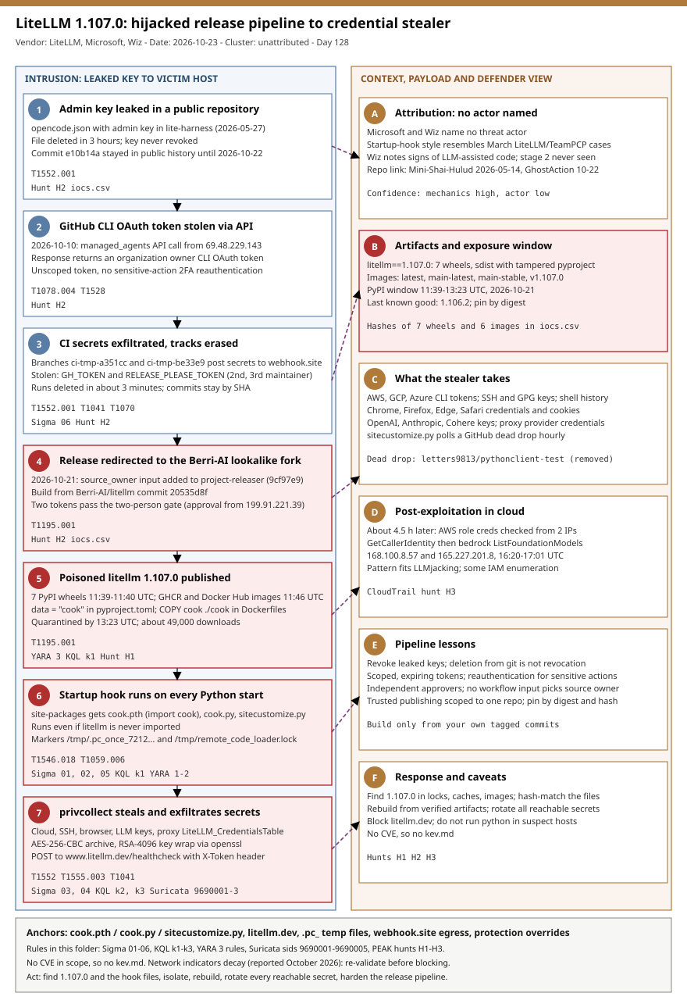

# LiteLLM 1.107.0: a hijacked release pipeline ships a credential stealer to PyPI and container registries through Python startup hooks

## TL;DR

On 2026-10-21 an attacker used stolen GitHub CLI OAuth tokens of three LiteLLM engineers to build and publish `litellm==1.107.0` (seven PyPI wheels, 11:39 to 11:40 UTC) and matching GHCR and Docker Hub images from a lookalike fork, `Berri-AI/litellm`. The wheels drop `cook.pth`, `cook.py` and `sitecustomize.py` into `site-packages`, so a credential stealer ("privcollect") runs at every Python start, even if LiteLLM is never imported. PyPI quarantined the release by 13:23 UTC after about 49,000 downloads; the root cause published on 2026-10-23 traces the intrusion to an admin key committed to a public repository on 2026-05-27 and never revoked. It matters today because the same pattern (unscoped OAuth tokens, a weakened two-person release gate, fork-sourced builds) exists in most CI-published projects, and because stolen cloud and LLM keys were being validated within hours.

## Attribution and confidence

- **Cluster:** none named. Microsoft and Wiz name no actor. Wiz notes the startup-hook launch behaviour resembles earlier LiteLLM compromises attributed to TeamPCP in March 2026, but that is a technique similarity, not an attribution.
- **Vendor and date:** LiteLLM incident post 2026-10-21 and root-cause post 2026-10-23; Microsoft Security 2026-10-23; Wiz; StepSecurity and Socket (independent analyses, not read in full); The Register 2026-10-26.
- **Confidence:** the compromise mechanics are **high** (vendor postmortem plus three independent analyses agree on files, hashes and timeline); attribution is **low** (no actor, no overlap proven).
- Wiz also observes signs of LLM-assisted code (verbose names, generic exception handling, a dead `exec_py` module) and that the second stage was never seen active. Treat that as an analyst opinion.

| Attribute | Observation |
|---|---|
| Entry | Admin key for the LiteLLM Agent Platform committed to `LiteLLM-Labs/lite-harness` on 2026-05-27, removed after about three hours but still in public history until 2026-10-22 |
| Tokens abused | Three GitHub CLI OAuth tokens (an organization owner, a second maintainer, a third maintainer) |
| Release source | Fork `Berri-AI/litellm` (hyphenated lookalike of `BerriAI`), commit `20535d8f` |
| Artifacts | PyPI wheels, GHCR and Docker Hub images (`latest`, `main-latest`, `main-stable`, `v1.107.0`) |
| Payload | `cook.pth` + `cook.py` (stealer) + `sitecustomize.py` (dead-drop loader, Linux and macOS) |

**Genealogy in this repo:** 2026-05-14 Mini-Shai-Hulud / TeamPCP mega-campaign (CI/CD supply chain, same tradecraft class) and 2026-10-22 GhostAction stage 2 (CI secret theft). No infrastructure overlap is claimed. 2026-10-28 listed LiteLLM as a secondary finding; this entry is the full case.

## Kill chain — summary table

| Stage | MITRE | Detail |
|---|---|---|
| 1. Exposed admin key | T1552.001 | Agent Platform admin key in a public repo commit, never revoked (2026-05-27) |
| 2. Token theft | T1078.004, T1528 | Managed-agents API returns the owner GitHub CLI OAuth token (2026-10-10) |
| 3. CI secret exfiltration | T1552.001, T1041, T1070 | `ci-tmp-*` branches post secrets to webhook.site; runs deleted |
| 4. Release redirection | T1195.001 | `source_owner` input added; build from lookalike fork; two tokens pass the gate (2026-10-21) |
| 5. Poisoned publish | T1195.001 | Seven wheels and images carry cook files; `data = "cook"` bundles them |
| 6. Startup-hook execution | T1546.018, T1059.006 | `cook.pth` runs `import cook` at interpreter start |
| 7. Credential theft and exfiltration | T1552, T1555.003, T1041 | AES-256-CBC + RSA-4096 archive POSTed to www.litellm.dev/healthcheck |
| 8. Loader and cloud abuse | T1102.001, T1105, T1078.004 | GitHub dead drop; AWS key validation from two IPs |



The left lane follows the intrusion from the leaked key to the stealer on a victim host; the right lane holds attribution, the artifacts, what the stealer takes, post-exploitation, the pipeline lessons and the response order. Detection anchors are the startup-hook files, the litellm.dev lookalike, `.pc_` temp files and OpenSSL staging, CI egress to webhook.site and GitHub audit events for protection overrides.

## Stage-by-stage detail

### 1. Exposed admin key (T1552.001)

An `opencode.json` containing an administrative key for the LiteLLM Agent Platform (an internal alpha) was committed to the public `LiteLLM-Labs/lite-harness` repository on 2026-05-27 at 18:53 UTC (commit `e10b14a`). A follow-up commit deleted the file about three hours later, but deletion does not revoke a key and the original stayed reachable in public history until 2026-10-22. The Register reports the key was never revoked.

### 2. Token theft (T1078.004, T1528)

On 2026-10-10 the attacker called the Agent Platform API from `69.48.229.143` and `GET /api/v1/managed_agents/agents?limit=100` returned the GitHub CLI OAuth token of an organization owner. The postmortem stresses that this was a CLI OAuth token, not a scoped personal access token: it carries broad scope and is not subject to GitHub's sensitive-action 2FA reauthentication. Wiz adds that CLI tokens can leak into logs when response bodies are logged.

### 3. CI secret exfiltration and cover-up (T1552.001, T1041, T1070)

Within an hour the owner token created throwaway branches whose workflows posted repository secrets to `webhook.site`: `ci-tmp-a351cc` in `BerriAI/litellm` (six secrets including `GH_TOKEN`) and `ci-tmp-be33e9` in `BerriAI/litellm-auto` (`RELEASE_PLEASE_TOKEN`). Both runs were deleted within three minutes. On 2026-10-12 more workflows on private repositories posted all repository secrets. The two stolen secrets held the second and third maintainers' GitHub CLI tokens.

### 4. Release redirection (T1195.001)

On 2026-10-21 at 10:08 UTC a push to `BerriAI/project-releaser` was rejected by branch protection, then succeeded five seconds later using the owner token (commit `9cf97e9`), which added a `source_owner` input to the release workflow; it previously hardcoded `BerriAI`. The attacker had pushed ten commits to the lookalike fork between 08:56 and 10:46 UTC (first nine author `ckdi82fkoos@proton.me`, GitHub-signed) and dispatched staging from `Berri-AI/litellm` at `20535d8f`. A recently relaxed gate that let any two engineers trigger and approve a release was satisfied with two separate tokens: the production approval at 11:11 UTC came from `199.91.221.39`.

### 5. Poisoned publish (T1195.001)

Seven `litellm==1.107.0` wheels reached PyPI between 11:39:51 and 11:40:13 UTC and images reached Docker Hub and GHCR at 11:46:56 UTC. The commits added `cook.pth`, `cook.py` and `sitecustomize.py`, bumped the version, added `data = "cook"` to `pyproject.toml` so the files ship in the wheel, and `COPY cook ./cook` to the Dockerfiles. The sdist carries no payload files but a tampered `pyproject.toml`. LiteLLM states the official GitHub `v1.107.0` tag did not contain the malicious files. The attacker deleted the production and staging run records at 11:53 UTC, then pushed a revert and force-pushed `main` back to `d687b69`.

### 6. Startup-hook execution (T1546.018, T1059.006)

```text
site-packages/cook.pth          -> single line:  import cook      (executed by site.py at every start)
site-packages/cook.py           -> decodes and decompresses the privcollect collector, runs it in a daemon thread
site-packages/sitecustomize.py  -> Linux/macOS loader; lock /tmp/remote_code_loader.lock
```

Python processes `.pth` lines beginning with `import` and imports `sitecustomize` during site initialization, so neither file needs `import litellm`. Wiz calls the combined `.pth` plus `sitecustomize.py` use apparently the first documented in-the-wild instance. The collector sets `PRIVCOLLECT_ACTIVE=1` to avoid duplicate runs in child processes and writes `/tmp/.pc_once_72129118c59f5636c0bb` after an HTTP 200 upload; Microsoft notes the marker is not a containment control. The marker path does not exist on Windows, so the stealer behaves unreliably there.

### 7. Credential theft and exfiltration (T1552.001, T1552.004, T1552.005, T1555.003, T1041)

The 16-module collector targets browser credentials and cookies (Chrome, Firefox, Edge, Safari), `~/.aws/`, environment variables and instance metadata, GCP service-account keys and application default credentials, Azure CLI tokens, SSH and GPG keys, shell history, LLM provider keys (OpenAI, Anthropic, Cohere and others) and, on a LiteLLM proxy host, up to 500 rows of the PostgreSQL table `LiteLLM_CredentialsTable`. Data is packed into a TAR.GZ, encrypted with AES-256-CBC with the key wrapped under RSA-4096 (OpenSSL staging in `.pc_e_*` directories) and POSTed to `www.litellm[.]dev/healthcheck` with a hardcoded `X-Token` header and an Internet Explorer 7 user agent.

### 8. Loader and cloud abuse (T1102.001, T1105, T1078.004)

`sitecustomize.py` reads `main/domain.txt` from `github.com/letters9813/pythonclient-test`; a non-empty value makes it fetch `http://<domain>/codepy` and execute the reply with no signature check. The file never held more than test values and the repository is gone, so no second stage was observed. Separately, about 4.5 hours after exfiltration, between 16:20 and 17:01 UTC, AWS role credentials harvested from CI runners and Kubernetes nodes were validated from `168.100.8.57` and `165.227.201.8`: `sts:GetCallerIdentity`, then `bedrock:ListFoundationModels` and a model listing (consistent with LLMjacking), with IAM enumeration in a few accounts.

## RE notes

| Component | SHA256 | Lang | Packer | Notes |
|---|---|---|---|---|
| cook.pth (POSIX) | 7f191632e7320705d154b85204f1ae546b543acbd7e8861229b76f5042b92bdb | Python .pth | none | One line, `import cook` |
| cook.pth (Windows) | 84dc8c82c0a4a4a62552ef826b49fcc86d1a5c4a5d0f2c06665723f93d129d7d | Python .pth | none | CRLF variant |
| cook.py (POSIX) | 9dd0a3926f96a37eb86cf1ee2310d9be93139cc4ebef3ef9e2efe9531390be25 | Python | embedded compressed blob | 22,252 bytes; deobfuscates itself, collector in daemon thread |
| cook.py (Windows) | 03ac2a8b752605d1d7710979c17ff18b03dd978203ba23ba97fd8ce3d6f897ea | Python | embedded compressed blob | CRLF variant |
| sitecustomize.py (POSIX) | 34bef04fe88ac9d0aae0475630b1738681d15b94f233ac8aa46eacf5968305fa | Python | none | 25,509 bytes; dead-drop loader, hourly loop |
| sitecustomize.py (Windows) | b6122440d0d9cb1eb1ade9933f49214da8c31288de7710c076c2680dfa528465 | Python | none | CRLF variant |

Microsoft's text says the four hashes cover LF and CRLF variants while its table lists six; the table above follows the six values. The stealer encrypts before upload, so network content inspection will not see credentials. Analysts see signs of LLM-assisted authorship: working happy path, silent failures on other platforms.

## Detection strategy

### Telemetry that matters

- Endpoint file events: creation of `cook.pth`, `cook.py`, `sitecustomize.py` under `site-packages`, and the two `/tmp` marker files (Sysmon EID 11, Defender `DeviceFileEvents`, auditd watches on `site-packages`).
- Process events: `pip` / `uv` installs naming `litellm` 1.107.0, `openssl pkeyutl -encrypt -pubin` on `.pc_` paths, inline `python -c` reading `LiteLLM_CredentialsTable` (Sysmon EID 1, `DeviceProcessEvents`).
- Network: DNS, TLS SNI and proxy logs for `litellm.dev`, `raw.githubusercontent.com/letters9813/`; runner egress to `webhook.site`.
- GitHub organization audit log and Actions run history (`protected_branch.policy_override`, `workflows.delete_workflow_run`, workflow file edits); registry pull logs and image digests.
- Cloud audit: CloudTrail `GetCallerIdentity`, `ListFoundationModels`, IAM `List*`; GCP Audit Logs; Azure sign-in logs; LLM provider key usage.

### Detection coverage

| Engine | File | Logic |
|---|---|---|
| Sigma | [01_python_startup_hook_cook_pth_or_cook_py_in_site_packages.yml](./sigma/01_python_startup_hook_cook_pth_or_cook_py_in_site_packages.yml) | cook.pth or cook.py written to site-packages |
| Sigma | [02_unexpected_sitecustomize_py_in_site_packages_root.yml](./sigma/02_unexpected_sitecustomize_py_in_site_packages_root.yml) | sitecustomize.py dropped by an installer (lead, confirm by hash) |
| Sigma | [03_network_connection_to_litellm_dev_exfiltration_domain.yml](./sigma/03_network_connection_to_litellm_dev_exfiltration_domain.yml) | Connection to litellm.dev |
| Sigma | [04_openssl_pkeyutl_encrypt_of_pc_staging_files.yml](./sigma/04_openssl_pkeyutl_encrypt_of_pc_staging_files.yml) | OpenSSL RSA-encrypting `.pc_` staging files |
| Sigma | [05_privcollect_runtime_markers_tmp_files.yml](./sigma/05_privcollect_runtime_markers_tmp_files.yml) | `/tmp/.pc_once_*` or `remote_code_loader.lock` created |
| Sigma | [06_ci_runner_connection_to_webhook_site.yml](./sigma/06_ci_runner_connection_to_webhook_site.yml) | CI runner egress to webhook.site |
| KQL | [k1](./kql/k1_litellm_startup_hook_files_and_known_hashes.kql) | Startup-hook files by name and SHA-256 |
| KQL | [k2](./kql/k2_litellm_dev_exfiltration_and_post_exploitation_ips.kql) | litellm.dev, dead drop and the two attacker IPs |
| KQL | [k3](./kql/k3_litellm_install_and_privcollect_process_behaviour.kql) | Install of 1.107.0 and privcollect process behaviour |
| YARA | [litellm_1_107_0_privcollect.yar](./yara/litellm_1_107_0_privcollect.yar) | Three rules: cook.pth, loader/stealer markers, tampered build files |
| Suricata | [litellm_1_107_0_network.rules](./suricata/litellm_1_107_0_network.rules) | sids 9690001-9690005: DNS, SNI, POST /healthcheck, dead drop, /codepy |

### Threat hunting hypotheses

- **H1** — poisoned install and startup-hook files on hosts, runners and images: [peak_h1_poisoned_install_and_startup_hook_files.md](./hunts/peak_h1_poisoned_install_and_startup_hook_files.md)
- **H2** — release-pipeline abuse in the GitHub audit log: [peak_h2_release_pipeline_abuse_in_github_audit.md](./hunts/peak_h2_release_pipeline_abuse_in_github_audit.md)
- **H3** — stolen cloud and LLM credential use after exfiltration: [peak_h3_stolen_credential_use_after_exfiltration.md](./hunts/peak_h3_stolen_credential_use_after_exfiltration.md)

## Incident response playbook

### First 60 minutes (triage)

1. Inventory exposure from a clean machine: lockfiles, build logs, image digests, running pods and notebooks that match `litellm` 1.107.0 or the image tags listed in `iocs.csv`.
2. Isolate any host with `cook.pth` / `cook.py` or the `/tmp` markers; do not run `python` or `pip` inside it.
3. Freeze and snapshot the host or image for forensics before rebuilding.
4. Revoke the most valuable secrets first: cloud keys and role sessions, LLM provider keys, GitHub CLI tokens and PATs, package-registry tokens.
5. Check CloudTrail for validation calls from 168.100.8.57 and 165.227.201.8 and for unusual Bedrock activity.
6. Pin LiteLLM to `1.106.2` by digest and block `litellm.dev` at DNS and proxy.

### Artifacts to collect

| Artifact | Path | Tool | Why |
|---|---|---|---|
| Startup-hook files | `<venv or system>/lib/python3.*/site-packages/{cook.pth,cook.py,sitecustomize.py}` | `sha256sum`, copy read-only | Prove the poisoned wheel installed; match the hashes |
| Run-once and lock files | `/tmp/.pc_once_*`, `/tmp/remote_code_loader.lock`, `/tmp/.pc_e_*` | `ls -la`, `stat` | Prove the stealer ran and when |
| pip / uv history and caches | `~/.cache/pip`, `~/.cache/uv`, build logs | `grep` | Which release, which wheel tag, which time |
| Container image and layers | local image store, registry pull logs | `docker history`, `crane digest` | Digest match to the poisoned tags |
| Shell and environment secrets | `~/.aws`, `~/.config/gcloud`, `~/.azure`, `~/.ssh`, `~/.config/gh` | inventory only | Scope what to rotate |
| GitHub audit log and Actions history | organization settings | `gh api` | Overrides, deleted runs, `ci-tmp-*` branches |
| Cloud audit logs | CloudTrail, GCP Audit Logs, Azure activity | Athena, `gcloud logging`, KQL | Use of stolen credentials |

### IR queries and commands

```bash
# Author: Jarmi
# Exposure sweep (read-only; run from a clean host or against a mounted image).
grep -rnE 'litellm(==|~=|>=)?1\.107\.0' --include='*requirements*.txt' --include='*.lock' .
find / \( -name cook.pth -o -path '*/site-packages/cook.py' \) 2>/dev/null | xargs -r sha256sum
ls -la /tmp/.pc_once_* /tmp/remote_code_loader.lock /tmp/.pc_e_* 2>/dev/null
env | grep PRIVCOLLECT_ACTIVE
gh api -X GET "/orgs/<ORG>/audit-log" -f phrase='action:protected_branch.policy_override created:>=2026-10-01' --paginate
```

```powershell
# Author: Jarmi
# Windows hosts: startup-hook files in every Python site-packages.
Get-ChildItem -Path C:\ -Recurse -Include cook.pth,cook.py -ErrorAction SilentlyContinue |
  Where-Object { $_.FullName -match 'site-packages' } |
  Select-Object FullName, Length, @{n='SHA256';e={(Get-FileHash $_.FullName -Algorithm SHA256).Hash}}
```

```kql
// Author: Jarmi
DeviceNetworkEvents
| where Timestamp > ago(30d) and RemoteUrl has "litellm.dev"
| project Timestamp, DeviceName, RemoteUrl, InitiatingProcessCommandLine
```

### Containment, eradication, recovery

- **Exit criteria:** no host or image carries the files or the poisoned digests; every credential reachable by an exposed identity is rotated from a clean machine; GitHub tokens replaced by scoped, expiring ones; release workflow only builds from your own organization and requires approval by a different identity and device.
- **Fix the pipeline:** replace long-lived CLI OAuth tokens and PATs with short-lived credentials; enforce sensitive-action reauthentication; remove workflow inputs that choose the source owner; require signed tags; use PyPI trusted publishing scoped to one repository and environment.
- **Do not:** uninstall the package and stop (secrets are already gone); investigate by running `python` or `pip` inside the suspect environment; trust the `/tmp` marker's absence as proof of safety.

### Recovery validation

Re-run H1 to H3 for 30 days. Confirm no new connection to `litellm.dev`, no use of rotated credentials from old addresses, and that every image in production resolves to a digest-pinned, rebuilt artifact.

## IOCs

Top rows below; full list in [iocs.csv](./iocs.csv). This case has no CVE, so no KEV status applies (a CVE-less supply-chain compromise is never "not exploited" because it is absent from KEV).

| Type | Value | Context | Confidence | Source |
|---|---|---|---|---|
| domain | www.litellm.dev | Lookalike exfiltration domain, POST /healthcheck | high | Microsoft; Wiz |
| url | https://raw.githubusercontent.com/letters9813/pythonclient-test/main/domain.txt | Dead-drop pointer; repository removed | medium | Microsoft; Wiz |
| ipv4 | 168.100.8.57 | AWS credential validation, 2026-10-21 | medium | Wiz |
| ipv4 | 165.227.201.8 | AWS credential validation, 2026-10-21 | medium | Wiz |
| ipv4 | 69.48.229.143 | Agent Platform API access, 2026-10-10 | medium | LiteLLM postmortem |
| ipv4 | 199.91.221.39 | Release pushes and production approval, 2026-10-21 | medium | LiteLLM postmortem |
| sha256 | 7f191632e7320705d154b85204f1ae546b543acbd7e8861229b76f5042b92bdb | cook.pth (POSIX) | high | Wiz; Microsoft |
| sha256 | 9dd0a3926f96a37eb86cf1ee2310d9be93139cc4ebef3ef9e2efe9531390be25 | cook.py stealer (POSIX) | high | Wiz; Microsoft |
| sha256 | 34bef04fe88ac9d0aae0475630b1738681d15b94f233ac8aa46eacf5968305fa | sitecustomize.py loader (POSIX) | high | Wiz; Microsoft |
| sha256 | 462d0c9f67ca522d9e0e4acd245e90b36ce0d5353604a66bb7c43a1ec4a6fcf7 | Wheel manylinux_2_28_x86_64 | high | Wiz |
| path | /tmp/.pc_once_72129118c59f5636c0bb | Run-once marker | high | Microsoft |
| path | /tmp/remote_code_loader.lock | Loader lock file | high | Microsoft |
| string | PRIVCOLLECT_ACTIVE=1 | Collector environment flag | high | Microsoft |
| url | https://github.com/Berri-AI/litellm | Lookalike fork used as the release source | high | LiteLLM postmortem |
| string | ci-tmp-a351cc | Exfiltration branch in BerriAI/litellm | high | LiteLLM postmortem |

These are indicators from October 2026 and decay quickly: re-validate before blocking. `webhook.site` is a dual-use service, kept in the CSV with medium confidence only.

## Secondary findings

- **OVHcloud CLI release replacement (2026-10-19):** a hijacked contributor account replaced release archives for v0.11.0 through v0.15.0; the fix is the immutable, signed-tag v0.16.0. The source page states no confirmed link to the LiteLLM compromise; they share a technique class (release-artifact tampering after account takeover), not a proven author.
- **Node2Shell (CISA warning):** reporting describes an actively exploited Node.js server RCE flagged by CISA. Not analysed here; check the KEV entry and vendor advisory before treating it as a patch-now item.
- **GhostAction / Shai-Hulud class continues:** the 2026-10-22 GhostAction stage 2 case and the 2026-08-06 Keyv/Cacheable worm show registry and CI abuse recurring weekly; the common fix is the same (pin by digest, scoped short-lived publish credentials).

## Pedagogical anchors

- A deleted secret is not a revoked secret: git history and forks keep it, and only rotation closes the exposure (five months passed between commit and abuse).
- Release approval is only a control if the two approvals are independent; when one actor holds several tokens, a two-person gate is theatre.
- Python executes code at startup through `.pth` lines and `sitecustomize`; treat `site-packages` root writes as high-signal events and pin dependencies by hash.
- Build from your own tagged commits: a workflow input that picks the source organization turned a legitimate pipeline into a malware factory.
- Credential validation (`GetCallerIdentity`) is the attacker's receipt and your cheapest tripwire.

## What's in this folder

| File | Purpose | Link |
|---|---|---|
| README.md | This case write-up. | [README.md](./README.md) |
| kill_chain.svg | Two-lane kill chain diagram. | [kill_chain.svg](./kill_chain.svg) |
| sigma/ | Six Sigma rules for startup-hook files, lookalike domain, OpenSSL staging, markers and CI egress. | [sigma/](./sigma/) |
| kql/ | Three Defender XDR queries. | [kql/](./kql/) |
| yara/ | Three rules for the hook files, loader/stealer markers and tampered build files. | [yara/](./yara/) |
| suricata/ | Five network rules (sids 9690001-9690005). | [suricata/](./suricata/) |
| hunts/ | Three PEAK hunts H1-H3. | [hunts/](./hunts/) |
| iocs.csv | Full indicator list (50 rows). | [iocs.csv](./iocs.csv) |

## Sources

- [LiteLLM - Security incident 2026-10-21: attack chain and indicators](https://docs.litellm.ai/blog/security-incident-oct-21-2026-attack-chain)
- [Microsoft - Inside the LiteLLM 1.107.0 supply chain compromise (2026-10-23)](https://www.microsoft.com/en-us/security/blog/2026/10/23/inside-the-litellm-1-107-0-supply-chain-compromise-credential-theft-through-python-startup-hooks/)
- [Wiz - LiteLLM compromised, steals credentials](https://www.wiz.io/blog/litellm-compromised-steals-credentials)
- [The Register - LiteLLM supply chain attack started with an exposed master key (2026-10-26)](https://www.theregister.com/security/2026/10/26/litellm-supply-chain-attack-started-with-an-exposed-master-key/5305544)
- [The Hacker News - LiteLLM compromised in supply chain attack delivering credential stealer and backdoor](https://thehackernews.com/2026/10/litellm-compromised-in-supply-chain.html)
- [StepSecurity - litellm 1.107.0 compromised on PyPI](https://www.stepsecurity.io/blog/litellm-1-107-0-compromised-pypi-backdoored-wheels-credential-stealer)
- [Shattered - LiteLLM supply chain attack: 7 wheels, 2 hours](https://shattered.io/litellm-supply-chain-attack-pypi-ovhcloud-cli-2026/)
