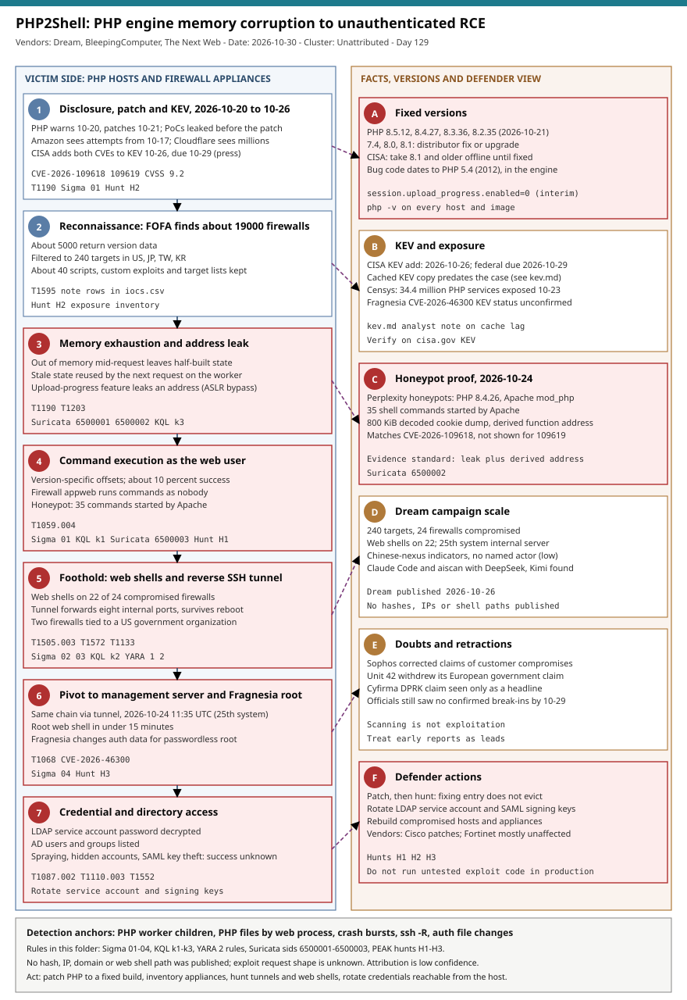

# PHP2Shell (CVE-2026-109618 and CVE-2026-109619): PHP engine memory corruption to unauthenticated RCE, and a Dream-reported firewall chain with Fragnesia root

## TL;DR

Two memory-safety bugs in the PHP engine itself (both CVSS 9.2, code present since PHP 5.4 in 2012) allow unauthenticated remote code execution through crafted HTTP requests; PHP shipped fixes on 2026-10-21 (8.5.12, 8.4.27, 8.3.36, 8.2.35), proof-of-concept code spread, and CISA added both CVEs to KEV on 2026-10-26 with a federal due date of 2026-10-29. On 2026-10-24 a honeypot run by Adel Karimi (Perplexity) confirmed real RCE with usable memory disclosure on PHP 8.4.26 under Apache mod_php, and on 2026-10-26 Dream reported a Chinese-nexus operation that used a non-public variant against the PHP appweb of a firewall platform, compromised 24 of 240 selected firewalls, reached two systems tied to a US government-affiliated organization, and chained the Linux kernel flaw Fragnesia (CVE-2026-46300) for root. Early success claims were partly withdrawn (Sophos, Unit 42), exploitation is unreliable (about 10 percent success), and about 34 million PHP services were still exposed on 2026-10-23, so the case is a patch-now and prove-clean exercise.

## Attribution and confidence

- **Cluster:** none named. Dream: "We do not attribute this activity to a named threat actor", with Chinese-language prompts, UTC+8 timestamps and targeting of the US, Japan, Taiwan and South Korea pointing to a Chinese-nexus operation. Confidence in that nexus: **low**. Recovered systems held Claude Code and an "aiscan" setup configured with DeepSeek and Kimi; Dream has no direct evidence that AI wrote the exploit and does not call the operation autonomous.
- **Conflicting claim:** a Cyfirma report (seen only as a headline and a tool summary) names a suspected North Korean campaign against 216 PHP hosts with 21 compromised nodes. It is treated as a separate, unverified campaign.
- **Overlap table**

| Item | This case | Earlier repo cases |
|---|---|---|
| Entry | Edge or web-facing PHP, unauthenticated | 2026-10-01 NetScaler zero-days; 2026-10-27 PAN-OS GlobalProtect |
| Post-exploitation | Reverse SSH tunnel, directory enumeration, SAML key theft attempts | 2026-10-27 Qilin and INC pivot to vCenter and ESXi |
| Memory-corruption exploit dev | Version-specific offsets, ASLR bypass through an info leak | 2026-08-14 AFD.sys zero-day (Lazarus, #28) |
| Actor | Unnamed, Chinese-nexus (low) | 2026-10-19 ARMORY CASTLE, 2026-10-25 BlackX (APT41-linked) |

- **Genealogy:** continues the 2026-10-27 firewall-to-hypervisor case (edge appliance as the first foothold) and the 2026-08-14 exploit-dev case; the PHP engine bug class (use-after-free like state surviving a request) is new to the repo.

## Kill chain — summary table

| Stage | MITRE | Detail |
|---|---|---|
| 1. Disclosure and race | T1190 | PHP warns admins 2026-10-20, patches 2026-10-21; leaked details and PoCs already exist; Amazon sees attempts from 2026-10-17 |
| 2. Reconnaissance | T1595 | FOFA finds about 19000 firewalls; 5000 return versions; 240 targets in US, JP, TW, KR |
| 3. Memory exhaustion and leak | T1190, T1203 | Out-of-memory mid-request leaves half-built state (CVE-2026-109618); stale state reused by the next request on the worker (CVE-2026-109619); an address is leaked to defeat ASLR |
| 4. Command execution as web user | T1059.004 | Offsets are version-specific; commands run as `nobody` (firewall) or Apache (honeypot) |
| 5. Foothold and tunnel | T1505.003, T1572, T1133 | Web shells on 22 of 24 firewalls; reverse SSH tunnel with eight forwarded ports, persistent across reboot |
| 6. Pivot and root | T1068, T1078 | Same chain run through the tunnel against an internal management server at 11:35 UTC 2026-10-24; Fragnesia changes authentication data for passwordless root |
| 7. Credential and directory access | T1087.002, T1110.003, T1552 | LDAP service account password decrypted; AD users and groups listed; spraying, hidden accounts and SAML signing-key theft attempted (success unknown) |



The left lane follows the intrusion from disclosure to credential access; the right lane holds the facts a defender needs (versions, KEV dates, scale, doubts and fixes). Detection anchors are PHP-worker children, PHP files written by the web process, worker crash bursts, reverse SSH forwards and changes to local authentication files.

## Stage-by-stage detail

### 1. Disclosure and race

PHP warned administrators on 2026-10-20 and shipped fixes on 2026-10-21. Details and proof-of-concept code circulated before the patch; the PHP team said none of the early ones worked. Cloudflare saw thousands of attempts in the 10 hours before disclosure and millions by 2026-10-22; Amazon saw attempts from 2026-10-17. Scanning is not exploitation: as of 2026-10-29 several governments still reported no confirmed break-ins, and Sophos and Unit 42 corrected their own earlier statements.

MITRE: T1190 Exploit Public-Facing Application.

### 2. Reconnaissance

Dream says the actor found about 19000 internet-facing firewalls with FOFA, about 5000 returning version data, and narrowed the list to 240 targets in the US, Japan, Taiwan and South Korea. The same operator kept about 40 post-compromise scripts, custom exploits, target lists and attack logs.

MITRE: T1595 Active Scanning (no technique ID in the sources; mapped by the analyst).

### 3. Memory exhaustion and leak (CVE-2026-109618, CVE-2026-109619)

Per watchTowr (as summarised by BankInfoSecurity and Security Affairs): CVE-2026-109618 is reached when PHP runs out of memory part way through setting up a request, leaving internal data half built; CVE-2026-109619 leaves internal state that outlives the request memory it points to, so the next request handled by the same worker can act on leftover data. In the Dream chain the attacker exhausted memory, leaked a memory address through PHP's `session.upload_progress` feature and then manipulated the damaged structures. VulnCheck has an exploit that defeats ASLR by combining the leak with the other bug. No source gives the HTTP request shape.

```text
Public detail stops here: no request path, header or payload was published in the sources read.
Honeypot evidence: an 800 KiB decoded cookie dump, then an execution payload that contains a function
address derived from that dump with the public exploit's offsets.
```

MITRE: T1190; T1203 Exploitation for Client Execution is used only loosely here because the target is server-side.

### 4. Command execution as the web user

The exploit needs precise, version-specific memory offsets; Dream's researcher states that no universal exploit exists and only about 10 percent of attempts succeeded, mostly failing by timeout. The Dream code is described as a custom, non-public implementation for the appweb server of a firewall platform whose vendor is withheld. On the honeypots, Apache started 35 shell commands on three PHP 8.4.26 mod_php targets, followed by attempts to reach outside servers with PHP, curl and wget; the evidence matches CVE-2026-109618 and does not show CVE-2026-109619 in use.

MITRE: T1059.004 Unix Shell.

### 5. Foothold and tunnel

Web shells were left on 22 of the 24 compromised firewalls (names and paths not published). On two firewalls tied to a US government-affiliated organization, the first crashed and the second was compromised on 2026-10-24; the actor set up a reverse SSH tunnel forwarding eight internal ports, with startup settings that survive reboot.

MITRE: T1505.003 Web Shell; T1572 Protocol Tunneling; T1133 External Remote Services.

### 6. Pivot and root

At 11:35 UTC on 2026-10-24 the same chain ran through the tunnel against an internal firewall management server (the 25th compromised system) and installed a root web shell in under 15 minutes. Fragnesia (CVE-2026-46300) changed local authentication data, which gave root without a password.

MITRE: T1068 Exploitation for Privilege Escalation; T1078 Valid Accounts.

### 7. Credential and directory access

The actor decrypted an LDAP service account password and listed Active Directory users and groups. Password spraying, creation of backdoor accounts and theft of SAML signing keys were attempted; whether they succeeded is not known.

MITRE: T1087.002 Domain Account; T1110.003 Password Spraying; T1552 Unsecured Credentials.

## Detection strategy

### Telemetry that matters

- Linux process creation on web hosts (EDR, auditd `execve`, Sysmon for Linux): children of Apache, PHP-FPM, php-cgi, LiteSpeed and appweb.
- Linux file events: PHP files created by the web user; writes to `/etc/passwd`, `/etc/shadow` and `/etc/sudoers`.
- Syslog from PHP-FPM and Apache: worker exits on signal 11 or 6, out-of-memory messages.
- Network: plaintext HTTP after TLS termination (WAF, reverse proxy), egress flow logs from web hosts and appliances, SSH sessions from servers to the internet.
- Identity: LDAP bind and query logs, domain controller 4624/4625/4768/4769, SAML signing-key access.

### Detection coverage

| Engine | File | Logic |
|---|---|---|
| Sigma | [sigma/01_linux_web_worker_spawns_shell_or_downloader.yml](./sigma/01_linux_web_worker_spawns_shell_or_downloader.yml) | shell or download tool below a PHP-serving process |
| Sigma | [sigma/02_linux_reverse_ssh_tunnel_multi_port_forward.yml](./sigma/02_linux_reverse_ssh_tunnel_multi_port_forward.yml) | ssh with `-R` and `-N` |
| Sigma | [sigma/03_linux_web_worker_writes_php_file_in_webroot.yml](./sigma/03_linux_web_worker_writes_php_file_in_webroot.yml) | web process creates a PHP file |
| Sigma | [sigma/04_linux_auth_files_changed_outside_package_or_admin_tools.yml](./sigma/04_linux_auth_files_changed_outside_package_or_admin_tools.yml) | authentication files changed by a non-standard process |
| KQL | [kql/k1_web_worker_child_shell_and_reverse_ssh.kql](./kql/k1_web_worker_child_shell_and_reverse_ssh.kql) | Defender XDR process lineage and ssh forwards |
| KQL | [kql/k2_web_worker_writes_php_files.kql](./kql/k2_web_worker_writes_php_files.kql) | Defender XDR PHP file creation by the web process |
| KQL | [kql/k3_php_worker_crash_bursts_in_syslog.kql](./kql/k3_php_worker_crash_bursts_in_syslog.kql) | Sentinel Syslog worker-crash bursts |
| YARA | [yara/php2shell_post_exploitation_generic.yar](./yara/php2shell_post_exploitation_generic.yar) | 2 generic rules: request-to-exec PHP shell, reverse SSH tunnel script |
| Suricata | [suricata/php2shell_network.rules](./suricata/php2shell_network.rules) | 3 sids: upload-progress field, oversized Set-Cookie, web host curl/wget egress |

### Threat hunting hypotheses

- **H1:** a PHP-serving process ran a command or reached the internet. [hunts/peak_h1_php_worker_children_and_egress.md](./hunts/peak_h1_php_worker_children_and_egress.md)
- **H2:** PHP services are unpatched or still expose upload progress, including inside appliances. [hunts/peak_h2_php_exposure_and_version_inventory.md](./hunts/peak_h2_php_exposure_and_version_inventory.md)
- **H3:** tunnels, directory enumeration and local root changes followed a web foothold. [hunts/peak_h3_post_compromise_tunnels_credentials_and_root.md](./hunts/peak_h3_post_compromise_tunnels_credentials_and_root.md)

## Incident response playbook

### First 60 minutes (triage)

1. Inventory every PHP-serving host, container image and appliance with a PHP management page; record version and SAPI.
2. Patch to 8.5.12, 8.4.27, 8.3.36 or 8.2.35 (or the distributor fix); take PHP 8.1 and older unsupported builds offline until fixed, as CISA advises.
3. Run H1 and H3 on internet-facing hosts first; check worker crash bursts since 2026-10-17.
4. Pull egress flow logs for web hosts and appliances; look for SSH to the internet and for curl or wget user agents.
5. If a hit appears, isolate the host, preserve memory and the web root, and rotate every credential the host could read.

### Artifacts to collect

| Artifact | Path | Tool | Why |
|---|---|---|---|
| Web root and PHP files by mtime | web root and appliance management folders | find, tar | Web shells; names and paths were not published |
| Web server and PHP-FPM logs | `/var/log/apache2/`, `/var/log/php*-fpm.log`, syslog | scp, SIEM | Crash bursts, odd POST requests |
| Process list and network connections | live host | ps, ss, lsof | Reverse SSH tunnels and shell children |
| Auth files and shell history | `/etc/passwd`, `/etc/shadow`, `/etc/sudoers`, `~/.ssh/` | stat, sha256sum | Fragnesia effect, tunnel keys |
| Startup scripts | `/etc/rc*`, `/etc/init.d`, cron, systemd units | grep | Tunnel persistence across reboot |
| LDAP and DC logs | directory server and domain controllers | SIEM | Service account use and enumeration |

### IR queries and commands

```bash
# Author: Jarmi
# Read-only: PHP build, SAPI, upload-progress setting and long-running reverse SSH clients.
php -v | head -1
php -i 2>/dev/null | grep -E '^Server API|session.upload_progress.enabled'
ps -eo pid,user,lstart,args | grep -E 'ssh .* -R ' | grep -v grep
```

```bash
# Author: Jarmi
# Read-only: PHP files changed in the last 30 days under common web roots.
find /var/www /srv /usr/share/nginx -type f \( -name '*.php' -o -name '*.phtml' -o -name '*.phar' \) -mtime -30 -printf '%TY-%Tm-%Td %p\n' 2>/dev/null | sort | tail -50
```

```kql
// Author: Jarmi
// Defender XDR: children of PHP-serving processes in the last 14 days.
DeviceProcessEvents
| where Timestamp > ago(14d) and InitiatingProcessFileName in~ ("apache2", "httpd", "php-fpm", "php-cgi", "lsphp", "appweb")
| where FileName !in~ ("php-fpm", "apache2", "httpd")
| summarize count() by DeviceName, FileName, InitiatingProcessFileName
```

### Containment, eradication, recovery

- **Exit criteria:** every PHP host on a fixed build or offline; no unexplained children of the web processes; no reverse SSH tunnels; no new PHP files or authentication-file changes; service account and signing keys reviewed or rotated.
- Fixing the entry point does not remove web shells, tunnels or stolen credentials; rebuild compromised hosts and appliances from clean images and rotate the LDAP service account and any SAML signing keys the host could reach.
- For appliances where the vendor controls PHP, follow the vendor advisory and restrict the management interface to a management network.
- **What NOT to do:** do not rely on ASLR, a WAF or EDR as the fix (the sources call them mitigating, not a remedy); do not patch only and declare the host clean; do not publish or run untested exploit code on production hosts.

### Recovery validation

Re-run H1 to H3 after patching, confirm the PHP version string on each host and image, confirm no crash bursts for 14 days, and confirm that rotated credentials are not used from old sources.

## IOCs

No hash, IP address, domain or web shell path was published by any source read. The table lists vulnerability identifiers and behavioural strings; the full list is in `iocs.csv`.

| Type | Value | Context | Confidence | Source |
|---|---|---|---|---|
| cve | CVE-2026-109618 | PHP engine memory corruption, unauthenticated RCE, CVSS 9.2 | high | watchTowr via BankInfoSecurity |
| cve | CVE-2026-109619 | Stale per-request state reused by the next request, CVSS 9.2 | high | watchTowr via BankInfoSecurity |
| cve | CVE-2026-46300 | Fragnesia Linux kernel local privilege escalation chained after PHP2Shell | medium | Cybersecurity News 2026-10-29 |
| cve | CVE-2026-115560 | Separate PHP RCE needing odd configuration; unpatched on 2026-10-26 | medium | BleepingComputer |
| string | session.upload_progress.enabled | php.ini setting; interim mitigation 0 | medium | BleepingComputer |
| string | PHP_SESSION_UPLOAD_PROGRESS | Standard multipart trigger field name (analyst inference) | low | PHP documentation |
| note | Fixed PHP versions | 8.5.12, 8.4.27, 8.3.36, 8.2.35 | high | The Next Web |
| note | Honeypot confirmation | 35 Apache-started commands on PHP 8.4.26 mod_php on 2026-10-24 | high | BleepingComputer |
| note | Dream campaign scale | 240 targets, 24 compromised, web shells on 22, 25th system on 2026-10-24 | medium | Cybersecurity News |
| note | Retracted claims | Sophos and Unit 42 corrected early success reports | high | The Next Web |

**KEV status:** the cached KEV copy (catalogVersion 2026.10.16) shows none of this case's CVEs, but it predates the case. The Next Web (2026-10-28) reports that CVE-2026-109618 and CVE-2026-109619 were added to KEV on 2026-10-26 with a federal remediation due date of 2026-10-29, and CISA's own alert is cited there; this was not verified against the live catalog (see [kev.md](./kev.md)). Ransomware use is not stated. Fragnesia (CVE-2026-46300) KEV status is unconfirmed.

## Secondary findings

- **Mirai variant "Potassium" (Sophos, Arctic Wolf via Security Affairs):** appears after disclosure, contacts a hard-coded C2 and fetches a Linux executable; Sophos blocked delivery so no payload was seen. ENS name resolution is present but disabled; fallback DNS is 8.8.8.8 and 1.1.1.1. No C2 was published.
- **CVE-2026-115560 (BleepingComputer 2026-10-26):** a separate PHP RCE that needs an unusual combination of configuration and application code and had no patch; PHP advised `session.upload_progress.enabled=0`.
- **Cisco and Fortinet statements (summary only):** Cisco has patches for Expressway Series and Duo Access Gateway (Duo Access Gateway is end of life except for federal customers); Fortinet says most products are unaffected, with FortiDDoS and FortiSOAR under assessment. The page text was truncated, so verify on the vendor advisories.

## Pedagogical anchors

- A bug in the language runtime turns every application on it into attack surface; patch the runtime and inventory it inside appliances and container images, not only on servers you run.
- Memory-corruption exploits are fragile: version-specific offsets and a 10 percent success rate mean many failed attempts leave crashes and timeouts. Crash telemetry is detection data.
- Early "confirmed exploitation" claims can be wrong; the honeypot report with a cookie dump and a derived function address is the standard of evidence to ask for, and two vendors retracted theirs.
- Patching the entry point does not evict an intruder: web shells, a reverse SSH tunnel with eight forwards, a decrypted service account and attempted SAML key theft all outlive the fix.
- A KEV listing is a deadline, not proof of your compromise; absence of KEV for a companion bug such as Fragnesia in the sources read means "unconfirmed", not "safe".

## What's in this folder

| File | Purpose | Link |
|---|---|---|
| README.md | This analysis. | [README.md](./README.md) |
| kill_chain.svg | Kill chain diagram (template A). | [kill_chain.svg](./kill_chain.svg) |
| sigma/ | Four Sigma rules (process, ssh tunnel, file, authentication files). | [sigma/](./sigma/) |
| kql/ | Three KQL queries for Defender XDR and Sentinel. | [kql/](./kql/) |
| yara/ | Two generic YARA rules for web shells and tunnel scripts. | [yara/php2shell_post_exploitation_generic.yar](./yara/php2shell_post_exploitation_generic.yar) |
| suricata/ | Three Suricata sids for the trigger field, cookie leak and web host egress. | [suricata/php2shell_network.rules](./suricata/php2shell_network.rules) |
| hunts/ | Three PEAK hunts H1 to H3. | [hunts/](./hunts/) |
| iocs.csv | Identifiers and behavioural strings (16 rows). | [iocs.csv](./iocs.csv) |
| kev.md | CISA KEV cross-reference for this case's CVEs. | [kev.md](./kev.md) |

## Sources

- [CISA confirms attackers are exploiting both PHP2Shell flaws (The Next Web, 2026-10-28)](https://thenextweb.com/news/php2shell-flaws-exploited-cisa-kev)
- [PHP2Shell security flaws now successfully exploited in the wild (BleepingComputer, 2026-10-26)](https://bleepingcomputer.com/news/security/php2shell-security-flaws-now-sucessfully-exploited-in-the-wild)
- [Hackers chain PHP2Shell and Linux kernel exploits to gain root access on 25 servers (Cybersecurity News, 2026-10-29)](https://cybersecuritynews.com/php2shell-gained-root-access-on-25-servers/)
- [China-linked hackers exploit PHP2Shell to breach US government network (Cybernews)](https://cybernews.com/security/china-linked-hackers-exploit-php2shell-breach-us-government/)
- [PHP2Shell: millions of attacks, no confirmed successful exploits yet (Security Affairs, 2026-10-23)](https://securityaffairs.com/?p=201538)
- [PHP2Shell actively exploited, US cybersecurity agency warns (BankInfoSecurity)](https://www.bankinfosecurity.com/php2shell-actively-exploited-us-cybersecurity-agency-warns-a-33219)
