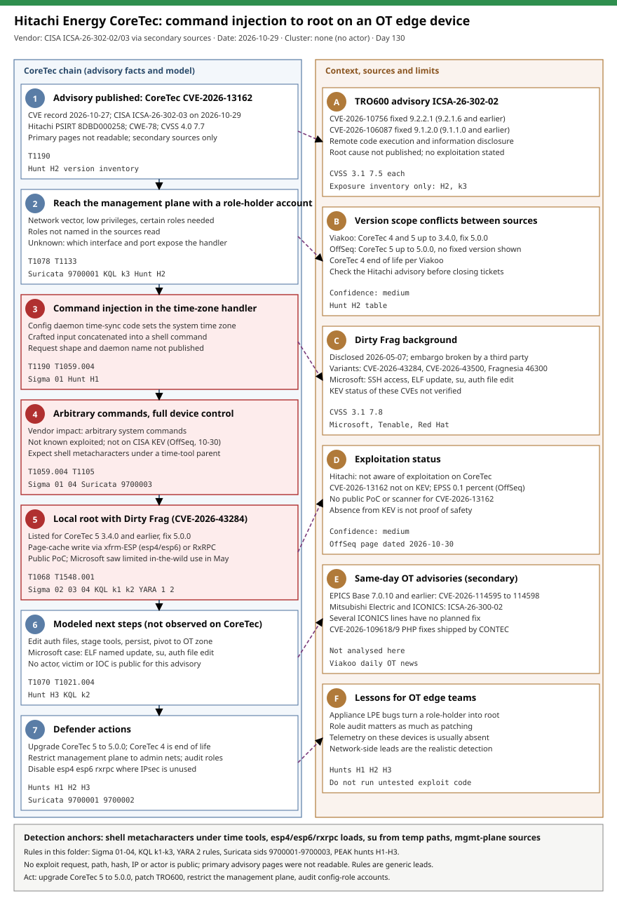

# Hitachi Energy CoreTec (CVE-2026-13162): time-zone command injection plus Dirty Frag root on an OT edge device, with the TRO600 RCE advisory

## TL;DR

On 2026-10-29 CISA published ICSA-26-302-03 for Hitachi Energy CoreTec 4 and 5: CVE-2026-13162 is an OS command injection (CWE-78, CVSS 4.0 7.7) in the configuration daemon's time-synchronization handler, reachable over the network by an authenticated user with certain roles. The same advisory lists the Linux kernel flaw CVE-2026-43284 (Dirty Frag) for CoreTec 5 3.4.0 and earlier, so a role-holder account can plausibly become root on a device that sits at the OT-IT boundary. A sister advisory, ICSA-26-302-02, covers Hitachi Energy TRO600 with two RCE flaws (CVE-2026-10756, CVE-2026-106087). Nobody has published an exploit request, an actor, a victim or an indicator, and Hitachi says it knows of no exploitation on CoreTec, so this day is an exposure and hunting lesson, not an incident write-up. The primary CISA and Hitachi pages could not be read in this run; every fact below comes from secondary sources and is marked accordingly.

## Attribution and confidence

- **Cluster:** none. No threat actor is named for CVE-2026-13162, CVE-2026-10756 or CVE-2026-106087.
- **Vendor / date:** CISA advisories ICSA-26-302-03 and ICSA-26-302-02 dated 2026-10-29 (Hitachi Energy PSIRT 8DBD000258 and 8DBD000224); secondary reports from the Viakoo daily OT news (2026-10-30, syndicated on Security Boulevard) and the OffSeq CVE page.
- **Confidence:** `medium` for the advisory facts (two consistent secondary sources, primary pages unread); `low` for any exploitation or attacker-behaviour claim, because none is published for CoreTec.

| Overlap | Evidence | Verdict |
|---|---|---|
| Dirty Frag in the wild (May 2026) | Microsoft reported limited use: SSH access, an ELF named `update`, `su` escalation, an authentication-file edit | Different victims; shows what the LPE looks like after use, no link to CoreTec |
| Fragnesia chain (2026-10-30 case) | Same kernel family (esp/xfrm page-cache writes) | Shared bug class, no shared actor |
| Hitachi advisories | Two advisories on the same day | Coincidence of disclosure, no evidence of a campaign |

**Genealogy in this repo:** the 2026-10-30 PHP2Shell case already used Fragnesia (CVE-2026-46300) for root on a firewall, and 2026-07-24 covered the XFS page-cache race RefluXFS. This case is the OT-edge sibling: same kernel bug class, different device class, and no sign of real-world abuse yet.

## Kill chain — summary table

Stages 1 to 5 follow the advisory facts; stage 6 is a model of generic next steps and was not observed on CoreTec.

| Stage | MITRE | Detail |
|---|---|---|
| 1. Advisory published | T1190 | CVE record 2026-10-27; CISA ICSA-26-302-03 on 2026-10-29; CoreTec 4 and 5 |
| 2. Reach the management plane | T1078, T1133, T0822 | Network vector, low privileges, certain roles required |
| 3. Command injection in the time-zone handler | T1190, T1059.004, T0866 | Input concatenated into a shell command (CWE-78) |
| 4. Arbitrary commands, device control | T1059.004, T1105 | Vendor impact statement; no exploitation known |
| 5. Local root with Dirty Frag | T1068, T1548.001 | CVE-2026-43284 listed for CoreTec 5 3.4.0 and earlier |
| 6. Modeled post-exploitation | T1070, T1021.004 | Edit auth files, stage tools, pivot; not observed |
| 7. Defender actions | n/a | Upgrade CoreTec 5 to 5.0.0, restrict the management plane, audit roles |



The left lane is the CoreTec chain (advisory facts, then the modeled steps); the right lane holds the TRO600 advisory, the conflicts between sources, Dirty Frag background and exploitation status. Detection anchors are a shell with metacharacters under a time-tool parent, module loads or namespace creation for esp4/esp6/rxrpc, `su` from temp paths, and management-plane access from unlisted sources.

## Stage-by-stage detail

### 1. Advisory and scope

Per the Viakoo summary of ICSA-26-302-03, CVE-2026-13162 affects CoreTec 4 and CoreTec 5 version 3.4.0 and earlier, and CoreTec 5 5.0.0 fixes both CVEs in the advisory while CoreTec 4 is end of life. OffSeq instead lists CoreTec 5 up to 5.0.0 as affected and shows no fixed version. Treat the version scope as unresolved until the Hitachi advisory is read.

```text
CVE-2026-13162   CWE-78   CVSS 4.0 7.7  AV:N/AC:H/AT:N/PR:L/UI:N/VC:H/VI:H/VA:H  (CNA: Hitachi Energy)
Advisory: CISA ICSA-26-302-03, Hitachi PSIRT 8DBD000258, published 2026-10-29
```

MITRE: T1190 Exploit Public-Facing Application.

### 2. Reach the management plane

The attacker must be authenticated with certain roles (not named in the sources read), over the network, with high attack complexity. The interface and port that expose the handler are not published. In practice the question for defenders is who can reach the management plane and which accounts hold configuration rights.

MITRE: T1078 Valid Accounts, T1133 External Remote Services; ICS T0822.

### 3. Command injection in the time-zone handler

OffSeq describes the configuration daemon's time-synchronization handler, the code that sets the system time zone, concatenating crafted input into shell commands without sanitization. No request shape, URL path, parameter or daemon name is public, so detection has to be behavioural.

```text
Generic indicator: a shell or interpreter child of a time-tool parent whose command line holds ; | $( ` or &&
Rule: sigma/01 (low confidence)   Hunt: H1
```

MITRE: T1190, T1059.004 Unix Shell; ICS T0866 Exploitation of Remote Services.

### 4. Arbitrary commands and device control

The vendor impact statement is arbitrary system commands and full device control. Hitachi said it was not aware of exploitation in the wild affecting CoreTec; CVE-2026-13162 is not on CISA KEV per OffSeq (data dated 2026-10-30), EPSS is 0.1 percent, and no public PoC exists. Absence from KEV is not proof of safety, particularly for a device class with little telemetry.

MITRE: T1059.004, T1105 Ingress Tool Transfer.

### 5. Local root with Dirty Frag

The advisory also lists CVE-2026-43284 (CVSS 3.1 7.8) for CoreTec 5. The xfrm-ESP variant (esp4/esp6 modules, needs user or network namespace creation) lets a low-privileged local user corrupt page-cache contents of readable files and reach root; the RxRPC variant (CVE-2026-43500) depends on the rxrpc module. Microsoft saw limited in-the-wild use: external SSH access, an ELF named `update` that escalated through `su`, an edit of an authentication file, reconnaissance, then deletion and wiping of PHP session files. Disclosure was 2026-05-07 and a public PoC exists.

```bash
# Published mitigation (Tenable) - also blocks legitimate IPsec, review first
printf 'install esp4 /bin/false\ninstall esp6 /bin/false\ninstall rxrpc /bin/false\n' > /etc/modprobe.d/dirtyfrag.conf
rmmod esp4 esp6 rxrpc 2>/dev/null; echo 3 > /proc/sys/vm/drop_caches
```

MITRE: T1068 Exploitation for Privilege Escalation, T1548.001 Setuid and Setgid.

### 6. Modeled post-exploitation

Not observed on CoreTec. On a root shell, the generic next steps are editing authentication files, staging tools, persisting and pivoting into the OT zone over SSH. The Microsoft case is the only concrete reference and its `update` name is trivially changed.

MITRE: T1070 Indicator Removal, T1021.004 SSH.

### 7. TRO600 sister advisory

ICSA-26-302-02 (Hitachi PSIRT 8DBD000224) lists CVE-2026-10756 (affects 9.2.1.6 and earlier, fixed 9.2.2.1, low privileges, high complexity) and CVE-2026-106087 (affects 9.1.1.0 and earlier, fixed 9.1.2.0, network, no privileges, low complexity), both CVSS 3.1 7.5, with remote code execution and information disclosure. The root cause is not published, so coverage is exposure inventory only.

## Detection strategy

### Telemetry that matters

- **Linux process telemetry** (EDR, auditd `execve`, Sysmon for Linux) where it exists: parent/child for time tools, `modprobe`, `unshare`, `su`, SUID binaries. Most OT edge units have none, so extend it to jump hosts and engineering workstations.
- **Defender XDR:** `DeviceProcessEvents`, `DeviceLogonEvents`, `DeviceFileEvents`; **Sentinel:** `Syslog`, `CommonSecurityLog` (firewall logs for management-plane access).
- **Network:** NetFlow or IDS on the OT boundary for management ports, ESP (IP protocol 50) and device egress.
- **Device-side logs:** configuration-change and account-role audit logs from CoreTec and TRO600 management interfaces, if the vendor exposes them.

### Detection coverage

| Engine | File | Logic |
|---|---|---|
| Sigma | [01_linux_time_config_daemon_spawns_shell_with_metacharacters.yml](./sigma/01_linux_time_config_daemon_spawns_shell_with_metacharacters.yml) | Shell or interpreter under a time-tool parent with metacharacters (CVE-2026-13162 lead, low confidence) |
| Sigma | [02_linux_dirty_frag_module_load_or_userns_netns.yml](./sigma/02_linux_dirty_frag_module_load_or_userns_netns.yml) | modprobe/insmod of esp4, esp6, rxrpc, or unshare with mapped root user plus new network namespace |
| Sigma | [03_linux_dirtyfrag_modprobe_blacklist_file_written.yml](./sigma/03_linux_dirtyfrag_modprobe_blacklist_file_written.yml) | `dirtyfrag.conf` written; mitigation inventory, not an alert |
| Sigma | [04_linux_su_or_suid_from_tmp_or_update_binary.yml](./sigma/04_linux_su_or_suid_from_tmp_or_update_binary.yml) | su or SUID binary started from /tmp, /dev/shm, /var/tmp or a home-directory `update` |
| KQL | [k1_dirty_frag_module_aliases_and_userns_by_non_root.kql](./kql/k1_dirty_frag_module_aliases_and_userns_by_non_root.kql) | Module aliases and namespace commands by non-root users |
| KQL | [k2_su_or_suid_from_temp_path_after_inbound_ssh.kql](./kql/k2_su_or_suid_from_temp_path_after_inbound_ssh.kql) | SUID launch from temp paths within 5 minutes of an inbound SSH logon |
| KQL | [k3_ot_edge_mgmt_access_from_unlisted_sources.kql](./kql/k3_ot_edge_mgmt_access_from_unlisted_sources.kql) | Management-port access from outside the allow-list, first-time sources flagged |
| YARA | [coretec_dirtyfrag_artifacts.yar](./yara/coretec_dirtyfrag_artifacts.yar) | Mitigation file content (defensive artifact); generic small ELF with xfrm/RxRPC and namespace strings |
| Suricata | [coretec_ot_edge.rules](./suricata/coretec_ot_edge.rules) | Sids 9700001-9700003: management sessions from outside admin nets, inbound ESP, edge egress with curl/wget user agent |

None of these keys on a published exploit request, because none exists. YARA and Suricata files were not compiled in this run (no engine on the working VM).

### Threat hunting hypotheses

- **H1:** a role-holder account abused the time-zone setting to run commands. See [peak_h1_coretec_timezone_command_injection.md](./hunts/peak_h1_coretec_timezone_command_injection.md).
- **H2:** devices below the fixed versions are reachable from networks that should not reach them, by more accounts than needed. See [peak_h2_coretec_tro600_exposure_and_version_inventory.md](./hunts/peak_h2_coretec_tro600_exposure_and_version_inventory.md).
- **H3:** root was obtained through Dirty Frag and left traces, and credentials reachable from the device need rotation. See [peak_h3_dirty_frag_escalation_traces_and_credential_rotation.md](./hunts/peak_h3_dirty_frag_escalation_traces_and_credential_rotation.md).

## Incident response playbook

### First 60 minutes (triage)

1. Inventory CoreTec 4/5 and TRO600 units and their firmware; compare with the version table in H2 and flag any below the fixed builds.
2. List every network path and account with access to each unit's management plane; cut anything outside the engineering and jump-host ranges.
3. If a unit looks suspicious, capture configuration, logs and a memory/process snapshot before any reboot; coordinate with the plant owner before taking OT gear offline.
4. Pull jump-host and firewall logs for management-plane sessions in the last 30 days (KQL k3).
5. Check the module state on any unit with shell access (`lsmod`, `/etc/modprobe.d/`) to learn whether the Dirty Frag mitigation is in place.
6. Rotate shared credentials and keys that the unit can read, starting with those that reach other OT assets.

### Artifacts to collect

| Artifact | Path | Tool | Why |
|---|---|---|---|
| Time and timezone configuration | `/etc/localtime`, `/etc/timezone`, device NTP settings | `ls -l`, `cat` | Evidence of tampered values (vendor path layout may differ) |
| Authentication files | `/etc/passwd`, `/etc/shadow`, `/etc/sudoers*` | `stat`, `sha256sum` | Dirty Frag page-cache writes change file content |
| Module state | `/etc/modprobe.d/`, `lsmod`, `/proc/modules` | shell | Mitigation present or exploit modules loaded |
| Shell history and temp binaries | `/tmp`, `/dev/shm`, `/var/tmp`, home directories | `find -newermt` | Staged tools such as an `update` ELF |
| Management audit logs | Device web/admin logs | Vendor export | Config changes and role use around the time-zone setting |
| Boundary logs | Firewall and IDS | SIEM | Sources reaching the management plane |

### IR queries and commands

```bash
# Newly written executables in temp locations in the last 14 days
find /tmp /dev/shm /var/tmp -type f -perm -u+x -mtime -14 -ls 2>/dev/null
# Dirty Frag module and mitigation state
lsmod | grep -E 'esp4|esp6|rxrpc'; ls -l /etc/modprobe.d/ 2>/dev/null
# Recent su / sudo use
grep -E 'su:|sudo:' /var/log/auth.log /var/log/secure 2>/dev/null | tail -100
# Authentication file integrity
stat /etc/passwd /etc/shadow; sha256sum /etc/passwd /etc/shadow
```

```kql
// Management-plane sources outside the allow-list (see kql/k3 for the full query)
CommonSecurityLog
| where DestinationPort in (80, 443, 8080, 8443)
| where not(ipv4_is_in_any_range(SourceIP, dynamic(["<add_known_mgmt_subnets>"])))
| summarize Sessions=count(), FirstSeen=min(TimeGenerated) by SourceIP, DestinationIP
```

### Containment, eradication, recovery

- **Containment:** restrict the management plane to the admin nets, remove stale or shared role accounts, and block device egress to the internet.
- **Eradication:** upgrade CoreTec 5 to 5.0.0 (confirm the fixed build in the Hitachi advisory), patch TRO600 to 9.2.2.1 or 9.1.2.0, replace CoreTec 4 (end of life per Viakoo). If root compromise is suspected, reflash the unit rather than clean it.
- **Recovery exit criteria:** fixed firmware confirmed on every unit, role list reviewed and signed off, no unexplained management sessions in 30 days, credentials the unit could read rotated.
- **What NOT to do:** do not disable IPsec blindly with the Dirty Frag modprobe lines on units that carry VPN traffic; do not reboot a suspected unit before capturing state; do not test exploit code on production OT.

### Recovery validation

Re-run H2 to confirm versions and reachability, re-run H3 on any unit with shell access, and check that Suricata sid 9700001 stays quiet for sources outside the admin nets for a full week.

## IOCs

No hash, IP, domain, URL path, parameter name or daemon name was published. The table shows the top entries; the full list is in [iocs.csv](./iocs.csv).

| Type | Value | Context | Confidence | Source |
|---|---|---|---|---|
| cve | CVE-2026-13162 | CoreTec time-zone handler command injection, CVSS 4.0 7.7 | high | Viakoo, OffSeq 2026-10-30 |
| cve | CVE-2026-43284 | Dirty Frag LPE, listed for CoreTec 5 3.4.0 and earlier | high | Viakoo; Microsoft; Tenable |
| cve | CVE-2026-43500 | Dirty Frag RxRPC variant | medium | Tenable; Microsoft |
| cve | CVE-2026-46300 | Fragnesia, related esp/xfrm bug | medium | Microsoft |
| cve | CVE-2026-10756 | TRO600 RCE, fixed 9.2.2.1 | medium | Viakoo |
| cve | CVE-2026-106087 | TRO600 RCE, fixed 9.1.2.0 | medium | Viakoo |
| string | /etc/modprobe.d/dirtyfrag.conf | Published mitigation file (defensive) | medium | Tenable |
| string | xfrm-type-10-50 | Kernel module alias, Microsoft hunt key | medium | Microsoft |
| string | net-pf-38 | RxRPC socket family alias | medium | Microsoft |
| path | ./update | ELF name in one Dirty Frag intrusion; easily renamed | low | Microsoft |
| note | Version scope conflict | Viakoo and OffSeq disagree on affected and fixed CoreTec versions | medium | Viakoo; OffSeq |
| note | Exploitation status | No known exploitation on CoreTec; not on KEV (OffSeq data of 2026-10-30) | medium | Viakoo; OffSeq |

**KEV:** see [kev.md](./kev.md) for the CISA KEV cross-reference of this case's CVEs. Cached catalog (2026.10.16) shows 0 of 6 CVEs listed; the cache predates the advisory and was not verified against the live catalog. OffSeq (2026-10-30) states CVE-2026-13162 is not on KEV; Dirty Frag KEV status is unconfirmed, so do not treat absence as safety.

## Secondary findings

- **Same-day OT advisories:** CISA also published ICSA-26-300-01 (EPICS Base 7.0.10 and earlier, four CVEs, CVSS v3 9.8, no known exploitation) and ICSA-26-300-02 (Mitsubishi Electric and ICONICS products, several lines with no planned fix). Both are headlines from one secondary summary and were not analysed.
- **Dirty Frag keeps resurfacing in embedded Linux:** a May 2026 kernel bug now appears in an October OT advisory because device firmware lags upstream by months.
- **Source quality:** CISA and Hitachi pages returned errors or empty shells in this run; a follow-up with the advisory text would settle the version scope.

## Pedagogical anchors

- A command injection that needs a low-privilege role is still a remote root path when a local privilege escalation sits behind it; audit roles with the same urgency as patching.
- Firmware inherits kernel bugs late: ask vendors which upstream kernel CVEs each release carries.
- When two sources disagree on affected versions, record the conflict and resolve it from the vendor text before closing tickets.
- With no published exploit request, defend with exposure inventory and behavioural leads rather than invented signatures.
- Network-side leads (management sources, ESP exposure, device egress) are often the only telemetry available for OT edge devices.

## What's in this folder

| File | Purpose | Link |
|---|---|---|
| README.md | This case write-up. | [README.md](./README.md) |
| kill_chain.svg | Two-lane kill chain diagram (template A). | [kill_chain.svg](./kill_chain.svg) |
| sigma/ | Four atomic Sigma rules for the injection lead and Dirty Frag traces. | [sigma/](./sigma/) |
| kql/ | Three KQL hunts for Defender XDR and Sentinel. | [kql/](./kql/) |
| yara/ | One file, two rules for Dirty Frag artifacts. | [yara/coretec_dirtyfrag_artifacts.yar](./yara/coretec_dirtyfrag_artifacts.yar) |
| suricata/ | Three network leads, sids 9700001-9700003. | [suricata/coretec_ot_edge.rules](./suricata/coretec_ot_edge.rules) |
| hunts/ | Three PEAK hunts (H1-H3). | [hunts/](./hunts/) |
| iocs.csv | Full indicator list (15 rows, mostly notes). | [iocs.csv](./iocs.csv) |
| kev.md | CISA KEV cross-reference for this case's CVEs. | [kev.md](./kev.md) |

## Sources

- [Daily OT Security News: October 30, 2026 (Viakoo, via Security Boulevard)](https://securityboulevard.com/2026/10/daily-ot-security-news-october-30-2026/)
- [CVE-2026-13162 CoreTec 5 OS Command Injection (OffSeq)](https://radar.offseq.com/threat/cve-2026-13162-cwe-78-os-command-injection-in-hitachi-energy-coretec-5-317cd307aa1e1d5d)
- [CISA ICSA-26-302-03 Hitachi Energy CoreTec](https://www.cisa.gov/news-events/ics-advisories/icsa-26-302-03) (not readable in this run)
- [CISA ICSA-26-302-02 Hitachi Energy TRO600](https://www.cisa.gov/news-events/ics-advisories/icsa-26-302-02) (not readable in this run)
- [Microsoft: Active attack, Dirty Frag Linux vulnerability expands post-compromise risk](https://www.microsoft.com/en-us/security/blog/2026/05/08/active-attack-dirty-frag-linux-vulnerability-expands-post-compromise-risk/)
- [Tenable: Dirty Frag FAQ](https://www.tenable.com/blog/dirty-frag-cve-2026-43284-cve-2026-43500-frequently-asked-questions-linux-kernel-lpe)
- [Red Hat: CVE-2026-43284](https://access.redhat.com/security/cve/cve-2026-43284)
