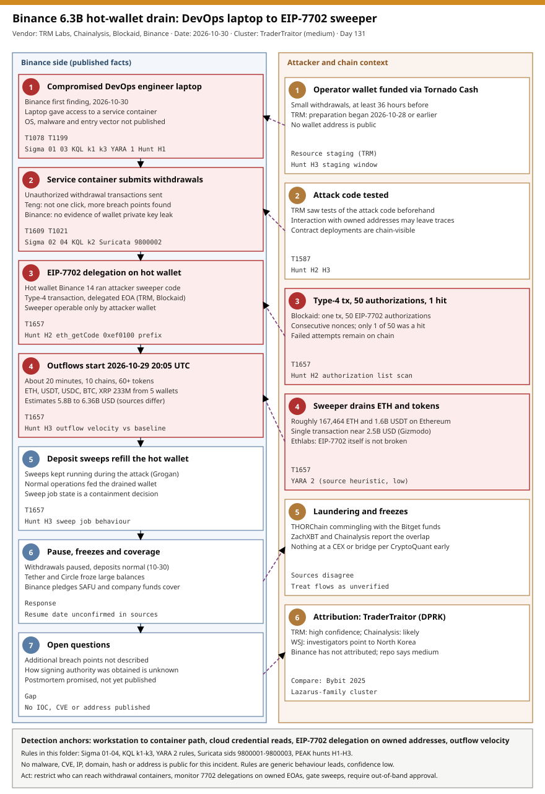

# Binance 6.3B hot-wallet drain: compromised DevOps laptop, EIP-7702 sweeper and TraderTraitor attribution

## TL;DR

Starting at 20:05 UTC on 2026-10-29, funds left Binance wallets on 10 blockchains in about 20 minutes; estimates of the loss run from 5.8 to 6.36 billion USD depending on the source and the price used. Binance's first finding (2026-10-30) is that a compromised DevOps engineer's laptop gave access to a service container that submitted unauthorized withdrawal transactions, and its CEO later said the attack was more complex and that further breach points were found. On Ethereum, TRM Labs and Blockaid describe an EIP-7702 delegation that made the hot wallet "Binance 14" run an attacker-controlled sweeper contract. TRM Labs attributes the theft to TraderTraitor (DPRK) with high confidence and Chainalysis says it is likely, while Binance has not attributed it. No malware, CVE, address, hash, IP or domain is public, so this day is a pathway-hardening and monitoring lesson built on behaviour leads, not an IOC drop.

## Attribution and confidence

- **Cluster:** TraderTraitor, the DPRK subcluster behind the February 2025 Bybit theft. Aliases are not asserted here beyond the Lazarus family.
- **Vendor / date:** TRM Labs (preparation timeline, EIP-7702 mechanics, attribution, 2026-10-30), Chainalysis (Jonathan Levin, "likely" DPRK TraderTraitor, 2026-10-30), Blockaid (EIP-7702 reconstruction), ZachXBT (THORChain commingling), Binance (laptop finding, 2026-10-30). Press: Forbes, Gizmodo, Hackread (all 2026-10-30).
- **Confidence:** `medium`. Two blockchain-intelligence firms point the same way and the WSJ reports that investigators point to North Korea, but the evidence is on-chain behaviour and off-chain intelligence that is not public, and Binance has not named an actor.

| Overlap | Evidence | Verdict |
|---|---|---|
| Bybit theft (2025-02) | Gizmodo reports TRM comparing the two; laundering style and scale | Behavioural similarity, supports attribution |
| Bitget exploit proceeds (388M USD) | ZachXBT and Chainalysis report commingling via THORChain | Strong on-chain link if confirmed; sources disagree on whether funds reached a CEX or bridge |
| DPRK Ethereum dead-drop npm packages (2026-08) | Hackread notes it only as a similarity | No technical link to this incident |
| Secure.com TTP reconstruction (fake interviews, Terraform lock files) | One vendor blog, labelled a pattern and not a fact | Uncorroborated, not used for any conclusion |

**Repo genealogy:** [2026-06-14 Humanity Protocol DPRK bridge key theft](../../06/2026-06-14_Humanity-Protocol-DPRK-Bridge-KeyTheft/README.md) (signing-path compromise at a bridge) and [2026-08-14 DreamJob / Lazarus AFDsys](../../08/2026-08-14_DreamJob-Lazarus-AFDsys-ZeroDay-FudModule-Troy/README.md) (developer-targeting social engineering from the same ecosystem). Last primary for taxonomy slot #16 was 2026-08-01; this is the largest crypto event in the diary and breaks the weekend gap rotation.

## Kill chain — summary table

| Stage | MITRE | Detail |
|---|---|---|
| Preparation (at least 36 h earlier) | T1657 context | Operator wallet funded through small Tornado Cash withdrawals; attack code tested (TRM). No addresses published. |
| Developer laptop compromised | T1078, T1199 | Binance's first finding: a DevOps engineer's laptop. OS, malware and entry vector not published. |
| Service container reached | T1609, T1021 | The laptop gave access to a service container that submitted unauthorized withdrawal transactions. Teng: not a single one-click action, more breach points found. |
| EIP-7702 delegation | T1657 | One type-4 transaction carried 50 authorizations on consecutive nonces and only one hit; the hot wallet Binance 14 then ran the attacker's sweeper (TRM, Blockaid). |
| Drain | T1657 | From 2026-10-29 20:05 UTC; about 20 minutes; 10 chains, ETH, USDT, USDC, BTC, XRP and 60+ other tokens. |
| Laundering and freezes | T1657 context | THORChain commingling with Bitget proceeds; Tether and Circle froze large balances. |
| Response | n/a | Withdrawals paused, deposits normal, SAFU and company funds pledged to cover losses, postmortem promised. |



The left lane holds what Binance and the vendors have published about the Binance side, in time order, with the red boxes marking the steps that moved money. The right lane holds attacker preparation and chain context, linked by dashed arrows to the stage each fact explains. Detection anchors in the footer are generic: the workstation-to-container path, cloud credential reads, EIP-7702 delegations on owned addresses, and outflow velocity.

## Stage-by-stage detail

### 1. Preparation: Tornado Cash funding and code tests

TRM Labs says preparation began at least 36 hours before the drain, with an operator wallet funded through small Tornado Cash withdrawals and tests of the attack code. No wallet, contract or transaction hash is public. Chain-visible tests that touch your own addresses are the one preparation signal a defender can monitor (Hunt H3).

- MITRE: T1657 (Financial Theft) context only; preparation of this kind has no clean ATT&CK technique.

### 2. Developer laptop and service container

Binance reported on 2026-10-30 that a compromised DevOps engineer's laptop gave access to a service container that submitted unauthorized withdrawal transactions. Teng added that the attacker did not simply use one engineer's permissions and that more breach points were found. Binance says it found no evidence that wallet private keys leaked, so the open question is how authorized signatures were produced without keys (Forbes and Hackread flag this).

```bash
# Illustrative read-only audit of who can exec into withdrawal-capable workloads (adapt names)
kubectl auth can-i --list --as=<engineer> -n <withdrawal-namespace>
kubectl get rolebindings,clusterrolebindings -A -o json | jq -r '.items[] | select(.subjects[]?.name=="<group>") | .metadata.name'
```

- MITRE: T1078 (Valid Accounts), T1199 (Trusted Relationship), T1609 (Container Administration Command), T1021 (Remote Services).

### 3. EIP-7702 delegation on the hot wallet

EIP-7702 (live since May 2025) lets an externally owned account delegate its code to a contract through a signed authorization in a type-4 transaction. TRM and Blockaid say the attacker used it so that the hot wallet "Binance 14" executed a sweeper that only the attacker wallet could operate. Blockaid counts 50 authorizations in one transaction, one of which hit. Ethlabs argues the standard is not broken; the lesson is that a signing path able to issue authorizations is a full-custody path.

```bash
# An undelegated EOA returns 0x; a delegated one returns 0xef0100 + the 20-byte delegate address
curl -s -X POST "$RPC_URL" -H 'content-type: application/json' \
  -d '{"jsonrpc":"2.0","id":1,"method":"eth_getCode","params":["<owned_address>","latest"]}' | jq -r .result
```

- MITRE: T1657 (Financial Theft).

### 4. Drain and sweeper behaviour

Outflows began at 20:05 UTC on 2026-10-29. Five wallets sent 233 million XRP to a single address; Ethereum lost about 167,464 ETH and about 1.6 billion USDT in under four minutes per Secure.com, while Gizmodo describes a single transaction near 2.5 billion USD. Sources disagree on several figures (ETH amount in one headline, start minute in one teaser, start of the statement), which is why the totals above are ranges. Coinbase's Conor Grogan observed Binance's deposit-wallet sweeps still refilling the compromised hot wallet during the attack, which is a containment lesson: stop the sweep jobs that feed a drained wallet.

- MITRE: T1657.

### 5. Laundering, freezes and response

ZachXBT and Chainalysis report commingling with the Bitget exploit proceeds through THORChain; an early CryptoQuant observation said nothing had yet reached a CEX, bridge or mixer, so treat flow claims as unverified. Tether and Circle reportedly froze large balances (reported totals differ by source). Binance paused withdrawals while deposits stayed normal, pledged to cover losses from SAFU and company funds, and promised a postmortem. A CNBC headline from 2026-10-31 (page not readable in this run) says about 90 percent of losses are covered and withdrawals resume Sunday; that is unverified here.

## Detection strategy

### Telemetry that matters

- **Workstations:** Sysmon for Linux / auditd `execve`, EDR process and file events for cloud CLI use, `.aws/credentials`, `.kube/config` reads, IDE or interpreter parents spawning `kubectl`.
- **Kubernetes / containers:** API-server audit logs for `pods/exec`, `pods/portforward`, `pods/attach`, secret reads and service-account token requests; container runtime events.
- **Cloud:** CloudTrail / Azure Activity and Entra sign-in logs for new-source service identities followed by high-value actions (Key Vault reads, signing, role assignment).
- **Chain side:** node RPC logs and an indexer for type-4 transactions, `eth_getCode` on owned addresses, and outflow velocity per hot wallet.
- **Network:** east-west flows from developer networks to kubelet (10250) and Docker API (2375/2376) ports; plain-HTTP JSON-RPC submission from hosts that are not signers.

### Detection coverage

| Engine | File | Logic |
|---|---|---|
| Sigma | [01_dev_workstation_cloud_cli_or_kube_credential_harvest_from_interpreter.yml](./sigma/01_dev_workstation_cloud_cli_or_kube_credential_harvest_from_interpreter.yml) | Interpreter or temp-path process exporting cloud / Kubernetes secrets or reading credential stores. |
| Sigma | [02_kubectl_or_docker_exec_into_production_container_from_workstation.yml](./sigma/02_kubectl_or_docker_exec_into_production_container_from_workstation.yml) | `kubectl exec/debug/cp/port-forward` or `docker exec` from a workstation-class parent with production markers. |
| Sigma | [03_iac_lock_or_registry_config_written_outside_vcs_tooling.yml](./sigma/03_iac_lock_or_registry_config_written_outside_vcs_tooling.yml) | Terraform lock or CLI config written by a non-IaC, non-VCS process. |
| Sigma | [04_container_shell_reaching_cloud_metadata_endpoint.yml](./sigma/04_container_shell_reaching_cloud_metadata_endpoint.yml) | Shell, curl, wget, nc or python connecting to a cloud metadata endpoint. |
| KQL | [k1_workstation_cloud_credential_read_then_outbound.kql](./kql/k1_workstation_cloud_credential_read_then_outbound.kql) | Credential read followed by public egress in the same process tree within 10 minutes. |
| KQL | [k2_service_identity_new_source_then_high_value_action.kql](./kql/k2_service_identity_new_source_then_high_value_action.kql) | Service principal from a new IP then a high-value action within 60 minutes. |
| KQL | [k3_lock_or_registry_config_written_by_non_vcs_process.kql](./kql/k3_lock_or_registry_config_written_by_non_vcs_process.kql) | Lock and registry config files written by unexpected processes. |
| YARA | [binance_devops_workstation_artifacts.yar](./yara/binance_devops_workstation_artifacts.yar) | 2 low-confidence heuristics: credential harvest plus exfil script; Solidity sweeper-shaped source. |
| Suricata | [binance_devops_egress.rules](./suricata/binance_devops_egress.rules) | sids 9800001-9800003: cleartext JSON-RPC send from non-signers, workstation to kubelet / Docker API, workstation to metadata endpoint. |

None of these detects the Binance attack itself; they are behaviour leads for the published first finding. YARA and Suricata rules were not compiled in this run (no engine available), only checked by the repo validator.

### Threat hunting hypotheses

- **H1:** a developer workstation can reach withdrawal-capable containers more broadly than intended. [peak_h1_devops_workstation_to_withdrawal_container_path.md](./hunts/peak_h1_devops_workstation_to_withdrawal_container_path.md)
- **H2:** an owned address carries, or recently carried, an EIP-7702 delegation. [peak_h2_eip7702_delegation_on_owned_addresses.md](./hunts/peak_h2_eip7702_delegation_on_owned_addresses.md)
- **H3:** withdrawal volume, sweep jobs or staging activity deviated from baseline before an outflow. [peak_h3_withdrawal_pathway_velocity_and_pre_attack_staging.md](./hunts/peak_h3_withdrawal_pathway_velocity_and_pre_attack_staging.md)

## Incident response playbook

### First 60 minutes (triage)

1. Stop value movement first: pause withdrawals and halt every deposit-sweep job that refills hot wallets; move remaining balances to pre-designated cold storage under dual, out-of-band approval.
2. Ask issuers and exchanges to freeze: contact Tether, Circle and the major venues with transaction hashes and receiving addresses as soon as you have them (Tether and Circle froze large balances here).
3. Revoke on-chain delegations: for each owned EOA, run `eth_getCode`; any `0xef0100` prefix you did not authorize means the signing path is compromised. Clear or replace the account with a fresh key set.
4. Freeze the identities in the path: disable the service accounts and tokens of the withdrawal service, revoke engineer sessions and kubeconfigs, rotate cloud keys reachable from the suspect laptop.
5. Isolate and image the engineer's laptop; preserve the container filesystem and the API-server audit log of the withdrawal namespace before any restart.
6. Open the attacker-timeline question: when was the first unusual `exec`, token request or secret read, and from which workstation.

### Artifacts to collect

| Artifact | Path | Tool | Why |
|---|---|---|---|
| Kubernetes API audit log | cluster audit sink (`pods/exec`, `secrets`, `serviceaccounts/token`) | kubectl, SIEM export | Who reached the withdrawal containers and when. |
| Container filesystem and process tree | node runtime storage, `docker export` / `crictl` | crictl, Velociraptor, Volatility | Injected code, mounted secrets. |
| Workstation triage | `~/.aws/`, `~/.kube/`, shell history, browser profile, package manager config | Velociraptor, EDR triage collection | Credential theft and initial access on the laptop. |
| Cloud audit | CloudTrail / Azure Activity / Entra sign-ins | provider consoles, SIEM | New-source service identities and high-value actions. |
| Signing-service logs | signer / broadcaster application logs and HSM or MPC approval records | vendor tools | Which request produced each authorization. |
| Chain evidence | tx hashes, delegation (type-4) transactions, receiving addresses | block explorer, own node, indexer | Freezing requests and scope. |

### IR queries and commands

```bash
# Delegation audit of owned addresses (adapt RPC_URL and the address list)
while read -r a; do
  c=$(curl -s -X POST "$RPC_URL" -H 'content-type: application/json' \
    -d "{\"jsonrpc\":\"2.0\",\"id\":1,\"method\":\"eth_getCode\",\"params\":[\"$a\",\"latest\"]}" | jq -r .result)
  case "$c" in 0xef0100*) echo "DELEGATED $a $c";; esac
done < owned_addresses.txt
```

```bash
# Who exec'd or port-forwarded into the withdrawal namespace in the last 7 days (audit log in JSON lines)
jq -r 'select(.objectRef.namespace=="<withdrawal-namespace>" and (.objectRef.subresource=="exec" or .objectRef.subresource=="portforward")) | [.requestReceivedTimestamp,.user.username,.sourceIPs[0],.verb] | @tsv' audit.log
```

```kql
// Service principals with a first-seen source IP followed by Key Vault secret reads
SigninLogs
| where ServicePrincipalId != ""
| summarize FirstSeen=min(TimeGenerated) by ServicePrincipalId, IPAddress
| join kind=inner (AzureDiagnostics | where OperationName == "SecretGet" | project TimeGenerated, CallerIPAddress, identity_claim_appid_g) on $left.IPAddress == $right.CallerIPAddress
```

### Containment, eradication, recovery

- **Exit criteria:** no owned address returns a delegation designator you did not authorize; all withdrawal-path secrets and signing keys rotated from clean hosts; every workstation with access to the path reimaged or proven clean; sweep jobs and withdrawal limits re-enabled behind out-of-band approval.
- **Do not:** re-enable sweeps before the delegation audit, restart suspect containers before imaging them, reuse any key that ever lived on the suspect laptop, or announce coverage figures before the loss is reconciled.

### Recovery validation

- Reconcile every outbound transaction against the approved-withdrawal ledger for the whole window (Hunt H3 `comm` method).
- Test that a non-signer host cannot submit a transaction and that a workstation cannot reach the withdrawal namespace.
- Re-publish proof of reserves only after reconciliation, as Binance has said it will.

## IOCs

No malware hash, IP, domain, URL or wallet address has been published for this incident; the table below carries the behavioural indicators and context. Full list in [iocs.csv](./iocs.csv). No CVE is involved, so there is no `kev.md`.

| Type | Value | Context | Confidence | Source |
|---|---|---|---|---|
| string | `0xef0100` | EIP-7702 delegation designator returned by `eth_getCode` for a delegated EOA; audit tool, not an indicator of this theft | medium | EIP-7702; TRM / Blockaid via Gizmodo |
| string | type-4 transaction with an authorization list | Blockaid: 50 authorizations in one transaction, one hit | medium | Blockaid via Gizmodo |
| string | 2026-10-29T20:05:00Z | Start of outflows | medium | TRM via Hackread; Secure.com |
| string | Binance 14 | Hot wallet label made to run the sweeper; no address public | medium | TRM via Gizmodo |
| note | Tornado Cash funding of operator wallet, at least 36 h earlier | Preparation window | medium | TRM via Hackread |
| note | THORChain commingling with Bitget proceeds | Laundering overlap | low | Gizmodo; Forbes |
| note | TraderTraitor (DPRK) attribution | TRM high, Chainalysis likely, Binance silent | medium | Hackread; Gizmodo |
| note | Compromised DevOps laptop to service container | Binance first finding | high | Hackread; Gizmodo |
| note | Terraform lock file / fake interview TTPs | Uncorroborated vendor speculation | low | Secure.com |
| note | Loss estimates 5.8 to 6.36 billion USD | Sources differ | medium | Forbes; Gizmodo; Hackread |

## Secondary findings

- **EIP-7702 as a custody risk, not a bug:** Ethlabs argues the standard is not broken. Any signing path that can produce authorizations can hand an account's code to a third party, so exchanges should monitor and restrict delegation on hot wallets (Hunt H2).
- **Uncorroborated TTP reconstruction:** a vendor blog proposes fake job interviews and poisoned Terraform lock files and registries as the likely route. It labels this a pattern, not a fact; treat it as a hypothesis to test in your own environment, which is why Sigma 03 and KQL k3 exist at low confidence.
- **Source disagreement is data:** the loss total, ETH quantity, start time, freeze totals and withdrawal-resume status differ across Forbes, Gizmodo, Hackread, Secure.com and Cryptoticker; the CNBC page could not be read. Wait for the Binance postmortem and the TRM and Blockaid write-ups before quoting precise numbers.

## Pedagogical anchors

- A developer laptop is part of the production trust boundary when it can reach containers that authorize money movement; map and cut that path before debating keys.
- "No private key leaked" does not mean "no signing authority leaked"; audit what can request, approve and broadcast, not only what stores keys.
- EIP-7702 turns an EOA into a programmable account in one signed message; monitor `eth_getCode` on owned addresses the way you monitor new IAM roles.
- Failed attacker attempts (49 of 50 authorizations here) are evidence; keep chain and RPC logs long enough to see them.
- During a drain, anything that refills the wallet (deposit sweeps) works for the attacker; containment has to include automation, not just access.

## What's in this folder

| File | Purpose | Link |
|---|---|---|
| README.md | This analysis. | [README.md](./README.md) |
| kill_chain.svg | Two-lane kill chain (template A, crypto-defi accent). | [kill_chain.svg](./kill_chain.svg) |
| iocs.csv | Behavioural indicators and context; no network or wallet IOCs published. | [iocs.csv](./iocs.csv) |
| sigma/ | Four generic Sigma rules for the workstation-to-container path. | [sigma/](./sigma/) |
| kql/ | Three KQL hunts for credential reads, service identities and config tampering. | [kql/](./kql/) |
| yara/binance_devops_workstation_artifacts.yar | Two low-confidence YARA heuristics. | [yara/binance_devops_workstation_artifacts.yar](./yara/binance_devops_workstation_artifacts.yar) |
| suricata/binance_devops_egress.rules | Three Suricata policy rules, sids 9800001-9800003. | [suricata/binance_devops_egress.rules](./suricata/binance_devops_egress.rules) |
| hunts/ | PEAK hunts H1-H3. | [hunts/](./hunts/) |

## Sources

- [Binance's 6.3 billion hack started with one engineer's laptop - Forbes, 2026-10-30](https://www.forbes.com/sites/digital-assets/2026/10/30/binances-63-billion-hack-started-with-one-engineers-laptop/)
- [How hackers stole 6.3 billion from Binance in minutes - Gizmodo, 2026-10-30](https://gizmodo.com/how-hackers-stole-6-3-billion-from-binance-in-minutes-2000833158)
- [Binance probes DevOps engineer's hacked laptop after 6.3B theft - Hackread, 2026-10-30](https://hackread.com/binance-devops-engineer-hacked-laptop-billion-theft/)
- [How did a compromised laptop lead to the 6.3 billion Binance hack? - Secure.com, 2026-10-30 (vendor blog, speculative parts flagged)](https://www.secure.com/blog/cybersecurity/binance-hack-compromised-laptop)
- [Binance hack: the cause and the 6.3 billion estimate - Cryptoticker, 2026-10-30](https://cryptoticker.io/en/binance-hack-cause-devops-laptop/)
- [MITRE ATT&CK T1657 Financial Theft](https://attack.mitre.org/techniques/T1657/)
- [MITRE ATT&CK T1609 Container Administration Command](https://attack.mitre.org/techniques/T1609/)
