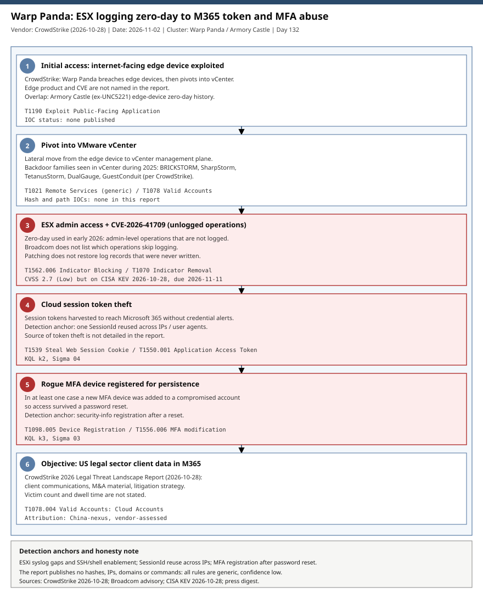

# Warp Panda and the VMware ESX insufficient-logging zero-day (CVE-2026-41709): hidden admin operations, stolen session tokens and rogue MFA devices

## TL;DR

CrowdStrike's 2026 Legal Threat Landscape Report (2026-10-28) says the China-nexus cluster Warp Panda exploited CVE-2026-41709, a Broadcom VMware ESX flaw that lets an admin-level actor perform certain operations without them being logged, as a zero-day in early 2026. CISA added the CVE to KEV on 2026-10-28 (federal due date 2026-11-11, per press). The flaw scores only CVSS 2.7, yet it removes the audit trail defenders rely on during an investigation. The same reporting describes cloud session-token theft against Microsoft 365 and at least one rogue MFA device that survived a password reset, aimed mainly at US legal-sector data. No hashes, IPs, domains or commands were published, so every rule in this folder is a generic, low-confidence hunting aid.

## Attribution and confidence

| Field | Value |
|---|---|
| Cluster | Warp Panda (CrowdStrike) |
| Aliases | Armory Castle (formerly UNC5221), Clay Typhoon, VerdantBamboo (per The Hacker News, SQ Magazine, Aviatrix) |
| Vendor and date | CrowdStrike, 2026 Legal Threat Landscape Report, 2026-10-28 |
| Confidence | **medium** (single-vendor attribution relayed by press; the CrowdStrike report itself was not read in this run) |
| Malware overlap | BRICKSTORM, SharpStorm; TetanusStorm, DualGauge, GuestConduit in vCenter during 2025 |

Genealogy with previous repo cases: the case of 2026-10-19 (`2026-10-19_ARMORY-CASTLE-BeyondTrust-Remote-Support-...`) tracks the same actor under its Google name; that case covered a remote-support appliance, this one covers the hypervisor and identity side. Press attributes the BeyondTrust activity to Warp Panda, but this entry did not verify that link against CrowdStrike's own text.

## Kill chain — summary table

| Stage | MITRE | Detail |
|---|---|---|
| 1. Edge device | T1190 | Internet-facing edge device exploited; product not named in the sources read |
| 2. vCenter pivot | T1021, T1078 | Move into VMware vCenter; BRICKSTORM-family backdoors |
| 3. Unlogged ESX admin operations | T1562.006, T1070 | CVE-2026-41709 hides certain admin operations |
| 4. Session token theft | T1539, T1550.001 | Cloud session tokens used to reach Microsoft 365 |
| 5. Rogue MFA device | T1098.005, T1556.006 | New MFA device registered; survives password reset |
| 6. Objective | T1078.004 | US legal-sector client data in M365 |



The diagram is a single lane (template C). Red stages 3, 4 and 5 are the detection anchors: ESXi syslog gaps and shell/SSH enablement, one SessionId reused from several IPs or user agents, and MFA registration right after a password reset.

## Stage-by-stage detail

### 1. Initial access on an edge device (T1190)

CrowdStrike says Warp Panda exploits internet-facing edge devices and then pivots into vCenter. The sources read do not name the product or CVE. The cluster's history with edge-device zero-days (Armory Castle) is why exposure of management interfaces is a standing hunt.

### 2. Pivot into vCenter (T1021, T1078)

Per CrowdStrike (as relayed), BRICKSTORM, SharpStorm, TetanusStorm, DualGauge and GuestConduit were deployed in vCenter environments during 2025. No file path, hash or network indicator is public in the pages read.

### 3. CVE-2026-41709: operations that leave no log (T1562.006, T1070)

```text
Flaw : Broadcom VMware ESX, "insufficient logging", CVSS 2.7 (Low)
Effect: admin-level actor performs certain operations without them being logged
Fixed : ESXi-9.1.0.0-25370933 | ESXi-9.0.2.0100-25595025 | ESXi80U3j-25429389 | VCF 5.2.4
Work-around: none listed; patching does not restore unwritten records
```

Broadcom does not disclose which operations skip logging, so the only defensible detection is indirect: host-level silence, unexpected SSH/ESXi Shell enablement, lockdown mode changes and syslog configuration edits, compared against vCenter-side events that the actor may not control.

### 4. Cloud session token theft (T1539, T1550.001)

CrowdStrike (via press) says tokens were harvested to reach Microsoft 365 without credential-based alerts. The detection anchor is a SessionId or token used from several IPs or user agents.

### 5. Rogue MFA device (T1098.005, T1556.006)

In at least one case a new MFA device was registered so access survived a password reset. Pair every password reset with a review of new security-info registrations in the following 24 hours.

### 6. Objective

The legal sector holds client communications, M&A material and litigation strategy across clients. Victim count and dwell time are not stated in the sources.

## Detection strategy

### Telemetry that matters

- ESXi: forwarded syslog (hostd, shell, auth), SSH/ESXi Shell service state, lockdown mode, syslog configuration; vCenter events and vCenter appliance logs.
- Microsoft Entra / M365: `AuditLogs` (security info and device registration), `SigninLogs` and `AADNonInteractiveUserSignInLogs` (SessionId, IP, user agent), `OfficeActivity`/`CloudAppEvents`.
- Network: management ports (22, 443, 902, 5480, 9443) exposed to the internet; ESXi hosts talking to the internet or to non-corporate DNS.

### Detection coverage

| Engine | File | Logic |
|---|---|---|
| Sigma | [01_esxi_ssh_shell_enabled_or_lockdown_disabled.yml](./sigma/01_esxi_ssh_shell_enabled_or_lockdown_disabled.yml) | ESXi SSH/Shell enabled or lockdown disabled |
| Sigma | [02_esxi_syslog_forwarding_or_audit_config_changed.yml](./sigma/02_esxi_syslog_forwarding_or_audit_config_changed.yml) | Syslog forwarding or audit settings changed |
| Sigma | [03_entra_security_info_registered.yml](./sigma/03_entra_security_info_registered.yml) | New security info or device registered |
| Sigma | [04_entra_signin_anomalous_token_risk.yml](./sigma/04_entra_signin_anomalous_token_risk.yml) | Token-replay risk types on sign-ins |
| KQL | [k1](./kql/k1_esxi_syslog_gaps_and_admin_service_changes.kql) | Per-host syslog silence plus admin service changes |
| KQL | [k2](./kql/k2_entra_session_id_reuse_across_ip_and_useragent.kql) | SessionId reuse across IPs and user agents |
| KQL | [k3](./kql/k3_entra_new_mfa_method_after_password_reset.kql) | MFA method registered within 24 h of a password reset |
| YARA | [warp_panda_esxi_vcenter_generic.yar](./yara/warp_panda_esxi_vcenter_generic.yar) | 2 generic low-confidence rules |
| Suricata | [warp_panda_vmware_mgmt.rules](./suricata/warp_panda_vmware_mgmt.rules) | sids 9900001-9900003: mgmt exposure, ESXi outbound TLS, rogue DNS |

All rules are generic: the sources publish no indicators. Treat matches as leads, not verdicts.

### Threat hunting hypotheses

- **H1** ESXi or vCenter admin activity exists that the host log does not show: [peak_h1](./hunts/peak_h1_esxi_vcenter_logging_gaps_and_admin_ops.md).
- **H2** vCenter was reached from an edge device and holds BRICKSTORM-family implants: [peak_h2](./hunts/peak_h2_vcenter_edge_pivot_and_brickstorm_family.md).
- **H3** Stolen M365 session tokens and rogue MFA devices are in use: [peak_h3](./hunts/peak_h3_m365_session_token_replay_and_rogue_mfa_device.md).

## Incident response playbook

### First 60 minutes (triage)

1. Confirm ESXi builds against the fixed list; record hosts below it.
2. Check ESXi SSH/Shell state and lockdown mode on every host; note any host where SSH is on without a change ticket.
3. Compare vCenter task/event history with each host's own syslog for the same window; gaps are findings.
4. Export Entra sign-in and audit logs for privileged and legal-team users (last 90 days).
5. List MFA methods registered in the last 30 days; call the user for each unexpected one.
6. Revoke refresh tokens and sessions for any account with a suspicious registration.

### Artifacts to collect

| Artifact | Path | Tool | Why |
|---|---|---|---|
| ESXi logs | `/var/log/` (shell, auth, hostd) | SCP / vm-support | Gap analysis |
| ESXi syslog config | `esxcli system syslog config get` | esxcli | Detect forwarding changes |
| vCenter events | vCenter UI / API export | PowerCLI | Cross-check with host logs |
| Entra audit and sign-ins | Tenant logs | Graph / Sentinel | MFA and token evidence |

### IR queries and commands

```bash
# ESXi: current service and syslog posture (read-only)
vim-cmd hostsvc/hostsummary | grep -i version
esxcli system syslog config get
chkconfig --list 2>/dev/null | grep -i ssh
```

```powershell
# Entra: list auth methods for a user (Microsoft Graph PowerShell)
Get-MgUserAuthenticationMethod -UserId <user@domain>
Revoke-MgUserSignInSession -UserId <user@domain>
```

### Containment, eradication, recovery

Exit criteria: all hosts on fixed builds, unexplained SSH/Shell enablement closed, rogue MFA devices removed, sessions revoked, vCenter and ESXi credentials rotated. Do not rely on host logs from unpatched periods as proof of absence, and do not reboot or rebuild hosts before capturing logs and memory where possible.

### Recovery validation

Re-run the H1 to H3 queries for 14 days after remediation; confirm syslog arrives continuously from every host and no new unexplained registrations appear.

## IOCs

Full list in [iocs.csv](./iocs.csv). No network or file indicators are public.

| Type | Value | Context | Confidence | Source |
|---|---|---|---|---|
| cve | CVE-2026-41709 | ESX insufficient logging, exploited as zero-day | high | THN, Cyber Security News |
| string | ESXi-9.1.0.0-25370933 | Fixed build | medium | Cyber Security News |
| string | ESXi-9.0.2.0100-25595025 | Fixed build | medium | Cyber Security News |
| string | ESXi80U3j-25429389 | Fixed build | medium | Cyber Security News |
| string | BRICKSTORM | Linked malware family | medium | THN, Aviatrix |
| string | SharpStorm | Linked malware family | medium | THN, Aviatrix |
| string | TetanusStorm, DualGauge, GuestConduit | vCenter families (2025) | low | SQ Magazine |

KEV: press and CISA's alert title report CVE-2026-41709 added to KEV on 2026-10-28 with a federal due date of 2026-11-11. The local KEV cache predates this, so this status was not verified against the live catalogue (see analyst note in [kev.md](./kev.md)).

## Secondary findings

- **Other PANDA clusters in the same report:** TITAN PANDA (Intapp Time Server, April 2026), MURKY PANDA (ORB28 password spraying, 340+ organisations) and OVERCAST PANDA (UK legal firm, Sep-Oct 2025); press says these are distinct operations. Only the summary was read.
- **ESET APT report (Oct 2026):** headlines on Iran-aligned expansion and Belarus-aligned wiper activity; not analysed here.
- **Unit 42 on Screening Serpens (Iran):** headline only; candidate for a future espionage Monday.

## Pedagogical anchors

- A CVSS 2.7 flaw can be strategically severe when it degrades the evidence you need later; score the effect on detection, not only on confidentiality.
- Patching closes the door but cannot restore logs that were never written: hosts on unpatched builds have an incomplete history.
- Hypervisor logs must be compared with a second, independent source (vCenter events, network flow, forwarded syslog).
- Session tokens and MFA registrations are the identity-side persistence that outlives a password reset.
- When a vendor publishes no indicators, build behaviour-based hunts and state their confidence honestly.

## What's in this folder

| File | Purpose | Link |
|---|---|---|
| README.md | This analysis. | [README.md](./README.md) |
| kill_chain.svg | Single-lane kill-chain diagram. | [kill_chain.svg](./kill_chain.svg) |
| iocs.csv | CVE, fixed builds, malware family names and notes. | [iocs.csv](./iocs.csv) |
| kev.md | CISA KEV cross-reference for this case's CVE. | [kev.md](./kev.md) |
| sigma/ | 4 generic Sigma rules. | [sigma](./sigma/) |
| kql/ | 3 KQL hunts. | [kql](./kql/) |
| yara/ | 1 file, 2 generic rules. | [yara](./yara/) |
| suricata/ | 1 file, 3 sids. | [suricata](./suricata/) |
| hunts/ | 3 PEAK hunts. | [hunts](./hunts/) |

## Sources

- [China-Linked Hackers Exploited VMware ESX Zero-Day to Reduce Audit Trail Visibility — The Hacker News](https://thehackernews.com/2026/10/china-linked-hackers-exploited-vmware.html)
- [CISA Warns of VMware ESX Logging Vulnerability Exploited in Attacks — Cyber Security News](https://cybersecuritynews.com/vmware-esx-logging-vulnerability-exploited/)
- [Warp Panda Exploits VMware ESX Zero-Day — Aviatrix](https://aviatrix.ai/threat-research-center/china-linked-hackers-exploited-vmware-esx-zero-day-reduce-audit-trail-visibility/)
- [Warp Panda Exploited ESXi Logging Flaw — SQ Magazine](https://sqmagazine.co.uk/vmware-esxi-logging-zero-day-cve-2026-41709/)
- [CISA alert, 2026-10-28 (linked by the press, not read)](https://www.cisa.gov/news-events/alerts/2026/10/28/cisa-adds-two-known-exploited-vulnerabilities-catalog)
- [Broadcom security advisory (linked by the press, not read)](https://support.broadcom.com/web/ecx/support-content-notification/-/external/content/SecurityAdvisories/0/38017)
- [CrowdStrike 2026 Legal Threat Landscape Report (linked by the press, not read)](https://www.crowdstrike.com/en-us/blog/crowdstrike-2026-legal-threat-landscape-report/)
