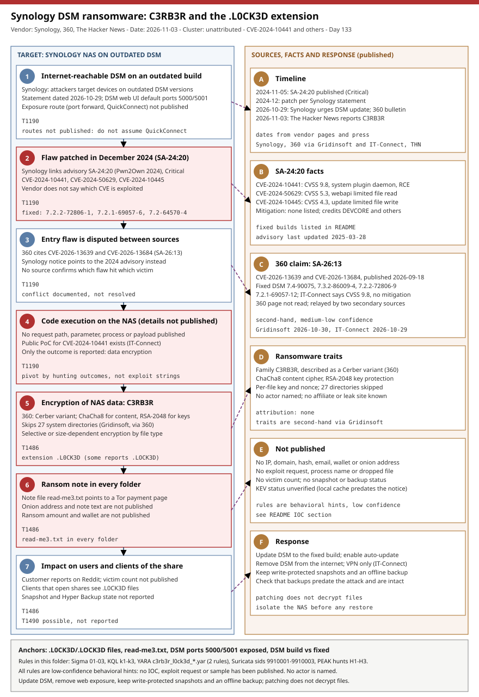

# Synology DSM ransomware: C3RB3R (a Cerber variant), the .L0CK3D extension and a disputed entry flaw

## TL;DR

On 2026-10-29 Synology told customers that threat actors are exploiting a vulnerability patched in December 2024 to encrypt data on NAS devices running outdated DSM versions and demand a ransom; The Hacker News (2026-11-03) names the family C3RB3R and the extension `.L0CK3D`, based on customer reports on Reddit.
The 360 bulletin of the same day, relayed by Gridinsoft and IT-Connect, calls C3RB3R a Cerber variant (ChaCha8 for file contents, RSA-2048 for keys, a `read-me3.txt` note in every folder) and blames two 2026 flaws instead of the 2024 advisory; no source confirms which flaw was used, and no IOC, exploit request, victim count or actor has been published.
The sector is small business and home users running NAS appliances; dwell time and the number of victims are unknown.
The reason to study it today is the evidence problem: a NAS encrypts its own disks, so endpoint telemetry sees the damage only through clients, and the only verified, decidable defensive question is patch level plus exposure.

## Attribution and confidence

**Cluster:** none. No source names an actor, affiliate programme or leak site. **Family:** C3RB3R, described by 360 as a Cerber variant (second-hand through Gridinsoft and IT-Connect; the 360 page itself was not read). **Vendors and dates:** Synology press statement 2026-10-29; 360 bulletin 2026-10-29; Gridinsoft 2026-10-30; IT-Connect 2026-10-29; The Hacker News 2026-11-03. **Confidence:** the existence of an active ransomware campaign against outdated DSM is **high** (vendor statement plus customer reports); the family traits are **medium-low** (second-hand); the entry flaw is **unresolved**; attribution is **none**.

| Item | Synology | 360 (via Gridinsoft and IT-Connect) | The Hacker News |
|---|---|---|---|
| Family name | Not named in the statement text | C3RB3R, a Cerber variant | C3RB3R |
| Extension and note | Not stated | `.L0CK3D` (some reports `.LOCK3D`); `read-me3.txt` in every folder | `.L0CK3D` |
| Entry flaw | "A vulnerability patched in December 2024", links Synology-SA-24:20 without naming a CVE | CVE-2026-13639 and CVE-2026-13684 (Synology-SA-26:13, 2026-09-18) | Lists the three CVEs of SA-24:20, "not confirmed" by the vendor |
| Evidence | Vendor statement | Help requests since early or during October | Customer reports on Reddit |

**Source conflicts, listed and not resolved.**

- *Which flaw.* Synology links the 2024 advisory (CVE-2024-10441, CVE-2024-50629, CVE-2024-10445); 360 cites two 2026 CVEs. Gridinsoft says the two reports "point to different vulnerabilities" and do not establish the same victim set. IT-Connect says Synology's email alert names CVE-2024-10441; Gridinsoft says the notice does not identify the CVE used in each attack. Hunt both patch levels.
- *Patch date.* The Hacker News says the flaw was "patched in December 2024" and links an advisory published 2024-11-05; Synology's statement also says December 2024. The advisory shows a first publication on 2024-11-05 and a last update on 2025-03-28. Treat the exact fix date per DSM branch as something to read in the advisory, not here.
- *Extension spelling.* `.L0CK3D` with a zero is the main spelling; IT-Connect adds `.LOCK3D` with the letter O from some reports.

**Source handling.** Synology's statement and advisory, The Hacker News, Gridinsoft and IT-Connect were read through a summarising fetch tool, not in a browser; strings were copied as extracted and should be checked against the originals. The 360 bulletin, the Reddit threads and the public proof of concept mentioned by IT-Connect were **not** read. The CISA SafePay page could not be read either (see Secondary findings).

**Genealogy with this repo.** Ransomware that reaches data stores and backup layers through unpatched management surfaces: the Qilin and INC case of 2026-10-27 (PAN-OS to vCenter, ESXi and Veeam) and the AhsayCBS backup console case of 2026-10-15; both are listed in INDEX.md. This is the consumer and small-business end of the same pattern: the storage appliance is the target, not a stepping stone.

## Kill chain — summary table

| Stage | MITRE | Detail |
|---|---|---|
| 1. Exposed outdated DSM | T1190 | Devices on outdated DSM builds are the stated target; exposure route not published |
| 2. Flaw patched in 2024 | T1190 | Synology links SA-24:20 (CVE-2024-10441 is the remote code execution); exploited CVE not named |
| 3. Disputed entry flaw | T1190 | 360 cites CVE-2026-13639 and CVE-2026-13684; unconfirmed |
| 4. Code execution on the NAS | T1190 | Details not published |
| 5. Encryption | T1486 | C3RB3R: ChaCha8 content cipher, RSA-2048 key protection; `.L0CK3D` |
| 6. Ransom note | T1486 | `read-me3.txt` in every folder, pointing to a Tor payment page |
| 7. Impact | T1486 | Customers lose access to shares; snapshot and backup state not reported |



The left lane follows the NAS from exposure to impact; red stages are the flaw, the code execution, the encryption and the note. The right lane separates the timeline, the advisory facts, the 360 claim, the ransomware traits, what is not published and the response. Detection anchors are the extension, the note name, the exposed DSM ports and the DSM build number.

## Stage-by-stage detail

### Stage 1: an outdated DSM that is reachable

Synology's statement (Taipei, 2026-10-29) says threat actors target devices running outdated DSM versions and urges all users of vulnerable versions to update immediately and to enable automatic updates. It does not say how the attacker reaches the appliance. IT-Connect advises removing port forwards to the DSM interface and using a VPN; neither Gridinsoft nor IT-Connect names QuickConnect, brute force or specific ports as the vector. DSM serves its web interface on ports 5000 (HTTP) and 5001 (HTTPS) by default.

```text
Default DSM web ports:  5000/tcp (HTTP)   5001/tcp (HTTPS)
Not published:          the exposure route used in the attacks
```

MITRE: T1190 Exploit Public-Facing Application.

### Stage 2: Synology-SA-24:20 (the 2024 advisory Synology links)

The advisory "DSM (PWN2OWN 2024)" was first published 2024-11-05, rated **Critical**, with mitigation listed as "None"; it credits DEVCORE (Pumpkin Chang, Orange Tsai), Ryan Emmons and Team Smoking Barrels.

| CVE | CVSS | Component and impact |
|---|---|---|
| CVE-2024-10441 | 9.8 | Improper encoding or escaping of output in the DSM system plugin daemon; remote code execution via unspecified vectors |
| CVE-2024-50629 | 5.3 | webapi component; limited file read via unspecified vectors |
| CVE-2024-10445 | 4.3 | Improper certificate validation in the update functionality; limited file write via unspecified vectors |

Fixed builds: DSM 7.2.2-72806-1, 7.2.1-69057-6, 7.2-64570-4, 7.1.1-42962-7 and 6.2.4-25556-8 or above. The Hacker News infers the three CVEs from the advisory the vendor linked; the vendor does not say which one is exploited.

MITRE: T1190.

### Stage 3: the 2026 flaws cited by 360

Gridinsoft and IT-Connect both relay 360's attribution of its cases to CVE-2026-13639 and CVE-2026-13684, disclosed in Synology-SA-26:13 on 2026-09-18. IT-Connect describes them as unauthenticated, remote, arbitrary file read and write with CVSS 9.8 and no mitigation other than updating; Gridinsoft describes login-logic and SCGI flaws. The fixed builds listed by the two secondary sources are DSM 7.4-90075, 7.3.2-86009-4, 7.2.2-72806-9 and 7.2.1-69057-12. Verify them against the Synology advisory before using them as acceptance criteria.

MITRE: T1190.

### Stage 4: code execution on the appliance

Nothing is published about the exploit request, the process that runs, the files dropped or the way the encryptor reaches disk. IT-Connect says a public proof of concept for CVE-2024-10441 exists on GitHub and abuses the DSM login username field; that page was not read and this repo does not reproduce the request shape. Because the exploit is invisible, the detections in this folder look for outcomes.

MITRE: T1190.

### Stage 5: encryption by C3RB3R

360, as relayed by Gridinsoft and IT-Connect, describes C3RB3R as a Cerber variant: ChaCha8 for file contents with a per-file key and nonce, RSA-2048 protecting the keys, 27 system directories skipped, and selective or size-dependent encryption depending on the file type. Encrypted files carry `.L0CK3D`.

```text
Cipher (reported):   ChaCha8 (content), RSA-2048 (key protection), per-file key and nonce
Extension:           .L0CK3D  (digit zero)   alt. spelling .LOCK3D (letter O)
Skipped:             27 system directories plus some executable and script files
```

MITRE: T1486 Data Encrypted for Impact.

### Stage 6: the ransom note

A note named `read-me3.txt` is dropped in every folder and points to a Tor payment page. Neither Gridinsoft nor IT-Connect reproduces the onion address or the note text, and no ransom amount or wallet is published.

MITRE: T1486.

### Stage 7: impact

Customers report encrypted data on Reddit; no victim count is published. No source says whether snapshots, Hyper Backup targets or replicated copies were encrypted or deleted. Gridinsoft advises checking that existing backups or snapshots predate the attack and remain intact; IT-Connect advises write-protected snapshots and an offline backup. Deletion of recovery data (T1490) is plausible for ransomware but is **not** reported here and is not claimed.

MITRE: T1486.

## Detection strategy

All detections here are **behavioral hints with low confidence**: Synology and the press sources published no exploit request, process, file, IP, domain, hash or note text. The only concrete strings are the extension, the note name, the family name and the CVE identifiers.

### Telemetry that matters

- **NAS side:** DSM version from `/etc.defaults/VERSION`, Log Center and syslog forwarding (login events, package changes, share access), the `#snapshot` folders and Snapshot Replication or Hyper Backup task history.
- **Network:** firewall and NAT logs for 5000/5001 and any forwarded port; Suricata with SMB file tracking on the segment that carries NAS traffic.
- **Endpoints that mount the NAS:** Sysmon EID 11 (file create) and Defender `DeviceFileEvents` for `.L0CK3D`, `.LOCK3D` and `read-me3.txt`; the NAS encrypts its own disks, so these see only what a client opens, copies or syncs.

### Detection coverage

| Engine | File | Logic |
|---|---|---|
| Sigma | [01_file_with_l0ck3d_extension_written_on_a_client_endpoint.yml](./sigma/01_file_with_l0ck3d_extension_written_on_a_client_endpoint.yml) | File ending `.L0CK3D` or `.LOCK3D` created on an endpoint; threshold in the SIEM |
| Sigma | [02_c3rb3r_ransom_note_read_me3_txt_written.yml](./sigma/02_c3rb3r_ransom_note_read_me3_txt_written.yml) | `read-me3.txt` written on an endpoint |
| Sigma | [03_scripted_client_connection_to_dsm_management_ports.yml](./sigma/03_scripted_client_connection_to_dsm_management_ports.yml) | Scripted client (curl, PowerShell, Python, wget) connecting to ports 5000 or 5001; exposure hint |
| KQL | [k1](./kql/k1_l0ck3d_files_and_read_me3_note_on_endpoints_and_shares.kql) | Extension and note on endpoints and UNC paths |
| KQL | [k2](./kql/k2_file_rename_or_write_burst_on_unc_paths_by_one_device.kql) | Generic write or rename bursts per device and share (starting thresholds 200 events, 20 folders) |
| KQL | [k3](./kql/k3_dsm_management_ports_access_and_syslog_hints.kql) | Access to 5000/5001 from outside admin subnets; commented Syslog query |
| YARA | [c3rb3r_l0ck3d_ransom_note_hints.yar](./yara/c3rb3r_l0ck3d_ransom_note_hints.yar) | Small text files naming the family, extension or note; plus a generic Tor ransom-note pattern |
| Suricata | [synology_dsm_exposure_and_l0ck3d_smb_hints.rules](./suricata/synology_dsm_exposure_and_l0ck3d_smb_hints.rules) | Sids 9910001-9910003: external access to 5001 and POST to 5000; SMB access to a name ending `.L0CK3D` |

The SMB rule covers the digit-zero spelling only. YARA and Suricata were not compiled in this run (no engine available).

### Threat hunting hypotheses

- **H1:** a NAS runs a DSM build below the fixed builds and its web interface is reachable from untrusted networks. See [peak_h1](./hunts/peak_h1_dsm_exposure_and_patch_level_vs_sa_2024_20.md).
- **H2:** clients that mount NAS shares hold `.L0CK3D` files or `read-me3.txt` notes, which scopes the affected shares and the encryption window. See [peak_h2](./hunts/peak_h2_client_side_l0ck3d_extension_and_read_me3_note.md).
- **H3:** snapshots, Hyper Backup targets and offline copies predate the attack and are intact. See [peak_h3](./hunts/peak_h3_snapshot_and_backup_integrity_after_nas_ransomware.md).

## Incident response playbook

### First 60 minutes (triage)

1. Disconnect the NAS from the network (pull the cable or disable the switch port) without powering it off, so volatile state and logs survive.
2. Block inbound access to ports 5000/5001 and any forwarded DSM port at the firewall.
3. Record the DSM version from `/etc.defaults/VERSION` and compare it with the fixed builds of SA-24:20 and SA-26:13.
4. Find the earliest `read-me3.txt` and `.L0CK3D` timestamps to estimate when encryption started.
5. Identify which snapshots, Hyper Backup targets and offline copies predate that time; do not delete or prune anything.
6. List every client that mounted the NAS and look for `.L0CK3D` files and notes on those clients.

### Artifacts to collect

| Artifact | Path | Tool | Why |
|---|---|---|---|
| DSM build | `/etc.defaults/VERSION` | SSH, `cat` | Patch level against fixed builds |
| DSM logs | Log Center export / syslog server | DSM UI, SIEM | Logins, package and share events around the first note |
| Ransom notes | `read-me3.txt` in affected shares | `find`, `Get-ChildItem` | Earliest and latest timestamps; note text for the case file |
| Encrypted samples | `*.L0CK3D`, `*.LOCK3D` | `find` | Evidence; do not open on production hosts |
| Snapshots | `#snapshot` folders per volume | `ls -la` | Recovery points that predate the attack |
| Firewall and NAT logs | Perimeter device | Vendor tool | Exposure and source of access to 5000/5001 |

### IR queries and commands

```bash
# Author: Jarmi
# On the NAS (SSH): exact DSM build, then affected files and notes. Read-only.
cat /etc.defaults/VERSION
find /volume*/ -name 'read-me3.txt' 2>/dev/null | head -50
find /volume*/ \( -name '*.L0CK3D' -o -name '*.LOCK3D' \) 2>/dev/null | head -50
```

```powershell
# Author: Jarmi
# From a client: read-only scan of a mapped share for the note and the extension.
Get-ChildItem -Path '\\<add_nas_name>\<add_share>' -Recurse -Force -ErrorAction SilentlyContinue |
  Where-Object { $_.Name -ieq 'read-me3.txt' -or $_.Extension -in '.L0CK3D','.LOCK3D' } |
  Select-Object FullName, LastWriteTime | Sort-Object LastWriteTime | Select-Object -First 50
```

```kql
// Author: Jarmi
DeviceFileEvents
| where Timestamp > ago(14d)
| where FileName =~ "read-me3.txt" or FileName endswith ".L0CK3D" or FileName endswith ".LOCK3D"
| summarize First = min(Timestamp), Last = max(Timestamp), Files = dcount(FileName) by DeviceName, FolderPath
```

### Containment, eradication, recovery

Exit criteria: the NAS is off the production network; DSM is on a fixed build with automatic updates enabled; the web interface is not reachable from the internet (VPN only); administrator and service passwords are reset after the update; a clean restore is validated from a copy that predates the first note. **Do not** pay or contact the Tor payment page from a corporate host, do not run cleanup scripts that delete files on the encrypted volumes, do not prune snapshots, and do not assume updating decrypts files: patching closes the door, it does not undo the damage.

### Recovery validation

Restore to a rebuilt or factory-reset NAS, not over the encrypted volume. Compare file counts and checksums against the clean copy, confirm no `.L0CK3D` or `read-me3.txt` file is restored, and re-run hunts H1 and H2 after one week.

## IOCs

Network, hash and wallet indicators are **not published**; the table lists every concrete string the sources give. Full list in [iocs.csv](./iocs.csv).

| Type | Value | Context | Confidence | Source |
|---|---|---|---|---|
| cve | CVE-2024-10441 | DSM system plugin daemon RCE, CVSS 9.8; in SA-24:20 | medium | Synology-SA-24:20 |
| cve | CVE-2024-50629 | DSM webapi limited file read, CVSS 5.3 | low | Synology-SA-24:20 |
| cve | CVE-2024-10445 | DSM update certificate validation, limited file write, CVSS 4.3 | low | Synology-SA-24:20 |
| cve | CVE-2026-13639 | Cited by 360 (SA-26:13); second-hand | low | Gridinsoft, IT-Connect |
| cve | CVE-2026-13684 | Cited by 360 (SA-26:13); second-hand | low | Gridinsoft, IT-Connect |
| string | .L0CK3D | Extension of encrypted files (digit zero) | medium | The Hacker News, Gridinsoft |
| string | .LOCK3D | Alternative spelling (letter O) | low | IT-Connect |
| string | C3RB3R | Family name; Cerber variant per 360 | medium | The Hacker News, Gridinsoft |
| path | read-me3.txt | Ransom note in every folder | medium | Gridinsoft, IT-Connect |
| string | ChaCha8 + RSA-2048 | Reported cryptography | low | Gridinsoft, IT-Connect |
| note | No network indicators published | No IP, domain, hash, email, wallet or onion address | high | Synology, The Hacker News |

**KEV:** not verified. None of the five CVEs appears in the local CISA KEV cache (catalogVersion 2026.10.16, older than the Synology notice), no source read mentions KEV, and the live catalogue could not be fetched in this run. See [kev.md](./kev.md). Absence from the cache is not proof that the flaws are not exploited: Synology says one is.

## Secondary findings

- **SafePay advisory (CISA and FBI, reported 2026-10-23).** IdentityWeek reports a joint #StopRansomware advisory on SafePay: roughly 600 victim organisations, access through compromised credentials and known flaws in internet-facing devices, dual-use IT tools, and deletion or reset of backup systems before encryption. The CISA page itself could not be read, so no advisory ID, IOC or MITRE mapping is verified. Candidate for a future Tuesday.
- **NAS ransomware lineage.** The Hacker News places this campaign after QNAPCrypt (eCh0raix, 2019, QNAP) and the 2021 StealthWorker brute-force wave against Synology; the repeated lesson is that consumer storage appliances are an extortion target in their own right.
- **Monthly statistics headline.** A search result titled "Ransomware Attacks October 2026: 1,127 Claims, +25.8%" appeared; the page was not read and the figure is not used as a fact here.

## Pedagogical anchors

- A vendor statement can be strong evidence of exploitation and still be silent on the CVE; write the hunt for patch level and exposure first, because that question is decidable without any IOC.
- When two sources cite different flaws, keep both in the hunt scope and say so; resolving the conflict by choosing one is how a gap gets left open.
- A NAS that encrypts its own disks is a blind spot for endpoint telemetry; plan visibility through client file events, SMB inspection, syslog and snapshot integrity checks.
- Patching a storage appliance after the compromise closes the entry point but neither decrypts files nor proves the backups are safe: validate a restore point that predates the first note.
- Low-confidence detections should say so in the header; an honest hint is more useful than a rule that implies an IOC nobody published.

## What's in this folder

| File | Purpose | Link |
|---|---|---|
| README.md | This analysis. | [README.md](./README.md) |
| kill_chain.svg | Two-lane kill chain diagram (template A). | [kill_chain.svg](./kill_chain.svg) |
| iocs.csv | Every concrete indicator the sources publish (CVEs, extension, note name). | [iocs.csv](./iocs.csv) |
| kev.md | CISA KEV cross-reference for this case's CVEs. | [kev.md](./kev.md) |
| sigma/ | Three Sigma rules (extension, note, scripted access to DSM ports). | [sigma/](./sigma/01_file_with_l0ck3d_extension_written_on_a_client_endpoint.yml) |
| kql/ | Three Defender XDR / Sentinel queries. | [kql/](./kql/k1_l0ck3d_files_and_read_me3_note_on_endpoints_and_shares.kql) |
| yara/ | Two low-confidence YARA rules for notes. | [yara/](./yara/c3rb3r_l0ck3d_ransom_note_hints.yar) |
| suricata/ | Three Suricata rules, sids 9910001-9910003. | [suricata/](./suricata/synology_dsm_exposure_and_l0ck3d_smb_hints.rules) |
| hunts/ | PEAK hunts H1-H3 (exposure and patch level, client traces, backup integrity). | [hunts/](./hunts/peak_h1_dsm_exposure_and_patch_level_vs_sa_2024_20.md) |

## Sources

- [Synology: Synology urges users to update DSM following ransomware attacks on outdated DSM versions (2026-10-29)](https://www.synology.com/en-global/company/news/article/C3RB3R/Synology%20urges%20users%20to%20update%20DSM%20following%20ransomware%20attacks%20on%20outdated%20DSM%20versions)
- [Synology-SA-24:20 DSM (PWN2OWN 2024)](https://www.synology.com/en-global/security/advisory/Synology_SA_24_20)
- [The Hacker News: Synology NAS Devices Targeted in Ransomware Attacks Exploiting Patched DSM Flaw (2026-11-03)](https://thehackernews.com/2026/11/synology-nas-devices-targeted-in.html)
- [Gridinsoft: Synology C3RB3R Ransomware: Locked NAS Files and Patch Advice (2026-10-30)](https://blog.gridinsoft.com/synology-c3rb3r-ransomware-nas-backups/)
- [IT-Connect: C3RB3R ransomware is hitting Synology NAS devices (2026-10-29)](https://www.it-connect.tech/c3rb3r-ransomware-is-hitting-synology-nas-devices-how-to-protect-yours/)
- [IdentityWeek: SafePay #StopRansomware joint advisory (2026-10-23)](https://identityweek.net/safepay-stopransomware-campaign-of-joint-cybersecurity-advisory/)
- 360 bulletin of 2026-10-29 (cited by Gridinsoft and IT-Connect; not read): https://www.360.cn/n/13055.html
