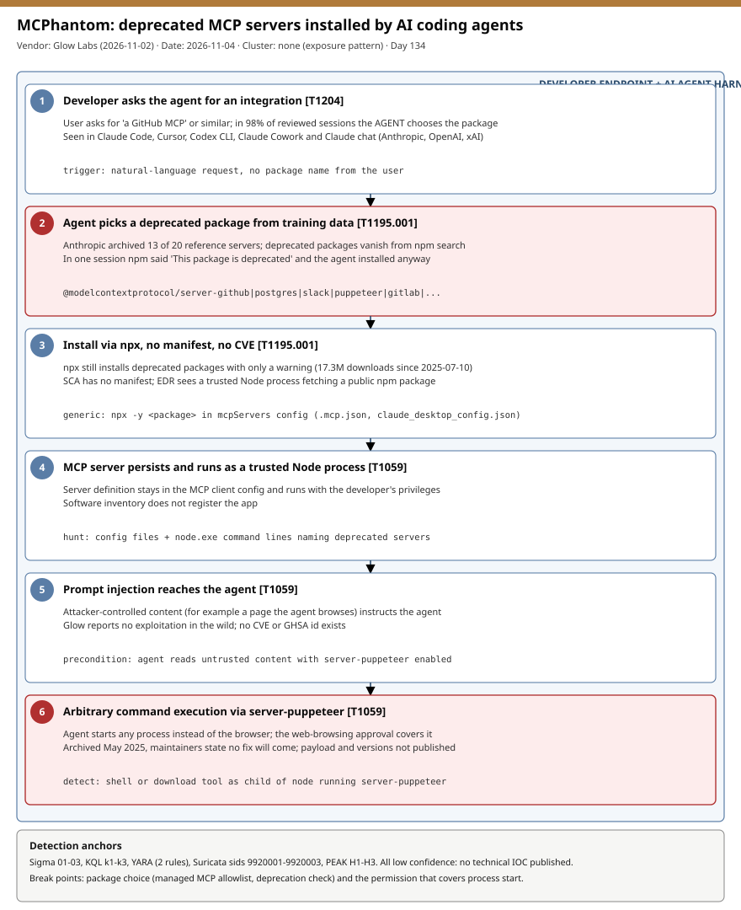

# MCPhantom: AI coding agents install deprecated MCP servers from training data, including an unpatched server-puppeteer RCE

## TL;DR

Glow Labs (Nadav Cohen, blog dated 2026-11-02/03, covered by Help Net Security on 2026-11-03) reports that AI coding agents (Claude Code, Cursor, Codex CLI, Claude Cowork, Claude chat) keep installing archived, deprecated `@modelcontextprotocol` reference MCP servers on developer machines. In 98% of the reviewed sessions the agent picked the package from its training data; in 2% the user named it. The deprecated packages were downloaded 17.3 million times since 2025-07-10, and one of them, `server-puppeteer`, has a high-severity RCE that a prompt injection can trigger and that will never be fixed upstream. Glow reports no exploitation in the wild, no CVE and no GHSA id exist, so SCA, EDR and software inventory all have a blind spot. Why today: it is a fresh, structural weakness in the AI-agent supply chain with no patch to wait for.

## Attribution and confidence

- **Cluster:** none. This is a research finding about an exposure pattern ("MCPhantom" is Glow Labs' name), not an intrusion set. No victims, no threat actor and no exploitation were reported.
- **Vendor / date:** Glow Labs, blog 2026-11-02 (a second date, 2026-11-03, appears on the page); Help Net Security, Mirko Zorz, 2026-11-03.
- **Confidence:** medium for the exposure statistics (vendor-reported, no total session sample size published); low for the exploitability details (only the Puppeteer RCE is described, and without payload, code path or affected versions). Three of the four reported vulnerabilities are not described at all.

| Overlap candidate | Relation | Evidence |
|---|---|---|
| Earlier npm supply-chain cases in this repo | Same ecosystem, different mechanism | Those involved attacker-published malicious packages; here the packages are legitimate but abandoned and the agent is the distribution channel. |
| 2026-10-29 LiteLLM PyPI pipeline hijack | Related theme (developer tooling as entry point) | Different actor-driven compromise; no shared indicators. |

Genealogy: this is the first case in the repo whose primary slot is a pure agent-decision weakness (#18) rather than a malicious package.

## Kill chain — summary table

| Stage | MITRE | Detail |
|---|---|---|
| 1. Developer asks the agent for an integration | T1204 | The user asks for "a GitHub MCP" or similar; in 98% of sessions the agent, not the user, chooses the package name. |
| 2. Agent picks a deprecated package from training data | T1195.001 | The model recalls an archived `@modelcontextprotocol` reference server; npm may print "This package is deprecated" and the agent installs anyway (one reported session). |
| 3. Install via npx | T1195.001 | `npx` still installs deprecated packages with only a warning; there is no manifest, so SCA sees nothing. |
| 4. Server runs as a trusted Node process | T1059 | The MCP server persists in the client config and runs with the developer's privileges. |
| 5. Prompt injection reaches the agent | T1059 | Attacker-controlled content (a web page the agent browses) instructs the agent; per Glow, with `server-puppeteer` the agent starts an arbitrary process instead of a browser. |
| 6. Arbitrary command execution | T1059 | The developer's "allow web browsing" approval is said to cover the command, so the harness does not block it. Exact payload not published. |



The diagram uses a single lane because the chain is linear: the developer-side flow runs from request to command execution, and the red stages mark the two decision points where a control could break it (package choice and the permission that covers process start). Detection anchors are the `npx -y` command line, the MCP client config files and Node child processes.

## Stage-by-stage detail

### 1. Request and package choice

Glow's transcript review found deprecated servers landing on machines through Claude Code, Cursor, Codex CLI, Claude Cowork and Claude chat, across Anthropic, OpenAI and xAI models. The sources state that 98% of sessions involved the agent filling in the name from training data. Anthropic archived 13 of its 20 original reference servers (archive notice at `modelcontextprotocol/servers-archived`).

```text
Packages named by Glow (unscoped on the page; scope "@modelcontextprotocol"):
server-github server-postgres server-slack server-puppeteer server-brave-search
server-google-maps server-gitlab server-gdrive server-redis create-server
server-aws-kb-retrieval server-everart
```

MITRE: T1195.001 Compromise Software Dependencies and Development Tools (the dependency is abandoned rather than malicious).

### 2. Install and persistence in client configuration

Deprecated packages disappear from npm search but `npx` still installs them. Generic MCP knowledge (not from the sources): clients store servers in JSON config under an `mcpServers` object with `command: npx` and `args: ["-y", "<package>"]`, in files such as `.mcp.json`, `.cursor/mcp.json` and `claude_desktop_config.json`.

```json
{"mcpServers": {"example": {"command": "npx", "args": ["-y", "<deprecated-package>"]}}}
```

MITRE: T1195.001.

### 3. Prompt injection to command execution

Per the sources, a prompt injection is enough to make the agent start any process instead of the browser through `server-puppeteer`; the developer's web-browsing permission ends up covering it. Payload, preconditions and affected versions are not published, and no exploitation has been observed.

MITRE: T1059 Command and Scripting Interpreter.

### 4. Why existing controls miss it

EDR sees a trusted Node process installing a public npm package; SCA has no manifest (npx) and the flaws have no CVE; software inventory does not list the app. Glow's disclosure timeline: advisory and HackerOne report on 2026-07-30 (closed out of scope), four flaws reported to Anthropic's CNA 2026-10-04 to 2026-10-11, advisory closed with no fix coming from the archive.

## Detection strategy

### Telemetry that matters

- Windows: Sysmon EID 1 (process creation with command line), EID 11 (file create) for MCP config files, EID 3 (network connection) from Node processes; Defender XDR `DeviceProcessEvents`, `DeviceFileEvents`, `DeviceNetworkEvents`.
- Linux/macOS: auditd `execve` records and EDR process trees for `node` parents; shell history is weak evidence.
- Network: TLS SNI and DNS for `registry.npmjs.org` from developer subnets (inventory only, traffic is encrypted).
- Agent harness logs and transcripts where available (they record the install decision).

### Detection coverage

| Engine | File | Logic |
|---|---|---|
| Sigma | [01_npx_install_of_deprecated_modelcontextprotocol_mcp_server.yml](./sigma/01_npx_install_of_deprecated_modelcontextprotocol_mcp_server.yml) | Package runner with `-y` naming one of the 12 deprecated packages. |
| Sigma | [02_mcp_client_config_file_written.yml](./sigma/02_mcp_client_config_file_written.yml) | Write to an MCP client config file (hint; inspect content). |
| Sigma | [03_shell_spawned_by_deprecated_mcp_server_process.yml](./sigma/03_shell_spawned_by_deprecated_mcp_server_process.yml) | Shell or download tool whose parent command line names a deprecated server. |
| KQL | [k1_package_runner_invocations_of_deprecated_mcp_servers.kql](./kql/k1_package_runner_invocations_of_deprecated_mcp_servers.kql) | Runner invocations of deprecated packages, grouped by host, user and harness. |
| KQL | [k2_shell_children_of_deprecated_mcp_server_node_processes.kql](./kql/k2_shell_children_of_deprecated_mcp_server_node_processes.kql) | Shell children of Node processes running a deprecated server. |
| KQL | [k3_mcp_client_config_file_writes_inventory.kql](./kql/k3_mcp_client_config_file_writes_inventory.kql) | MCP config file writes for an inventory review. |
| YARA | [mcphantom_deprecated_mcp_config_hints.yar](./yara/mcphantom_deprecated_mcp_config_hints.yar) | 2 rules: MCP config text and lockfile/cache text naming deprecated packages. |
| Suricata | [mcphantom_npm_registry_hints.rules](./suricata/mcphantom_npm_registry_hints.rules) | 3 sids (9920001-9920003): npm registry SNI/DNS inventory from developer and non-developer hosts. |

All rules are low-confidence behavioral hints: no hashes, domains or payloads were published. YARA and Suricata were not compiled (no engine available).

### Threat hunting hypotheses

- **H1:** deprecated MCP servers are already configured on developer machines — [peak_h1](./hunts/peak_h1_inventory_of_deprecated_mcp_servers_in_configs_and_npx_cache.md).
- **H2:** Node processes of an MCP server spawn unexpected children — [peak_h2](./hunts/peak_h2_agent_child_processes_from_mcp_server_node_processes.md).
- **H3:** agent install decisions ignore npm deprecation status and approval policy — [peak_h3](./hunts/peak_h3_agent_install_decisions_vs_npm_deprecation_status_and_approval_policy.md).

## Incident response playbook

### First 60 minutes (triage)

1. Identify hosts with a deprecated server configured (H1 queries); prioritise machines holding source code, cloud credentials or signing keys.
2. For hosts where `server-puppeteer` ran, list Node children and outbound connections in the same time window (H2).
3. Check whether the agent browsed untrusted content in the same sessions (transcripts, harness logs).
4. If a suspicious child process is found, isolate the host and rotate secrets reachable from that user (tokens in env vars, `~/.aws`, `~/.npmrc`, SSH keys).
5. Remove the server entry from the client config and tell the developer which approved server replaces it.

### Artifacts to collect

| Artifact | Path | Tool | Why |
|---|---|---|---|
| MCP client configs | `.mcp.json`, `.cursor/mcp.json`, `claude_desktop_config.json`, `~/.claude.json` (generic locations) | PowerShell / grep | Shows which servers are configured and with what arguments. |
| npx cache | `~/.npm/_npx`, `%LOCALAPPDATA%\npm-cache\_npx` (generic locations) | PowerShell / ls | Shows which packages were actually fetched and when. |
| Process telemetry | EDR / Sysmon EID 1 | KQL / Event Viewer | Parent-child chains from Node. |
| Agent transcripts and harness logs | Per product | Manual review | Records who chose the package and what content the agent read. |

### IR queries and commands

```powershell
Get-ChildItem -Path $env:USERPROFILE,$env:APPDATA -Recurse -Include .mcp.json,mcp.json,claude_desktop_config.json -ErrorAction SilentlyContinue |
  Select-String -Pattern 'server-github|server-postgres|server-slack|server-puppeteer|server-brave-search|server-google-maps|server-gitlab|server-gdrive|server-redis|create-server|server-aws-kb-retrieval|server-everart'
```

```bash
grep -rEl 'server-(github|postgres|slack|puppeteer|brave-search|google-maps|gitlab|gdrive|redis|aws-kb-retrieval|everart)|create-server' ~ --include='*mcp*.json' --include='.claude.json' 2>/dev/null
npm view @modelcontextprotocol/server-puppeteer deprecated
```

```kql
DeviceProcessEvents
| where Timestamp > ago(30d)
| where InitiatingProcessFileName =~ "node.exe" and InitiatingProcessCommandLine has "server-puppeteer"
| where FileName in~ ("cmd.exe","powershell.exe","pwsh.exe","curl.exe","certutil.exe")
| project Timestamp, DeviceName, AccountName, FileName, ProcessCommandLine
```

### Containment, eradication, recovery

Exit criteria: no deprecated server in any MCP config, replacement servers approved (one per service), no unexplained Node children, secrets rotated where a suspicious command ran. Do not delete configs before copying them as evidence, and do not treat an `npm uninstall` as sufficient: the npx cache and client config entries remain.

### Recovery validation

Re-run the H1 inventory across the fleet, confirm the approval list is enforced by the harness (pre-execution hook or managed config), and confirm npm deprecation status is part of the approval checklist.

## IOCs

No technical IOCs were published (no hashes, domains, IPs or paths). The table lists the package names the sources name and the weakness identifiers; full list in [iocs.csv](./iocs.csv).

| Type | Value | Context | Confidence | Source |
|---|---|---|---|---|
| string | @modelcontextprotocol/server-puppeteer | Deprecated server with unpatched RCE (scope per source, name unscoped on page) | medium | Glow Labs |
| string | @modelcontextprotocol/server-github | Deprecated; 5,266,085 downloads since 2025-07-10 | medium | Glow Labs |
| string | @modelcontextprotocol/server-postgres | Deprecated; 4,312,874 downloads | medium | Glow Labs |
| string | @modelcontextprotocol/server-slack | Deprecated; 3,198,630 downloads | medium | Glow Labs |
| string | @modelcontextprotocol/server-brave-search | Deprecated; 1,461,811 downloads | medium | Glow Labs |
| string | @modelcontextprotocol/server-google-maps | Deprecated; 814,615 downloads | medium | Glow Labs |
| string | @modelcontextprotocol/server-gitlab | Deprecated; 273,296 downloads | medium | Glow Labs |
| string | @modelcontextprotocol/server-gdrive | Deprecated; 247,891 downloads | medium | Glow Labs |
| string | @modelcontextprotocol/server-redis | Deprecated; 131,160 downloads | medium | Glow Labs |
| string | @modelcontextprotocol/create-server | Deprecated; 122,534 downloads | medium | Glow Labs |
| string | @modelcontextprotocol/server-aws-kb-retrieval | Deprecated; 23,028 downloads | medium | Glow Labs |
| string | @modelcontextprotocol/server-everart | Deprecated; 12,817 downloads | medium | Glow Labs |
| note | No CVE or GHSA id exists for the four vulnerabilities | Nothing to cross-reference against CISA KEV | high | Help Net Security |

KEV status: no CVE is associated with this case, so there is nothing to check against CISA KEV. Absence of a CVE does not mean the flaws are harmless or unexploited.

## Secondary findings

- Help Net Security reports that in one session npm returned "This package is deprecated" and the agent installed the package anyway: a lookup-before-install step does not help unless the deprecation result gates the install.
- Maintainers closed Glow's report as out of scope for an archived repository and said they would look at marking the npm package deprecated; a deprecated package still installs through `npx`, so upstream status changes alone do not protect existing users.
- Deprecated MCP servers sit outside normal patch management: no manifest, no CVE, no inventory entry, so the only reliable control is a managed allowlist of MCP servers.

## Pedagogical anchors

- An abandoned dependency is a supply-chain risk even when nobody malicious published it; the agent's training data is now a dependency-selection mechanism with no freshness check.
- Permission scope matters more than the tool name: "allow web browsing" that also covers process start turns prompt injection into command execution.
- Controls that key on CVEs, manifests or software inventory miss npx-installed agent tooling; hunt on the command line and the client config files instead.
- A single approved server per service, with deprecation status in the approval criteria, is cheaper than detecting every bad install.

## What's in this folder

| File | Purpose | Link |
|---|---|---|
| README.md | This write-up. | [README.md](./README.md) |
| kill_chain.svg | Single-lane kill chain diagram. | [kill_chain.svg](./kill_chain.svg) |
| iocs.csv | Package names and weakness notes named by the sources. | [iocs.csv](./iocs.csv) |
| sigma/ | Three Sigma rules (package runner, config write, shell child). | [sigma/](./sigma/) |
| kql/ | Three Defender XDR hunting queries. | [kql/](./kql/) |
| yara/ | One YARA file with two config/lockfile hint rules. | [yara/](./yara/) |
| suricata/ | Three npm registry inventory rules (sids 9920001-9920003). | [suricata/](./suricata/) |
| hunts/ | Three PEAK hunts (inventory, child processes, install policy). | [hunts/](./hunts/) |

## Sources

- [Glow Labs — MCPhantom: AI coding agents are installing vulnerable, deprecated MCP servers from training data](https://www.glow.io/blogs/mcphantom-ai-coding-agents-are-installing-vulnerable-deprecated-mcp-servers-from-training-data)
- [Help Net Security — AI coding agents are installing MCP servers that will never be patched (2026-11-03)](https://www.helpnetsecurity.com/2026/11/03/mcphantom-deprecated-mcp-servers/)
- [modelcontextprotocol/servers-archived (archive notice)](https://github.com/modelcontextprotocol/servers-archived)
- [MITRE ATT&CK T1195.001](https://attack.mitre.org/techniques/T1195/001/)
