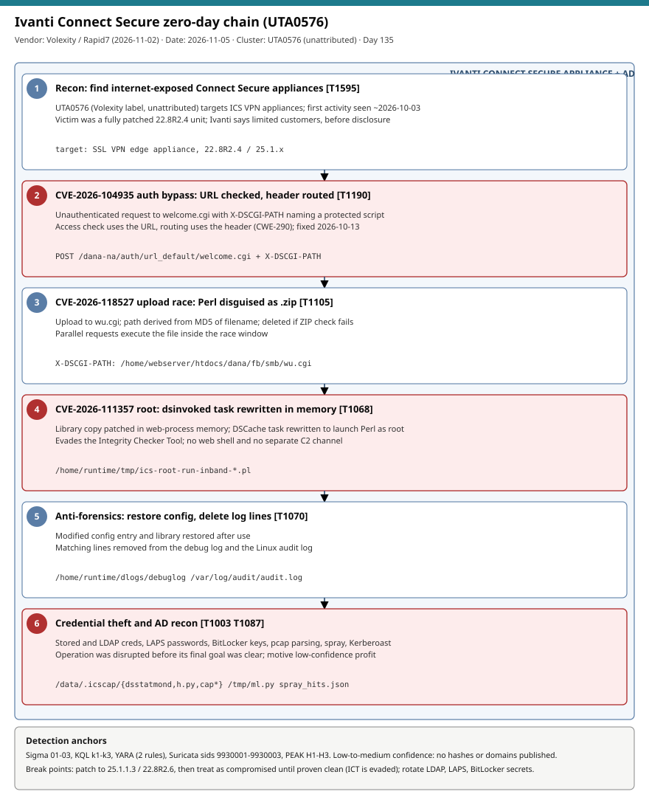

# Ivanti Connect Secure zero-day chain: UTA0576 chains CVE-2026-104935, CVE-2026-118527 and CVE-2026-111357 for unauthenticated root

## TL;DR

Volexity tracked a cluster it calls UTA0576 breaking into a fully patched Ivanti Connect Secure (ICS) 22.8R2.4 appliance from about 2026-10-03, using an unauthenticated authentication bypass (CVE-2026-104935, fixed 2026-10-13) chained with an authenticated file upload (CVE-2026-118527) and a local privilege escalation to root (CVE-2026-111357). Ivanti updated its advisory on 2026-10-29 with the two new CVEs, says a limited number of customers were hit before disclosure, and CISA added both to KEV on 2026-10-30; Rapid7 summarised the case on 2026-11-02. The October 13 builds (25.1.1.2 and 22.8R2.5) do not fix the two new flaws; only 25.1.1.3 and 22.8R2.6 do. Post-root activity targeted stored and LDAP credentials, Windows LAPS passwords and BitLocker recovery keys, and Volexity reports the activity evades Ivanti's Integrity Checker Tool, so a clean scan proves nothing. Why today: the VPN edge is the front door, patching is not eviction, and the credential blast radius sits in Active Directory.

## Attribution and confidence

- **Cluster:** UTA0576 (Volexity's uncategorised label). Ivanti names no actor; the secondary sources lean low-confidence towards a profit motive over espionage. No nation-state or ransomware affiliation is stated.
- **Vendor / date:** Volexity (original write-up 2026-10-13, later updated); Ivanti advisory update 2026-10-29; Rapid7 ETR 2026-11-02; Tech Insider 2026-11-03 and CISO Platform briefing 2026-11-03/04 (both secondary).
- **Confidence:** medium. CVE IDs, fixed builds and KEV dates agree across sources; the CVSS attribution for CVE-2026-111357 differs (Ivanti 8.8 vs CVE record and Rapid7 7.0); the exploit payload, discovery credit for the two new CVEs and the number of victims are not published.

| Overlap candidate | Relation | Evidence |
|---|---|---|
| 2026-10-01 NetScaler DTLS zero-days | Same class (VPN edge zero-days), no shared actor | No shared indicators in the sources read. |
| 2026-10-27 Qilin/INC via PAN-OS GlobalProtect | Same edge-to-AD pattern | Different actor and CVEs; the AD-credential follow-on is analogous. |

Genealogy: continues the run of edge-appliance cases in the repo (NetScaler, PAN-OS, BeyondTrust); the in-memory patching and log cleanup that evades the vendor integrity tool is the distinguishing feature.

## Kill chain — summary table

| Stage | MITRE | Detail |
|---|---|---|
| 1. Recon of exposed ICS appliances | T1595 | Internet-facing SSL VPN; first victim was a fully patched 22.8R2.4 unit. |
| 2. Auth bypass (CVE-2026-104935) | T1190 | Request to `/dana-na/auth/url_default/welcome.cgi` with an `X-DSCGI-PATH` header; access check uses the URL, routing uses the header. |
| 3. Upload race (CVE-2026-118527) | T1105 | Perl script disguised as `.zip` uploaded to `wu.cgi`; path derived from MD5 of the filename; parallel requests execute it before deletion. |
| 4. Root (CVE-2026-111357) | T1068 | `dsinvoked` root maintenance service; library copy patched in web-process memory and a DSCache task rewritten to launch Perl. |
| 5. Cleanup | T1070 | Config entry and library restored; matching lines removed from debug log and audit log. |
| 6. Credential theft and AD recon | T1003, T1087, T1110.003, T1558.003 | Stored and LDAP credentials, LAPS passwords, BitLocker keys, pcap parsing, spraying, Kerberoast-style tooling. |



The diagram is a single lane because the chain is linear on one appliance, ending in the Active Directory blast radius. Red stages are the bypass, the root escalation and the credential theft; detection anchors are the `welcome.cgi` plus `X-DSCGI-PATH` request, the staging paths, the Volexity IP and LAPS/BitLocker reads by the VPN account.

## Stage-by-stage detail

### 1. Authentication bypass: CVE-2026-104935

Per Volexity via Tech Insider, the unauthenticated request carries an `X-DSCGI-PATH` header naming a protected script. The access check evaluates the URL; the router dispatches to the header's target. Observed header values:

```text
POST /dana-na/auth/url_default/welcome.cgi
X-DSCGI-PATH: /home/webserver/htdocs/dana/fb/smb/wu.cgi
X-DSCGI-PATH: /home/runtime/tmp/<MD5(filename)>
```

The full request shape (method, body) is not published. MITRE: T1190 Exploit Public-Facing Application. Rapid7 classifies it CWE-290, CVSS 8.6 (Ivanti), remote unauthenticated command execution.

### 2. Upload race: CVE-2026-118527

A Perl script disguised as `.zip` is uploaded to `wu.cgi`; the storage path derives from an MD5 of the filename and the file is deleted when the ZIP check fails, so parallel requests execute it inside the window. CWE-340, CVSS 4.3, authenticated upload to a known location. MITRE: T1105 Ingress Tool Transfer.

### 3. Root: CVE-2026-111357

The attacker patched a library copy in web-process memory and rewrote a DSCache task read by the `dsinvoked` root maintenance service so it launches Perl as root. Staging files on the appliance:

```text
/home/runtime/tmp/ics-root-run-inband-*.pl
/home/runtime/tmp/ics-root-result-inband-*
/data/.icscap/{dsstatmond, cap*, h.py}
/tmp/{ml.py, rq5.py, mk.py, rr.py, pu.txt, sp_out.txt, spray_hits.json}
```

Rapid7 lists CVSS 8.8 (Ivanti) vs 7.0 (CVE record), CWE-306/862/345. MITRE: T1068 Exploitation for Privilege Escalation. There is no web shell and no separate C2: commands and results travel inside ordinary HTTPS requests.

### 4. Cleanup and evasion

The modified config entry and library were restored and matching lines deleted from `/home/runtime/dlogs/debuglog` and `/var/log/audit/audit.log`. Volexity reports the activity evades the Integrity Checker Tool. MITRE: T1070 Indicator Removal.

### 5. Credential theft and AD reconnaissance

Volexity observed harvesting of stored credentials (including domain credentials used for LDAP), AD queries for Windows LAPS local-admin passwords and BitLocker recovery keys, packet-capture parsing for plaintext LDAP credentials, HTTP basic auth and NTLM challenge-response, password spraying and Kerberoast-style tooling. The operation was disrupted before its final goal was clear. MITRE: T1003, T1087, T1110.003, T1558.003.

## Detection strategy

### Telemetry that matters

- Appliance side: forwarded syslog, `/home/runtime/dlogs/debuglog`, `/var/log/audit/audit.log` (look for gaps and selective deletion), a forensic image or memory capture; the ICT result is not proof of cleanliness.
- Perimeter: TLS-terminating reverse proxy or WAF logs in front of ICS (request URI and headers); firewall logs to 108.165.147.64.
- Identity: Windows Security 4662 (directory object reads), 4769/4768 (Kerberos), 4625/4624 (spray), LDAP bind sources from the VPN service account; Defender for Identity `IdentityQueryEvents`.

### Detection coverage

| Engine | File | Logic |
|---|---|---|
| Sigma | [01_ivanti_ics_welcome_cgi_dscgi_path_auth_bypass.yml](./sigma/01_ivanti_ics_welcome_cgi_dscgi_path_auth_bypass.yml) | welcome.cgi URI plus a second marker (wu.cgi, X-DSCGI-PATH, /home/runtime/tmp/). |
| Sigma | [02_ivanti_ics_uta0576_appliance_staging_files.yml](./sigma/02_ivanti_ics_uta0576_appliance_staging_files.yml) | Linux file events for the staging paths and file names. |
| Sigma | [03_ivanti_ics_uta0576_network_ip_108_165_147_64.yml](./sigma/03_ivanti_ics_uta0576_network_ip_108_165_147_64.yml) | Connections to or from the Volexity IP (may be stale). |
| KQL | [k1_ics_appliance_traffic_uta0576_ip_and_welcome_cgi.kql](./kql/k1_ics_appliance_traffic_uta0576_ip_and_welcome_cgi.kql) | CommonSecurityLog and DeviceNetworkEvents for the IP and URI markers. |
| KQL | [k2_laps_bitlocker_reads_by_ivanti_service_account.kql](./kql/k2_laps_bitlocker_reads_by_ivanti_service_account.kql) | LAPS and BitLocker attribute reads by the VPN account or from the appliance. |
| KQL | [k3_syslog_ics_artifacts_and_log_gaps.kql](./kql/k3_syslog_ics_artifacts_and_log_gaps.kql) | Artifact strings in Syslog and message gaps per appliance. |
| YARA | [ivanti_ics_uta0576_hints.yar](./yara/ivanti_ics_uta0576_hints.yar) | 2 rules: on-disk artifact paths; X-DSCGI-PATH request carve. |
| Suricata | [ivanti_ics_uta0576_hints.rules](./suricata/ivanti_ics_uta0576_hints.rules) | 3 sids (9930001-9930003); HTTP rules need decrypted traffic. |

Confidence is low to medium: no hashes or domains were published, and Volexity's own YARA and IOC list were not read in this run. YARA and Suricata were not compiled (no engine available).

### Threat hunting hypotheses

- **H1:** exposed ICS appliances are below 25.1.1.3 / 22.8R2.6 or were exploited before patching — [peak_h1](./hunts/peak_h1_ics_exposure_and_patch_level_inventory.md).
- **H2:** the appliance image holds the staging artifacts or shows log gaps since 2026-10-03 — [peak_h2](./hunts/peak_h2_appliance_forensic_artifacts_and_log_gaps.md).
- **H3:** secrets reachable from the appliance (LDAP bind account, LAPS, BitLocker) were read or sprayed — [peak_h3](./hunts/peak_h3_identity_blast_radius_ldap_laps_bitlocker_spray.md).

## Incident response playbook

### First 60 minutes (triage)

1. Inventory every ICS appliance and its build; anything below 25.1.1.3 or 22.8R2.6 is exposed to the two new CVEs even if the October 13 build was applied.
2. Before patching or rebooting, preserve memory and logs (the exploit patches library code in memory and restores config afterwards).
3. Review appliance and upstream firewall/WAF logs from 2026-10-03 onward for `welcome.cgi` requests with `X-DSCGI-PATH` and traffic with 108.165.147.64.
4. Look for gaps or selective line removal in `debuglog` and `audit.log`; gaps are evidence, not noise.
5. Identify the LDAP bind / service account and any credentials stored on the appliance; start rotation with those.
6. Decide in advance on rebuild from a known-good image if any indicator appears; a clean Integrity Checker Tool result does not rule out compromise.

### Artifacts to collect

| Artifact | Path | Tool | Why |
|---|---|---|---|
| Debug log | `/home/runtime/dlogs/debuglog` | Ivanti snapshot / forensic image | Gaps or removed lines after 2026-10-03. |
| Audit log | `/var/log/audit/audit.log` | Forensic image | Serial-number gaps betray deleted records. |
| Staging files | `/home/runtime/tmp/`, `/data/.icscap/`, `/tmp/` | Forensic image | Files named in the Volexity list. |
| Memory | appliance RAM | Vendor-supported capture | In-memory library patch is not on disk. |
| Perimeter logs | WAF / proxy / firewall | SIEM | URI, header and IP evidence. |
| Directory logs | DC Security log, MDI | KQL | LAPS, BitLocker, spray, Kerberoast activity. |

### IR queries and commands

```bash
# Author: Jarmi - on a mounted forensic image of the appliance (mount point is an example)
find /mnt/ics_img/home/runtime/tmp /mnt/ics_img/data/.icscap /mnt/ics_img/tmp -maxdepth 2 \
  \( -name 'ics-root-run-inband-*' -o -name 'ics-root-result-inband-*' -o -name 'dsstatmond' -o -name 'h.py' \
     -o -name 'ml.py' -o -name 'rq5.py' -o -name 'mk.py' -o -name 'rr.py' -o -name 'spray_hits.json' \) 2>/dev/null
```

```kql
// Author: Jarmi
CommonSecurityLog
| where TimeGenerated > datetime(2026-10-03)
| where SourceIP == "108.165.147.64" or DestinationIP == "108.165.147.64" or RequestURL has "welcome.cgi"
| project TimeGenerated, DeviceVendor, SourceIP, DestinationIP, RequestURL, DeviceAction
```

```powershell
# Author: Jarmi - list who can read LAPS passwords and which hosts hold BitLocker keys (scope for rotation)
Get-ADComputer -Filter * -Properties msLAPS-PasswordExpirationTime,ms-Mcs-AdmPwdExpirationTime |
  Select-Object Name,'msLAPS-PasswordExpirationTime','ms-Mcs-AdmPwdExpirationTime' | Measure-Object
```

### Containment, eradication, recovery

- **Exit criteria:** appliance rebuilt or proven clean from an image, patched to 25.1.1.3 / 22.8R2.6 or later, all secrets stored on or reachable from it rotated (LDAP bind, VPN-integrated credentials, certificates), LAPS passwords and BitLocker keys rotated for the exposed scope.
- **Do NOT:** reboot or factory-reset before capturing memory and logs; rely on the Integrity Checker Tool as a clean bill; block only the one IP and call it done; follow the vendor recovery article blindly (Rapid7 notes it contains references to older releases).

### Recovery validation

- Re-run H1 to confirm builds, H2 against the new image, and H3 for 14 days after rotation.
- Confirm no new LAPS/BitLocker reads or LDAP binds from the appliance outside the expected service account pattern.

## IOCs

| Type | Value | Context | Confidence | Source |
|---|---|---|---|---|
| cve | CVE-2026-104935 | Authentication bypass by spoofing; chain entry point; fixed 2026-10-13 | high | [Rapid7](https://www.rapid7.com/blog/post/etr-additional-ivanti-connect-secure-zero-days-exploited-in-the-wild-cve-2026-111357-cve-2026-118527/) |
| cve | CVE-2026-111357 | Local privilege escalation to root; fixed 25.1.1.3 / 22.8R2.6 | high | Rapid7 |
| cve | CVE-2026-118527 | Authenticated file upload to a known path; fixed 25.1.1.3 / 22.8R2.6 | high | Rapid7 |
| ipv4 | 108.165.147.64 | UTA0576 exploitation IP (Volexity); may be stale | medium | Rapid7 |
| url | /dana-na/auth/url_default/welcome.cgi | Endpoint abused with X-DSCGI-PATH; URI alone is benign | medium | Rapid7 |
| string | X-DSCGI-PATH | Routing header naming the protected script | medium | Rapid7 |
| path | /home/webserver/htdocs/dana/fb/smb/wu.cgi | Observed header value; upload script | medium | Rapid7 |
| path | /home/runtime/tmp/ics-root-run-inband-*.pl | Root-run Perl staging pattern | medium | Rapid7 |
| path | /home/runtime/tmp/ics-root-result-inband-* | Root output pattern | medium | Rapid7 |
| path | /data/.icscap/{dsstatmond,h.py,cap*} | Attacker directory contents | medium | Rapid7 |
| path | /tmp/{ml.py,rq5.py,mk.py,rr.py,pu.txt,sp_out.txt,spray_hits.json} | Attacker files in /tmp | medium | Rapid7 |
| path | /home/runtime/dlogs/debuglog | Check for selective deletion | medium | Rapid7 |
| path | /var/log/audit/audit.log | Check for selective deletion | medium | Rapid7 |

No hashes or domains are published in the sources read. **KEV:** 1 of 3 CVEs is confirmed on the local KEV cache (CVE-2026-104935, added 2026-10-13); the cache predates the update, and Rapid7 reports CVE-2026-111357 and CVE-2026-118527 added on 2026-10-30. Those two entries and their due dates were not verified against the live catalog (see [kev.md](./kev.md)). Full list in `iocs.csv`.

## Secondary findings

- **Patching is not eviction:** the first victim was a fully patched 22.8R2.4 unit, and the October 13 builds do not fix the two new CVEs. Ivanti recommends moving 22.8 customers to 25.1.1.3 or later, with 22.8R2.6 only if migration is not immediate.
- **CVSS disagreement:** CVE-2026-111357 is 8.8 per Ivanti's scoring but 7.0 in the CVE record and Rapid7's database (attribute vector AC:H vs AC:L and scope change); treat the priority as KEV-driven, not score-driven.
- **Source discrepancies:** the secondary pages disagree on who owns the 8.8 score and on publication dates; the Volexity GitHub IOC list and YARA rules were not read in this run.

## Pedagogical anchors

- When the access control checks one input (the URL) and the router uses another (a header), the gap between them is the vulnerability; look for parser differentials in every proxy chain.
- A vendor integrity checker is a control the attacker can test against; plan detection around external evidence (logs, network, identity) instead.
- Patch, then hunt: exploitation preceded disclosure by weeks, so the patch date is not the compromise-free date.
- The real blast radius of a VPN appliance is the credentials it stores and the directory it can query: LDAP bind account, LAPS and BitLocker secrets.
- Detection on closed appliances depends on what you forward and image; build that pipeline before the next advisory.

## What's in this folder

| File | Purpose | Link |
|---|---|---|
| README.md | This analysis. | [README.md](./README.md) |
| kill_chain.svg | Single-lane kill chain diagram (template C). | [kill_chain.svg](./kill_chain.svg) |
| iocs.csv | Full indicator list with context and confidence. | [iocs.csv](./iocs.csv) |
| kev.md | CISA KEV cross-reference for this case's CVEs. | [kev.md](./kev.md) |
| sigma/ | 3 Sigma rules (web, Linux file event, network). | [sigma](./sigma/) |
| kql/ | 3 KQL hunts (traffic, identity, Syslog). | [kql](./kql/) |
| yara/ | 2 YARA hint rules. | [yara](./yara/) |
| suricata/ | 3 Suricata rules (sids 9930001-9930003). | [suricata](./suricata/) |
| hunts/ | 3 PEAK hunts H1-H3. | [hunts](./hunts/) |

## Sources

- [Rapid7 — Additional Ivanti Connect Secure zero-days exploited in the wild (CVE-2026-111357, CVE-2026-118527)](https://www.rapid7.com/blog/post/etr-additional-ivanti-connect-secure-zero-days-exploited-in-the-wild-cve-2026-111357-cve-2026-118527/)
- [Tech Insider — Ivanti Connect Secure CVE-2026-111357 / 118527, KEV deadline Nov 13](https://tech-insider.org/ivanti-connect-secure-cve-2026-111357-118527-kev-deadline-nov-13-2026/)
- [CISO Platform — Breach Watch: Ivanti patches two more CVEs](https://www.cisoplatform.com/profiles/blogs/breach-watch-ivanti-patches-two-more-cves-amid-highly-unusual-con)
- [Volexity threat-intel repository, 2026-10-13 Ivanti (IOC CSV and YARA; linked from Rapid7, not read)](https://github.com/volexity/threat-intel/tree/main/2026/2026-10-13%20Ivanti)
- [Rapid7 — Ivanti Connect Secure zero-day CVE-2026-104935 (linked, not read)](https://www.rapid7.com/blog/post/etr-ivanti-connect-secure-zero-day-exploited-in-the-wild-cve-2026-104935/)
- [CISA Known Exploited Vulnerabilities Catalog](https://www.cisa.gov/known-exploited-vulnerabilities-catalog)
