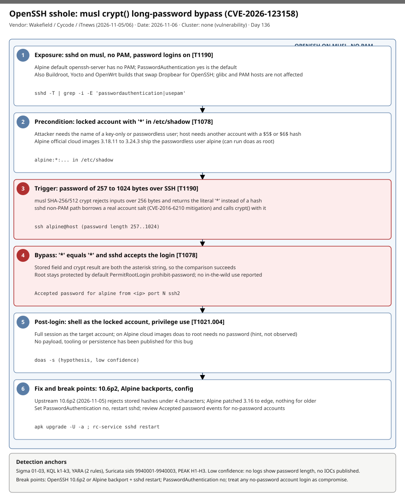

# OpenSSH *sshole: musl crypt() returns '*' for passwords over 256 bytes, letting a long password log in to locked accounts (CVE-2026-123158)

## TL;DR

Wakefield researcher Ozgun Kultekin reported, and OpenSSH fixed on 2026-11-05 in Portable OpenSSH 10.6p2, an authentication bypass (CVE-2026-123158, CVSS 3.1 8.1) that affects sshd built against musl libc without PAM, which is the default `openssh-server` package on Alpine Linux. A password of 257 to 1024 bytes makes musl's SHA-256/512 `crypt()` fail with the literal string `*`; an account whose `/etc/shadow` field is exactly `*` (a key-only or passwordless user) then "matches" and logs in. Alpine patched branches 3.16 to edge; Buildroot, Yocto and OpenWrt builds that use OpenSSH are also named. No source reports exploitation in the wild, a public exploit or any IOC, so this case is about exposure inventory and log hunting, not an actor.

## Attribution and confidence

- **Cluster:** none. This is a vulnerability disclosure, not an intrusion; no actor, campaign or victim is named.
- **Vendor / date:** Ozgun Kultekin (Wakefield), found with AI-agent swarms that built sshd in every glibc/musl and PAM/no-PAM combination and sent about 17,600 unusual logins; Cycode write-up syndicated by Security Boulevard (2026-11-05); Threat Landscape (2026-11-05); iTnews (2026-11-06). OpenSSH 10.6p2 and the Alpine advisory are dated 2026-11-05.
- **Confidence:** medium. The CVE ID, CVSS and fixed versions come from two sources that agree; mechanism details come from Threat Landscape and Cycode and agree with iTnews. Sources differ on which Alpine account is affected on cloud images (the `alpine` user per iTnews and Cycode; Threat Landscape says root, which contradicts the default `PermitRootLogin prohibit-password`), and the OX Security, BleepingComputer, upstream release notes and `sshhole.com` pages could not be read.

| Overlap candidate | Relation | Evidence |
|---|---|---|
| 2026-11-04 MCPhantom (agent-installed packages) | Both are Linux/dev-infrastructure exposure cases with no actor | No shared indicators; same "inventory first" lesson. |
| 2026-11-05 Ivanti Connect Secure chain | Both are authentication bypasses on internet-facing Linux services | Different component and no actor overlap. |

Genealogy: no previous repo case covers OpenSSH or musl; the closest recurring theme is edge-service authentication bypass.

## Kill chain — summary table

| Stage | MITRE | Detail |
|---|---|---|
| 1. Exposure | T1190 | sshd on musl, no PAM, `PasswordAuthentication yes` (the Alpine defaults). |
| 2. Precondition | T1078 | A target account with `*` in `/etc/shadow` and at least one other account with a real `$5$`/`$6$` hash. |
| 3. Trigger | T1190 | SSH password of 257 to 1024 bytes. |
| 4. Bypass | T1078 | `crypt()` returns `*`, equal to the stored field, so sshd accepts the login. |
| 5. Post-login | T1021.004 | Session as the locked account; `doas` to root on Alpine cloud images is a hint, not observed. |
| 6. Fix | n/a | OpenSSH 10.6p2 or Alpine backport, restart sshd, or `PasswordAuthentication no`. |



The diagram is a single lane because the bug is a linear logic flaw on one host. Red stages are the trigger and the accepted login; detection anchors are `Accepted password` events for accounts that have no password, sshd running inside containers, and the `sshd -T` exposure check.

## Stage-by-stage detail

### 1. Exposure: musl, no PAM, password logins

The bug needs all of: OpenSSH linked against musl, PAM not used, `PasswordAuthentication yes`. Cycode states the default Alpine `openssh-server` package has no PAM (or `openssh-server-pam` with `UsePAM no`). glibc distributions (Debian, Ubuntu, Fedora), PAM logins and Dropbear are not affected. iTnews adds Alpine cloud images, Buildroot and Yocto systems and OpenWrt devices that replaced Dropbear with OpenSSH; Alpine containers are at risk only if they run sshd.

```bash
sshd -T | grep -i -E 'passwordauthentication|usepam'
```

Per Cycode, the system is not exposed if password logins are off or PAM is on. MITRE: T1190.

### 2. Precondition: a locked account and a donor hash

The target account has the exact string `*` in the password field of `/etc/shadow` (typical for key-only users). The attacker must know that username, and the host needs another account with a real SHA-256/512 hash that supplies a salt. On Alpine official cloud images 3.18.11 to 3.24.3 the default `alpine` user has no password and can run `doas` as root (Cycode). Root itself is protected by the default `PermitRootLogin prohibit-password`. MITRE: T1078.

### 3. Trigger: a 257 to 1024 byte password

musl's SHA-256/512 `crypt()` rejects inputs longer than 256 bytes and returns the literal `*` instead of a hash (Threat Landscape cites musl commits from August 2012). Passwords between 257 and 1024 bytes trigger this. The exact exploit request is not published beyond this description; `sshhole.com` hosts a demonstration that was not read. MITRE: T1190.

### 4. Bypass: `*` equals `*`

After the CVE-2016-6210 mitigation, sshd's non-PAM path borrows the salt of a real account (`pick_salt()`) when the target has no usable hash, then calls `crypt(password, salt)`. For an over-length password that returns `*`, which equals the locked account's stored field, so authentication succeeds.

```text
Accepted password for alpine from <source> port <n> ssh2
```

This log line is the only detection guidance the sources give: search `/var/log/messages` for `Accepted password` on an account that has no password and treat a hit as a compromise. sshd does not log the password length. MITRE: T1078.

### 5. Post-login activity

The sources describe a full login session as the target account and name root reachable through `doas` on the Alpine cloud images. No payload, persistence or tooling has been published, so Sigma 02 and hunt H3 are hypotheses, not observations. MITRE: T1021.004.

### 6. Fix and mitigation

Upstream 10.6p2 (2026-11-05) is a workaround: stored hashes must be at least four characters before comparison. Alpine fixed packages: edge 10.6_p2-r0, 3.24 10.3_p1-r2, 3.23 10.2_p1-r1, 3.22 10.0_p1-r11, 3.21 9.9_p2-r1, 3.20 9.7_p1-r6, 3.19 9.6_p1-r3, 3.18 9.3_p2-r4, 3.17 9.1_p1-r7, 3.16 9.0_p1-r6; branches before 3.16 get no package. OpenSSH developer Damien Miller (via iTnews) advised setting `PasswordAuthentication no` immediately.

## Detection strategy

### Telemetry that matters

- sshd authentication logs: `/var/log/messages` (Alpine syslog) or auth logs forwarded as Syslog to Sentinel; the `Accepted password for <user>` line.
- Defender for Endpoint on Linux: `DeviceProcessEvents` and `DeviceNetworkEvents` for sshd inside containers or on unexpected hosts.
- Configuration and shadow audits: `sshd -T`, `/etc/shadow` fields equal to `*`, package versions (`apk info -v openssh`).
- Flow/IDS logs for inbound SSH to Alpine/OpenWrt hosts (exposure only; the password is encrypted).

### Detection coverage

| Engine | File | Logic |
|---|---|---|
| Sigma | [01_sshd_accepted_password_for_passwordless_account.yml](./sigma/01_sshd_accepted_password_for_passwordless_account.yml) | Accepted password event for a passwordless account (`alpine` plus a placeholder list). |
| Sigma | [02_doas_su_by_alpine_user_after_ssh_session.yml](./sigma/02_doas_su_by_alpine_user_after_ssh_session.yml) | `doas`/`su` run by the `alpine` user from a shell/sshd parent (hypothesis, low). |
| Sigma | [03_sshd_started_inside_container.yml](./sigma/03_sshd_started_inside_container.yml) | sshd launched under a container runtime (exposure inventory). |
| KQL | [k1_syslog_sshd_accepted_password_passwordless_accounts.kql](./kql/k1_syslog_sshd_accepted_password_passwordless_accounts.kql) | Syslog accepted-password events for passwordless accounts. |
| KQL | [k2_mde_linux_sshd_in_containers_and_listeners.kql](./kql/k2_mde_linux_sshd_in_containers_and_listeners.kql) | MDE sshd processes in containers joined to listeners. |
| KQL | [k3_syslog_password_success_after_only_failures.kql](./kql/k3_syslog_password_success_after_only_failures.kql) | Sources that failed, then succeeded with a password. |
| YARA | [openssh_sshole_cve_2026_123158_config_hints.yar](./yara/openssh_sshole_cve_2026_123158_config_hints.yar) | Provisioning scripts and sshd_config combining no-PAM and password logins. |
| Suricata | [openssh_sshole_cve_2026_123158_hints.rules](./suricata/openssh_sshole_cve_2026_123158_hints.rules) | Exposure hints only (sids 9940001-9940003); no exploit signature exists. |

### Threat hunting hypotheses

- **H1:** hosts exist in the estate that run musl OpenSSH with no PAM, password logins on, and a `*` account. See [peak_h1](./hunts/peak_h1_musl_nopam_password_auth_exposure_inventory.md).
- **H2:** a successful password login occurred to an account whose shadow field is `*`. See [peak_h2](./hunts/peak_h2_password_logins_to_star_shadow_accounts.md).
- **H3:** after such a login, privilege use (`doas`, new `authorized_keys`, new users) followed. See [peak_h3](./hunts/peak_h3_post_login_privilege_use_doas_keys_users.md).

All rules are low-confidence hints: sshd does not log password length and the sources publish no on-the-wire or on-disk indicator.

## Incident response playbook

### First 60 minutes (triage)

1. Identify musl hosts running OpenSSH: Alpine, OpenWrt, Buildroot/Yocto images, containers with sshd.
2. Run `sshd -T | grep -i -E 'passwordauthentication|usepam'` on each; set `PasswordAuthentication no` and restart sshd where password logins are not needed.
3. Search auth logs for `Accepted password` on accounts with no password.
4. Snapshot `/etc/passwd`, `/etc/shadow` metadata, `authorized_keys` files and shell history before changes.
5. Upgrade (`apk upgrade -U -a`, `rc-service sshd restart`) and confirm the running version.

### Artifacts to collect

| Artifact | Path | Tool | Why |
|---|---|---|---|
| sshd logs | `/var/log/messages` | `grep`, syslog forwarder | Accepted password events for no-password accounts. |
| Account database | `/etc/passwd`, `/etc/shadow` | `awk`, `stat` | Accounts with `*` and recent changes. |
| SSH keys | `~/.ssh/authorized_keys`, `/etc/ssh/` | `find`, `stat` | New keys as persistence (hypothesis). |
| sshd config | effective config | `sshd -T` | Confirm PAM and password settings. |
| Package state | apk database | `apk info -v openssh` | Confirm fixed version. |

### IR queries and commands

```bash
sshd -T | grep -i -E 'passwordauthentication|usepam'
awk -F: '$2=="*"{print $1}' /etc/shadow
grep 'Accepted password' /var/log/messages
apk upgrade -U -a && rc-service sshd restart
```

```kql
Syslog
| where ProcessName == "sshd" and SyslogMessage has "Accepted password for"
```

### Containment, eradication, recovery

Exit criteria: patched or password logins disabled and sshd restarted; no unexplained `Accepted password` events for passwordless accounts; no new keys or users. If a hit is found, treat the host as compromised per the Cycode guidance: rebuild from a clean image and rotate any secrets reachable from it. Do not rely only on the upgrade: it does not remove access gained earlier. Do not assume root is safe by default; confirm `PermitRootLogin`.

### Recovery validation

Re-run `sshd -T`, confirm the package version against the list above, and verify key-based logins work before disabling passwords.

## IOCs

| Type | Value | Context | Confidence | Source |
|---|---|---|---|---|
| cve | CVE-2026-123158 | musl no-PAM OpenSSH long-password bypass; fixed in 10.6p2 | high | [Security Boulevard](https://securityboulevard.com/2026/11/sshole-cve-2026-123158-openssh-password-bypass-on-alpine-linux/) |
| cve | CVE-2016-6210 | Salt-borrowing mitigation whose code path the bug abuses | medium | [Threat Landscape](https://threatlandscape.io/blog/openssh-musl-linux-arbitrary-long-passwords-locked-accounts) |
| string | Accepted password for alpine | Log line for the passwordless cloud-image user | medium | [Security Boulevard](https://securityboulevard.com/2026/11/sshole-cve-2026-123158-openssh-password-bypass-on-alpine-linux/) |
| path | /etc/shadow | Fields equal to `*` are targets | high | [Threat Landscape](https://threatlandscape.io/blog/openssh-musl-linux-arbitrary-long-passwords-locked-accounts) |
| string | openssh 10.6_p2-r0 | Alpine edge fixed package | high | [Security Boulevard](https://securityboulevard.com/2026/11/sshole-cve-2026-123158-openssh-password-bypass-on-alpine-linux/) |
| note | No IPs, domains or hashes published | No in-the-wild exploitation reported | high | [iTnews](https://www.itnews.com.au/news/lightweight-linux-distros-vulnerable-to-sshole-password-bypass-630155) |

Full list in [iocs.csv](./iocs.csv).

**KEV status:** 0 of 2 CVEs are on the CISA KEV list (cached catalog 2026.10.16; live fetch unavailable). CVE-2026-123158 is newly disclosed and no source reports exploitation, so absence from KEV does not mean it is safe; patch now. See [kev.md](./kev.md).

## Secondary findings

- **Source discrepancy on affected account:** Threat Landscape says root is reachable on Alpine cloud images, while iTnews and Cycode say the `alpine` user (root is blocked by `PermitRootLogin prohibit-password`). Treat root exposure as unconfirmed.
- **Non-Alpine exposure:** iTnews names OpenWrt devices that replaced Dropbear with OpenSSH, Buildroot and Yocto; Cycode lists images such as Gitea, Gogs, Jenkins SSH agent and linuxserver openssh-server, noting they disable password logins by default and only a small number were exposed.
- **Debian/Ubuntu APT flaw (fixed in APT 3.0.4 on Debian Trixie, disclosed 2026-11-04):** an on-path attacker can replace a verified package on retried downloads (gbhackers, single source); noted as a future candidate, not analysed here.

## Pedagogical anchors

- A fail-open error value (`*`) that doubles as a legitimate stored value turns a library edge case into an authentication bypass; check how callers compare return values.
- Defences added for one bug (the CVE-2016-6210 timing fix) can create the next; review mitigations against every libc, not only glibc.
- Inventory beats signatures: with no IOC and no length in logs, the control is knowing which hosts run musl sshd with passwords on.
- Locked accounts are not safe accounts; `*` and `!` only protect if the verifier cannot be made to agree.

## What's in this folder

| File | Purpose | Link |
|---|---|---|
| README.md | This case write-up. | [README.md](./README.md) |
| kill_chain.svg | Single-lane kill chain diagram. | [kill_chain.svg](./kill_chain.svg) |
| kev.md | CISA KEV cross-reference for this case's CVEs. | [kev.md](./kev.md) |
| iocs.csv | Indicators and detection strings. | [iocs.csv](./iocs.csv) |
| sigma/ | Three Sigma rules. | [sigma/](./sigma/) |
| kql/ | Three KQL queries. | [kql/](./kql/) |
| yara/ | One YARA file with two rules. | [yara/](./yara/) |
| suricata/ | One Suricata file with three sids. | [suricata/](./suricata/) |
| hunts/ | Three PEAK hunts. | [hunts/](./hunts/) |

## Sources

- [sshole (CVE-2026-123158): OpenSSH password bypass on Alpine Linux - Security Boulevard / Cycode](https://securityboulevard.com/2026/11/sshole-cve-2026-123158-openssh-password-bypass-on-alpine-linux/)
- [Lightweight Linux distros vulnerable to *sshole password bypass - iTnews](https://www.itnews.com.au/news/lightweight-linux-distros-vulnerable-to-sshole-password-bypass-630155)
- [sshhole: OpenSSH musl Password Bypass on Alpine and OpenWrt - Threat Landscape](https://threatlandscape.io/blog/openssh-musl-linux-arbitrary-long-passwords-locked-accounts)
- [OpenSSH 10.6p2 release notes](https://www.openssh.org/releasenotes.html)
- [Alpine Linux advisory 2026-11-05](https://alpinelinux.org/posts/2026-11-05-openssh-password-authentication-bypass/)
- [OpenSSH Authentication Bypass Lets Hackers Log In Without Passwords - Cyberpress](https://cyberpress.org/critical-openssh-authentication/)
