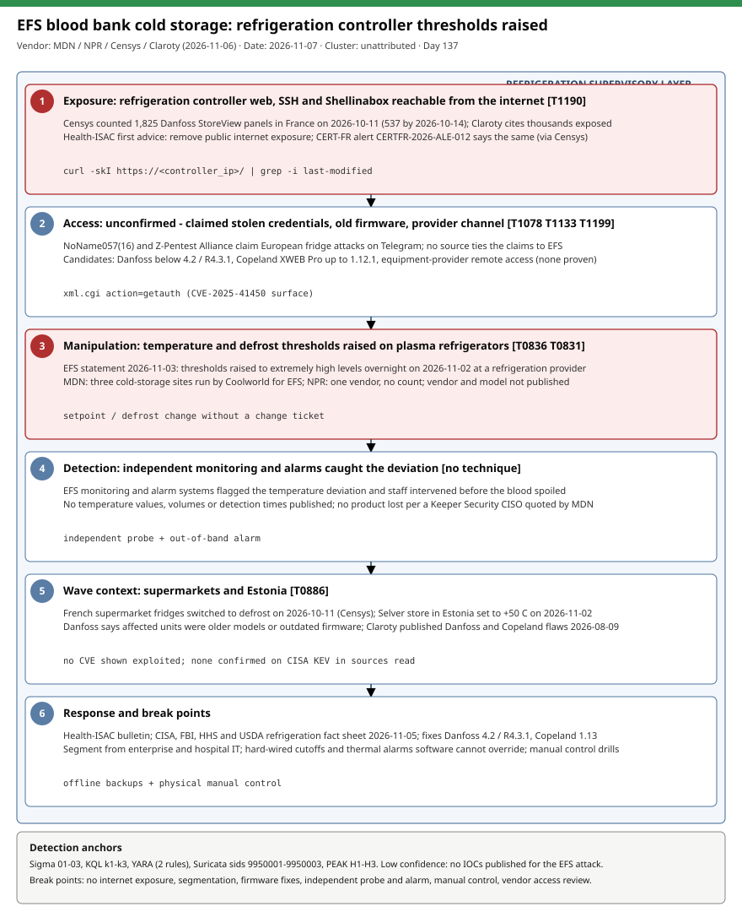

# French blood bank cold storage hit through refrigeration controllers: EFS plasma freezer thresholds raised in a Europe-wide refrigeration attack wave

## TL;DR

The French Blood Establishment (EFS) confirmed on 2026-11-03 a cybersecurity incident at one of its refrigeration-equipment providers: overnight on 2026-11-02 the attackers raised the temperature and defrost thresholds of plasma refrigerators to extremely high levels, and EFS monitoring and alarms caught the deviation so staff could intervene before the blood spoiled. Medical Device Network reports three cold-storage sites operated by Coolworld for EFS, while NPR speaks of one vendor; no actor, access vector, controller model or CVE has been confirmed for EFS. The case sits inside a wider 2026 wave against supervisory refrigeration controllers (French supermarkets on 2026-10-10/11, an Estonian store on 2026-11-02) in which pro-Russian hacktivists claim responsibility without tying the claims to EFS. Health-ISAC issued a bulletin and CISA, FBI, HHS and USDA published a refrigeration fact sheet on 2026-11-05, which is why the topic is current today; the public Danfoss and Copeland controller research gives defenders concrete exposure checks.

## Attribution and confidence

- **Cluster:** none confirmed. Medical Device Network says the culprits "have not yet been identified". NPR reports that NoName057(16) and Z-Pentest Alliance posted videos on Telegram claiming refrigeration attacks across Europe, alleging hacked credentials, but the page does not say they claimed EFS; experts are skeptical (SentinelOne's Tom Hegel calls Russian-aligned actors a credible hypothesis but not the missing evidentiary link).
- **Vendor / date:** EFS press release 2026-11-03 (quoted indirectly); Medical Device Network 2026-11-06; NPR / Health-ISAC bulletin 2026-11-06; Censys 2026-10-14 for the supermarket wave; Claroty Team82 2026-08-09 for the controller research.
- **Confidence:** low for attribution and access vector; high that EFS reported a refrigeration-provider incident with raised temperature and defrost thresholds; medium on site count (MDN says three sites managed by Coolworld, NPR gives no count). The EFS release itself could not be read (the page requires JavaScript) and neither could the CISA fact sheet, CERT-FR alert or the Health-ISAC bulletin text.

| Overlap candidate | Relation | Evidence |
|---|---|---|
| NoName057(16) / Z-Pentest Alliance (claimed) | Claimed refrigeration attacks in Europe | Telegram videos relayed by NPR; no tie to EFS stated. |
| 2026-07-12 NoName057 DDoSia case | Same claimed cluster, different tradecraft (DDoS) | Repo case; no shared indicators. |
| 2026-08-16 MicroLogix lockout, US water PLCs | Same pattern: internet-exposed controllers reconfigured | Genealogy only; different vendor and actor. |

Genealogy: first repo case on refrigeration and cold chain; related OT cases are the US water PLC reconfiguration and the FUXA SCADA HMI bypass.

## Kill chain — summary table

| Stage | MITRE | Detail |
|---|---|---|
| 1. Exposure | T1190 | Refrigeration supervisory controllers with web, SSH or Shellinabox management reachable from the internet (Censys counted 1,825 StoreView panels in France on 2026-10-11). |
| 2. Access (unconfirmed) | T1078, T1133, T1199 | Hacktivists claim stolen credentials; vulnerable firmware (Danfoss below 4.2 / 4.3.1, Copeland XWEB Pro up to 1.12.1) and the equipment-provider channel are candidates, none proven. |
| 3. Controller manipulation | T0836, T0831 | Temperature and defrost thresholds raised on plasma refrigerators. |
| 4. Detection | n/a | EFS monitoring and alarm systems flagged the deviation overnight; staff intervened before spoilage. |
| 5. Wave context | T0886 | Supermarkets switched to defrost on 2026-10-11; Estonian Selver store set to +50 C on 2026-11-02. |
| 6. Response | n/a | EFS statement 2026-11-03; Health-ISAC bulletin; CISA/FBI/HHS/USDA fact sheet 2026-11-05; CERT-FR alert CERTFR-2026-ALE-012 (via Censys). |



The diagram is a single lane because the published chain is linear and mostly unconfirmed. Red stages are the controller manipulation and the exposure that makes it possible; detection anchors are management-interface access from non-management networks, setpoint or defrost changes without a change ticket, and an independent temperature probe that the controller cannot overwrite.

## Stage-by-stage detail

### 1. Exposure: management interfaces on the internet

Censys fingerprints Danfoss AK-SM 8xxA controllers by the HTTP title `Danfoss StoreView` or `Danfoss - StoreView Web` and infers firmware from the `Last-Modified` header. On 2026-10-11 it saw 1,825 panels in France (about 61% of devices worldwide before the attacks); by 2026-10-14 only 537 remained, and hosts dropped at similar rates whether patched or not, which Censys reads as operators pulling controllers offline rather than patching. Claroty cites thousands of exposed interfaces and 2,765 devices in a Censys scan. Health-ISAC's first recommendation is to eliminate public internet exposure. MITRE: T1190.

```bash
# Inventory what answers on your own ranges (replace the placeholder with your controller subnet)
curl -sk -m 5 https://<controller_ip>/ | grep -i -o 'Danfoss[^<]*StoreView[^<]*'
curl -skI -m 5 https://<controller_ip>/ | grep -i '^last-modified'
```

### 2. Access: what is claimed and what is known

No source states how the attackers got in. NPR relays the groups' claim of hacked credentials and notes it is unclear whether stolen credentials were even needed. Danfoss said most affected controllers were older models without updates or newer ones on outdated firmware (Censys). Claroty published, on 2026-08-09, three Danfoss flaws and a set of Copeland flaws that make these controllers a plausible surface:

| Product | CVE | Type (Claroty) | Fixed in |
|---|---|---|---|
| Danfoss AK-SM 8xxA | CVE-2025-41450 | Auth bypass via a date-derived "code of the day"; `xml.cgi` with `action="getauth"` and two undocumented attributes set to 1 (CVSS 8.2) | firmware 4.2 |
| Danfoss AK-SM 8xxA | CVE-2025-41451 | OS command injection in the SMTP email configuration, post-auth (CVSS 7.6) | R4.3.1 |
| Danfoss AK-SM 8xxA | CVE-2025-41452 | nginx config injection via `action="load_nginx_headers"` (`headers.conf` upload), can crash `sm_app` (CVSS 5.4) | R4.3.1 |
| Copeland XWEB 300D/500D PRO | CVE-2026-25085 | Auth bypass: unknown `auth_mode` in the Basic Authorization header yields a truthy empty Lua table (CVSS 8.6) | 1.13 |
| Copeland XWEB 300D/500D PRO | CVE-2026-21718 | Pre-auth code execution via a predictable daily admin password from date, MAC and hard-coded keys, over SSH / Shellinabox (CVSS 10.0) | 1.13 |
| Copeland XWEB 300D/500D PRO | CVE-2026-24663 | Unauthenticated OS command injection via the libraries installation route (CVSS 9.0) | 1.13 |

No source says any of these was used against EFS, and no source says they are exploited in the wild. The provider channel matters too: MDN quotes a Keeper Security CISO on unsecured third-party remote access into OT, and EFS itself says the incident hit one of its refrigeration providers. MITRE: T1078, T1133, T1199.

### 3. Controller manipulation: thresholds, not data

EFS states the attack raised the temperature and defrost thresholds of plasma refrigerators to extremely high levels. This is an alarm-limit and defrost-schedule change on the supervisory layer, so the physical equipment keeps running while its protection logic is moved. Claroty's lab demonstration shows the same family of effects (a displayed temperature changed and fans disabled over serial Modbus to an XR60CX field controller on a mini fridge); it is a demonstration, not evidence of the EFS method. MITRE ICS: T0836 Modify Parameter, T0831 Manipulation of Control; enterprise T1565.001.

### 4. Detection by independent monitoring

EFS says its "monitoring and alarm systems" detected the temperature deviations and staff intervened before the blood was spoiled; a Keeper Security CISO says no product was lost. The defender lesson is that detection came from monitoring that did not depend on the attacked thresholds. No temperature values, volumes or detection times are published.

### 5. The wider wave

Censys (citing The Guardian) reports attacks on refrigeration at hundreds of French supermarkets over the weekend of 2026-10-10, with hundreds of fridges switched to defrost on the night of 2026-10-11. MDN links EFS to an October attack on roughly 150 Intermarche refrigeration systems. NPR reports a Selver store in Estonia set to +50 C on 2026-11-02 and cites a prior DOJ attribution of a refrigeration attack to CyberArmyofRussia_Reborn. MITRE ICS: T0886 Remote Services.

### 6. Response and guidance

Health-ISAC's bulletin (via NPR) advises: remove public internet exposure; strict segmentation of refrigeration from enterprise and guest networks; safeguards that software overrides cannot bypass, such as hard-wired mechanical cutoffs and independent thermal alarms; separation from hospital IT and medical gas monitors; staff trained to take physical manual control; offline backups. The Danfoss fixes are firmware 4.2 and R4.3.1 and the Copeland fix is 1.13. CERT-FR alert CERTFR-2026-ALE-012 (via Censys) asks operators to remove the controllers from the internet.

## Detection strategy

### Telemetry that matters

- Reverse-proxy, WAF or nginx logs in front of controller web interfaces (`xml.cgi` requests, source address, request body if logged); firewall logs for sessions to the controller subnet.
- Controller and building-management audit logs: setpoint, alarm-limit and defrost-schedule changes with the account and source address.
- An independent temperature probe or data logger with its own alarm path, compared against the controller's reported values.
- VPN and remote-access sign-ins for equipment-provider accounts (`SigninLogs`, `DeviceLogonEvents`), plus `DeviceNetworkEvents` from jump hosts to the controller subnet.

### Detection coverage

| Engine | File | Logic |
|---|---|---|
| Sigma | [01_danfoss_storeview_xml_cgi_from_untrusted_source.yml](./sigma/01_danfoss_storeview_xml_cgi_from_untrusted_source.yml) | `xml.cgi` requests from outside the management network, or a logged `load_nginx_headers` action (low). |
| Sigma | [02_refrigeration_controller_mgmt_reached_from_non_mgmt_network.yml](./sigma/02_refrigeration_controller_mgmt_reached_from_non_mgmt_network.yml) | Allowed sessions to the controller subnet from outside management and jump-host ranges. |
| Sigma | [03_vendor_remote_access_posts_to_controller_web_ui.yml](./sigma/03_vendor_remote_access_posts_to_controller_web_ui.yml) | POSTs to controllers from the vendor VPN pool or vendor accounts; night and volume thresholds go to SIEM aggregation. |
| KQL | [k1_syslog_nginx_storeview_xml_cgi_untrusted_sources.kql](./kql/k1_syslog_nginx_storeview_xml_cgi_untrusted_sources.kql) | Syslog nginx hunt for `xml.cgi`, `getauth` and `load_nginx_headers` from untrusted sources. |
| KQL | [k2_mde_internal_hosts_to_refrigeration_controller_subnets.kql](./kql/k2_mde_internal_hosts_to_refrigeration_controller_subnets.kql) | Devices other than known jump hosts connecting to the controller subnet. |
| KQL | [k3_signin_vendor_remote_access_outside_window.kql](./kql/k3_signin_vendor_remote_access_outside_window.kql) | Vendor account sign-ins outside the agreed window, without MFA or from a new country. |
| YARA | [refrigeration_controllers_storeview_xweb_artifact_hints.yar](./yara/refrigeration_controllers_storeview_xweb_artifact_hints.yar) | Scripts, notes and exports that reference the Danfoss `xml.cgi` API or Copeland XWEB with Shellinabox / Basic auth (2 rules). |
| Suricata | [refrigeration_controllers_storeview_xweb_hints.rules](./suricata/refrigeration_controllers_storeview_xweb_hints.rules) | External POST to `xml.cgi` with `getauth`; `load_nginx_headers`; StoreView page served to external clients (sids 9950001-9950003). |

### Threat hunting hypotheses

- **H1:** controllers with web, SSH or Shellinabox management are reachable from the internet or from the enterprise network. See [peak_h1](./hunts/peak_h1_internet_facing_storeview_xweb_exposure_inventory.md).
- **H2:** setpoint or defrost-threshold changes occurred without a change ticket and diverge from an independent probe. See [peak_h2](./hunts/peak_h2_setpoint_defrost_changes_without_change_ticket.md).
- **H3:** equipment-provider remote-access accounts or hacktivist claims touch your assets outside agreed windows. See [peak_h3](./hunts/peak_h3_vendor_remote_access_and_hacktivist_claim_correlation.md).

All rules are low-confidence hunting hints: no source publishes an IP, domain, hash or request body from the EFS attack, and the rules detect exposure and the published API behaviour, not the incident itself.

## Incident response playbook

### First 60 minutes (triage)

1. Read the current temperature at the cabinets with a calibrated handheld probe and compare with the controller display; move critical stock if they diverge.
2. Take controllers off the internet (firewall rule or unplug the WAN path) without powering them down; keep the local alarm and compressors running.
3. Export setpoint, alarm-limit and defrost-schedule configuration and compare with the last approved baseline.
4. Preserve proxy, firewall, controller audit and vendor-VPN logs before rotation.
5. Switch to manual control (hard-wired thermostat or mechanical cutoff) where the controller cannot be trusted, and notify the equipment provider, the national CERT and your sector ISAC.

### Artifacts to collect

| Artifact | Path | Tool | Why |
|---|---|---|---|
| Controller configuration export | Vendor export / backup function | Vendor tool | Baseline versus current thresholds and schedules. |
| Controller audit and alarm history | Controller web UI or BMS | Vendor tool, screenshots | Who changed what and when. |
| Reverse-proxy or WAF logs | Proxy host | `grep`, SIEM | `xml.cgi` requests and sources. |
| Firewall and VPN logs | Perimeter | SIEM | Sessions to the controller subnet; vendor VPN pool. |
| Independent probe data | Data logger | Logger export | Ground truth for temperature. |
| Firmware version | Controller UI (`Last-Modified` of web assets for Danfoss) | `curl -I` | Map to the fixed versions. |

### IR queries and commands

```bash
curl -skI -m 5 https://<controller_ip>/ | grep -i '^last-modified'
grep -E 'xml\.cgi' /var/log/nginx/access.log | awk '{print $1}' | sort | uniq -c | sort -rn | head
```

```kql
Syslog
| where SyslogMessage has "xml.cgi"
| summarize count() by HostName, bin(TimeGenerated, 1h)
```

### Containment, eradication, recovery

Exit criteria: controllers unreachable from the internet and from enterprise networks; firmware at Danfoss 4.2 / R4.3.1 or later and Copeland 1.13 or later; configuration matches the approved baseline; credentials and vendor accounts rotated; an independent alarm confirmed working. Do not rely on the controller's own alarm limits as the only protection (that is what was changed at EFS), do not power-cycle controllers before exporting configuration, and do not assume the provider's remote access is clean until its accounts are reviewed.

### Recovery validation

Compare the live configuration with the baseline, force a test alarm on the independent probe, and confirm that a setpoint change made from the controller raises an out-of-band alert.

## IOCs

| Type | Value | Context | Confidence | Source |
|---|---|---|---|---|
| cve | CVE-2025-41450 | Danfoss AK-SM auth bypass via date-derived code; fixed in 4.2; exposure context, not shown used at EFS | medium | [Claroty](https://claroty.com/team82/research/freeze-the-controller-defrost-the-food-uncovering-vulnerabilities-in-danfoss-refrigeration-controllers) |
| cve | CVE-2025-41451 | Danfoss AK-SM SMTP command injection, post-auth; fixed R4.3.1 | medium | [Claroty](https://claroty.com/team82/research/freeze-the-controller-defrost-the-food-uncovering-vulnerabilities-in-danfoss-refrigeration-controllers) |
| cve | CVE-2025-41452 | Danfoss AK-SM nginx config injection; fixed R4.3.1 | medium | [Claroty](https://claroty.com/team82/research/freeze-the-controller-defrost-the-food-uncovering-vulnerabilities-in-danfoss-refrigeration-controllers) |
| cve | CVE-2026-25085 | Copeland XWEB Pro Basic-auth bypass; fixed 1.13 | medium | [Claroty](https://claroty.com/team82/research/chilling-discoveries-unpacking-vulnerabilities-in-copeland-xweb-pro-controllers) |
| cve | CVE-2026-21718 | Copeland XWEB Pro predictable daily admin password (CVSS 10.0); fixed 1.13 | medium | [Claroty](https://claroty.com/team82/research/chilling-discoveries-unpacking-vulnerabilities-in-copeland-xweb-pro-controllers) |
| cve | CVE-2026-24663 | Copeland XWEB Pro unauthenticated command injection; fixed 1.13 | medium | [Claroty](https://claroty.com/team82/research/chilling-discoveries-unpacking-vulnerabilities-in-copeland-xweb-pro-controllers) |
| string | Danfoss StoreView | HTTP title used by Censys to find Danfoss AK-SM web panels | high | [Censys](https://censys.com/blog/frostbitten-in-france-a-danfoss-storeview-internet-exposure-report/) |
| path | /xml.cgi | Danfoss API endpoint routed to sm_fcgi_app | medium | [Claroty](https://claroty.com/team82/research/freeze-the-controller-defrost-the-food-uncovering-vulnerabilities-in-danfoss-refrigeration-controllers) |
| string | load_nginx_headers | Danfoss API action behind CVE-2025-41452 | medium | [Claroty](https://claroty.com/team82/research/freeze-the-controller-defrost-the-food-uncovering-vulnerabilities-in-danfoss-refrigeration-controllers) |
| string | CERTFR-2026-ALE-012 | CERT-FR alert on exposed controllers (relayed by Censys, not read) | low | [Censys](https://censys.com/blog/frostbitten-in-france-a-danfoss-storeview-internet-exposure-report/) |
| note | No IPs, domains or hashes published | No source gives network or host IOCs for the EFS attack | high | [Medical Device Network](https://www.medicaldevice-network.com/news/cyberattack-on-trio-of-french-blood-storage-sites-highlights-security-blind-spots/) |

Full list in [iocs.csv](./iocs.csv).

**KEV status:** 0 of 6 CVEs are on the CISA KEV list according to the cached catalog (2026.10.16, older than this case; live fetch unavailable and not verified against the live catalog). None of the sources read says these CVEs are exploited in the wild or were used against EFS, but absence from the cache is not proof of safety; patch to Danfoss 4.2 / R4.3.1 and Copeland 1.13. See [kev.md](./kev.md).

## Secondary findings

- **Site count and operator conflict:** MDN says three cold-storage facilities managed by Coolworld for EFS; NPR says one vendor and gives no count. The EFS release (JavaScript-only page) could not be read, so treat "three" and "Coolworld" as single-source.
- **Hundreds of controllers left the internet in days:** Censys saw French StoreView panels fall from 1,825 to 537 between 2026-10-11 and 2026-10-14, at similar rates for patched and unpatched hosts, so removing exposure is happening faster than patching.
- **Cross-border signals:** an Estonian Selver store was set to +50 C on 2026-11-02 and RIA warned; the Censys post "European Refrigeration Controller Exposure: A Second Attack Wave" (2026-11-05) was seen in listings but not read.

## Pedagogical anchors

- In cyber-physical systems the attacker often edits the protection (alarm limits, defrost schedules) rather than the process; defend with a sensor and alarm the controller cannot overwrite.
- A hard-wired mechanical cutoff and a manual-control drill are controls that survive a fully compromised supervisory layer.
- Third-party equipment providers are part of your attack surface: their remote access and accounts belong in your inventory and your logging.
- Hacktivist claims on Telegram are leads, not attribution; hold them as hypotheses until a primary source ties them to your incident.
- Exposure inventory is a detection: a fingerprint as simple as an HTTP title lets both Censys and your own scanner find the same panels.

## What's in this folder

| File | Purpose | Link |
|---|---|---|
| README.md | This case write-up. | [README.md](./README.md) |
| kill_chain.svg | Single-lane kill chain diagram. | [kill_chain.svg](./kill_chain.svg) |
| kev.md | CISA KEV cross-reference for this case's CVEs. | [kev.md](./kev.md) |
| iocs.csv | Indicators and detection strings. | [iocs.csv](./iocs.csv) |
| sigma/ | Three Sigma rules. | [sigma/](./sigma/) |
| kql/ | Three KQL queries. | [kql/](./kql/) |
| yara/ | One YARA file with two rules. | [yara/](./yara/) |
| suricata/ | One Suricata file with three sids. | [suricata/](./suricata/) |
| hunts/ | Three PEAK hunts. | [hunts/](./hunts/) |

## Sources

- [Cyberattack on trio of French blood storage sites highlights security blind spots - Medical Device Network](https://www.medicaldevice-network.com/news/cyberattack-on-trio-of-french-blood-storage-sites-highlights-security-blind-spots/)
- [Health intel-sharing group warns industry in wake of cyberattack on French blood bank - NPR via HPPR](https://www.hppr.org/npr-news/2026-11-06/health-intel-sharing-group-warns-industry-in-wake-of-cyberattack-on-french-blood-bank)
- [Frostbitten in France: Danfoss StoreView internet exposure - Censys](https://censys.com/blog/frostbitten-in-france-a-danfoss-storeview-internet-exposure-report/)
- [Freeze the controller, defrost the food: Danfoss refrigeration controllers - Claroty Team82](https://claroty.com/team82/research/freeze-the-controller-defrost-the-food-uncovering-vulnerabilities-in-danfoss-refrigeration-controllers)
- [Chilling discoveries: Copeland XWEB Pro controllers - Claroty Team82](https://claroty.com/team82/research/chilling-discoveries-unpacking-vulnerabilities-in-copeland-xweb-pro-controllers)
- [EFS press release, 2026-11-03 (page not readable without JavaScript)](https://presse.efs.sante.fr/actualites/l-efs-confirme-l-incident-de-cybersecurite-impactant-un-de-ces-prestataires-d-equipement-frigorifique-2c07c-08a0a.html)
