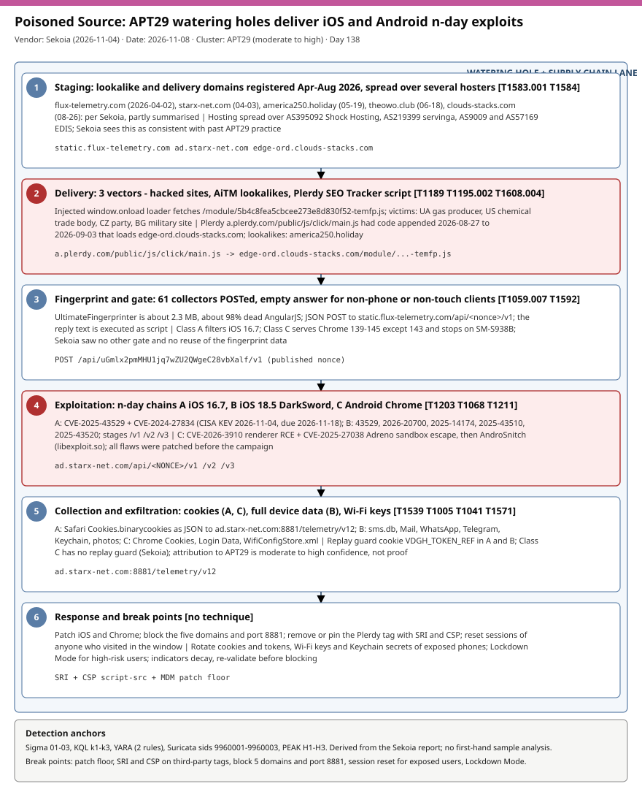

# Poisoned Source: APT29 turns a hijacked Plerdy analytics script and watering holes into iOS and Android n-day exploit delivery

## TL;DR

Sekoia TDR published "Poisoned Source" on 2026-11-04: a watering-hole and supply-chain campaign that its analysts assess, with moderate to high confidence, is APT29 (Midnight Blizzard, Cozy Bear). Legitimate sites (a Ukrainian gas producer, a US chemical-industry trade association, a Czech political party, a Bulgarian military-related site), two AiTM lookalike sites, and the third-party Plerdy SEO Tracker script (tampered 2026-08-27 to 2026-09-03) load a fingerprinter that decides whether to serve one of three already-patched exploit chains: iOS 16.7 (cookie theft), iOS 18.5 (DarkSword, full device data) or Android Chrome 139 to 145 (AndroSnitch). Everything is exfiltrated to `ad.starx-net.com:8881`. It matters today because CVE-2024-27834 from the Class A chain went onto the CISA KEV list on 2026-11-04 and the campaign shows that mobile patch lag, not zero-days, is the exposure.

## Attribution and confidence

- **Cluster:** APT29, aliases Midnight Blizzard, Cozy Bear, The Dukes, Russian SVR nexus. Sekoia is unsure whether the operator is APT29 itself or a subgroup, and says the exploits probably came from a third party; DarkSword is described as a suspected commercial surveillance vendor kit.
- **Vendor / date:** Sekoia TDR 2026-11-04 (authors Amaury Garcon, Felix Aime, Robin Kwiatkowski); The Hacker News 2026-11-04 and 2026-11-05 (CISA KEV addition). Sekoia began investigating in mid-October 2026.
- **Confidence:** moderate to high for the APT29 assessment (Sekoia wording); THN says "presumed". Low for any individual targeting: Sekoia could not tell whether visitors of specific sites or as many unpatched devices as possible were the goal. Part of the Sekoia page (about 11,000 of 50,900 characters) was only available as a machine-generated summary, so domain creation dates, some IP and ASN mappings and a few hash labels are marked medium or low in `iocs.csv`.

| Overlap candidate | Relation | Evidence |
|---|---|---|
| 2024 APT29 Mongolian-government watering hole (Google TAG) | Same cookie-theft goal and framework similarity; the 2024 campaign had a hardcoded site filter, this one does not | Google TAG confirmed the resemblance to Sekoia; AndroSnitch is named after the 2024 AndroSnatch. |
| Backend files on one compromised site | Traces of a separate 2025 APT29-attributed watering-hole campaign | Found by a partner CERT; Sekoia offers leftover artifacts or injected leftovers as explanations. |
| DarkSword / Coruna iOS kits | Exploit source, likely third party | Public reporting on DarkSword; reuse of commercial surveillance vendor frameworks (Sekoia). |
| Multi-hoster infrastructure | Consistent with past APT29 practice | Sekoia infrastructure analysis. |

Genealogy: closest repo cases are 2026-10-26 AdFection (Candiru zero-click spyware through ads, same mobile exploit-delivery theme but a commercial vendor), 2026-08-11 Midnight Blizzard Storm-2945 (same actor family, different tradecraft) and 2026-10-29 / 2026-10-22 supply-chain script abuse (npm and PyPI rather than a browser tag).

## Kill chain — summary table

| Stage | MITRE | Detail |
|---|---|---|
| 1. Staging | T1583.001, T1584 | Five core domains registered between 2026-04-02 and 2026-08-26 across several hosters (Shock Hosting, servinga, EDIS). |
| 2. Delivery | T1189, T1195.002, T1608.004 | Injected loaders on four compromised sites, AiTM lookalikes (america250.holiday, theowo.club) and the tampered Plerdy script. |
| 3. Fingerprint and gate | T1059.007, T1592 | 61 collectors, 394 fields POSTed; empty reply for non-phone or non-touch clients; Class and version filters. |
| 4. Exploitation | T1203, T1068 | Class A iOS 16.7, Class B iOS 18.5 (DarkSword), Class C Android Chrome 139 to 145 (excluding 143). |
| 5. Collection and exfiltration | T1539, T1005, T1041, T1571 | Cookies (A, C) or full device data (B) and Wi-Fi keys posted to `ad.starx-net.com:8881/telemetry/v12`. |
| 6. Response | n/a | Patch floor, block, tag integrity controls, credential and session reset. |



The diagram is a single lane from infrastructure staging to response. Red stages (delivery and exploitation) are where the campaign is most distinctive: a third-party script and a gate that withholds payloads from desktops. Detection anchors are the five core domains, port 8881, the `temfp.js` loader path and the sequence "Plerdy `main.js` then edge-ord loader".

## Stage-by-stage detail

### 1. Staging

Per Sekoia (partly from the summarised section of the page) the domains were created as follows. Treat creation dates and IP mappings as medium confidence.

```text
static.flux-telemetry.com      2026-04-02   109.104.106.107  AS395092
ad.starx-net.com               2026-04-03   195.58.140.105   AS395092 (Shock Hosting)
america250.holiday             2026-05-19   192.121.46.25    AS9009
theowo.club                    2026-06-18   188.190.17.232   AS57169
edge-ord.clouds-stacks.com     2026-08-26   95.133.231.28    AS219399 (servinga)
```

MITRE: T1583.001 Acquire Infrastructure: Domains, T1584 Compromise Infrastructure.

### 2. Delivery: three vectors

1. **Compromised legitimate sites.** On `window.onload` the injected code creates a script element and appends it to `document.body`, with the source set to `https://static.flux-telemetry.com/module/5b4c8fea5cbcee273e8d830f52-temfp.js`. First detected on a Ukrainian gas production company site. On the Bulgarian military-related site an existing JavaScript library was tampered with instead of the template.
2. **AiTM lookalike sites.** `america250[.]holiday` proxies the official America250 site and `theowo[.]club` proxied a London hotel site (now offline). Sekoia speculates about invitation-themed spear phishing; no lure was observed.
3. **Plerdy SEO Tracker supply chain.** `a.plerdy.com/public/js/click/main.js` had code appended between 2026-08-27 and 2026-09-03 (variable `_0x3af331`) that loads `https://edge-ord.clouds-stacks.com/module/5b4c8fea5cbcee273e8d830f52-temfp.js`. Sekoia could not retrieve the edge-ord file (offline) and infers it is the same fingerprinter because the file name matches. Affected victims are the Plerdy-using sites, including Ukrainian army, special-forces and military-equipment sites and, in the summarised section, an unrelated Australian clinic.

MITRE: T1189 Drive-by Compromise, T1195.002 Compromise Software Supply Chain, T1608.004 Drive-by Target.

### 3. Fingerprint and gate

The "UltimateFingerprinter" is about 2.3 MB, roughly 98% dead AngularJS code (possibly to look legitimate or to exceed the context window of automated analysis). It runs 61 collectors (canvas, audio, WebGL, fonts, WebRTC, sensors, iOS and Mac features, Safari extensions, USB, NFC, Bluetooth) and POSTs the JSON as `application/json` to `https://static.flux-telemetry.com/api/<nonce>/v1`. The reply is inserted into a script element and executed.

```text
Observed nonce in the Sekoia snippet: uGmlx2pmMHU1jq7wZU2QWgeC28vbXalf
Gate: HTTP 200 with an empty body if the screen is not phone-sized or navigator.maxTouchPoints == 0
Class A filter: iOS 16.7 / 16.7.10 (exploit reportedly works 16.0 to 17.4)
Class C filter: Chrome 139.0.0.0 to 145.0.0 except 143; stop if model == SM-S938B
```

Sekoia saw no other delivery gate and did not observe the fingerprint data being reused. MITRE: T1059.007 JavaScript, T1592 Gather Victim Host Information.

### 4. Exploitation

| Class | Target | Chain | Result |
|---|---|---|---|
| A | iOS 16.7 | CVE-2025-43529 (WebKit RCE, DarkSword reimplementation) then CVE-2024-27834 (PAC bypass) | Cookie theft |
| B | iOS 18.5 | CVE-2025-43529, CVE-2026-20700 (PAC bypass), CVE-2025-14174 and CVE-2025-43510 (sandbox escapes), CVE-2025-43520 (kernel read/write); stages `/v1`, `/v2`, `/v3` on `ad.starx-net.com` | Full device data |
| C | Android, Chrome 139 to 145 except 143 | CVE-2026-3910 (renderer RCE) then CVE-2025-27038 (Adreno GPU driver escape) | AndroSnitch |

All flaws were patched before the campaign (n-days); the sources read do not give patched build numbers for every CVE. Class A and B share the replay-guard cookie `VDGH_TOKEN_REF` (the expiry is written as `days=1` but computes to about one minute); Class C has no guard, so repeat infection is possible. MITRE: T1203 Exploitation for Client Execution, T1068 Exploitation for Privilege Escalation.

### 5. Collection and exfiltration

- **Class A:** Safari cookies (`/private/var/mobile/Containers/Data/Application/<UUID>/Library/Cookies/Cookies.binarycookies`) POSTed as JSON with keys `category`, `description`, `path` (all `only_cookies`), `size` 2097152, `deviceUUID`, `data`. Functions `ASDhdhashdasads()` (PID sweep) and `AHSDhdashashs()` (collector).
- **Class B:** SMS and iMessage (`sms.db`), Mail (`Envelope Index`, `Protected Index`), WhatsApp and Telegram databases, iCloud Keychain, Wi-Fi passwords (`wifi_passwords.txt`), contacts, call history, Safari history and cookies, photos, Health, Calendar, Notes.
- **Class C (AndroSnitch, `libexploit.so`):** Chrome `Cookies`, `Login Data`, `History`, and `WifiConfigStore.xml`; sent with libcurl and headers `Filename` and `X-Device-Id`.
- **Endpoint (all classes):** `https://ad.starx-net.com:8881/telemetry/v12`.

MITRE: T1539 Steal Web Session Cookie, T1005 Data from Local System, T1041 Exfiltration Over C2 Channel, T1571 Non-Standard Port.

### 6. Response and break points

Cookies stolen from a phone are session hijack material: patching does not undo a past theft. Exposed users need session revocation, password and token rotation, and, for Class B, treatment of Keychain secrets, messaging sessions and Wi-Fi keys as exposed.

## RE notes

| Component | SHA256 | Lang | Packer | Notes |
|---|---|---|---|---|
| UltimateFingerprinter (`temfp.js`) | not published | JavaScript | none (bloat with dead AngularJS) | About 2.3 MB, 61 collectors, 394 JSON fields; first-hand file not analysed here. |
| Class A JS sample | `bee3e014e3df87ddce0250b0985b87f6868a427a7b650a74b7ffedb9d57f3088` | JavaScript | none | 101K; stage label differs between the body and the summarised part of the page. |
| AndroSnitch | `387a7fb768db1350a9788d9704e7a72abe07152734e0ff026af72b417e36268c` | native ELF library | none stated | `libexploit.so` with 16 functions; `.comment` shows Clang/LLD 14.0.7, which Sekoia notes can be forged. |
| Class B /v3 | `69b6cb327a4d5da99399718f6a66f84de69f89425b0a31f2dcee0682f811596f` | JavaScript | none stated | Kernel read/write stage then the harvester. |

No sample was analysed first-hand for this entry; the rules are derived from the Sekoia report.

## Detection strategy

### Telemetry that matters

- Secure web gateway, forward proxy and TLS-inspection logs (full URL for `temfp.js`, `/api/<nonce>/v1`, `/telemetry/v12`), DNS resolver logs and firewall / NetFlow for port 8881.
- Defender XDR `DeviceNetworkEvents` (RemoteUrl, RemotePort) for managed endpoints; `DeviceTvmSoftwareInventory` for Chrome versions 139 to 145; `CommonSecurityLog` for proxy and firewall feeds.
- Own web servers: IIS / nginx logs, file-integrity monitoring on templates and bundled JavaScript libraries, Content-Security-Policy violation reports, Subresource Integrity failures.
- Mobile: MDM patch level for iOS and Android, mobile threat defence alerts (hints only). Safari and Chrome on unmanaged phones are largely invisible to the SOC, so the network layer is the only control for BYOD.

### Detection coverage

| Engine | File | Logic |
|---|---|---|
| Sigma | `sigma/01_proxy_poisoned_source_core_domains_and_exfil_port_8881.yml` | Proxy requests to the five core domains, the `temfp.js` path and `ad.starx-net.com:8881`. |
| Sigma | `sigma/02_proxy_plerdy_tracker_followed_by_edge_ord_loader_request.yml` | Plerdy `main.js` and edge-ord / flux-telemetry loader requests (time-ordered pairing left to the SIEM). |
| Sigma | `sigma/03_webserver_fingerprinter_nonce_api_post.yml` | POST to the fingerprint nonce API and the `/api/<nonce>/v1-v3` and `/telemetry/v12` stage URLs. |
| KQL | `kql/k1_mde_cef_poisoned_source_domains_and_port_8881_90d.kql` | 90-day retro-hunt for domains, medium-confidence IPs and port 8881. |
| KQL | `kql/k2_mde_plerdy_main_js_then_edge_ord_loader_correlation.kql` | Same device requests Plerdy then edge-ord within two minutes, flagged inside the tamper window. |
| KQL | `kql/k3_mde_tvm_chrome_and_web_logs_poisoned_source_exposure.kql` | Chrome 139 to 145 (not 143) exposure plus an optional IIS log search for loader strings. |
| YARA | `yara/poisoned_source_apt29_loader_and_androsnitch.yar` | Loader injection and Class A markers in JavaScript; AndroSnitch ELF strings. |
| Suricata | `suricata/poisoned_source_apt29_infrastructure.rules` | TLS SNI (9960001), DNS query (9960002) and TLS to port 8881 (9960003). Not compile-tested. |

All rules are low to medium confidence: the report publishes no certificates, JA3 / JA4 hashes or user agents.

### Threat hunting hypotheses

- **H1:** some device in the estate contacted the core domains or port 8881 in the last 90 days. See [peak_h1](./hunts/peak_h1_outbound_retro_hunt_core_domains_and_port_8881.md).
- **H2:** pages that load the Plerdy tag requested the edge-ord loader during 2026-08-27 to 2026-09-03; the organisation uses Plerdy at all. See [peak_h2](./hunts/peak_h2_plerdy_tag_exposure_and_page_resource_correlation.md).
- **H3:** our own websites carry an injected loader or tampered library, and the mobile fleet contains devices below the patch floor for Classes A, B or C. See [peak_h3](./hunts/peak_h3_own_website_integrity_and_mobile_fleet_exposure.md).

## Incident response playbook

### First 60 minutes (triage)

1. Run KQL k1 and the Sigma proxy rules over 90 days; list every user and device that contacted a core domain or port 8881.
2. Classify each hit by device OS and version (Class A iOS 16.x, Class B iOS 18.5, Class C Chrome 139 to 145): only those can have been exploited.
3. If a hit is on a managed phone, isolate it from corporate access (conditional access block) and revoke its sessions.
4. Check whether your sites or any third-party tag matches the loader pattern (YARA rule 1, H3).
5. Block the five core domains and port 8881 at DNS and proxy, and open a hold on the Plerdy tag (see containment).

### Artifacts to collect

| Artifact | Path | Tool | Why |
|---|---|---|---|
| Proxy / DNS logs | SWG, resolver, firewall exports | SIEM export | Who contacted the infrastructure and when. |
| Page source and JS bundles | Web root, CDN, tag-manager container | `curl`, file diff, YARA | Proof of injected loader or tampered library. |
| iOS sysdiagnose / MDM inventory | Device or MDM console | MDM, Apple tools | OS version and crash logs around the visit. |
| Android Chrome version and device model | MDM / TVM inventory | Defender TVM, MDM | Chrome 139 to 145 exposure and SM-S938B exclusion. |
| Browser session store | Safari and Chrome cookie stores on the device | MDM wipe / re-login policy | Scope of stolen sessions (cookies are the target). |

### IR queries and commands

```bash
# Author: Jarmi
# Search saved page sources or bundles for the loader name and campaign hosts
grep -RIlE '5b4c8fea5cbcee273e8d830f52-temfp\.js|flux-telemetry\.com|starx-net\.com|clouds-stacks\.com' /var/www /srv 2>/dev/null
```

```powershell
# Author: Jarmi
# Hash a downloaded script and compare it with the vendor's published version (offline copy of the tag)
Get-FileHash .\main.js -Algorithm SHA256
```

```kql
// Author: Jarmi
DeviceNetworkEvents
| where Timestamp > ago(90d)
| where RemoteUrl has_any ("flux-telemetry.com", "starx-net.com", "clouds-stacks.com", "america250.holiday", "theowo.club") or RemotePort == 8881
| project Timestamp, DeviceName, InitiatingProcessFileName, RemoteUrl, RemoteIP, RemotePort
```

### Containment, eradication, recovery

Exit criteria: no hits on the indicators in the retro-hunt window, third-party tags pinned with SRI or removed, exposed users' sessions rotated, mobile patch floor enforced. Steps: block the domains and port, remove or sandbox the Plerdy tag until the vendor confirms the clean period, rebuild or restore tampered templates from known-good source, force sign-out and token revocation for users who visited an affected page in the window on a vulnerable device. What NOT to do: do not block `a.plerdy.com` globally without business sign-off (it is a legitimate service), and do not treat patching as remediation for sessions already stolen.

### Recovery validation

Re-run the retro-hunt after 7 days, confirm CSP / SRI reports are quiet, confirm MDM shows no device below the patch floor, and verify with the website owners that third-party tag changes now go through review.

## IOCs

| Type | Value | Context | Confidence | Source |
|---|---|---|---|---|
| domain | static.flux-telemetry.com | Fingerprinter and nonce API host | medium | [Sekoia](https://www.sekoia.com/blog/poisoned-source-apt29-watering-holes-targets-mobile-devices-with-n-day-exploits) |
| domain | ad.starx-net.com | Exploit stages and exfiltration on port 8881 | medium | [Sekoia](https://www.sekoia.com/blog/poisoned-source-apt29-watering-holes-targets-mobile-devices-with-n-day-exploits) |
| domain | edge-ord.clouds-stacks.com | Loader appended to the Plerdy script; offline when checked | medium | [Sekoia](https://www.sekoia.com/blog/poisoned-source-apt29-watering-holes-targets-mobile-devices-with-n-day-exploits) |
| domain | america250.holiday | AiTM lookalike of america250.org | medium | [Sekoia](https://www.sekoia.com/blog/poisoned-source-apt29-watering-holes-targets-mobile-devices-with-n-day-exploits) |
| domain | theowo.club | AiTM lookalike of a London hotel site; offline | medium | [Sekoia](https://www.sekoia.com/blog/poisoned-source-apt29-watering-holes-targets-mobile-devices-with-n-day-exploits) |
| url | https://a.plerdy.com/public/js/click/main.js | Tampered legitimate tracker script (2026-08-27 to 2026-09-03) | high | [Sekoia](https://www.sekoia.com/blog/poisoned-source-apt29-watering-holes-targets-mobile-devices-with-n-day-exploits) |
| url | https://static.flux-telemetry.com/module/5b4c8fea5cbcee273e8d830f52-temfp.js | Fingerprinter loader | high | [Sekoia](https://www.sekoia.com/blog/poisoned-source-apt29-watering-holes-targets-mobile-devices-with-n-day-exploits) |
| url | https://ad.starx-net.com:8881/telemetry/v12 | Exfiltration endpoint, all classes | high | [Sekoia](https://www.sekoia.com/blog/poisoned-source-apt29-watering-holes-targets-mobile-devices-with-n-day-exploits) |
| ipv4 | 109.104.106.107 | static.flux-telemetry.com, AS395092; may have rotated | medium | [Sekoia](https://www.sekoia.com/blog/poisoned-source-apt29-watering-holes-targets-mobile-devices-with-n-day-exploits) |
| ipv4 | 192.121.46.25 | america250.holiday, AS9009; may have rotated | medium | [Sekoia](https://www.sekoia.com/blog/poisoned-source-apt29-watering-holes-targets-mobile-devices-with-n-day-exploits) |
| string | VDGH_TOKEN_REF | Replay-guard cookie in Classes A and B | medium | [Sekoia](https://www.sekoia.com/blog/poisoned-source-apt29-watering-holes-targets-mobile-devices-with-n-day-exploits) |
| sha256 | 387a7fb768db1350a9788d9704e7a72abe07152734e0ff026af72b417e36268c | AndroSnitch | medium | [Sekoia](https://www.sekoia.com/blog/poisoned-source-apt29-watering-holes-targets-mobile-devices-with-n-day-exploits) |
| cve | CVE-2024-27834 | PAC bypass in Class A; on CISA KEV per THN | high | [THN](https://thehackernews.com/2026/11/hackers-exploit-patched-apple-flaw-to.html) |
| cve | CVE-2025-43529 | WebKit RCE in Classes A and B | medium | [THN](https://thehackernews.com/2026/11/apt29-linked-hackers-hijack-web.html) |
| cve | CVE-2026-3910 | Chrome renderer RCE in Class C | medium | [Sekoia](https://www.sekoia.com/blog/poisoned-source-apt29-watering-holes-targets-mobile-devices-with-n-day-exploits) |

Full list (51 entries) in [iocs.csv](./iocs.csv). Indicators decay: at least two domains were already offline when Sekoia checked, so re-validate before treating any as live.

**KEV status:** 7 of 8 CVEs are on the CISA KEV list in the cached catalog (2026.10.16; live fetch unavailable); the eighth, CVE-2024-27834, was added on 2026-11-04 with remediation due 2026-11-18 according to The Hacker News and is not yet in the cache, so that listing was not verified against the live catalog. Ransomware use is unknown for all. Details in [kev.md](./kev.md).

## Secondary findings

- **DeadTag and Coruna / DarkSword at scale:** THN relays Report URI research on 660+ expired and re-registered domains behind forgotten analytics and ad tags, and Zimperium counting 608 domains delivering Coruna-family code in October 2026. This is the same "trusted third-party script becomes a delivery network" pattern as Plerdy, from the opposite direction (abandoned tags rather than a live vendor compromise). Not read first-hand.
- **Kaspersky on hacktivist ties to DDoS providers (2026-11-06):** 148 DDoS actors analysed, 9 with hacktivist ties, at least 4 hacktivist groups promoting self-made DDoS tools, 16 new DDoS actors in Q1 2026. Read only through a machine-extracted summary of a trade-press page; the original Kaspersky post was not read. Candidate for a future #17 or #21 case.
- **Washington Secretary of State ballot-box map outage (2026-11-03):** the state said a sharp traffic increase took an election information page offline for a time. Single source (KIRO 7 interview), no technique, actor or indicators; not publishable as a case until a primary source appears.

## Pedagogical anchors

- Patching closes the door, not the past: cookies stolen from a vulnerable phone remain valid until sessions are revoked, so the remediation unit is the session, not only the device.
- A third-party script runs with the privileges of the page that loads it; Subresource Integrity cannot cover a tag that is meant to change, so tag governance and a tight Content-Security-Policy are the compensating controls.
- A delivery gate (touch points, screen size, version window) means a sandbox or a desktop analyst sees an empty page; absence of a payload in your own test is not evidence of a clean site.
- Attribution is a graded judgment: moderate to high confidence plus an explicit possibility of a third-party exploit supplier is the honest way to carry it.
- Partial vendor data (no JA3, no user agent, no public IOC repository) is common; write the rule you can justify, label the confidence, and say what the report did not publish.

## What's in this folder

| File | Purpose | Link |
|---|---|---|
| README.md | This case write-up. | [README.md](./README.md) |
| kill_chain.svg | Single-lane kill chain diagram (template C). | [kill_chain.svg](./kill_chain.svg) |
| iocs.csv | Full indicator list (51 entries) with confidence and source. | [iocs.csv](./iocs.csv) |
| kev.md | CISA KEV cross-reference for this case's CVEs. | [kev.md](./kev.md) |
| sigma/ | Three Sigma rules for proxy and web-log detection. | [sigma/](./sigma/) |
| kql/ | Three KQL hunts for Defender XDR and Sentinel. | [kql/](./kql/) |
| yara/ | Two YARA rules (loader JavaScript and AndroSnitch ELF). | [yara/](./yara/) |
| suricata/ | Three Suricata rules (SNI, DNS, port 8881). | [suricata/](./suricata/) |
| hunts/ | Three PEAK hunts H1 to H3. | [hunts/](./hunts/) |

## Sources

- [Sekoia TDR: Poisoned Source - APT29 watering holes target mobile devices with n-day exploits](https://www.sekoia.com/blog/poisoned-source-apt29-watering-holes-targets-mobile-devices-with-n-day-exploits)
- [The Hacker News: APT29-Linked Hackers Hijack Web Analytics Script to Deliver iOS and Android Exploits](https://thehackernews.com/2026/11/apt29-linked-hackers-hijack-web.html)
- [The Hacker News: Hackers Exploit Patched Apple Flaw to Deliver Info-Stealing Malware, CISA Says](https://thehackernews.com/2026/11/hackers-exploit-patched-apple-flaw-to.html)
- [CISA: adds one known exploited vulnerability to catalog (2026-11-04)](https://www.cisa.gov/news-events/alerts/2026/11/04/cisa-adds-one-known-exploited-vulnerability-catalog)
- [CISA Known Exploited Vulnerabilities catalog](https://www.cisa.gov/known-exploited-vulnerabilities-catalog)
- [Google Cloud: DarkSword iOS exploit chain](https://cloud.google.com/blog/topics/threat-intelligence/darksword-ios-exploit-chain)
- [Report URI: DeadTag](https://blog.report-uri.com/deadtag-how-forgotten-website-tags-became-a-delivery-network-for-iphone-spyware/)
- [Zimperium: Inside Coruna and DarkSword chains](https://zimperium.com/blog/inside-coruna-and-darksword-chains-from-web-lures-to-ios-exploitation)
- [Tahawul Tech: Kaspersky finds growing ties between hacktivist groups and DDoS providers](https://www.tahawultech.com/insight/kaspersky-finds-growing-ties-between-hacktivist-groups-and-ddos-providers/)
- [KIRO 7: Washington officials stopped cyberattack targeting ballot box map](https://www.kiro7.com/news/local/wa-midterm-election-2026-officials-stopped-cyberattack-targeting-ballot-box-map/Y53X37JKGNEAHF4ORPOO7V5QIY/)
