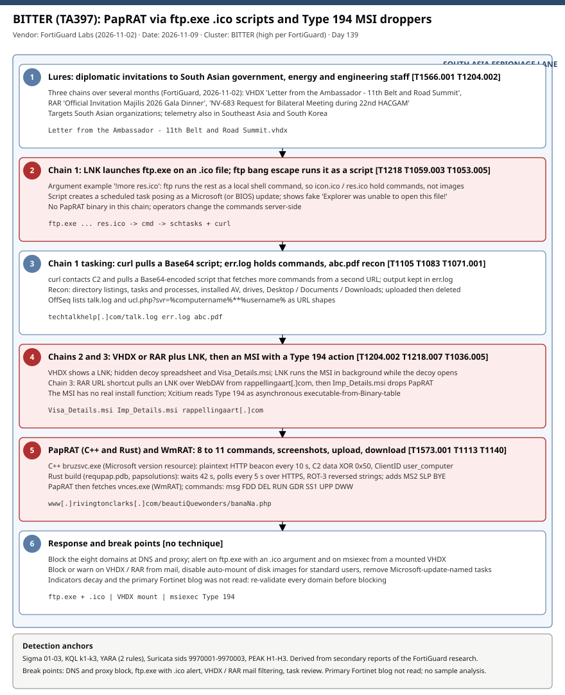

# BITTER (TA397) PapRAT: ftp.exe .ico scripts, VHDX and RAR lures, and Type 194 MSI droppers against South Asian government and energy targets

## TL;DR

FortiGuard Labs (Fortinet) published on 2026-11-02 an analysis of a months-long BITTER (TA397) campaign against South Asian government, energy and engineering organizations, with telemetry also in Southeast Asia and South Korea. Diplomatic-themed lures deliver three chains: an LNK that abuses `ftp.exe` so an `.ico` file runs as a shell script, a VHDX that hides an MSI with one Type 194 CustomAction, and a RAR whose URL shortcut pulls an LNK over WebDAV. The payload is PapRAT (C++ and Rust builds), which then fetches WmRAT. The case matters today because the first chain needs no binary on disk and the lure filenames, ftp.exe argument pattern and domains give concrete hunting anchors. All specifics come from secondary reports; the primary Fortinet blog was not read.

## Attribution and confidence

- **Cluster:** BITTER, also tracked as TA397; suspected South Asian group active since about 2013. OffSeq alone also labels it HAZY TIGER (not attributed to FortiGuard).
- **Vendor / date:** FortiGuard Labs (researcher named as Cara Lin by Infosecurity Magazine), 2026-11-02. Read via Infosecurity Magazine (2026-11-02), Hackread (2026-11-02), GBHackers and Cyberpress (2026-11-03), SecurityOnline (2026-11-04), SOC Prime (2026-11-05), Xcitium (2026-11-06) and OffSeq/OTX (2026-11-03).
- **Confidence:** `high` for the BITTER assessment as stated by FortiGuard (lure filenames, C2 patterns, file metadata, malware analysis). Individual victims and infection counts are not published.

| Overlap candidate | Relation | Evidence |
|---|---|---|
| WmRAT / MiyaRAT | Same tooling family documented by Proofpoint in December 2024 | PapRAT downloads `vnces.exe`, identified as WmRAT |
| Earlier BITTER Banana Login panel | Infrastructure lineage | GBHackers links the decoded `rivingtonclarks[.]com/banana/` string to it |
| Proofpoint / Threatray (June 2025) | State-backed, aligned with Indian government interests (as cited by GBHackers) | Not fetched here |

Genealogy: the repo already holds 2026-06-22 ProSpy/BITTER (Android spyware against MENA civil society, hack-for-hire overlap). That case was mobile and MENA; this one is Windows and South Asia, so it is a different toolset of the same cluster.

## Kill chain — summary table

| Stage | MITRE | Detail |
|---|---|---|
| 1. Lure | T1566.001, T1204.002 | Diplomatic invitations: VHDX, RAR and a bilateral-meeting request. |
| 2. Chain 1 execution | T1218, T1059.003, T1053.005 | LNK runs `ftp.exe` on `res.ico` / `icon.ico`; the ftp bang escape runs the file as shell commands; a Microsoft-update-like scheduled task is created. |
| 3. Chain 1 tasking | T1105, T1083, T1071.001 | `curl` pulls a Base64 script; commands stored in `err.log`; recon staged as `abc.pdf`, uploaded, deleted. |
| 4. Chains 2 and 3 install | T1204.002, T1218.007, T1036.005 | `Visa_Details.msi` / `Imp_Details.msi` with a Type 194 CustomAction drop PapRAT. |
| 5. Implant | T1573.001, T1113, T1140, T1027 | PapRAT C++ (`bruzsvc.exe`, HTTP every 10 s, XOR 0x50) and Rust (`requpap.pdb`, HTTPS every 5 s, ROT-3); WmRAT `vnces.exe`. |



The single lane runs from the lure through the chain 1 ftp.exe execution (critical), chain 1 tasking, the MSI drop (critical) and the implant (critical) to response break points. Detection anchors are the `ftp.exe` command line with an `.ico` argument, `msiexec` from a mounted VHDX, the campaign domains and the 10-second plaintext HTTP beacon.

## Stage-by-stage detail

### 1. Lures

Filenames printed by the reports: `Letter from the Ambassador – 11th Belt and Road Summit.vhdx`, `Official Invitation Majilis 2026 Gala Dinner.rar` and `NV-683 Request for Bilateral Meeting during 22nd HACGAM`. GBHackers, citing Proofpoint and Threatray, says the group masquerades as diplomatic entities from China, Madagascar, Mauritius and South Korea. T1566.001, T1204.002.

### 2. Chain 1: LNK, ftp.exe, scheduled task

A malicious LNK launches `ftp.exe` with an argument pointing at an `.ico` file. The printed example is:

```text
!more res.ico
```

The `!` prefix makes ftp run the rest as a local shell command, so `icon.ico` / `res.ico` contain commands, not images. The exact LNK command line is not published. The script creates a scheduled task disguised as a Microsoft (one report: Microsoft or BIOS) update and shows a fake `Explorer was unable to open this file!` error. SOC Prime's task name `MicrosoftUpdatesupdates11678` is its own simulation value, not an observed name. T1218, T1059.003, T1053.005.

### 3. Chain 1: curl tasking and recon

`curl` contacts C2 and fetches a Base64-encoded script that pulls commands from a second URL; downloaded commands are stored in `err.log`. Recon covers directory listings, running tasks, installed antivirus, drives and the Desktop, Documents and Downloads folders; the result goes to `abc.pdf`, is uploaded and deleted locally. No PapRAT binary is involved and operators change the commands server-side. T1105, T1083, T1071.001.

### 4. Chains 2 and 3: MSI droppers

The VHDX exposes a visible LNK and two hidden files: a decoy spreadsheet and `Visa_Details.msi`. The LNK starts the MSI in the background (`&` separator) while the decoy opens. The MSI has no real install function; its only executable action is a Type 194 CustomAction that drops PapRAT (Xcitium reads 194 as base type 2 plus the asynchronous flags 64 and 128; this is the vendor's interpretation). In chain 3 the RAR holds a URL shortcut that retrieves an LNK over WebDAV from `rappellingaart[.]com`, then `Imp_Details.msi` runs and a scheduled task is created. T1204.002, T1218.007, T1036.005.

### 5. PapRAT and WmRAT

The C++ build masquerades as `bruzsvc.exe` with a Microsoft Corporation version resource, beacons over plaintext HTTP every 10 seconds, encodes host, port and paths with XOR key `0x50`, builds the ClientID as `username_computername` and accepts JSON with eight commands: `msg`, `FDD`, `DEL`, `RUN`, `GDR`, `SS1`, `UPP`, `DWW`. The Rust build (PDB `requpap.pdb`, product `papsolutions`) waits 42 seconds, polls every 5 seconds over HTTPS, stores strings reversed and ROT-3 shifted (one decodes to `www[.]rivingtonclarks[.]com/banana/`) and adds `MS2` (PowerShell), `SLP` and `BYE`. PapRAT downloads `vnces.exe`, WmRAT. T1573.001, T1113, T1140, T1027, T1071.001.

## Detection strategy

### Telemetry that matters

Sysmon EID 1 (command line of `ftp.exe`, `msiexec.exe`, `schtasks.exe`, `curl.exe`), EID 11 (`err.log`, `abc.pdf`, `.ico` written by scripts), EID 22 and EID 3 (campaign domains, 10-second beacon); Defender XDR `DeviceProcessEvents`, `DeviceFileEvents`, `DeviceNetworkEvents`; Windows Installer events 1033/11707 for the MSI; proxy and DNS logs; mail gateway logs for VHDX / RAR attachments.

### Detection coverage

| Engine | File | Logic |
|---|---|---|
| Sigma | [01_bitter_ftp_exe_ico_argument_lnk_chain.yml](./sigma/01_bitter_ftp_exe_ico_argument_lnk_chain.yml) | `ftp.exe` with an `.ico` argument, or `ftp.exe` spawning cmd, more, curl, schtasks or PowerShell. |
| Sigma | [02_bitter_msi_installer_visa_or_imp_details_msi.yml](./sigma/02_bitter_msi_installer_visa_or_imp_details_msi.yml) | `Visa_Details.msi` / `Imp_Details.msi` execution and the `bruzsvc.exe` / `vnces.exe` image names. |
| Sigma | [03_bitter_campaign_domains_proxy_dns.yml](./sigma/03_bitter_campaign_domains_proxy_dns.yml) | DNS queries for the eight campaign domains. |
| KQL | [k1](./kql/k1_mde_ftp_exe_ico_and_msi_lure_process_chain.kql) | ftp.exe / .ico and MSI lure process chains in Defender XDR. |
| KQL | [k2](./kql/k2_mde_campaign_domains_and_c2_urls_90d.kql) | 90-day retro-hunt for domains and C2 URL fragments. |
| KQL | [k3](./kql/k3_mde_scheduled_task_ms_update_masquerade_and_rat_binaries.kql) | Update-named scheduled tasks plus RAT binaries and staging files. |
| YARA | [bitter_paprat_wmrat_artifacts.yar](./yara/bitter_paprat_wmrat_artifacts.yar) | Two rules: ftp/.ico script text (low confidence) and the PapRAT PE. |
| Suricata | [bitter_paprat_infrastructure.rules](./suricata/bitter_paprat_infrastructure.rules) | Sids 9970001-9970003: TLS SNI, DNS and plaintext HTTP URI fragments. |

### Threat hunting hypotheses

- **H1:** a user opened an LNK and `ftp.exe` ran an `.ico` file; see [peak_h1](./hunts/peak_h1_ftp_exe_ico_lnk_chain_and_scheduled_task_masquerade.md).
- **H2:** a VHDX was mounted and an MSI ran from it, leaving PapRAT or WmRAT binaries; see [peak_h2](./hunts/peak_h2_vhdx_mount_lnk_msi_type194_and_rat_binaries.md).
- **H3:** a host contacts the campaign domains or beacons over plaintext HTTP every 10 seconds; see [peak_h3](./hunts/peak_h3_outbound_campaign_domains_and_plaintext_http_10s_beacon.md).

## Incident response playbook

### First 60 minutes (triage)

1. Identify hosts that hit the Sigma/KQL/Suricata detections or the domains in `iocs.csv`; rank by `ftp.exe`, MSI or RAT-binary evidence.
2. Isolate confirmed hosts from the network but keep them powered on.
3. Collect the lure container (VHDX / RAR) and the mail that delivered it; block the sender and attachment type.
4. Capture running processes, scheduled tasks and the files named below before cleanup.
5. Block the eight domains at DNS and proxy (re-validate first; indicators decay).

### Artifacts to collect

| Artifact | Path | Tool | Why |
|---|---|---|---|
| Scheduled tasks | `C:\Windows\System32\Tasks\` | Velociraptor `Windows.System.TaskScheduler` | Microsoft/BIOS-update-like task |
| Script files | `res.ico`, `icon.ico`, `err.log`, `abc.pdf` in user-writable and public user folders | Velociraptor file search | Chain 1 commands and recon |
| LNK and MRU | `%APPDATA%\Microsoft\Windows\Recent\` | LECmd | Lure launch evidence |
| Installer events | Application log 1033 / 11707 | EvtxECmd | MSI execution |
| Prefetch / Amcache | `C:\Windows\Prefetch\`, `Amcache.hve` | PECmd / AmcacheParser | `ftp.exe`, `msiexec.exe`, `bruzsvc.exe`, `vnces.exe` |
| Network | proxy / DNS logs | SIEM | Beacons to campaign domains |

### IR queries and commands

```powershell
# Author: Jarmi
Get-ScheduledTask | Where-Object { $_.TaskName -match 'Microsoft|Update|BIOS' -and $_.Actions.Execute -match 'curl|cmd|powershell' } |
  Select-Object TaskName, TaskPath, @{n='Exec';e={$_.Actions.Execute}}, @{n='Args';e={$_.Actions.Arguments}}
Get-ChildItem C:\Users -Recurse -Include err.log,abc.pdf,res.ico,icon.ico,bruzsvc.exe,vnces.exe -ErrorAction SilentlyContinue |
  Select-Object FullName, Length, LastWriteTime
```

### Containment, eradication, recovery

Exit criteria: no host beaconing to the campaign domains for 7 days, malicious tasks and binaries removed, credentials used on affected hosts rotated. Do NOT delete `err.log`, `abc.pdf` or the task before imaging, and do not assume the Rust build only uses HTTPS: the C++ build used plaintext HTTP and the port is not published.

### Recovery validation

Re-run the three KQL queries and the Sigma rules for 14 days, confirm no new `ftp.exe` with `.ico` arguments, and confirm VHDX/RAR attachments are filtered or auto-mount is disabled.

## IOCs

| Type | Value | Context | Confidence | Source |
|---|---|---|---|---|
| domain | rivingtonclarks[.]com | PapRAT C2; `/beautiQuewonders/banaNa.php`, `/banana/` | medium | [GBHackers](https://gbhackers.com/paprat-malware/) |
| domain | rappellingaart[.]com | WebDAV LNK host (chain 3) | medium | [GBHackers](https://gbhackers.com/paprat-malware/) |
| domain | techtalkhelp[.]com | `/talk.log` | medium | [GBHackers](https://gbhackers.com/paprat-malware/) |
| domain | netmansrvdns[.]com | Campaign domain, role not stated | medium | [GBHackers](https://gbhackers.com/paprat-malware/) |
| domain | goodnfortunes[.]com | `/ucl.php`, `/b99/` | medium | [OffSeq](https://radar.offseq.com/threat/bitter-expands-its-arsenal-with-paprat-57e8662fff8806ba) |
| domain | gomescareerplans[.]com | `/docs` | medium | [OffSeq](https://radar.offseq.com/threat/bitter-expands-its-arsenal-with-paprat-57e8662fff8806ba) |
| domain | chestergreenfarming[.]com | Single-source | low | [GBHackers](https://gbhackers.com/paprat-malware/) |
| domain | felixfuturenext[.]com | Single-source | low | [OffSeq](https://radar.offseq.com/threat/bitter-expands-its-arsenal-with-paprat-57e8662fff8806ba) |
| sha256 | a3081df333ca7f18bd90d10a45125ab5011dcf9d2806feae2935f09cab07da4c | LNK lure | medium | [GBHackers](https://gbhackers.com/paprat-malware/) |
| sha256 | e3992f8c945b0761242377cba32d91b0a390c7cecd79478439843d93e6d2b76b | LNK lure | medium | [GBHackers](https://gbhackers.com/paprat-malware/) |
| path | Visa_Details.msi / Imp_Details.msi | Type 194 MSI droppers | medium | [GBHackers](https://gbhackers.com/paprat-malware/) |
| path | bruzsvc.exe / vnces.exe | PapRAT C++ / WmRAT | medium | [GBHackers](https://gbhackers.com/paprat-malware/) |
| path | res.ico, icon.ico, err.log, abc.pdf | Chain 1 script and staging files | medium | [GBHackers](https://gbhackers.com/paprat-malware/) |
| string | requpap.pdb / papsolutions | PapRAT Rust build | medium | [GBHackers](https://gbhackers.com/paprat-malware/) |
| note | No CVEs published | No CISA KEV cross-reference applies (`kev.md` not generated) | medium | [Infosecurity Magazine](https://www.infosecurity-magazine.com/news/paprat-bitter-cyberespionage/) |

Full list: [iocs.csv](./iocs.csv). No IPs, mutexes, registry keys, user agents or C2 ports are published in the reports read.

## Secondary findings

- **Apple threat notifications reach the Bundestag (2026-11-02):** BSI told German lawmakers and other notable people who received Apple notifications to assume their devices may be compromised; Apple said the batch reached users in 99 countries. No vendor, spyware name, CVE or IOC is published (TechCrunch, read via summary); candidate #2 once technical detail appears.
- **NVIDIA suspected espionage targeting its CEO (GBHackers headline, 2026-11):** only the headline was seen in search results; not verified.
- **Kaspersky DDoS actor report and Washington mailbox-map web attack** were already noted on 2026-11-08 as single-source items.

## Pedagogical anchors

- LOLBAS is more than `certutil`: `ftp.exe` accepts a script file and a `!` shell escape, so a "script" can wear any extension, including `.ico`. Detect on the command line and parent chain, not on the file type.
- A Type 194 MSI CustomAction has no install function to inspect: the whole payload is in the installer's custom action, so analysts should dump the MSI tables rather than rely on the visible file list.
- Disk images (VHDX) and WebDAV shortcuts bypass mark-of-the-web assumptions; control auto-mount and attachment types, not just macros.
- Secondary-source reporting has gaps (no IPs, ports or exact command lines); rules built on it should say so and carry low confidence where the data is thin.

## What's in this folder

| File | Purpose | Link |
|---|---|---|
| README.md | This case write-up. | [README.md](./README.md) |
| kill_chain.svg | Six-stage single-lane kill chain diagram. | [kill_chain.svg](./kill_chain.svg) |
| sigma/ | Three Sigma rules for the ftp.exe chain, MSI droppers and campaign domains. | [sigma/](./sigma/) |
| kql/ | Three Defender XDR hunting queries. | [kql/](./kql/) |
| yara/ | One file, two YARA rules. | [yara/](./yara/) |
| suricata/ | One rule file, sids 9970001-9970003. | [suricata/](./suricata/) |
| hunts/ | Three PEAK hunts H1-H3. | [hunts/](./hunts/) |
| iocs.csv | Full indicator list with confidence and source. | [iocs.csv](./iocs.csv) |

## Sources

- [Infosecurity Magazine — Bitter Deploys PapRAT in Asian Cyber-Espionage Campaign](https://www.infosecurity-magazine.com/news/paprat-bitter-cyberespionage/)
- [GBHackers — Hackers Hide PapRAT Malware in Fake Diplomatic Invitations](https://gbhackers.com/paprat-malware/)
- [Hackread — BITTER APT Using Fake Diplomatic Documents to Deliver PapRAT](https://hackread.com/bitter-apt-fake-diplomatic-documents-paprat-spyware/)
- [Cyberpress — Diplomatic Decoys Deliver PapRAT](https://cyberpress.org/diplomatic-decoys-deliver-paprat/)
- [SOC Prime — BITTER APT Deploys PapRAT and WmRAT Malware](https://socprime.com/active-threats/bitter-expands-its-malware-arsenal-with-paprat/)
- [SecurityOnline — BITTER PapRAT Malware Targets South Asian Organizations](https://securityonline.info/bitter-paprat-malware-south-asia/)
- [Xcitium ThreatLabs — PapRAT Turns Windows Shortcuts Into Espionage Access](https://threatlabsnews.xcitium.com/blog/paprat-turns-windows-shortcuts-into-espionage-access/)
- [OffSeq Radar — BITTER Expands Its Arsenal with PapRAT](https://radar.offseq.com/threat/bitter-expands-its-arsenal-with-paprat-57e8662fff8806ba)
- [TechCrunch — Germany says lawmakers' iPhones may have been hacked with spyware](https://techcrunch.com/2026/11/02/germany-says-lawmakers-iphones-may-have-been-hacked-with-spyware/)
