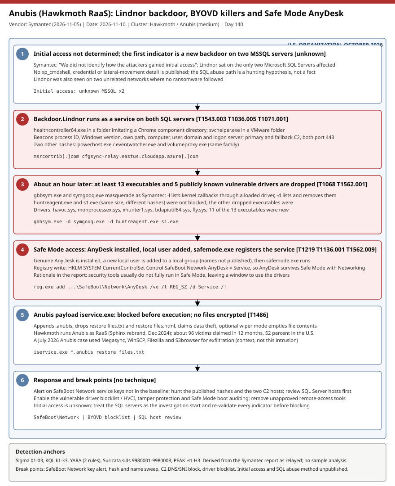

# Anubis ransomware intrusion: Lindnor backdoor on MSSQL servers, BYOVD security killers and AnyDesk persisted in Safe Mode

## TL;DR

Symantec (Broadcom) reported on 2026-11-05 an October 2026 intrusion at a U.S. organization where a previously unseen backdoor, Backdoor.Lindnor, ran as a service on the only two Microsoft SQL Servers among the affected systems, followed about an hour later by at least 13 dropped executables, five publicly known vulnerable drivers (BYOVD), a genuine AnyDesk install and a `safemode.exe` that registers AnyDesk for Safe Mode with Networking. The Anubis ransomware payload (`iservice.exe`, run by the Hawkmoth RaaS) was blocked before it ran, so no files were encrypted. The case matters today because GBHackers and Cyber Security News relayed it on 2026-11-09 with a full hash table, and the Safe Mode registry trick and the kernel-callback removal switch are concrete, hunt-ready behaviours. Initial access and the way the SQL servers were abused are not published, so the SQL-side detections are hypotheses.

## Attribution and confidence

- **Cluster:** Hawkmoth, the operator of the Anubis RaaS, as tracked by Symantec; Anubis emerged in December 2024 as a rebrand of Sphinx and the payload "looks mostly unchanged from Sphinx". The Lindnor backdoor was also seen on two unrelated networks where no ransomware followed, so its operator link to Hawkmoth is not proven.
- **Vendor / date:** Symantec (Broadcom) 2026-11-05 (primary, read in full); relayed by GBHackers and Cyber Security News on 2026-11-09. The Broadcom protection bulletin page returned an empty body.
- **Confidence:** `medium`. The malware names, hashes and behaviours are first-party vendor statements; the link between Lindnor and Anubis in this intrusion is inferred by the vendor from co-occurrence, and no initial-access or actor-infrastructure data is published.

| Overlap candidate | Relation | Evidence |
|---|---|---|
| Sphinx ransomware | Predecessor / rebrand | Symantec: Anubis emerged December 2024 from Sphinx, payload mostly unchanged |
| July 2026 Anubis case | Same ransomware family, different intrusion | Symantec cites Megasync, WinSCP, Filezilla and S3browser used for exfiltration |
| Lindnor on two other networks | Same backdoor, no ransomware seen | Symantec; no further detail |

Genealogy: the repo has other crime-economy cases (Qilin/INC, 2026-10-27; Synology ransomware, 2026-11-03) but no Hawkmoth or Anubis case; this is the first.

## Kill chain — summary table

| Stage | MITRE | Detail |
|---|---|---|
| 1. Initial access | unknown | Not determined by Symantec. |
| 2. Backdoor | T1543.003, T1036.005, T1071.001 | Lindnor runs as a service on two MSSQL servers; beacons over port 443 to primary and fallback C2. |
| 3. Tool drop | T1068, T1562.001 | At least 13 executables and 5 vulnerable drivers in about an hour; `-d` removes kernel callbacks. |
| 4. Remote access | T1219, T1136.001, T1562.009, T1112 | AnyDesk installed, local user created, `safemode.exe` writes the SafeBoot Network key. |
| 5. Impact | T1486 | `iservice.exe` (Anubis) blocked before execution; `.anubis`, ransom notes, optional wiper mode. |

Technique IDs are my mapping; Symantec prints none.



The single lane runs from the unknown access through the Lindnor backdoor (critical), the tool and driver drop (critical), the Safe Mode remote-access stage (critical) and the blocked ransomware payload to response break points. Detection anchors are the SafeBoot Network AnyDesk registry key, the published hashes and file names, the five driver names and the two C2 hosts.

## Stage-by-stage detail

### 1. Initial access (unknown)

Symantec states it did not identify how the attackers got in. Lindnor was the first indicator, on the two Microsoft SQL Servers. No `xp_cmdshell`, credential or lateral-movement detail is published; the SQL-server hunts in this folder are generic hypotheses, not case facts.

### 2. Backdoor.Lindnor

Lindnor appears to have run as a service. On one machine it was `healthcontroller64.exe` in a folder made to resemble a Chrome component unpacker directory; on the other `svchelper.exe` in a VMware folder. It sends the process ID, Windows version, its own file path, computer name, user name, domain and logon server to C2, and has a primary and a fallback C2, both on port 443. Two further hashes are listed (`powerhost.exe` / `eventwatcher.exe`, and `volumeproxy.exe`). Network IOCs: `msrcontrib[.]com` and `cfgsync-relay.eastus.cloudapp.azure[.]com`; the report does not say which is primary. T1543.003, T1036.005, T1071.001.

### 3. Security killers and BYOVD drivers

Within roughly an hour at least 13 executables and five signed, publicly known vulnerable drivers (`havoc.sys`, `monprocessex.sys`, `xhunter1.sys`, `bdapiutil64.sys`, `fly.sys`) were dropped; 11 of the 13 executables had not been published before. `gbbsym.exe` and `symgooq.exe` masquerade as Symantec and accept `-l` (list kernel callbacks through a loaded vulnerable driver) and `-d` (list and remove them); observed command lines used `-d`. `huntreagent.exe` and `s1.exe` (same size, different hashes) were not blocked and were not analysed. The other dropped executables were blocked and their roles are not labelled. T1068, T1562.001.

### 4. AnyDesk and Safe Mode

A genuine AnyDesk was installed, a new local user was created and added to a local group (names not published) and `safemode.exe` ran. The report prints the registry command:

```text
"CSIDL_SYSTEM\reg.exe" add HKLM\SYSTEM\CurrentControlSet\Control\SafeBoot\Network\AnyDesk /ve /t REG_SZ /d Service /f
```

This registers AnyDesk as a service allowed in Safe Mode with Networking. Symantec's rationale: security software generally does not fully run in Safe Mode, giving a window to use the drivers and disable protections. `CSIDL_SYSTEM` is the report's placeholder for the System32 path. T1219, T1136.001, T1562.009, T1112.

### 5. Anubis payload

`iservice.exe` appends `.anubis`, drops `restore files.txt` and `restore files.html` (spacing as printed) claiming data theft, and has an optional wiper mode that empties file contents. It was blocked before execution; no files were encrypted. Command-line options are not published. T1486.

## Detection strategy

### Telemetry that matters

Sysmon EID 13 (SafeBoot Network key writes), EID 1 (`reg.exe`, dropped executables, SQL Server child processes), EID 6 (driver load), EID 11 (driver and ransom-note files); Windows System log 7045 (new services); Security 4720 / 4732 (new local user and group change); Defender XDR `DeviceRegistryEvents`, `DeviceProcessEvents`, `DeviceFileEvents`, `DeviceEvents` (DriverLoad), `DeviceNetworkEvents`; DNS and TLS SNI logs; SQL Server audit and `sys.configurations`.

### Detection coverage

| Engine | File | Logic |
|---|---|---|
| Sigma | [01_anubis_anydesk_safeboot_network_registry.yml](./sigma/01_anubis_anydesk_safeboot_network_registry.yml) | `SafeBoot\Network\AnyDesk` key write (high); AnyDesk key under any SafeBoot mode (medium). |
| Sigma | [02_anubis_lindnor_edr_killer_and_payload_process.yml](./sigma/02_anubis_lindnor_edr_killer_and_payload_process.yml) | Nine published SHA-256 values and distinctive names for Lindnor, killers, `safemode.exe` and `iservice.exe`. |
| Sigma | [03_anubis_byovd_driver_drop_and_ransom_note.yml](./sigma/03_anubis_byovd_driver_drop_and_ransom_note.yml) | The five driver file names, ransom notes and the `.anubis` extension. |
| KQL | [k1](./kql/k1_mde_safeboot_network_anydesk_and_local_account.kql) | SafeBoot key and `reg.exe` additions joined to local-account creation and AnyDesk first run. |
| KQL | [k2](./kql/k2_mde_lindnor_anubis_byovd_hashes_and_names.kql) | 90-day hunt over 15 published hashes across process, file, driver and image events. |
| KQL | [k3](./kql/k3_mde_mssql_hosts_new_services_rare_folders_and_c2_domains.kql) | SQL hosts: new services, `sqlservr.exe` child shells, look-alike folders; C2 host lookups. |
| YARA | [anubis_lindnor_artifacts.yar](./yara/anubis_lindnor_artifacts.yar) | Two rules: Anubis note and extension strings (low); SafeBoot AnyDesk registration (medium). |
| Suricata | [lindnor_c2_domains.rules](./suricata/lindnor_c2_domains.rules) | Sids 9980001-9980003: DNS query and TLS SNI for the two C2 hosts. |

### Threat hunting hypotheses

- **H1:** a server or workstation gained a SafeBoot Network service entry, a new local account and AnyDesk; see [peak_h1](./hunts/peak_h1_safeboot_network_anydesk_persistence_and_local_account.md).
- **H2:** a vulnerable driver was dropped and kernel callbacks were removed before security tooling went blind; see [peak_h2](./hunts/peak_h2_byovd_driver_drop_and_kernel_callback_removal.md).
- **H3:** SQL Server hosts run an unexpected service from a vendor look-alike folder and beacon on 443 to a rare host; see [peak_h3](./hunts/peak_h3_mssql_servers_lindnor_service_folders_and_c2.md).

## Incident response playbook

### First 60 minutes (triage)

1. Sweep EDR and file inventory for the published hashes and file names, starting with every SQL Server.
2. Check the SafeBoot Network key for non-baseline services and for AnyDesk; list local accounts created in the last 30 days.
3. Isolate confirmed hosts but keep them powered on; do not reboot into Safe Mode.
4. Check driver load events and the vulnerable-driver blocklist state for the five driver names.
5. Block the two C2 hosts at DNS and proxy after re-validation (exact host for the Azure name).

### Artifacts to collect

| Artifact | Path | Tool | Why |
|---|---|---|---|
| SafeBoot keys | `HKLM\SYSTEM\CurrentControlSet\Control\SafeBoot\` | Velociraptor / RECmd | AnyDesk or other unapproved Safe Mode services |
| Services | `HKLM\SYSTEM\CurrentControlSet\Services\` and System log 7045 | RECmd / EvtxECmd | Lindnor service and driver services |
| Dropped binaries | Chrome-component-like and VMware-like folders on SQL hosts | Velociraptor file search | `healthcontroller64.exe`, `svchelper.exe` |
| Driver files | `*.sys` outside `DriverStore` | Velociraptor | The five BYOVD drivers |
| Execution evidence | Prefetch, Amcache, ShimCache | PECmd / AmcacheParser / ShimCacheParser | `gbbsym.exe`, `symgooq.exe`, `safemode.exe`, `iservice.exe` |
| AnyDesk traces | AnyDesk `ad.trace` and `connection_trace.txt` under ProgramData and AppData | Velociraptor | Remote sessions and client IDs |

### IR queries and commands

```powershell
# Author: Jarmi
Get-ChildItem 'HKLM:\SYSTEM\CurrentControlSet\Control\SafeBoot\Network' | Select-Object PSChildName
Get-LocalUser | Where-Object { $_.Enabled } | Select-Object Name, LastLogon, PasswordLastSet
Get-CimInstance Win32_Service | Where-Object { $_.PathName -match 'healthcontroller64|svchelper|powerhost|eventwatcher|volumeproxy' } |
  Select-Object Name, State, PathName
Get-ChildItem C:\ -Recurse -Include havoc.sys,monprocessex.sys,xhunter1.sys,bdapiutil64.sys,fly.sys -ErrorAction SilentlyContinue |
  Select-Object FullName, Length, LastWriteTime
```

### Containment, eradication, recovery

Exit criteria: no Lindnor, killer or driver files on any host, SafeBoot Network keys back to baseline, AnyDesk removed or approved, unknown local accounts removed, SQL service and administrator credentials rotated, no beacons to the two C2 hosts for 14 days. Do NOT reboot compromised hosts into Safe Mode, do not assume the blocked ransomware payload means no data theft (the ransom note claims theft), and do not block `cloudapp.azure.com` broadly.

### Recovery validation

Re-run KQL k1-k3 and the Sigma rules for 14 days, confirm the vulnerable driver blocklist / HVCI is enforced, and confirm initial access was found: with no vector identified, the same door may still be open.

## IOCs

| Type | Value | Context | Confidence | Source |
|---|---|---|---|---|
| domain | msrcontrib[.]com | Lindnor network IOC, role not stated | medium | [Symantec](https://www.security.com/threat-intelligence/lindnor-new-backdoor-anubis-ransomware) |
| domain | cfgsync-relay.eastus.cloudapp.azure[.]com | Lindnor network IOC, exact host only | medium | [Symantec](https://www.security.com/threat-intelligence/lindnor-new-backdoor-anubis-ransomware) |
| sha256 | fc200686175559f4544a5de826905f09a68476d889690a3be40ac32356790cb8 | Backdoor.Lindnor (`healthcontroller64.exe`, `svchelper.exe`) | high | [Symantec](https://www.security.com/threat-intelligence/lindnor-new-backdoor-anubis-ransomware) |
| sha256 | 5d2dd9caf2ae4a5083dbec16e688040456cdbc31eaeecbab78188e322ed0415b | Backdoor.Lindnor (`powerhost.exe`, `eventwatcher.exe`) | high | [Symantec](https://www.security.com/threat-intelligence/lindnor-new-backdoor-anubis-ransomware) |
| sha256 | ad9575a9ef2dcc9d2fd2a24376c418549d4b3db5564c22b20081d33cf7629e43 | Backdoor.Lindnor (`volumeproxy.exe`) | high | [Symantec](https://www.security.com/threat-intelligence/lindnor-new-backdoor-anubis-ransomware) |
| sha256 | e69b882218fa2a19fd351741874bfcd10a6ae91076e6a8483795e0e357f8d026 | Anubis payload `iservice.exe` | high | [Symantec](https://www.security.com/threat-intelligence/lindnor-new-backdoor-anubis-ransomware) |
| sha256 | aa779d811e00a30dfb56b994bdd63424cbf97617af737a218b6aff9f7c3a50f5 | `gbbsym.exe`, Symantec masquerade, `-d` removes callbacks | medium | [Symantec](https://www.security.com/threat-intelligence/lindnor-new-backdoor-anubis-ransomware) |
| sha256 | 854c3e76beb200243ccf6af260e9a2089c2fc545f8f1b34d34c6fe86f2d056c3 | `symgooq.exe`, same behaviour | medium | [Symantec](https://www.security.com/threat-intelligence/lindnor-new-backdoor-anubis-ransomware) |
| sha256 | 47a864736764112d7897c76e56d51111ce75b3e46fdbac6933df8a5b29507d17 | `safemode.exe` | medium | [Symantec](https://www.security.com/threat-intelligence/lindnor-new-backdoor-anubis-ransomware) |
| regkey | HKLM\SYSTEM\CurrentControlSet\Control\SafeBoot\Network\AnyDesk | Safe Mode service registration | high | [GBHackers](https://gbhackers.com/anubis-ransomware-attack/) |
| path | restore files.txt / restore files.html | Anubis ransom notes | high | [GBHackers](https://gbhackers.com/anubis-ransomware-attack/) |
| string | .anubis | Extension appended by Anubis | high | [GBHackers](https://gbhackers.com/anubis-ransomware-attack/) |
| path | havoc.sys, monprocessex.sys, xhunter1.sys, bdapiutil64.sys, fly.sys | Five publicly known vulnerable drivers | medium | [Symantec](https://www.security.com/threat-intelligence/lindnor-new-backdoor-anubis-ransomware) |
| note | No CVE is published for this intrusion | No CISA KEV cross-reference applies to the case itself | medium | [Symantec](https://www.security.com/threat-intelligence/lindnor-new-backdoor-anubis-ransomware) |

Full list (34 rows, including the remaining dropped-executable and driver hashes): [iocs.csv](./iocs.csv). No IPs, mutexes or service names are published. KEV: no CVE belongs to the case. The one CVE in the secondary findings (CVE-2026-108142) is not on the cached CISA KEV catalog (2026.10.16, older than the case); analyst note: not verified against the live catalog, see [kev.md](./kev.md).

## Secondary findings

- **Veeam Backup & Replication CVE-2026-108142 (KB4948, 2026-10-27):** a critical (CVSS v4.0 9.1) unauthenticated authorization bypass in the CDP Coordinator Service of Veeam Backup & Replication 13.x (13.1.1.18 and earlier, 13.0.2.29 and earlier; fixed in 13.1.2.57 and 13.0.3.63). Veeam has not published the request or protocol details, no exploitation or public PoC was reported as of 2026-10-29, and the CVE was not on CISA KEV in the sources read; backup consoles are standard ransomware targets, so patch before an exploit appears (candidate #30, read via IT-Connect and SOC Prime summaries, KB4948 not read).
- **AI-agent-driven INC and The Gentlemen affiliate intrusions (SOCRadar via The Hacker News, 2026-10-23):** exposed infrastructure at one IP showed OpenCode with commercial models, a "Phantom" framework and WormGPT-MCP servers driving intrusions into about 62 organizations; credential reuse was the main force multiplier. Not linked to Anubis; read via THN only (candidate #18/#3).
- **Anubis background:** about 96 victims claimed in 12 months, 52 percent in the U.S., and a July 2026 case with four exfiltration tools; context from Symantec, not from this intrusion.

## Pedagogical anchors

- A server role is a hunting dimension: the only two SQL Servers carried the backdoor, so asset-role inventories turn a vague "unknown initial access" into a starting point.
- Safe Mode is a blind spot by design: registering a remote-access tool under `SafeBoot\Network` survives reboots into a mode where most EDR does not fully run; audit those keys.
- BYOVD plus callback removal (`-d`) is the usual way to blind EDR before encryption; enforce the vulnerable driver blocklist and HVCI, and alert on unsigned-by-baseline driver drops.
- "Blocked before encryption" is not "no breach": the note claims data theft and initial access is still unknown.
- Relay articles omit what the primary report omits (initial access, paths, services); rules built on them carry low confidence where the facts stop.

## What's in this folder

| File | Purpose | Link |
|---|---|---|
| README.md | This case write-up. | [README.md](./README.md) |
| kill_chain.svg | Six-stage single-lane kill chain diagram. | [kill_chain.svg](./kill_chain.svg) |
| sigma/ | Three Sigma rules for the Safe Mode key, tool names and hashes, drivers and ransom notes. | [sigma/](./sigma/) |
| kql/ | Three Defender XDR hunting queries. | [kql/](./kql/) |
| yara/ | One file, two YARA rules. | [yara/](./yara/) |
| suricata/ | One rule file, sids 9980001-9980003. | [suricata/](./suricata/) |
| hunts/ | Three PEAK hunts H1-H3. | [hunts/](./hunts/) |
| iocs.csv | Full indicator list with confidence and source. | [iocs.csv](./iocs.csv) |
| kev.md | CISA KEV cross-reference for this case's CVEs. | [kev.md](./kev.md) |

## Sources

- [Symantec — New Lindnor backdoor and a glut of security killers used in Anubis ransomware attack](https://www.security.com/threat-intelligence/lindnor-new-backdoor-anubis-ransomware)
- [GBHackers — Hackers Use New Lindnor Backdoor to Target Microsoft SQL Servers in Anubis Ransomware Attack](https://gbhackers.com/anubis-ransomware-attack/)
- [Cyber Security News — Anubis Ransomware Hackers Deploy New Lindnor Backdoor and 13 Security-Killing Tools](https://cybersecuritynews.com/anubis-ransomware-lindnor-backdoor/)
- [The Hacker News — Exposed Infrastructure Reveals How Ransomware Affiliates Used AI Agents](https://thehackernews.com/2026/10/exposed-infrastructure-reveals-how.html)
- [IT-Connect — Critical unauthenticated flaw hits Veeam Backup & Replication 13](https://www.it-connect.tech/critical-unauthenticated-flaw-hits-veeam-backup-replication-13/)
- [SOC Prime — CVE-2026-108142 analysis](https://socprime.com/blog/cve-2026-108142-analysis/)
