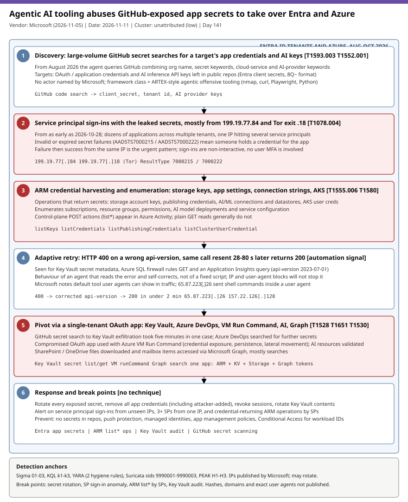

# Agentic AI tooling harvests GitHub-exposed application secrets and pivots through Entra service principals into Azure Key Vault, Run Command and AI resources

## TL;DR

Microsoft Threat Intelligence and Microsoft Security Research reported on 2026-11-05 that threat actors are using agentic AI offensive tooling to search GitHub at scale for exposed application credentials and AI inference API keys (queries since August 2026), then sign in to Entra ID tenants as service principals (from as early as 2026-10-28, mainly from 199.19.77[.]84 and the Tor exit 199.19.77[.]18). With the leaked secrets the agent calls Azure Resource Manager to pull storage keys, App Service settings, connection strings and AKS credentials, retries failed calls with corrected api-versions within 28 to 80 seconds, and in one case went from GitHub secret search to Key Vault exfiltration in five minutes. No actor, sector or geography is named, and no hashes or domains are published. It matters today because the whole chain uses valid non-interactive credentials, so MFA never fires and the only controls are secret hygiene, workload-identity policy and service-principal telemetry.

## Attribution and confidence

- **Cluster:** unattributed. Microsoft calls them "threat actors" and describes an "agentic AI offensive framework". **Confidence: low** for any actor attribution; **high** for the described behaviour, which is first-party Microsoft telemetry.
- **Vendor and date:** Microsoft Threat Intelligence + Microsoft Security Research, 2026-11-05 (page modified 2026-11-10). Only about two thirds of the page was read verbatim; the Advanced Hunting query text and the end of the detections table were not available, so nothing here is attributed to Microsoft's own queries.

| Candidate link | Evidence | Assessment |
|---|---|---|
| ARTEX / Storm-0940 | Microsoft's 2026-10-21 post attributes ARTEX-driven password spray and a ConnectWise multi-tenant app compromise to Storm-0940; this post only links to it | Not attributed here; same tooling class at most |
| 65.87.223[.]26 and 157.22.126[.]128 | Microsoft says they "may be linked" (exploitation indicators; AI-workload recon) | Low confidence, unconfirmed |
| Todyl report on stolen app credentials | Cited by Microsoft as a similar campaign; not read | Context only |

**Genealogy in this repo:** the 2026-10-28 Huntress case (M365 token spray and replay) covered user-session theft and rogue Entra devices and only mentioned ARTEX as a secondary finding; the 2026-07-22 ARToken/EvilTokens case was device-code phishing. This case is the first with **workload identity (service principal) abuse driven by leaked application secrets**, no user and no MFA involved.

## Kill chain — summary table

| Stage | MITRE | Detail |
|---|---|---|
| 1. Discovery | T1593.003, T1552.001 | Large-volume GitHub secret searches combining org name, secret, cloud-service and AI-provider keywords (from August 2026) |
| 2. Service principal sign-in | T1078.004 | Leaked app credentials used to sign in to dozens of apps across tenants, from 2026-10-28, mainly 199.19.77[.]84 and Tor exit 199.19.77[.]18 |
| 3. ARM credential harvesting | T1555.006, T1580, T1526 | Calls returning storage keys, App Service settings, connection strings, publishing credentials, AI/ML connections and datastores, AKS user credentials; enumeration of subscriptions, permissions, AI deployments |
| 4. Adaptive retry | (behavioural signal) | HTTP 400 on a wrong api-version, same call resent 28 to 80 seconds later with a corrected version returns 200 |
| 5. Pivot | T1528, T1651, T1530 | Token for a single-tenant OAuth app used for Key Vault secret exfiltration, Azure DevOps secret search, VM Run Command, AI resource validation, Graph file and mailbox access |
| 6. Anonymisation | T1090.003 | One of the two main IPs is a Tor exit node |

The ATT&CK mapping above is the repo's own; Microsoft's verbatim text carries no technique IDs (Figure 1 is an image that was not readable).



The diagram is a single lane because the chain is linear: red stages (sign-in, ARM harvesting, pivot) are where valid credentials turn into data access. The detection anchors are the service-principal sign-in logs (stages 2), Azure Activity credential-returning operations (stage 3), the retry fingerprint (stage 4) and Key Vault audit events (stage 5).

## Stage-by-stage detail

### 1. Discovery of exposed secrets

From August 2026 the framework sent large volumes of queries to GitHub, mixing a target organisation name with secret keywords, a cloud-service keyword or an AI-provider keyword. The goal is application credentials (Entra client secrets) and AI inference API keys. Entra client secrets have a recognisable shape, so the YARA hygiene rules and GitHub secret scanning find the same material the agent searches for:

```text
Entra client secret (documented format): 3 chars + "8Q~" + 34 chars of [A-Za-z0-9._~-]
Context keywords: client_secret, AZURE_CLIENT_SECRET, tenant id, OPENAI_API_KEY, AZURE_OPENAI_API_KEY
```

MITRE: T1593.003 (Search Open Websites/Domains: Code Repositories), T1552.001 (Unsecured Credentials: Credentials In Files).

### 2. Service principal sign-ins

From as early as 2026-10-28 the agent used leaked application credentials to sign in as service principals to Entra ID tenants, across dozens of applications and multiple tenants, mainly from `199.19.77[.]84` and `199.19.77[.]18` (Microsoft states the latter is a Tor exit node). Microsoft's hunting guidance: Entra errors `AADSTS7000215` (invalid secret) and `AADSTS7000222` (expired secret) mean someone holds a credential for the app, and a failure followed by a success is urgent; also look for one IP authenticating to three or more service principals with mixed results. Because these are non-interactive sign-ins with an app secret, no user MFA applies. MITRE: T1078.004 (Valid Accounts: Cloud Accounts).

### 3. ARM credential harvesting and enumeration

The agent called Azure Resource Manager operations that return credentials: storage account keys, App Service settings, connection strings, publishing credentials, AI/ML connections and datastores, and AKS user credentials, and enumerated subscriptions, resource groups, permissions, AI model deployments and service configuration. In Azure Activity these are control-plane POST actions of the `list*` family; plain GET reads (for example Azure SQL firewall rules) are generally not logged there, so Defender for Cloud and resource diagnostics matter. MITRE: T1555.006 (Cloud Secrets Management Stores), T1580 (Cloud Infrastructure Discovery), T1526 (Cloud Service Discovery).

### 4. Adaptive troubleshooting

Microsoft shows three ARM calls from 199.19.77[.]84 that failed with HTTP 400 because of a wrong or outdated `api-version` and were resent with only that parameter changed: Key Vault secret metadata enumeration (about 28 s later, ARM api-version `2023-07-01`, HTTP 200), an Azure SQL server firewall rules GET (about 60 s later) and an Application Insights query POST (about 80 s later). A fixed script does not do that; an agent reading the error does. Microsoft also notes the tools leave default user agents and that blocking an IP or user agent will not stop an agent that changes them, but it gives defenders an alert. Treat the retry shape as a behavioural signal, not an indicator.

### 5. Pivot through a single-tenant OAuth app

In multiple cases the same agents obtained a token for a single-tenant OAuth application in the target organisation and enumerated other cloud resources, exfiltrated secrets from Azure Key Vault, and searched Azure DevOps for more secrets; one case took five minutes from GitHub secret search to Key Vault exfiltration. A compromised OAuth app was used with Azure VM Run Command (credential exposure, persistence, lateral movement). The agents prioritised AI-service credentials (AI provider API keys, OAuth apps with Foundry Tools access) and tried to validate stolen Azure AI resources. Compromised apps also downloaded SharePoint/OneDrive files and accessed mailbox items through Microsoft Graph, mostly search requests. MITRE: T1528 (Steal Application Access Token), T1651 (Cloud Administration Command), T1530 (Data from Cloud Storage).

### 6. Other infrastructure

`65.87.223[.]26` showed exploitation indicators with shell commands embedded in a user agent and attempts to get App Service authentication tokens, and `157.22.126[.]128` scanned AI workloads on Azure AI services. Microsoft says both may be linked to the campaign without firm confirmation. MITRE: T1090.003 (Multi-hop Proxy) applies to the Tor exit.

## Detection strategy

### Telemetry that matters

- **Entra sign-in logs, service principal and non-interactive categories** (`AADServicePrincipalSignInLogs`, `AADNonInteractiveUserSignInLogs`, Defender XDR `EntraIdSpnSignInEvents`): source IP, app, `ResultType`. These must be exported to the SIEM; many tenants only ship interactive sign-ins.
- **Azure Activity / `CloudAuditEvents`:** `list*` actions and `runCommand/action`, caller IP and identity.
- **Key Vault diagnostics** (`AzureDiagnostics`, category `AuditEvent`) and **Storage** (`StorageBlobLogs`, `CloudStorageAggregatedEvents`): secret list/get and blob reads by service principals.
- **Entra audit logs and Graph activity** (`AuditLogs`, `GraphAPIAuditEvents`): new app credentials, consent and Graph search by apps.
- **GitHub:** secret scanning alerts and the audit log; Azure DevOps audit (PAT creation, service connections, pipeline edits).
- Table and field names from Microsoft's own queries could not be read verbatim; the KQL marks them "verify in tenant".

### Detection coverage

| Engine | File | Logic |
|---|---|---|
| Sigma | [01_agentic_ai_spn_signin_from_published_ips.yml](./sigma/01_agentic_ai_spn_signin_from_published_ips.yml) | Entra sign-in from the four Microsoft-published IPs |
| Sigma | [02_agentic_ai_arm_credential_listing_or_runcommand_from_published_ips.yml](./sigma/02_agentic_ai_arm_credential_listing_or_runcommand_from_published_ips.yml) | Credential-returning ARM operation or Run Command from those IPs |
| Sigma | [03_entra_spn_invalid_or_expired_client_secret.yml](./sigma/03_entra_spn_invalid_or_expired_client_secret.yml) | AADSTS7000215 / 7000222 failures; threshold and failure-then-success go to the SIEM |
| KQL | [k1_entra_spn_signins_campaign_ips_multi_spn_and_secret_failure_then_success.kql](./kql/k1_entra_spn_signins_campaign_ips_multi_spn_and_secret_failure_then_success.kql) | Campaign IPs, one IP to 3+ service principals, secret failure then success |
| KQL | [k2_azure_activity_credential_returning_arm_ops_runcommand_retry_and_multi_resource_tokens.kql](./kql/k2_azure_activity_credential_returning_arm_ops_runcommand_retry_and_multi_resource_tokens.kql) | list* operations by service principals, approximate retry fingerprint, multi-resource token requests |
| KQL | [k3_keyvault_secret_enumeration_by_spn_and_storage_access_from_campaign_ips.kql](./kql/k3_keyvault_secret_enumeration_by_spn_and_storage_access_from_campaign_ips.kql) | Key Vault secret list/get bursts from unseen IPs, Key Vault and Storage access from campaign IPs |
| YARA | [exposed_entra_app_secrets_hygiene.yar](./yara/exposed_entra_app_secrets_hygiene.yar) | Hygiene scanner for Entra client secrets and AI/Azure credential names in repo clones (not a campaign indicator) |
| Suricata | [agentic_ai_secret_abuse_campaign_ips.rules](./suricata/agentic_ai_secret_abuse_campaign_ips.rules) | Marginal: published IPs and a generic shell-in-user-agent heuristic; most activity is cloud API traffic a sensor does not see |

### Threat hunting hypotheses

- **H1:** a service-principal credential for one of our apps is in someone else's hands. Look for `AADSTS7000215` / `7000222` failures followed by a success from the same IP, and one IP reaching three or more service principals. [peak_h1](./hunts/peak_h1_entra_spn_credential_holder_failure_then_success.md)
- **H2:** a service principal is harvesting credentials through ARM, reading Key Vault and running commands on VMs, and retrying failed calls with corrected api-versions. [peak_h2](./hunts/peak_h2_arm_credential_harvest_keyvault_exfil_runcommand_retry_fingerprint.md)
- **H3:** our application secrets are exposed on GitHub or in code and long-lived. Inventory with secret scanning and the YARA rules, list app secrets by lifetime and rotate. [peak_h3](./hunts/peak_h3_github_exposed_app_secrets_inventory_and_long_lived_secret_rotation.md)

## Incident response playbook

### First 60 minutes (triage)

1. Search Entra service principal and non-interactive sign-in logs for `199.19.77.84` and `199.19.77.18` (including failures) as far back as retention allows; note every app that appears.
2. For each hit, list all credentials on the app registration and remove client secrets, certificates and federated credentials, including any you did not add. Disable the service principal if business impact allows; issued tokens stay valid until expiry.
3. Revoke sessions, Azure DevOps PATs and SSH keys of any affected user.
4. Pull Azure Activity, Key Vault, Storage, Entra audit, Azure DevOps audit and M365 unified audit logs for the same IPs and apps.
5. Rotate every secret in any Key Vault the app could read and every credential in accessed documents.
6. For MSP or multi-tenant apps, review Partner Center access, GDAP relationships and customer tenants, and notify customers.

### Artifacts to collect

| Artifact | Path | Tool | Why |
|---|---|---|---|
| Service principal sign-in logs | Entra / Log Analytics `AADServicePrincipalSignInLogs` | KQL, Graph | Source IP, app, AADSTS errors |
| Azure Activity log | Log Analytics `AzureActivity` | KQL | list* operations, Run Command |
| Key Vault audit | `AzureDiagnostics` category `AuditEvent` | KQL | Secret list/get |
| App registration credentials | Entra app `passwordCredentials`, `keyCredentials` | Graph, `az ad app` | Attacker-added secrets, lifetimes |
| GitHub secret scanning and audit log | GitHub org settings | `gh api` | Where the secret was exposed and for how long |
| Azure DevOps audit | Organization audit log | UI / API | PAT creation, service connections, pipeline edits |

### IR queries and commands

```powershell
# Author: Jarmi
# Read-only: app registrations with client secrets that are long-lived or expired
Connect-MgGraph -Scopes "Application.Read.All"
Get-MgApplication -All | ForEach-Object {
  $app = $_
  $app.PasswordCredentials | ForEach-Object {
    [pscustomobject]@{ App=$app.DisplayName; AppId=$app.AppId; KeyId=$_.KeyId; End=$_.EndDateTime; DaysLeft=(($_.EndDateTime - (Get-Date)).Days) }
  }
} | Sort-Object End | Format-Table -AutoSize
```

```kql
// Author: Jarmi
// Sentinel: service principal sign-ins from the two Microsoft-published IPs (verify table name in tenant)
AADServicePrincipalSignInLogs
| where TimeGenerated > ago(60d)
| where IPAddress in ("199.19.77.84", "199.19.77.18")
| project TimeGenerated, ServicePrincipalName, AppId, IPAddress, ResultType, ResourceDisplayName
```

### Containment, eradication, recovery

- **Exit criteria:** no unexplained credential on any affected app; all exposed secrets rotated and removed from history and caches; Key Vault contents rotated; no further sign-ins from non-baselined IPs for the app; Run Command history reviewed on VMs the app could reach.
- **Do NOT:** rely on blocking the two IPs (the agent changes infrastructure); delete the leaked file and call it fixed (treat public exposure as compromise); rotate only the app secret while leaving Key Vault contents the app could read.

### Recovery validation

Re-run H1 to H3 for 30 days, confirm Conditional Access for workload identities (needs Workload ID Premium) covers the apps, and confirm the app management policy caps secret lifetime.

## IOCs

| Type | Value | Context | Confidence | Source |
|---|---|---|---|---|
| ipv4 | 199.19.77.84 | Main service principal sign-in and ARM source; block exact IP; may rotate | high | Microsoft 2026-11-05 |
| ipv4 | 199.19.77.18 | Service principal sign-ins; Tor exit node | medium | Microsoft 2026-11-05 |
| ipv4 | 65.87.223.26 | Exploitation indicators, shell commands in user agent; possibly linked | low | Microsoft 2026-11-05 |
| ipv4 | 157.22.126.128 | Recon against Azure AI services; possibly linked | low | Microsoft 2026-11-05 |
| string | AADSTS7000215 | Invalid client secret error; someone holds a credential for the app | medium | Microsoft 2026-11-05 |
| string | AADSTS7000222 | Expired client secret error; failure then success is urgent | medium | Microsoft 2026-11-05 |
| string | 2023-07-01 | ARM api-version in the corrected Key Vault retry; generic, low value | low | Microsoft 2026-11-05 |

Full list in [iocs.csv](./iocs.csv). No hashes, domains or exact user agents are published. The IPs decay and one is a Tor exit: re-validate before treating any hit as live. No CVE is in scope, so no KEV cross-reference exists for this case.

## Secondary findings

- **Chainalysis breach (The Hacker News, 2026-11):** the headline says a breach exposed all users' credentials and forced a service shutdown; only the title was seen, nothing was verified. Candidate for a later crypto/identity slot once a primary report is readable.
- **Huntress "Knight Office" M365 AiTM kit (2026-09-02):** DocuSign-style lure, fake SharePoint/Teams device-code page, token replay from Tencent Cloud ranges and WHfB key binding; 25 .vu phishing domains and Turnstile sitekey published. Older than the window, adjacent to the 2026-10-28 and 2026-07-22 cases.
- **Microsoft follow-up (2026-11-06):** the page links a post saying ARTEX abuse expands to the financial sector; not read, not verified.

## Pedagogical anchors

- A service principal with a client secret is a password with no MFA: the control is secret hygiene and workload-identity policy (managed identities, secret lifetime caps, Conditional Access for workload IDs), not user-side controls.
- Treat any secret that touched a public repo as compromised even after deletion: agents search continuously and the time from exposure to use can be minutes.
- Agentic attackers self-correct: an HTTP 400 followed by a corrected retry seconds later is a behavioural fingerprint that blocking IPs or user agents will not remove.
- Export service-principal and non-interactive sign-in logs; the default interactive-only collection is blind to this entire chain.
- `AADSTS7000215` / `7000222` are credential-ownership signals, not noise: a failure followed by a success from one IP is the break point.

## What's in this folder

| File | Purpose | Link |
|---|---|---|
| README.md | This analysis. | [README.md](./README.md) |
| kill_chain.svg | Single-lane kill chain diagram (template C). | [kill_chain.svg](./kill_chain.svg) |
| iocs.csv | Published IPs, error codes and behavioural notes. | [iocs.csv](./iocs.csv) |
| sigma/ | Three Sigma rules (Azure sign-in, activity and failure signals). | [sigma/](./sigma/) |
| kql/ | Three KQL hunts for Defender XDR and Sentinel. | [kql/](./kql/) |
| yara/ | Two hygiene rules for exposed secrets in repo clones. | [yara/](./yara/) |
| suricata/ | Three marginal network rules (sids 9990001-9990003). | [suricata/](./suricata/) |
| hunts/ | Three PEAK hunts H1 to H3. | [hunts/](./hunts/) |

## Sources

- [Microsoft Security Blog: Threat actors use agentic AI tooling to find and abuse exposed secrets (2026-11-05)](https://www.microsoft.com/en-us/security/blog/2026/11/05/threat-actors-use-agentic-ai-tooling-to-find-and-abuse-exposed-secrets/)
- [Microsoft Security Blog: Storm-0940 uses ARTEX agentic AI in ConnectWise supply chain compromise (2026-10-21)](https://www.microsoft.com/en-us/security/blog/2026/10/21/storm-0940-uses-artex-agentic-ai-connectwise-supply-chain-compromise/)
- [Todyl: Stolen app credentials, real access (cited by Microsoft, not read)](https://www.todyl.com/blog/stolen-app-credentials-real-access-an-actor-is-signing-into-entra-id-and-azure-devops-as-your-workloads)
- [Huntress: Inside Knight Office, a new M365 AiTM phishing kit (2026-09-02)](https://www.huntress.com/blog/inside-knight-office-m365-aitm-attack)
- [The Hacker News: Chainalysis breach exposes all users' credentials (2026-11, headline only)](https://thehackernews.com/2026/11/chainalysis-breach-exposes-all-users.html)
