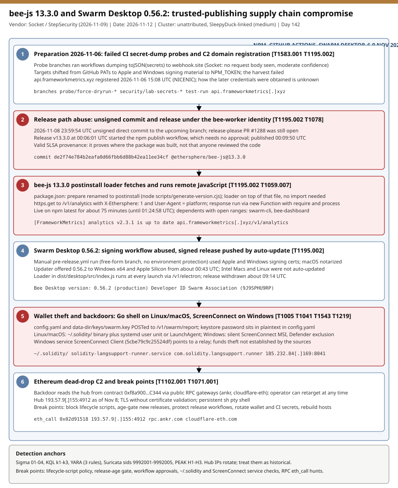

# Ethersphere bee-js 13.3.0 and Swarm Desktop 0.56.2: trusted-publishing supply chain compromise with an Ethereum dead-drop backdoor

## TL;DR

On 2026-11-09 at 00:09:50 UTC an attacker using the `bee-worker` release identity pushed an unsigned commit, cut a GitHub release and let the project's own trusted-publishing workflow publish `@ethersphere/bee-js@13.3.0` to npm with valid SLSA provenance. The package moved a script into a `postinstall` hook that downloads and runs remote JavaScript from `api.frameworkmetrics[.]xyz`, steals the Swarm node keystore and `config.yaml`, and installs a Go remote shell (Linux/macOS) or a ScreenConnect client (Windows). A signed Swarm Desktop 0.56.2 followed about 30 minutes later through the auto-updater. Exposure was short (npm about 75 minutes, desktop about 9 hours) but any host that ran the code must be treated as fully compromised. It matters today because provenance and signing both passed: the defence is release-workflow hardening and install-script policy, not artifact verification.

## Attribution and confidence

- **Cluster:** unattributed. Socket and The Hacker News tie the infrastructure to the SleepyDuck / EtherDuck Open VSX campaign (Pluto Security analysis, 2026-10-01) through a shared Ethereum contract and ScreenConnect relay. **Confidence: medium** for that link, **low** for any named actor.
- **Vendors:** StepSecurity (2026-11-08/09), Socket (2026-11-09), The Hacker News (2026-11-09), GitHub advisory GHSA-hh7j-5m3j-23pf. No CVE is assigned in the sources read.
- **Authorship is not attribution:** malicious commits appear as `bee-worker` or `lab-bot`; Socket says push events on 2026-11-06 point to a maintainer account. How the credentials were obtained is unknown.

| Evidence | Value | Weight |
|---|---|---|
| Ethereum dead-drop contract | `0xf8a900Db50b3331be6B768bA460BB59f3E40C344`, also used by earlier Open VSX extensions | Medium |
| ScreenConnect relay | `185.232.84[.]169:8041` shared with the Open VSX campaign | Medium |
| Tradecraft | Release-workflow abuse, no stolen npm token used | Context |

**Genealogy in this repo:** supply chain cases such as the 2026-10-22 GhostAction Stage 2 and 2026-10-29 LiteLLM hijack abused CI and publishing pipelines too; this case differs because the publish happened through legitimate trusted publishing and the C2 is resolved from an Ethereum contract.

## Kill chain — summary table

| Stage | MITRE | Detail |
|---|---|---|
| 1. Preparation | T1583.001, T1195.002 | 2026-11-06 failed CI secret-dump probes to webhook.site; C2 domain registered. |
| 2. Release path abuse | T1195.002, T1078 | Unsigned commit `de2f74e` as `bee-worker`; release v13.3.0 triggers npm publish without approval. |
| 3. Postinstall loader | T1059.007, T1204 | `postinstall` runs `scripts/generate-version.cjs`; remote JS executed through `new Function`. |
| 4. Swarm Desktop | T1195.002 | Manual signing workflow produces signed, notarized 0.56.2; auto-update delivers it. |
| 5. Theft and backdoor | T1005, T1041, T1543, T1219 | Keystore plus `config.yaml` exfiltrated; Go shell or ScreenConnect installed. |
| 6. Dead-drop C2 | T1102.001, T1071.001 | Hub address read from an Ethereum contract through public RPC gateways. |



The single lane runs from preparation to C2. Red stages (2, 3, 5) are the critical ones; detection anchors are Sigma 01-04, KQL k1-k3, the YARA rules, Suricata sids 9992001-9992005 and PEAK hunts H1-H3.

## Stage-by-stage detail

### 1. Preparation (2026-11-06)

Socket reports probe branches in swarm-desktop (`probe/force-dryrun-*`, `security/lab-secrets-*`, `test-run`) and edits to a swarm-cli workflow that dumped `${{ toJSON(secrets) }}` to webhook.site collectors, targeting PATs, then Apple/Windows signing material, then `NPM_TOKEN`. Across 38 captured requests none carried a body; Socket assesses with moderate confidence that nothing was exfiltrated and that the later credentials did not come from this attempt. `api.frameworkmetrics[.]xyz` was registered at 15:08 UTC the same day. **T1583.001, T1195.002.**

### 2. Release path abuse (2026-11-08 / 11-09)

```text
23:59:54 UTC  unsigned commit de2f74e784b2eafa0d66fbb6d88b42ea11ee34cf (client-set time), "chore(upcoming): release 13.3.0"
00:06:01 UTC  GitHub release v13.3.0 under bee-worker
00:06:03 UTC  "Publish on npm" workflow starts (no required reviewers, no tag policy)
00:09:50 UTC  @ethersphere/bee-js@13.3.0 published, valid SLSA provenance
01:24:58 UTC  version removed; GHSA issued 01:25:27 UTC
```

Release-please PR #1288 was still open. No npm token was used; the workflow built the already-poisoned source. **T1195.002, T1078.**

### 3. Postinstall loader

`package.json` renamed `prepare` to `postinstall` (`node scripts/generate-version.cjs`) and added `scripts` to `files`. The loader sits on top of the script and performs an unconditional HTTPS request to `/v1/analytics` with `X-Ethersphere: 1` and `User-Agent` set to `process.platform`, then runs the response with `new Function('require','console','process', body)`. Without the header the server returns decoy content. The install log shows `[FrameworkMetrics] analytics v2.3.1 is up to date`. npm 11 and earlier, Yarn Classic and Yarn Berry before 4.14.0 run dependency postinstall by default; newer npm, pnpm 10+, Bun and Deno skip unreviewed dependency scripts (Socket). **T1059.007, T1204.**

### 4. Swarm Desktop 0.56.2

A manually triggered `pre-release.yml` (free-form branch input, no environment protection) held Apple and Windows signing certificates. The macOS build was signed as `Developer ID Application: Swarm Association (9J9SPHU9RP)` and notarized. The updater offered it to Windows x64 and Apple Silicon from about 00:43 UTC; Intel Macs and Linux were not auto-updated. The loader runs at every launch via `/v1/electron`; the release was withdrawn about 09:14 UTC. Log evidence: `Bee Desktop version: 0.56.2 (production)` in `bee-desktop.log`. **T1195.002.**

### 5. Wallet theft and backdoors

```text
Targets:   <Swarm Desktop data dir>/config.yaml, data-dir/keys/swarm.key  -> POST /v1/swarm/report (configYaml, v3)
Linux:     ~/.solidity/linux_amd64|linux_arm64, ~/.solidity/.run.py,
           ~/.config/systemd/user/solidity-langsupport-runner.service
macOS:     ~/.solidity/darwin_arm64|darwin_amd64, .run.cjs|.run.py,
           ~/Library/LaunchAgents/com.solidity.langsupport.runner.plist
Windows:   %TEMP%\.stuffed-*, %LOCALAPPDATA%\.<32-hex-guid>\app.msi, invoke.ps1
```

`swarm.key` is an encrypted Ethereum V3 keystore and `config.yaml` holds its password in plaintext. On Windows the code checks for an existing ScreenConnect install, adds then removes a Defender exclusion, runs `app.msi` silently and leaves the service `ScreenConnect Client (5cbe79c9c25524df)` pointing at `185.232.84[.]169:8041`; Socket reports a UAC bypass (UACME method 39) for local admins. Whether any funds were stolen is not established. **T1005, T1041, T1543.001, T1543.002, T1219, T1562.001.**

### 6. Dead-drop C2

The Go backdoor exits if it detects a debugger or VM, reads the hub from contract `0xf8a900...C344` (`param1()` selector `0x02d91518`) through public gateways (`rpc.ankr.com`, `cloudflare-eth.com`), connects over TLS without certificate validation and runs commands in a persistent `sh` pseudo-terminal. The hub was `193.57.9[.]155:4912` as of 2026-11-08 23:30 UTC and has changed several times since March. **T1102.001, T1071.001.**

## RE notes

| Component | SHA256 | Lang | Packer | Notes |
|---|---|---|---|---|
| scripts/generate-version.cjs | `ee2f762e9ed3fd89f106e0b80c2e923bf1aed9a280277d3d998a5902c4d9ec0f` | JavaScript | none | Loader on top of the legitimate generator (hash from Socket summary section). |
| linux_amd64 | `9b73e7cd4e1425e770392549d8df46c706139ef476f4f7b9ac405165dc8d9696` | Go | not stated | Strings `hubclient.runCommand`, `hubclient.startShellLocked`, `github.com/creack/pty` (StepSecurity, not executed). |
| linux_arm64 | `b601776817363b96295119f7221338a122d5247a35a77a64b04f286e1bbcc565` | Go | not stated | Same family. |
| darwin_arm64 | `fae61f31f00988fdc5cc9e7272b51e08af2e245d81003237875415930fd27358` | Go | not stated | LaunchAgent clears quarantine attribute. |
| app.msi | `7527e86d70e7c9493db4356f1c3775380431b310000f2602c1e993cf435d01da` | MSI | n/a | ConnectWise-signed ScreenConnect 25.4.3 client (Socket summary section). |

The payload JavaScript source was not published. The Go module name `evjawbreaker` comes from THN; treat Go-string YARA hits as medium confidence.

## Detection strategy

### Telemetry that matters

- **Endpoint:** Sysmon EID 1/3/11/22 on Windows (msiexec, PowerShell/wscript from `%TEMP%\.stuffed-*`, DNS), auditd or EDR file events for `~/.solidity/` and `~/.config/systemd/user/`, macOS LaunchAgents; Defender XDR `DeviceNetworkEvents`, `DeviceProcessEvents`, `DeviceFileEvents`, `DeviceRegistryEvents`.
- **Build and developer side:** lockfiles, CI install logs, npm mirror logs (who fetched `@ethersphere/bee-js@13.3.0` between 2026-11-09 00:09:50 and 01:24:58 UTC), proxy logs.
- **GitHub:** audit log for unsigned direct pushes, `workflow_dispatch` on free-form branches, releases created without a merged PR.
- **Network:** DNS, TLS SNI, and egress to port 4912 from developer hosts.

### Detection coverage

| Engine | File | Logic |
|---|---|---|
| Sigma | [01_bee_js_swarm_loader_connection_to_frameworkmetrics.yml](./sigma/01_bee_js_swarm_loader_connection_to_frameworkmetrics.yml) | Any process connecting to `frameworkmetrics.xyz`. |
| Sigma | [02_solidity_backdoor_dropper_files_and_persistence.yml](./sigma/02_solidity_backdoor_dropper_files_and_persistence.yml) | Files under `/.solidity/`, the systemd unit or the LaunchAgent plist. |
| Sigma | [03_bee_js_swarm_windows_screenconnect_stage3.yml](./sigma/03_bee_js_swarm_windows_screenconnect_stage3.yml) | Hidden-GUID `app.msi` install, `.stuffed-` staging, ScreenConnect instance id. |
| Sigma | [04_dns_query_frameworkmetrics_xyz.yml](./sigma/04_dns_query_frameworkmetrics_xyz.yml) | DNS query for `frameworkmetrics.xyz`. |
| KQL | [k1](./kql/k1_frameworkmetrics_egress_hub_ips_and_solidity_eth_rpc_dead_drop.kql) | Egress to the C2, hub IPs on 4912, relay on 8041, RPC calls from `.solidity` processes. |
| KQL | [k2](./kql/k2_persistence_solidity_files_screenconnect_service_defender_exclusion_msiexec.kql) | Persistence and stage 3 traces in file, process and registry events. |
| KQL | [k3](./kql/k3_npm_install_exposure_window_and_swarm_desktop_0_56_2_inventory.kql) | Installs in the exposure window, loader runs, published hashes, Swarm Desktop inventory. |
| YARA | [bee_js_swarm_sleepyduck.yar](./yara/bee_js_swarm_sleepyduck.yar) | Loader JS, Go backdoor strings (medium), persistence unit/plist. Not compile-tested. |
| Suricata | [bee_js_swarm_c2.rules](./suricata/bee_js_swarm_c2.rules) | DNS, SNI, `X-Ethersphere` (needs TLS inspection), hub IPs, relay. Not compile-tested. |

### Threat hunting hypotheses

- **H1:** dev hosts and CI runners executed the `bee-js` 13.3.0 postinstall in the exposure window — [peak_h1](./hunts/peak_h1_bee_js_13_3_0_postinstall_on_dev_hosts_and_ci_runners.md).
- **H2:** a process under `~/.solidity` resolves a hub through `eth_call` and holds a raw TLS session on port 4912 with a pty shell child — [peak_h2](./hunts/peak_h2_ethereum_dead_drop_solidity_rpc_eth_call_then_hub_port_4912_pty_shell.md).
- **H3:** Swarm Desktop wallet exposure and release-workflow abuse (unsigned pushes, ad-hoc dispatch, secret-dump workflows) — [peak_h3](./hunts/peak_h3_swarm_desktop_wallet_exposure_and_release_workflow_abuse.md).

## Incident response playbook

### First 60 minutes (triage)

1. Search lockfiles, caches, internal registry mirrors and CI logs for `@ethersphere/bee-js@13.3.0` (including transitive copies via swarm-cli, bee-dashboard).
2. Check whether lifecycle scripts were enabled on the installing host; a clean install log does not rule out execution because errors are suppressed.
3. On desktops, grep `bee-desktop.log` for `Bee Desktop version: 0.56.2`.
4. Look for `~/.solidity/`, the systemd user unit, the LaunchAgent and the ScreenConnect service on affected hosts.
5. Isolate any host where the loader ran; preserve memory and disk before cleanup.
6. Block `api.frameworkmetrics[.]xyz` at DNS/proxy and review historical egress.

### Artifacts to collect

| Artifact | Path | Tool | Why |
|---|---|---|---|
| Lockfile and npm cache | `package-lock.json`, `~/.npm/_cacache` | `grep`, `npm cache ls` | Prove whether 13.3.0 was resolved. |
| Backdoor directory | `~/.solidity/` | `find`, `sha256sum` | Binaries and launchers. |
| Persistence | `~/.config/systemd/user/`, `~/Library/LaunchAgents/` | `ls -la`, `plutil` | Unit and plist content. |
| Windows staging | `%TEMP%\.stuffed-*`, `%LOCALAPPDATA%\.*\app.msi` | Velociraptor, EZ tools | Stage 3 evidence. |
| Services | `ScreenConnect Client (5cbe79c9c25524df)` | `sc qc`, registry | Remote access service. |
| Desktop log | `bee-desktop.log` | `grep` | Version evidence. |

### IR queries and commands

```bash
grep -rn "bee-js" package-lock.json pnpm-lock.yaml yarn.lock 2>/dev/null | grep -n "13\.3\.0"
ls -la ~/.solidity/ ~/.config/systemd/user/solidity-langsupport-runner.service 2>/dev/null
systemctl --user status solidity-langsupport-runner.service 2>/dev/null
ls ~/Library/LaunchAgents/com.solidity.langsupport.runner.plist 2>/dev/null
```

```powershell
Get-Service | Where-Object { $_.DisplayName -like "ScreenConnect Client*" }
Get-ChildItem $env:TEMP -Force -Filter ".stuffed-*" -ErrorAction SilentlyContinue
Get-ChildItem $env:LOCALAPPDATA -Force -Directory | Where-Object { $_.Name -match '^\.[0-9a-f]{32}$' }
```

Hunting queries are in KQL k1-k3 (see Detection strategy).

### Containment, eradication, recovery

- **Exit criteria:** no host runs 13.3.0 or 0.56.2; no `~/.solidity`, unit, plist or ScreenConnect service remains; DNS/proxy shows no contact with the C2; credentials reachable by affected users and CI jobs rotated from a clean machine.
- **Eradication:** removing the package or app does **not** remove persistence; rebuild from a trusted image (preferred).
- **Wallets:** treat the Swarm node keystore and `config.yaml` password as exposed; move xDAI/xBZZ, chequebook and stake to a new key generated on a clean system.
- **Do NOT** trust the valid provenance or signature as evidence of safety, and do not reuse the old keystore after removal.

### Recovery validation

Re-scan fleet and CI for the hashes in `iocs.csv`; confirm pinned `bee-js` 13.2.0 or later reviewed release; verify install scripts are blocked or allow-listed; watch DNS and port 4912 egress for two weeks.

## IOCs

Top entries (full list, 41 rows, in [iocs.csv](./iocs.csv)):

| Type | Value | Context | Confidence | Source |
|---|---|---|---|---|
| domain | `api.frameworkmetrics.xyz` | C2 and exfiltration; registered 2026-11-06 | high | StepSecurity |
| string | `X-Ethersphere: 1` | Header sent by loaders | high | Socket |
| string | `[FrameworkMetrics] analytics v2.3.1 is up to date` | npm install log line | high | Socket |
| string | `0xf8a900Db50b3331be6B768bA460BB59f3E40C344` | Ethereum dead-drop contract | high | Socket |
| string | `193.57.9.155:4912` | Hub as of 2026-11-08; decays | medium | Socket |
| string | `185.232.84.169:8041` | ScreenConnect relay | medium | THN |
| sha1 | `a205c8a5fed81e9a787645b2801f00be3db3348d` | Malicious bee-js tarball | high | StepSecurity |
| sha256 | `9b73e7cd4e1425e770392549d8df46c706139ef476f4f7b9ac405165dc8d9696` | linux_amd64 backdoor | high | THN |
| sha256 | `b601776817363b96295119f7221338a122d5247a35a77a64b04f286e1bbcc565` | linux_arm64 backdoor | high | THN |
| sha256 | `fae61f31f00988fdc5cc9e7272b51e08af2e245d81003237875415930fd27358` | darwin_arm64 backdoor | high | THN |
| sha256 | `7527e86d70e7c9493db4356f1c3775380431b310000f2602c1e993cf435d01da` | app.msi installer | high | THN |
| path | `~/.solidity/` | Backdoor directory | high | StepSecurity |
| path | `~/.config/systemd/user/solidity-langsupport-runner.service` | Linux persistence | high | StepSecurity |
| path | `~/Library/LaunchAgents/com.solidity.langsupport.runner.plist` | macOS persistence | high | StepSecurity |
| string | `@ethersphere/bee-js@13.3.0` | Malicious npm release | high | Socket |

No CVE is assigned (GHSA-hh7j-5m3j-23pf only), so there is no CISA KEV status and no `kev.md` for this case. Hub IPs and the domain decay; re-validate before treating as live.

## Secondary findings

- **4,837 hijacked GitHub accounts running a CI secret stealer in 1,806+ repositories** (The Hacker News, 2026-11): only the headline was seen in search results; not read, not verified.
- **wfx GitHub Actions credential stealer (SafeDep):** reported as hitting about 8,000 repos; only the search-result title was seen; not read.
- **Open VSX SleepyDuck / EtherDuck (Pluto Security, 2026-10-01):** the earlier campaign sharing this contract and relay; cited via Socket and THN, article not read.

## Pedagogical anchors

- Valid SLSA provenance and a notarized signature prove where something was built, not that the source was reviewed; protect the release identity and require approvals on publish and signing workflows.
- A `postinstall` hook is arbitrary code execution at install time; block lifecycle scripts by default and allow-list.
- Ethereum dead-drop resolvers make IP and domain blocking a moving target; hunt the behaviour (`eth_call` from an unexpected binary followed by a raw TLS session).
- Hash and removal are not recovery: persistence in `~/.solidity`, systemd, LaunchAgents and ScreenConnect survives package removal.
- Short exposure windows still matter for developers and CI runners that install on every build.

## What's in this folder

| File | Purpose | Link |
|---|---|---|
| README.md | This analysis. | [README.md](./README.md) |
| kill_chain.svg | Single-lane kill chain diagram. | [kill_chain.svg](./kill_chain.svg) |
| iocs.csv | 41 indicators with context and source. | [iocs.csv](./iocs.csv) |
| sigma/ | Four Sigma rules. | [sigma/](./sigma/) |
| kql/ | Three KQL hunting queries. | [kql/](./kql/) |
| yara/bee_js_swarm_sleepyduck.yar | Three YARA rules. | [yara/bee_js_swarm_sleepyduck.yar](./yara/bee_js_swarm_sleepyduck.yar) |
| suricata/bee_js_swarm_c2.rules | Five Suricata rules (sids 9992001-9992005). | [suricata/bee_js_swarm_c2.rules](./suricata/bee_js_swarm_c2.rules) |
| hunts/ | Three PEAK hunts H1-H3. | [hunts/](./hunts/) |

## Sources

- [Malicious bee-js npm Release and Swarm Desktop Releases Deliver SleepyDuck Ethereum C2 Backdoor — Socket](https://socket.dev/blog/bee-js-compromise) (first ~65% read verbatim, remainder from a summary)
- [@ethersphere/bee-js 13.3.0 Compromised — StepSecurity](https://www.stepsecurity.io/blog/ethersphere-bee-js-13-3-0-compromise)
- [Hackers compromise Ethersphere's bee-js — The Hacker News](https://thehackernews.com/2026/11/hackers-compromise-etherspheres-bee-js.html)
- [GHSA-hh7j-5m3j-23pf — GitHub Advisory](https://github.com/advisories/GHSA-hh7j-5m3j-23pf) (cited via THN, not opened)
- [SafeDep analysis](https://safedep.io/blog/ethersphere-bee-js-npm-compromise) (cited via THN, not read)
- [4,837 Hijacked GitHub Accounts Ran a CI Secret Stealer — The Hacker News](https://thehackernews.com/2026/11/4837-hijacked-github-accounts-ran-ci.html) (headline only)
