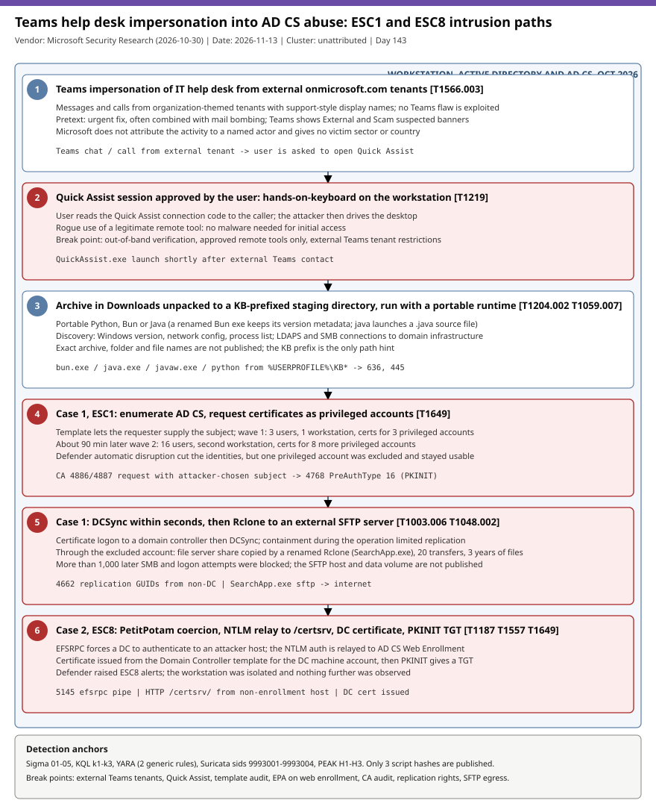

# Teams help desk impersonation and Quick Assist lead to AD CS abuse: ESC1 certificates for privileged accounts, DCSync and Rclone SFTP exfiltration, and an ESC8 PetitPotam relay

## TL;DR

Microsoft Security Research reported on 2026-10-30 (The Hacker News followed on 2026-11-02) two intrusions that start with Teams messages and calls from external tenants impersonating IT help desk staff. The user is talked into a Quick Assist session, the attacker stages a portable Python, Bun or Java runtime, then abuses Active Directory Certificate Services. In case 1 an ESC1-vulnerable template yielded certificates for 11 privileged accounts in two waves about 90 minutes apart, followed by DCSync within seconds and an Rclone copy of a file server share to an external SFTP server through one account that was excluded from Defender automatic attack disruption. In case 2 PetitPotam coerced a domain controller, the NTLM authentication was relayed to AD CS Web Enrollment (ESC8), and the resulting DC certificate gave a TGT through PKINIT. No actor, sector or country is named, there is no CVE, and only three script hashes are published. It matters today because the chain uses a legitimate remote tool and legitimate certificate logons, and revoking a certificate does not kill Kerberos tickets already issued.

## Attribution and confidence

- **Cluster:** unattributed. Microsoft states the activity "is not attributed to a specific threat actor". **Confidence: low** for any actor attribution; **high** for the behaviour, which is first-party Microsoft telemetry from two customer incidents.
- **Vendor and date:** Microsoft Security Research (Sagar Patil, Jesse Birch, Tal Tzhori), 2026-10-30; The Hacker News (Swati Khandelwal), 2026-11-02. Coverage caveat: only about 60% of the Microsoft page was read verbatim (through the first rows of the Defender table); the hunting query text, the rest of the alert table and the references were not available, so nothing here is attributed to Microsoft's own queries. The three hashes come from The Hacker News.

| Candidate link | Evidence | Assessment |
|---|---|---|
| Microsoft's earlier Teams help desk playbook (2026-04-18) | Cited by The Hacker News as the earlier entry method write-up; not read | Same entry technique, no actor link established |
| Quick Assist vishing cases in this repo | The 2026-10-20 SRG case also used vishing and Quick Assist | Technique overlap only; different cluster context |

**Genealogy in this repo:** the 2026-10-20 SRG Sleepless Threat case covered vishing, physical agents and Quick Assist as the initial access. This case is the first to follow the access into AD CS certificate abuse (ESC1 and ESC8) and the first on the DCSync plus Rclone exfiltration tail.

## Kill chain — summary table

| Stage | MITRE | Detail |
|---|---|---|
| 1. Teams impersonation | T1566.003 | Messages and calls from external organization-themed onmicrosoft.com tenants with support-style display names; no Teams vulnerability |
| 2. Quick Assist session | T1219 | The user opens Quick Assist and reads the connection code; the attacker gets hands-on-keyboard access |
| 3. Staged runtime and discovery | T1204.002, T1059.007, T1036.003 | Archive in Downloads unpacked to a KB-prefixed directory under the profile; portable Python, Bun or Java; renamed Bun keeps its version metadata |
| 4. ESC1 certificates (case 1) | T1649 | Template allows a requester-supplied subject; 3 privileged certificates in wave 1, 8 more about 90 minutes later in wave 2 |
| 5. DCSync and exfiltration (case 1) | T1003.006, T1048.002 | DCSync against a DC within seconds of a certificate; renamed Rclone (SearchApp.exe) copies a share to an external SFTP server |
| 6. ESC8 relay (case 2) | T1187, T1557, T1649 | PetitPotam coerces a DC, NTLM relayed to /certsrv, DC certificate issued from the Domain Controller template, PKINIT TGT |

The ATT&CK mapping above is the repo's own; the Microsoft text read carries no technique IDs.



The diagram is a single lane because the chain is linear per case. Red stages (Quick Assist, certificate theft, DCSync and exfiltration, DC certificate) are where a user-approved session turns into domain-wide identity compromise. The detection anchors are the Quick Assist launch after external Teams contact, the CA issuance and PKINIT events, replication rights use, and SFTP egress from file servers.

## Stage-by-stage detail

### 1. Teams impersonation of the help desk

Attackers message and call employees from external tenants with organization-themed onmicrosoft.com names and support-oriented display names. Microsoft shows a Teams call carrying the "External" and "Scam suspected" warnings as important user-facing signals, and lists Defender alerts for the pattern (for example "IT Support Teams Voice phishing following mail bombing activity"). Microsoft says the activity did not exploit a vulnerability in Teams.

MITRE: T1566.003 (Phishing: Spearphishing via Service).

### 2. Quick Assist session

The caller guides the user to open Quick Assist and read the connection code, which hands over interactive control of the workstation. No malware is needed for this step.

MITRE: T1219 (Remote Access Software).

### 3. Staging and discovery

An archive is placed in the victim's Downloads folder and extracted into a KB-prefixed staging directory under the user profile (an update-themed name; the exact path is not published). The payload runs with a portable Python, Bun or Java runtime. One JavaScript variant uses a renamed executable that keeps Bun version metadata; another uses a staged Java runtime to launch a Java source file. The attacker queries the Windows version, network configuration and processes, and the workstation connects to domain infrastructure over LDAPS and SMB.

```text
Pattern (unverified exact path): %USERPROFILE%\KB<...>\  -> bun.exe | java.exe | javaw.exe | python.exe
Network: workstation -> domain infrastructure on 636/tcp (LDAPS) and 445/tcp (SMB)
```

MITRE: T1204.002, T1059.007, T1059.006, T1036.003 (Masquerading: Rename Legitimate Utilities), T1082, T1016, T1057.

### 4. Case 1: ESC1 certificate requests

The attacker assessed AD CS and found a template where the requester can name the account the certificate represents (ESC1). Wave 1 involved three users and one workstation and produced certificates for three highly privileged accounts. Defender automatic attack disruption cut those identities, but one privileged account was excluded from automatic response and stayed usable. About 90 minutes later wave 2 involved 16 users and a second workstation and produced certificates for eight more privileged accounts. Microsoft says more than 1,000 later SMB and logon attempts were blocked.

MITRE: T1649 (Steal or Forge Authentication Certificates), T1078.002.

### 5. Case 1: DCSync and exfiltration

Within seconds of obtaining a certificate the attacker logged in to a domain controller and ran DCSync; containment started during the operation and limited replication. Through the excluded account the attacker reached a file server and ran a renamed Rclone binary (SearchApp.exe) to copy a share recursively to an external SFTP server, with 20 concurrent transfers, a three-year age filter and exclusions for executables, databases, virtual disks, media, temporary and log files. Microsoft did not say how much credential data or file data left.

```text
Generic Rclone shape (not published verbatim): <renamed>.exe copy <share> :sftp: --transfers 20 --max-age 3y --exclude "*.exe,*.db,*.vhd*,..."
```

MITRE: T1003.006 (DCSync), T1021.002 (SMB/Windows Admin Shares), T1048.002 (Exfiltration Over Asymmetric Encrypted Non-C2 Protocol).

### 6. Case 2: ESC8 NTLM relay

The template weakness was absent, so the attacker used PetitPotam (EFSRPC) to make a domain controller authenticate to an attacker-controlled system with its machine account. The NTLM authentication was relayed to AD CS Web Enrollment (/certsrv submission and retrieval endpoints), a certificate was issued from the Domain Controller template, and PKINIT gave a TGT for the DC account. Defender raised ESC8 alerts, the customer isolated the workstation and no further progression was observed.

MITRE: T1187 (Forced Authentication), T1557 (Adversary-in-the-Middle), T1649.

### Persistence note

A certificate keeps working after the account password is reset or the first machine is wiped. Revoking it does not invalidate Kerberos TGTs or service tickets already issued.

## Detection strategy

### Telemetry that matters

- **Defender XDR:** `CloudAppEvents` (Teams activity; the ActionType names are unverified), `DeviceProcessEvents` (QuickAssist.exe, bun/java/python from user paths, Rclone), `DeviceNetworkEvents` (636/445/88/22), `AlertInfo` and `AlertEvidence`.
- **Domain controllers and CA (Security log):** 4768 (PreAuthType 16 certificate logon), 4662 (replication GUIDs), 4624, 5145 (efsrpc pipe, needs Detailed File Share auditing), and on the CA 4886 and 4887 once the Certification Services audit subcategory and CA audit filter are on.
- **IIS on the web enrollment server:** `W3CIISLog` for /certsrv/ requests by machine accounts or unexpected clients.
- **Network sensor:** SFTP/SSH egress from file servers, EFSRPC binds to DCs, /certsrv/ over cleartext HTTP.

### Detection coverage

| Engine | File | Logic |
|---|---|---|
| Sigma | `sigma/01_quick_assist_launched_on_endpoint.yml` | Quick Assist process start by image or original file name |
| Sigma | `sigma/02_portable_runtime_from_user_profile_kb_staging_or_renamed_bun.yml` | Bun/Java/Python from a KB directory, renamed Bun, java launching a .java file |
| Sigma | `sigma/03_rclone_sftp_copy_or_renamed_rclone_binary.yml` | Renamed Rclone by OriginalFileName or Rclone-style SFTP command line |
| Sigma | `sigma/04_efsrpc_named_pipe_access_on_domain_controller.yml` | Security 5145 access to the efsrpc pipe on a DC (low confidence) |
| Sigma | `sigma/05_dcsync_replication_rights_by_non_machine_account.yml` | Security 4662 with replication GUIDs by non-machine accounts |
| KQL | `kql/k1_teams_external_helpdesk_contact_then_quick_assist_and_defender_alerts.kql` | External Teams contact followed by Quick Assist within 60 minutes, plus the published alert titles |
| KQL | `kql/k2_staged_portable_runtime_kb_directory_and_domain_ldaps_smb_contact.kql` | Staged runtime, the three hashes, discovery commands and 636/445/389/88 connections |
| KQL | `kql/k3_adcs_esc1_esc8_certificate_issuance_pkinit_and_dcsync.kql` | CA 4887 subject mismatch or SAN, machine account to /certsrv, 4768 cert logon, 4662 replication from non-DC |
| YARA | `yara/bun_runtime_and_renamed_rclone_hunting.yar` | 2 generic hunting rules (Bun markers, Rclone strings); not sample-derived, not compiled |
| Suricata | `suricata/helpdesk_impersonation_adcs_esc8_exfil_heuristics.rules` | 4 sids 9993001-9993004: file server SFTP egress, EFSRPC bind to DC (two variants), /certsrv/ from unapproved clients; heuristics, not loaded in an engine |

### Threat hunting hypotheses

- **H1:** an external Teams contact preceded a Quick Assist session and a staged runtime on a user workstation, see [peak_h1](./hunts/peak_h1_external_teams_helpdesk_quick_assist_staged_runtime.md).
- **H2:** AD CS holds enrollee-supplies-subject templates, HTTP web enrollment without EPA, or unexplained certificate issuance for privileged accounts and DCs, see [peak_h2](./hunts/peak_h2_adcs_esc1_esc8_template_web_enrollment_and_issuance_audit.md).
- **H3:** DCSync from non-DC hosts and SFTP egress from file servers, including accounts excluded from automatic containment, see [peak_h3](./hunts/peak_h3_dcsync_rclone_sftp_exfil_and_containment_excluded_accounts.md).

## Incident response playbook

### First 60 minutes (triage)

1. Isolate the workstation that ran Quick Assist and keep it powered on for triage.
2. Identify every account that received a certificate from the CA in the window (4886/4887) and treat each as compromised.
3. Disable or contain the privileged accounts, including any excluded from automatic response; do not rely on password reset alone.
4. Check domain controllers for 4662 replication events and 4768 PreAuthType 16 from unexpected hosts.
5. Check file servers and egress logs for SFTP/SSH to external hosts and for renamed Rclone processes.
6. Preserve Teams records, CA database, CA security events and IIS logs before cleanup.

### Artifacts to collect

| Artifact | Path | Tool | Why |
|---|---|---|---|
| Staging directory and archive | `%USERPROFILE%\KB*`, `%USERPROFILE%\Downloads` | KAPE / EZ Tools | Payload, runtime and script copies for hashing |
| Prefetch / Amcache | `C:\Windows\Prefetch`, `Amcache.hve` | PECmd, AmcacheParser | Quick Assist, runtime and renamed Rclone execution |
| CA database and audit events | CA server, Security log | certutil, EvtxECmd | Which templates and requesters issued certificates |
| DC Security log | `Security.evtx` on DCs | EvtxECmd | 4662, 4768, 5145 |
| IIS logs | `C:\inetpub\logs\LogFiles` on the web enrollment server | grep, Log Parser | /certsrv/ requests and source hosts |
| Teams audit | Purview / `CloudAppEvents` | KQL | External tenant, display name, timing |

### IR queries and commands

```powershell
# Author: Jarmi
# List certificates issued by the CA in the last 7 days (run on the CA, read-only)
certutil -view -restrict "NotBefore>=$((Get-Date).AddDays(-7).ToString('MM/dd/yyyy'))" -out "RequestID,RequesterName,CommonName,CertificateTemplate,NotBefore"
# Quick Assist and portable runtime execution traces
Get-WinEvent -FilterHashtable @{LogName='Security';Id=4688} -MaxEvents 5000 | Where-Object { $_.Message -match 'QuickAssist|bun\.exe|javaw?\.exe' } | Select-Object TimeCreated, Message -First 50
```

```kql
// Author: Jarmi
DeviceProcessEvents
| where Timestamp > ago(14d)
| where FileName =~ "QuickAssist.exe" or ProcessVersionInfoOriginalFileName =~ "rclone.exe"
| project Timestamp, DeviceName, AccountName, FileName, ProcessVersionInfoOriginalFileName, ProcessCommandLine, FolderPath
```

### Containment, eradication, recovery

- **Exit criteria:** every certificate issued to an affected account is revoked and the CRL republished; krbtgt rotated twice if DCSync is confirmed; vulnerable templates and web enrollment fixed; all accounts excluded from automatic containment reviewed; no further SFTP egress.
- **Do NOT** assume a password reset or certificate revocation ends access: issued TGTs and service tickets stay valid until expiry or krbtgt rotation. Do not wipe the first workstation before the CA and DC evidence is collected.

### Recovery validation

Re-run the template audit (no enrollee-supplied subject on authentication templates), confirm HTTPS and EPA on web enrollment (or removal), confirm the Certification Services audit subcategory is on, and verify that no non-DC account holds replication rights.

## IOCs

| Type | Value | Context | Confidence | Source |
|---|---|---|---|---|
| sha256 | `85b6c424117494d3056e88689dbc94c75e9afdb187a339714043aec0da109f17` | Initial-access JavaScript script | medium | The Hacker News 2026-11-02 |
| sha256 | `f326201269f1ee2f803ae435317507263bb6e0dbfdeb70bd1bb5446e2e46f001` | Initial-access Python script | medium | The Hacker News 2026-11-02 |
| sha256 | `06c5c14f043aee3bcc5843b5f50909623d5c9a6239a7c1fba9cddad4111469e7` | Initial-access Python script | medium | The Hacker News 2026-11-02 |
| string | `SearchApp.exe` | Renamed Rclone binary; match OriginalFileName and path | medium | Microsoft 2026-10-30 |
| string | `QuickAssist.exe` | Abused legitimate remote tool | high | Microsoft 2026-10-30 |
| path | `%USERPROFILE%\KB*` | KB-prefixed staging directory pattern, exact path unverified | low | Microsoft 2026-10-30 |
| string | `/certsrv/` | AD CS Web Enrollment endpoint relayed in ESC8 | medium | Microsoft 2026-10-30 |
| string | Defender alert titles (5) | Teams and initial access alert names | high | Microsoft 2026-10-30 |

No IPs, domains, file names for the hashes, SFTP host or Teams tenant names are published; the full list is in `iocs.csv`. **KEV:** no CVE applies (social engineering plus AD CS misconfiguration), so no `kev.md` was generated.

## Secondary findings

- **Partial containment leaves a route.** Microsoft's lesson from case 1 is that "partial identity containment can reduce attack activity while still leaving a viable privileged route": the one account excluded from automatic disruption was the one used for exfiltration.
- **EPA for AD CS defaults.** The Hacker News notes that Windows Server 2025 enables EPA for AD CS by default while Server 2022 and 2019 need it enabled manually (KB5005413 and the MSRC December 2024 post); this was not verified against Microsoft's page.
- **Runtime choice varies.** Microsoft says the portable runtime can change between deployments (Python, Bun, Java), so a single-runtime detection will miss variants.

## Pedagogical anchors

- A certificate is a long-lived credential: revoking it does not cancel Kerberos tickets already issued, so containment needs krbtgt rotation and ticket lifetime awareness.
- ESC1 needs only a template that lets the requester supply the subject; auditing templates for enrollee-supplied subject plus broad enrollment rights is cheaper than any detection.
- ESC8 is an NTLM relay problem: HTTPS plus EPA on web enrollment, or removing NTLM there, closes it regardless of coercion method.
- Legitimate remote tools (Quick Assist) are the intrusion, not malware: control who can reach users on Teams and which remote tools are allowed.
- Automatic containment exclusions are decisions: every excluded account needs a manual compensating action.

## What's in this folder

| File | Purpose | Link |
|---|---|---|
| kill_chain.svg | Single-lane kill chain diagram for both intrusion cases. | [kill_chain.svg](./kill_chain.svg) |
| iocs.csv | Published hashes, tool names, endpoints and alert titles with confidence. | [iocs.csv](./iocs.csv) |
| sigma/ | Five atomic Sigma rules (Quick Assist, runtime staging, Rclone, EFSRPC, DCSync). | [sigma/](./sigma/) |
| kql/ | Three KQL hunts for Defender XDR and Sentinel. | [kql/](./kql/) |
| yara/ | Two generic YARA hunting rules. | [yara/](./yara/) |
| suricata/ | Four low-confidence Suricata heuristics. | [suricata/](./suricata/) |
| hunts/ | Three PEAK hunts H1-H3. | [hunts/](./hunts/) |

## Sources

- [Microsoft Security Research: From help desk impersonation to AD CS abuse, ESC1 and ESC8 intrusion paths (2026-10-30)](https://www.microsoft.com/en-us/security/blog/2026/10/30/help-desk-impersonation-ad-cs-abuse-investigating-esc1-esc8-intrusion-paths/)
- [The Hacker News: Attackers Pose as IT Support on Microsoft Teams, Abuse AD CS to Steal Company Data (2026-11-02)](https://thehackernews.com/2026/11/attackers-pose-as-it-support-on.html)
- [Microsoft: Cross-tenant help desk impersonation playbook (2026-04-18), cited by THN, not read](https://www.microsoft.com/en-us/security/blog/2026/04/18/crosstenant-helpdesk-impersonation-data-exfiltration-human-operated-intrusion-playbook/)
- [Microsoft KB5005413: Mitigating NTLM relay attacks on AD CS](https://support.microsoft.com/help/5005413)
- [Microsoft Defender for Identity: certificate security posture assessments](https://learn.microsoft.com/defender-for-identity/security-posture-assessments/certificates)
- [SpecterOps: Certified Pre-Owned (ESC1, ESC8 background)](https://specterops.io/research/certified-pre-owned/)
