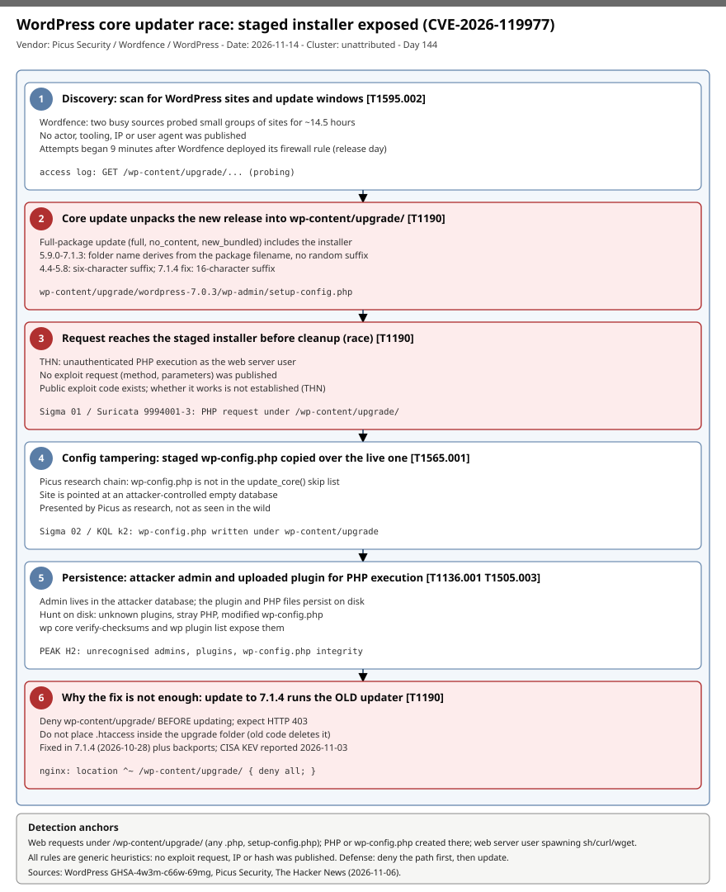

# WordPress core updater race (CVE-2026-119977): predictable wp-content/upgrade staging folder exposes the installer, exploited and on CISA KEV

## TL;DR

Picus Security researcher Umut Bayram disclosed a race condition in the WordPress core updater, fixed on 2026-10-28 in WordPress 7.1.4 (GHSA-4w3m-c66w-69mg, published 2026-10-29). During a full-package core update, WordPress unpacks the new release into `wp-content/upgrade/<package>/`, which includes the installer, and from 5.9.0 to 7.1.3 that folder name derives from the package filename with no random suffix. An unauthenticated attacker who reaches the staged installer before it is deleted can, per The Hacker News, run PHP as the web server user. CISA reportedly added the CVE to KEV in the week of 2026-11-03 and Wordfence saw attack attempts 9 minutes after deploying a firewall rule on release day. The unusual part is that installing the fix is itself exposed, because the update still runs the old, unpatched updater code.

## Attribution and confidence

- Cluster: none. Wordfence describes two busy sources probing small groups of sites for about 14.5 hours; no actor, tooling, IP or user agent was published.
- Discovery: Picus Security (Umut Bayram); fix by the WordPress project; attack telemetry by Wordfence; KEV listing by CISA. Dates: fix 2026-10-28, GHSA 2026-10-29, Picus page updated 2026-11-09, The Hacker News 2026-11-06.
- Confidence: **low** for any attribution; **medium** for exploitation (KEV listing plus Wordfence telemetry, while THN says public exploit code has "not been established" to work).
- Source discrepancy: the GHSA lists severity Low and "No known CVE"; the CVE-2026-119977 identifier and CVSS 8.1 come from Picus and THN. Picus describes a config-overwrite chain as its own research; THN describes direct PHP execution. Both are reported below as stated.

| Overlap | Observation |
|---|---|
| Genealogy | Earlier WordPress cases in this repo (Kirki account takeover, JCE for Joomla) were plugin or CMS-extension bugs; this one is in WordPress core's update path. |
| Actor overlap | None published. |

## Kill chain — summary table

| Stage | MITRE | Detail |
|---|---|---|
| Discovery of target | T1595.002 | Scanning for WordPress sites and update windows; Wordfence saw small-group probing for about 14.5 hours. |
| Wait for or trigger update | T1190 | A full-package core update unpacks into `wp-content/upgrade/<package>/` (5.9.0-7.1.3: name from the package filename). |
| Reach staged installer | T1190 | Request to `wp-content/upgrade/<package>/wp-admin/setup-config.php` before cleanup (race). |
| Config tampering (Picus chain) | T1565.001 | A `wp-config.php` written in the staging tree is copied over the live one by `update_core()`. |
| Persistence | T1136.001, T1505.003 | Admin account in the attacker database and an uploaded plugin for PHP execution (Picus research chain). |
| Execution | T1059.004 | PHP runs as the web server user (THN). |



The diagram uses one lane: the update window on the victim side, from staging to cleanup. Detection anchors are web requests into `/wp-content/upgrade/`, PHP or `wp-config.php` files appearing under that path, and web-server processes spawning shells.

## Stage-by-stage detail

### 1. Update staging

A core update with a `full`, `no_content` or `new_bundled` package extracts the new release into `wp-content/upgrade/`. Naming per Picus:

```text
2.7.0-2.7.1   wp-content/upgrade/core
2.8.0-4.3.35  name derived from the package filename (no random suffix)
4.4.0-5.8.18  six-character random suffix (exploitable only if the path leaks)
5.9.0-7.1.3   wp-content/upgrade/wordpress-7.0.3      (derived again, predictable)
7.1.4 fix     16-character random suffix added when the working directory is created
```

MITRE: T1190 Exploit Public-Facing Application.

### 2. Reaching the staged installer

The staged tree contains `wp-admin/setup-config.php`, `wp-config-sample.php` and `wp-settings.php`. Wordfence's published hunting guidance is requests to PHP files under `wp-content/upgrade`. No exploit request (method, parameters) was published.

### 3. Picus config-overwrite chain

Per Picus, `setup-config.php` in the staging tree only checks `wp-content/upgrade/<package>/wordpress/wp-config.php` and `<package>/wp-config.php`. Winning the race writes a `wp-config.php` into the staging tree; `update_core()` then copies it over the live file because `wp-config.php` is not in the skip list. The site then points at an attacker-controlled empty database, an admin is created and a plugin is uploaded for PHP execution. Picus presents this as its research chain, not as observed in the wild. MITRE: T1565.001, T1136.001, T1505.003.

### 4. Why the fix is not enough on its own

The update that installs 7.1.4 still extracts with the site's old code, so that first update stays exposed unless the path is blocked beforehand. The researcher quote in THN: whether the updater "already installed on the site has been fixed" decides exposure.

## Detection strategy

### Telemetry that matters

- Web access logs (nginx, Apache, IIS W3C, WAF/CommonSecurityLog): URI, status code, source IP.
- File telemetry on the web host: Defender for Endpoint `DeviceFileEvents` (Linux), auditd, inotify on `wp-content/upgrade` and `wp-config.php`.
- Process telemetry: web-server user spawning `sh`, `bash`, `curl`, `wget`.
- WordPress: `wp user list --role=administrator`, `wp plugin list`, `wp core verify-checksums`.

### Detection coverage

| Engine | File | Logic |
|---|---|---|
| Sigma | [01_web_request_php_under_wp_content_upgrade.yml](./sigma/01_web_request_php_under_wp_content_upgrade.yml) | Web request for `setup-config.php` or any PHP under `/wp-content/upgrade/`. |
| Sigma | [02_php_or_wp_config_created_under_wp_content_upgrade.yml](./sigma/02_php_or_wp_config_created_under_wp_content_upgrade.yml) | PHP or `wp-config.php` created under the staging path. |
| Sigma | [03_web_server_user_spawning_shell_or_downloader.yml](./sigma/03_web_server_user_spawning_shell_or_downloader.yml) | php-fpm/apache/nginx spawning shell or downloader. |
| KQL | [k1_web_requests_php_under_wp_content_upgrade.kql](./kql/k1_web_requests_php_under_wp_content_upgrade.kql) | Per-source-IP hourly aggregation of staging-path requests. |
| KQL | [k2_php_or_wp_config_writes_under_wp_content_upgrade.kql](./kql/k2_php_or_wp_config_writes_under_wp_content_upgrade.kql) | Staged or live `wp-config.php` changes and out-of-window PHP writes. |
| YARA | [wordpress_upgrade_staging_installer_and_small_php_shell_hunting.yar](./yara/wordpress_upgrade_staging_installer_and_small_php_shell_hunting.yar) | Generic installer and small PHP shell heuristics (not compiled, low confidence). |
| Suricata | [wordpress_upgrade_staging_requests_cve_2026_119977.rules](./suricata/wordpress_upgrade_staging_requests_cve_2026_119977.rules) | sids 9994001-9994003, generic URI heuristics (not tested, low confidence). |

All rules are generic hunting heuristics: the sources publish no exploit request, IP, hash or user agent.

### Threat hunting hypotheses

- **H1** — Requests to PHP under `/wp-content/upgrade/` exist in the web logs: [peak_h1](./hunts/peak_h1_web_log_requests_into_wp_content_upgrade.md).
- **H2** — Unrecognised admins, plugins or a modified `wp-config.php` exist after an update: [peak_h2](./hunts/peak_h2_unrecognised_admins_plugins_and_wp_config_integrity.md).
- **H3** — Sites on 5.9-7.1.3 are updating without denying the path: [peak_h3](./hunts/peak_h3_update_process_exposure_inventory.md).

## Incident response playbook

### First 60 minutes (triage)

1. Block web access to `wp-content/upgrade/` at the web server or WAF and confirm a 403.
2. Pull web logs since 2026-10-28 and search for requests under `/wp-content/upgrade/`.
3. Compare `wp-config.php` against a known-good copy (DB host, salts, mtime).
4. List administrators and plugins; flag anything nobody installed.
5. Look for PHP files under `wp-content/upgrade`, `wp-content/uploads` and `wp-content/plugins` newer than the last legitimate update.
6. Snapshot the host before cleaning.

### Artifacts to collect

| Artifact | Path | Tool | Why |
|---|---|---|---|
| Web access/error logs | `/var/log/nginx/`, `/var/log/apache2/` | cp, grep | Requests into the staging path and response codes. |
| wp-config.php | WordPress root | sha256sum, stat | Detect overwrite and DB host redirection. |
| Staging dir | `wp-content/upgrade/` | ls -laR | Leftover installer or dropped PHP. |
| Plugins and users | `wp-content/plugins/`, DB `wp_users` | wp-cli | Persistence from the Picus chain. |
| Auto-update log | WordPress update history | wp-cli | Establish the update window. |

### IR queries and commands

```bash
find /var/www -path '*/wp-content/upgrade/*' -name '*.php' -printf '%TY-%Tm-%Td %TH:%TM %p\n'
wp core verify-checksums --path=/var/www/html
wp user list --role=administrator --fields=ID,user_login,user_registered
wp plugin list --fields=name,status,version
grep -E '/wp-content/upgrade/.*\.php' /var/log/nginx/access.log* | awk '{print $1,$9,$7}' | sort | uniq -c | sort -rn | head
```

### Containment, eradication, recovery

- Exit criteria: path denied, `wp-config.php` matches known-good, no unknown admins or plugins, checksums clean, DB credentials and salts rotated if `wp-config.php` was touched.
- Do NOT rely on installing 7.1.4 alone while the old updater is in place; deny the path first, or update manually outside the web root as Picus describes.
- Do NOT put an `.htaccess` inside `wp-content/upgrade/` itself; the old code deletes it.

### Recovery validation

Request `/wp-content/upgrade/` and expect 403, run `wp core version` (7.1.4 or the backported fix for your branch), re-run checksums, and watch logs for 7 days.

## IOCs

No attacker IPs, domains, hashes, user agents or payloads were published. The full list is in [iocs.csv](./iocs.csv).

| Type | Value | Context | Confidence | Source |
|---|---|---|---|---|
| cve | CVE-2026-119977 | WordPress core updater race; CVSS 8.1 per Picus | medium | Picus, THN |
| path | /wp-content/upgrade/ | Staging directory; any PHP request here is suspicious | medium | THN, Picus |
| path | wp-admin/setup-config.php | Staged installer reached under the staging path | medium | Picus |
| path | wp-content/upgrade/wordpress-7.0.3 | Example predictable staging name (5.9.0-7.1.3) | medium | Picus |
| string | wp-config.php | Written in staging tree then copied over the live file (Picus chain) | low | Picus |
| note | No attacker infrastructure published | Do not block by IP from this feed | high | THN |

KEV: CISA reportedly added CVE-2026-119977 on 2026-11-03 (Picus; THN of 2026-11-06 says "earlier this week"). Analyst note: the local KEV cache is dated 2026-10-16 and was not verified against the live catalog, so the listing, remediation due date and ransomware-use flag are unconfirmed here.

## Secondary findings

- **Apache HTTP Server mod_http2 RCE (CVE-2026-119618).** A race in `assign_headers()` affecting 2.4.55-2.4.70, fixed in 2.4.71 on 2026-11-11, found by Anthropic's OSS Scanner and Google Cloud Vulnerability Research (SecurityWeek, 2026-11-12). Wiz reported no in-the-wild exploitation as of its post; a public PoC shows crashes and memory corruption but not RCE. Disabling HTTP/2 is a stopgap.
- **Patching tooling as attack surface.** The same lesson in two places: the component that applies fixes (WordPress updater) and the component that is fixed (mod_http2) both fail on concurrency, so test update paths like production paths.
- **Same-month Apache fixes.** The 2.4.71 release also fixes a mod_md NULL dereference and a mod_vhost_alias stack overflow, per the Apache advisory.

## Pedagogical anchors

- A race condition is an exposure window: shrink it (random names, delete early) and remove reachability (deny the path) instead of only fixing logic.
- The first patch can run old code. Always ask which version of the updater performs the update.
- Predictable temp names under a web-served directory are a recurring bug class; audit staging, upload and cache folders.
- When sources disagree on severity or CVE assignment (GHSA Low, Picus 8.1, KEV), record both and act on exploitation evidence.
- Hunt on what persists on disk when a chain's database side lives elsewhere.

## What's in this folder

| File | Purpose | Link |
|---|---|---|
| README.md | This write-up. | [README.md](./README.md) |
| kill_chain.svg | Single-lane update-window diagram. | [kill_chain.svg](./kill_chain.svg) |
| sigma/ | Three generic Sigma rules. | [sigma/](./sigma/) |
| kql/ | Two KQL hunting queries. | [kql/](./kql/) |
| yara/ | One file, two low-confidence rules. | [yara/](./yara/) |
| suricata/ | Three generic URI heuristics. | [suricata/](./suricata/) |
| hunts/ | Three PEAK hunts. | [hunts/](./hunts/) |
| iocs.csv | Indicator list (no attacker infrastructure published). | [iocs.csv](./iocs.csv) |
| kev.md | CISA KEV cross-reference for this case's CVEs. | [kev.md](./kev.md) |

## Sources

- [WordPress GHSA-4w3m-c66w-69mg](https://github.com/WordPress/wordpress-develop/security/advisories/GHSA-4w3m-c66w-69mg)
- [Picus Security — CVE-2026-119977: When updating WordPress becomes the vulnerability](https://www.picussecurity.com/resource/blog/cve-2026-119977-when-updating-wordpress-becomes-the-vulnerability)
- [The Hacker News — Installing the fix for an exploited WordPress flaw can expose some sites one last time](https://thehackernews.com/2026/11/installing-fix-for-exploited-wordpress.html)
- [SecurityWeek — Apache patches critical HTTP Server RCE found by Anthropic, Google](https://www.securityweek.com/apache-patches-critical-http-server-rce-found-by-anthropic-google/)
- [Apache HTTP Server 2.4 vulnerabilities](https://httpd.apache.org/security/vulnerabilities_24.html)
- [CISA Known Exploited Vulnerabilities Catalog](https://www.cisa.gov/known-exploited-vulnerabilities-catalog)
