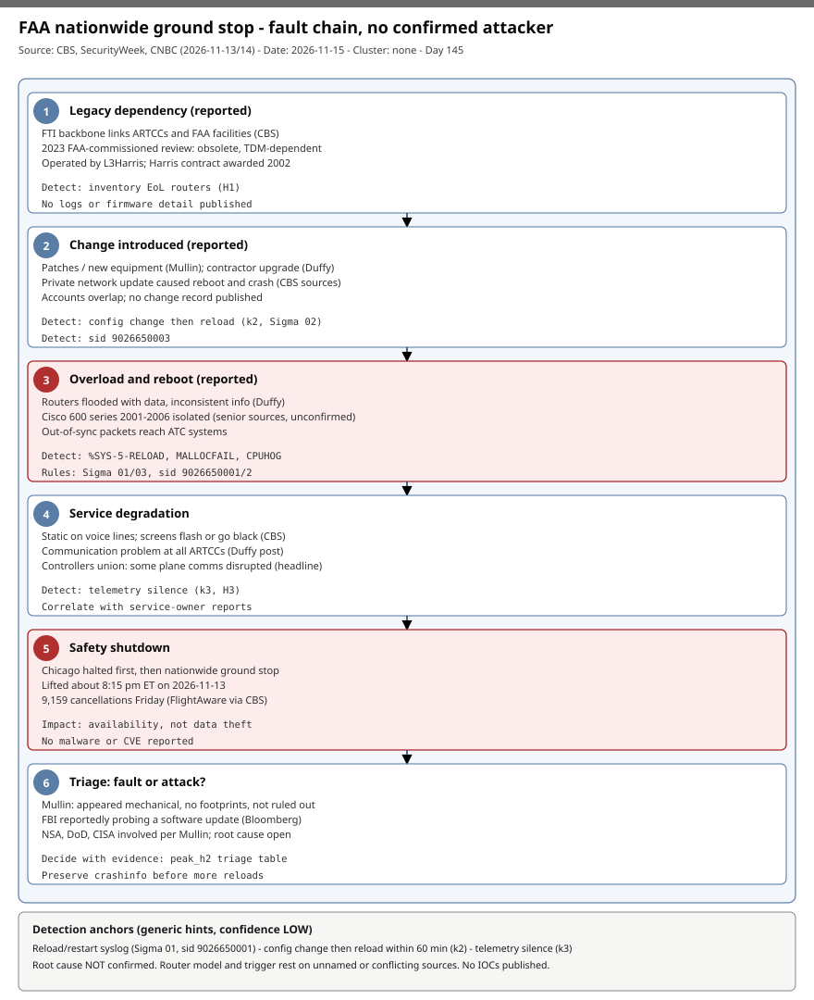

# FAA nationwide ground stop: a change-induced failure on legacy ATC network routers, and how to tell it from a cyberattack

## TL;DR

On Friday 2026-11-13 the FAA ordered a nationwide ground stop after a communication problem hit all Air Route Traffic Control Centers; the stop lasted more than four hours (CBS says about five) and cascaded into 9,159 cancellations that day per FlightAware via CBS. Officials say it was not a cyberattack: the Transportation Secretary blamed routers overloaded by data on an old system, and the Homeland Security Secretary said newly introduced patches and equipment appeared to overwhelm the legacy network. Senior sources cited by CBS point at Cisco 600 series routers (2001-2006) and at an update to the private network operated by L3Harris, but CBS also says sources conflict and no root cause is confirmed. This is a Day 145 case about the defender's side of an outage: no IOCs, CVEs or attacker TTPs exist, so the value is a repeatable triage method (change vs fault vs tampering), legacy-router inventory discipline and syslog-based early warning. Aviation (taxonomy #34) had gone 127 days without a primary case.

## Attribution and confidence

- **Cluster:** none. No threat actor is named by any source. Confidence that this was a non-malicious, change-induced failure: **medium** (consistent statements by two cabinet secretaries and reporting that the FBI does not believe a cyberattack or criminal activity caused it, but Mullin said they would not rule it out and the investigation is open).
- **Root cause:** NOT officially confirmed. Competing claims, all attributed: routers overloaded and giving inconsistent information (Duffy); new patches / equipment overwhelming old routers (Mullin); Cisco 600 series routers made 2001-2006 isolated by the FAA preliminary investigation (senior government sources via CBS); an update to the private communications network causing a reboot, crash and outage (unnamed sources via CBS); a contractor upgrade to an L3Harris telecommunication system (Duffy, per CNBC headline). L3Harris had not responded to CBS.
- **Ruled out by officials:** the Microsoft 365 outage earlier that week and the FAA's recently deployed AI systems (SecurityWeek, 2026-11-14).

| Claim | Source | Status |
|---|---|---|
| Routers overloaded, inconsistent data, system shut down | Duffy via CBS / SecurityWeek | Official statement, root cause not confirmed |
| New security patches overwhelmed old routers | Mullin via CBS | Official statement, hedged ("appeared") |
| Cisco 600 series routers (2001-2006) isolated | Senior government sources via CBS | Unnamed sources, preliminary |
| Private network update caused reboot and crash | Unnamed sources via CBS | CBS says sources conflict |
| FBI reportedly probing a software update; no cyberattack suspected | Bloomberg via SecurityWeek | Not read directly (robots.txt blocked) |

**Genealogy with previous repo cases:** none of the 144 earlier cases covers an ATC or FAA event. Closest in spirit is the Day 144 WordPress updater race (an update path that itself becomes the failure mode) and the OT availability cases such as the Day 137 refrigeration-controller wave; here the lesson is inverted, because nothing shows an adversary.

## Kill chain — summary table

There is no confirmed attacker, so the table is a **fault chain** reconstructed from reported statements. Every stage is "reported", none is verified by logs, and no MITRE technique is claimed.

| Stage | MITRE | Detail |
|---|---|---|
| 1. Legacy dependency | n/a | Aging backbone (FTI, TDM-dependent per a 2023 FAA-commissioned review via CBS) with old routers |
| 2. Change introduced | n/a | Patches / new equipment / contractor upgrade applied to the private network (reported) |
| 3. Overload and reboot | n/a | Routers overloaded, rebooted or crashed; out-of-sync packets reach ATC systems (reported) |
| 4. Service degradation | n/a | Static on voice lines, screens flashing or going black; communication problem at all ARTCCs |
| 5. Safety shutdown | n/a | Nationwide ground stop, Chicago halted first |
| 6. Triage and attribution | n/a | FAA, FBI, NSA, DoD, CISA reportedly involved; no cyberattack footprints found so far |



The diagram is a single-lane fault chain: the change, the overload on legacy routers, the symptoms operators saw, the safety shutdown and the triage question. The detection anchors are in the footer: unexpected reload/restart syslog, config change shortly before reload, and telemetry silence.

## Stage-by-stage detail

### 1. Legacy dependency

CBS reports that the FAA Telecommunications Infrastructure (FTI) connects ATC centers and FAA facilities, that Harris (now L3Harris) won the contract to modernize, operate and manage it in July 2002, and that a November 2023 FAA-commissioned safety review called it obsolete and dependent on TDM, warning that an unexpected failure could disconnect individual facilities or a whole regional center. Duffy called the ATC system incredibly old and asked Congress for emergency modernization funding.

### 2. Change introduced

Mullin said new security patches and new equipment introduced into the older system appeared to overwhelm it. Other unnamed sources told CBS that an update to the private network caused a reboot and crash. Duffy tied the stop to a contractor upgrade to an L3Harris telecommunication system (CNBC headline, 2026-11-14). These accounts overlap but are not identical, and none comes with a change record.

### 3. Overload and reboot

Duffy said switches and routers were flooded with data and began producing inconsistent information. Senior sources cited by CBS said the problem was limited to Cisco 600 series routers manufactured 2001-2006, which were identified and isolated, and that they fed out-of-sync packets into ATC systems. No firmware version, configuration, log line or packet detail was published.

### 4. Service degradation

Per CBS, the overloaded routers caused static on voice lines and screens to flash or go black. SecurityWeek quotes the FAA as describing a communication issue affecting all Air Route Traffic Control Centers. The controllers' union chief said communications with some planes were disrupted (reported in a live-blog headline, not read in full).

### 5. Safety shutdown

The FAA halted traffic in Chicago, then issued the nationwide ground stop for departing flights (inbound international flights handled case by case per SecurityWeek). It was lifted at about 8:15 pm ET. FlightAware via CBS: 9,159 cancellations and 7,190 delays on Friday; more than 3,800 cancellations on Saturday. The previous nationwide stop was in January 2023 (a contractor deleted files on the NOTAM system; no cyberattack found).

### 6. Triage and attribution

Mullin: the incident did not appear to be a cyberattack, "appeared to be mechanical", "we haven't seen any footprints", but they were still looking. Bloomberg (via SecurityWeek) reported the FBI is examining a software update and does not think a cyberattack or crime caused it; NSA, DoD and CISA are involved per Mullin. This is the decision the hunts in this folder try to make fast and with evidence.

## Detection strategy

**Honesty note:** the FAA logs are unpublished. Everything below uses generic Cisco IOS syslog mnemonics as hunting hints (confidence LOW). None of it reproduces what the FAA saw, and no claim is made about which messages a Cisco 600 series router emits.

### Telemetry that matters

- Network device syslog (Cisco IOS mnemonics `%SYS-5-RELOAD`, `%SYS-5-RESTART`, `%SYS-5-CONFIG_I`, `%SYS-2-MALLOCFAIL`, `%SYS-3-CPUHOG`, `%SYS-2-WATCHDOG`) in the Sentinel `Syslog` table or any collector.
- AAA / TACACS+ / RADIUS logs and the change-management system (to separate approved change from tampering).
- SNMP / NetFlow / interface counters, to see traffic floods and loss of polling.
- Crashinfo files and `show tech-support` captures from affected devices.
- Voice and data path quality metrics from the service owner (static, dropped calls, console blackouts).

### Detection coverage

| Engine | File | Logic |
|---|---|---|
| Sigma | [01_network_device_unexpected_reload_or_restart.yml](./sigma/01_network_device_unexpected_reload_or_restart.yml) | Reload / restart / logging-host start-stop syslog keywords |
| Sigma | [02_network_device_configuration_change.yml](./sigma/02_network_device_configuration_change.yml) | `%SYS-5-CONFIG_I` "Configured from" messages |
| Sigma | [03_network_device_resource_exhaustion_crash_precursors.yml](./sigma/03_network_device_resource_exhaustion_crash_precursors.yml) | MALLOCFAIL / CPUHOG / WATCHDOG and link flap precursors |
| KQL | [k1_syslog_reload_restart_burst_per_device_and_site.kql](./kql/k1_syslog_reload_restart_burst_per_device_and_site.kql) | 15-minute buckets, local vs fleet-wide reload bursts |
| KQL | [k2_syslog_config_change_followed_by_reload_60m.kql](./kql/k2_syslog_config_change_followed_by_reload_60m.kql) | Config change then reload or crash on the same host within 60 minutes |
| KQL | [k3_syslog_network_device_telemetry_silence.kql](./kql/k3_syslog_network_device_telemetry_silence.kql) | Devices that were logging and went silent |
| YARA | [cisco_ios_crash_reload_triage_evidence.yar](./yara/cisco_ios_crash_reload_triage_evidence.yar) | Triage of collected crashinfo / show-tech text, not malware |
| Suricata | [faa_fti_router_update_failure_syslog_hints.rules](./suricata/faa_fti_router_update_failure_syslog_hints.rules) | sids 9026650001-9026650003: syslog on UDP/TCP 514 carrying reload, crash-precursor and config-change mnemonics |

### Threat hunting hypotheses

- **H1** — a legacy router population we depend on cannot absorb patch or update load and lacks maintenance-window gating: [peak_h1_legacy_router_inventory_and_maintenance_window_gating.md](./hunts/peak_h1_legacy_router_inventory_and_maintenance_window_gating.md).
- **H2** — a reload or crash with no approved change and no AAA anomaly is tampering or hardware fault, not a failed change: [peak_h2_change_vs_fault_vs_adversary_triage.md](./hunts/peak_h2_change_vs_fault_vs_adversary_triage.md).
- **H3** — telemetry silence and voice/data degradation precede or accompany a backbone failure and can be correlated early: [peak_h3_telemetry_gap_and_voice_data_path_degradation.md](./hunts/peak_h3_telemetry_gap_and_voice_data_path_degradation.md).

## Incident response playbook

The playbook is written for the owner of a backbone that just failed with no known cause. The first goal is to decide within the first hour whether this is a failed change, a capacity or hardware fault, or tampering, because the containment actions differ.

### First 60 minutes (triage)

1. Declare the incident on availability grounds and freeze all further changes to the affected network (no "one more patch").
2. Pull the change calendar and the contractor work log for the last 72 hours: what was patched, upgraded or installed, by whom, on which devices.
3. List the devices that reloaded, crashed or went silent, and map them by site, model and software image. Look for one model or one image concentrated in the failures.
4. Check AAA / TACACS+ logs for logins, config writes and privilege changes around the first failure; no unexplained access supports a change or fault theory, it does not prove it.
5. Preserve volatile evidence before further reloads: `show logging`, `show tech-support`, crashinfo, interface counters and a packet capture on an uplink of one failing device.
6. Isolate the suspect device class (as the FAA reportedly did) and move traffic to an alternate path if one exists; document each action with a timestamp.
7. Tell the service owner in plain terms what is known and unknown; avoid declaring "no cyberattack" or "cyberattack" before evidence supports either.

### Artifacts to collect

| Artifact | Path | Tool | Why |
|---|---|---|---|
| Device syslog and buffer | Collector store and `show logging` output | SIEM export, CLI | Order of reload, crash and config events |
| Crashinfo / core files | Device flash (`crashinfo*`) | TFTP/SCP to evidence host | Crash reason and traceback |
| `show tech-support`, `show version` | CLI capture | Terminal logging | Image, uptime, last reload reason |
| Running and startup config | Device and config archive | Archive diff | Unplanned changes |
| AAA / TACACS+ logs | AAA server | Server export | Who touched what |
| Change tickets and vendor work log | ITSM / contractor system | Export | Approved scope vs observed activity |
| NetFlow / SNMP history | NMS | Export | Flood or loss pattern before failure |
| Packet capture on uplinks | SPAN/TAP | tcpdump / Wireshark | Out-of-sync or flooding traffic |

### IR queries and commands

```bash
# Author: Jarmi
# On a collected show-tech or crashinfo text file: last reload reason and traceback hints
grep -nE 'System returned to ROM by|System restarted at|Traceback=|%SYS-2-MALLOCFAIL|%SYS-3-CPUHOG|%SYS-2-WATCHDOG' show_tech.txt
```

```kql
// Author: Jarmi
// Reloads per device in the last 24h from forwarded Cisco syslog (adapt to your collector)
Syslog
| where TimeGenerated > ago(24h)
| where SyslogMessage has_any ("%SYS-5-RELOAD", "%SYS-5-RESTART")
| summarize Reloads = count(), First = min(TimeGenerated), Last = max(TimeGenerated) by HostName
| order by Reloads desc
```

The folder queries [k1](./kql/k1_syslog_reload_restart_burst_per_device_and_site.kql), [k2](./kql/k2_syslog_config_change_followed_by_reload_60m.kql) and [k3](./kql/k3_syslog_network_device_telemetry_silence.kql) extend this to site bursts, change-then-reload correlation and telemetry silence.

### Containment, eradication, recovery

- **Exit criteria:** failing device class isolated or rolled back; no unexplained reloads for a full traffic cycle; AAA and config diff reviewed with no unexplained change; service owner confirms voice and data quality.
- **Roll back before rolling forward:** restore the last known-good image and config on a small canary group, then widen; never push the same update to the whole fleet again during recovery.
- **What NOT to do:** do not reload devices in bulk before capturing crashinfo and logs; do not apply further patches while the cause is unknown; do not publicly rule a cyberattack in or out before evidence exists; do not wipe configs of isolated devices.

### Recovery validation

Compare running configs against the archive, confirm the software image on every restored device, replay a synthetic voice/data test across each path, watch k1 and k3 for 72 hours, and run a post-incident review that adds a change-gating control (maintenance window, canary, rollback plan) for the legacy device class.

## IOCs

No indicators were published for this incident: no hashes, IPs, domains, malware, CVEs or attacker infrastructure. Nothing in the IOC feed should be treated as an indicator of compromise.

| Type | Value | Context | Confidence | Source |
|---|---|---|---|---|
| note | No network or host IOCs published | Officials report no indication of a cyberattack; the FAA router logs are unpublished | high | [SecurityWeek](https://www.securityweek.com/no-signs-of-hacking-in-faa-ground-stop-as-fbi-reportedly-probes-software-update/) |
| note | Root cause not officially confirmed | CBS says sources give conflicting information | high | [CBS News](https://www.cbsnews.com/news/faa-issues-nationwide-ground-stop/) |
| note | Reported device class: Cisco 600 series routers made 2001-2006 | Senior government sources via CBS, preliminary, unconfirmed | low | [CBS News](https://www.cbsnews.com/news/faa-issues-nationwide-ground-stop/) |
| note | Reported network: FAA Telecommunications Infrastructure (FTI), operated by L3Harris | CBS reporting; L3Harris had not responded | medium | [CBS News](https://www.cbsnews.com/news/faa-issues-nationwide-ground-stop/) |
| string | %SYS-5-RELOAD | Generic Cisco IOS reload mnemonic used as a hunting hint, not derived from the incident | low | [CBS News](https://www.cbsnews.com/news/faa-issues-nationwide-ground-stop/) |
| string | %SYS-5-CONFIG_I | Generic Cisco IOS config-change mnemonic used as a hunting hint | low | [CBS News](https://www.cbsnews.com/news/faa-issues-nationwide-ground-stop/) |

KEV: no CVE is associated with this case, so no `kev.md` was generated and nothing is on the CISA KEV catalog for it. The full list is in [iocs.csv](./iocs.csv).

## Secondary findings

- **Aviation targeting by an Iranian APT (context from May 2026, not new):** Check Point reported (via SecurityWeek, 2026-05-26) that Nimbus Manticore (aliases Bohrium, Smoke Sandstorm, TA455, UNC1549) targeted aviation and software companies with updated tooling such as MiniJunk and MiniFast and AppDomain hijacking. SecurityWeek published no IOCs; the vendor report was not read. It is useful as a reminder that real adversary activity against aviation exists, separate from this outage.
- **Concurrent Microsoft 365 outage:** SecurityWeek reported an Outlook, Exchange Online and Teams outage earlier in the same week; officials said it was unrelated to the FAA stop. Two simultaneous public outages are exactly when attribution rumors spread, so keep evidence-based triage ahead of narrative.
- **Precedent:** the January 2023 nationwide ground stop followed a contractor deleting files on the NOTAM system, and no cyberattack was found. Both nationwide stops involved a maintenance action on aging systems rather than an adversary, per SecurityWeek and CBS.

## Pedagogical anchors

- Availability incidents are incidents: treat an unexplained backbone failure with the same evidence discipline as an intrusion, and do not let either "it is a hack" or "it is just a glitch" decide the response before logs do.
- Change is the most common cause of outage; correlating config changes with reloads inside a short window (k2) is the cheapest triage that separates a failed update from tampering.
- Legacy devices have no headroom: an end-of-life router that works at steady state may fail under update or load, so inventory them, gate maintenance windows and test rollbacks on a canary first.
- Telemetry loss is itself a signal: if devices stop logging, alert on the silence (k3) rather than waiting for users to report static on voice lines.
- Keep claims attributed. In this case the router model, the vendor role and the trigger all rest on unnamed or conflicting sources, and the right output is a confidence statement, not a story.

## What's in this folder

| File | Purpose | Link |
|---|---|---|
| README.md | This analysis. | [README.md](./README.md) |
| kill_chain.svg | Single-lane fault chain diagram with detection anchors. | [kill_chain.svg](./kill_chain.svg) |
| sigma/ | Three Sigma rules for reload, config-change and crash-precursor syslog. | [sigma/](./sigma/) |
| kql/ | Three Sentinel Syslog queries for bursts, change-then-reload and telemetry silence. | [kql/](./kql/) |
| yara/ | Triage rules for collected crashinfo / show-tech text. | [cisco_ios_crash_reload_triage_evidence.yar](./yara/cisco_ios_crash_reload_triage_evidence.yar) |
| suricata/ | Three syslog-content rules (sids 9026650001-3). | [faa_fti_router_update_failure_syslog_hints.rules](./suricata/faa_fti_router_update_failure_syslog_hints.rules) |
| hunts/ | Three PEAK hunts H1-H3. | [hunts/](./hunts/) |
| iocs.csv | Notes and generic hint strings; no real indicators exist. | [iocs.csv](./iocs.csv) |

## Sources

- [FAA Ground Stop Issued Due to 'Extraordinary Circumstances' - SecurityWeek](https://www.securityweek.com/faa-ground-stop-issued-due-to-extraordinary-circumstances/)
- [No Signs of Hacking in FAA Ground Stop as FBI Reportedly Probes Software Update - SecurityWeek](https://www.securityweek.com/no-signs-of-hacking-in-faa-ground-stop-as-fbi-reportedly-probes-software-update/)
- [FAA issues nationwide ground stop - CBS News](https://www.cbsnews.com/news/faa-issues-nationwide-ground-stop/)
- [Nationwide ground stop followed contractor upgrade to L3Harris telecommunication system - CNBC](https://www.cnbc.com/2026/11/14/faa-ground-stop-flights-resume-delays.html)
- [FAA blames Friday's ground stop on 'equipment issue' during telecoms network upgrade - NPR](https://www.npr.org/2026/11/14/nx-s1-6040952/faa-ground-stop-airplane-travel)
- [Iranian APT Targets Aviation, Software Companies With Updated Tools - SecurityWeek](https://www.securityweek.com/iranian-apt-targets-aviation-software-companies-with-updated-tools/)
