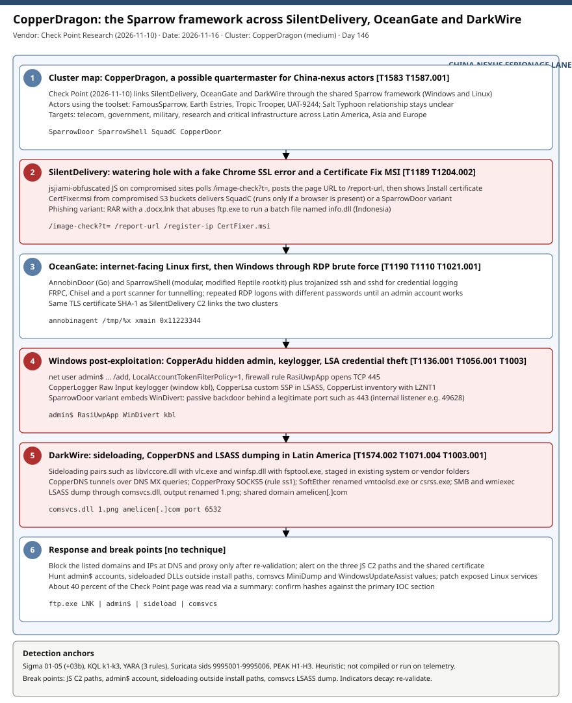

# CopperDragon's Sparrow framework: three China-nexus clusters (SilentDelivery, OceanGate, DarkWire) share one toolset against telecom, government and research targets

## TL;DR

On 2026-11-10 Check Point Research published a report on CopperDragon, a possible "digital quartermaster" whose Sparrow framework (SparrowDoor, SparrowShell, SquadC and the Copper* tools) is used by several China-nexus actors against telecom, government, military and research organizations in Latin America, Asia and Europe. Three clusters are described: SilentDelivery (watering holes with a fake Chrome certificate warning, 2026), OceanGate (Linux-first intrusions moving to Windows over RDP, 2025-2026) and DarkWire (telecom and government in Latin America, from mid-2025). The case matters today because it hands defenders durable behavioural anchors (JS C2 paths, the `admin$` account, sideloading pairs, `comsvcs.dll` LSASS dumps) rather than only hashes that will age. About 40 percent of the Check Point page was read through a model-extracted summary, so hashes, domains and IPs carry medium confidence.

## Attribution and confidence

- **Cluster:** CopperDragon (umbrella codename; assessed as a possible supplier of tools to China-nexus actors). Related names used by vendors: FamousSparrow, Earth Estries, Tropic Trooper, UAT-9244 (and UAT-8302 per The Hacker News). ESET told The Hacker News that DarkWire matches what it calls FamousSparrow (tooling, infrastructure, victimology overlap).
- **Vendor / date:** Check Point Research, 2026-11-10; The Hacker News (Ravie Lakshmanan), 2026-11-10; Positive Technologies (August 2026) for part of SilentDelivery.
- **Confidence:** `medium`. Check Point uses hedged language ("potential", "we assess"); it states that shared backdoors or C2 do not necessarily mean the same operator, and that the relationship to Salt Typhoon remains unclear.

| Overlap candidate | Relation | Evidence |
|---|---|---|
| FamousSparrow | Same SparrowDoor lineage; SilentDelivery reuses its DLL loader, server layout, ports, HTTP banners and a TLS certificate | Check Point; ESET comment via The Hacker News |
| Earth Estries, Tropic Trooper, UAT-9244 | Listed as users of the same tooling | Check Point |
| Salt Typhoon | Some overlap; relationship unclear | Check Point; The Hacker News |
| Melofee | SparrowShell shares Reptile-based rootkit code, hide/show arguments and self-signed certificates with fake DNS-server CNs | Check Point ("we assess") |

Genealogy: the repo holds no earlier Sparrow, FamousSparrow or CopperDragon case. The closest prior espionage entry is 2026-11-09 BITTER, which also abuses `ftp.exe` from an LNK; here the batch script hides in a file named `info.dll` and the payload is SquadC.

## Kill chain — summary table

| Stage | MITRE | Detail |
|---|---|---|
| 1. Cluster map | T1583, T1587.001 | One toolset, several operators; CopperDragon is the shared supplier hypothesis. |
| 2. SilentDelivery | T1189, T1204.002 | Compromised sites show a fake Chrome SSL error; "Certificate Fix" MSI installs SquadC or SparrowDoor. |
| 3. OceanGate | T1190, T1110, T1021.001 | Internet-facing Linux server, AnnobinDoor and SparrowShell, credential logging, RDP brute force to Windows. |
| 4. Windows post-exploitation | T1136.001, T1056.001, T1003 | CopperAdu hidden admin, keylogger, LSA SSP, WinDivert passive backdoor. |
| 5. DarkWire | T1574.002, T1071.004, T1003.001 | Sideloaded CopperLoader and CopperDoor, DNS MX tunnelling, SOCKS5 proxy, LSASS dump. |
| 6. Break points | none | DNS and proxy blocks after re-validation, behaviour hunts, Linux patching. |



The diagram is a single lane because the three clusters converge on the same Windows post-exploitation steps; red-bordered stages are the highest-value detection points. Anchors are the three JS C2 paths, the `admin$` account and `RasiUwpApp` firewall rule, sideloading outside install paths, and `comsvcs.dll` LSASS dumping.

## Stage-by-stage detail

### 1. SilentDelivery (Europe and Asia, from early 2026)

Obfuscated JavaScript (jsjiami) injected into compromised government, shipping, IT and research sites checks for Windows, polls a C2 and, if the visitor qualifies, replaces the page with a fake Google Chrome SSL error and an "Install certificate" button. The download is `CertFixer.msi`, hosted on three S3 buckets Check Point believes were compromised (names not published); it delivers SquadC or a SparrowDoor variant. Telemetry countries: Czech Republic, Germany, France, Taiwan, Nepal, Hong Kong, Indonesia; Positive Technologies suggests Egypt and the Philippines.

```text
GET  /image-check?t=<datetime>      polling; HTTP 200 leaves the page alone
POST /report-url                    JSON {url: window.location.href} on button click
     /register-ip                   sent by the backdoor after execution
```

SquadC is a C/C++ three-stage in-memory loader with anti-sandbox checks; it runs only when a browser process (`chrome.exe`, `msedge.exe`, `edge.exe`, `firefox.exe`, `brave.exe`) is present and persists through a value named `WindowsUpdateAssist`. MITRE: T1189, T1204.002, T1547.001.

Phishing variant (Indonesia): `Strategi_AS_Referensi_April2026.rar` holds `Strategi_AS_Referensi_April2026.docx.lnk` (abuses `ftp.exe`), `_rels/info.dll` (a batch script, not a DLL), `_rels/.rels.log` (CAB with the SquadC loader) and `_rels/557.pdf` (empty decoy). MITRE: T1566.001, T1218, T1059.003.

### 2. OceanGate (mainly Asia, 2025-2026)

Initial access is through internet-facing Linux servers (the exploited weakness is not named). The Linux phase deploys AnnobinDoor (UPX-packed Go backdoor, internal name `annobinagent`, WebSocket by default) and SparrowShell (modular; plugins decrypted to `/tmp/%x`, loaded with `dlopen`, run through `xmain`, then deleted; magic `0x11223344`; modified Reptile rootkit loaded through `init_module`, ioctl `0x0e0e0e0e`). Trojanized `ssh` and `sshd` log credentials; FRPC, Chisel and ASimplePortScanner provide tunnelling and discovery. Operators then brute-force RDP on Windows with different passwords until an administrator account authenticates. MITRE: T1190, T1014, T1556, T1090, T1110, T1021.001.

### 3. Windows post-exploitation (OceanGate)

```text
net user admin$ "Admin@123456" /add /expires:never /passwordchg:no     CopperAdu (adu.exe)
LocalAccountTokenFilterPolicy=1 ; LanmanServer + LanmanWorkstation started
firewall rule "RasiUwpApp" opens TCP 445
```

CopperLogger is a Raw Input keylogger (hidden window `kbl`, captures window titles, process paths and clipboard); CopperLsa installs a custom SSP in LSASS and collects NTLM and Kerberos material to a log file; CopperList inventories hosts, disks and files with LZNT1 compression. A SparrowDoor variant embeds WinDivert drivers for a "passive" backdoor: traffic to a legitimate port such as 443 is redirected to an internal listener (example 49628) and only packets from a specific source IP carrying the magic are queued as commands. MITRE: T1136.001, T1056.001, T1003, T1572.

### 4. DarkWire (Latin America, from mid-2025)

CopperLoader (reflective loader, RC4 `.dat` next stage, stripped PE headers) runs through DLL sideloading and delivers CopperDoor (in-memory modular backdoor with call-stack spoofing; ESET calls it SparroWocky), CopperDNS (C2 over DNS MX queries), CopperProxy (SOCKS5, firewall rule `ss1`, up to 300 clients), PyProxy (PyInstaller UDP relay) and CopperLsass. Operators avoid creating new directories and use existing system or vendor paths. SoftEther VPN is renamed `vmtoolsd.exe` or `csrss.exe`; lateral movement uses SMB and `wmiexec`. LSASS is dumped through `comsvcs.dll` and `dep.dll` with custom encryption, and the output is renamed `1.png`. MITRE: T1574.002, T1071.004, T1090, T1003.001, T1036.005, T1047.

```text
Sideloading pairs (DLL / host EXE):
  ncpmif32.dll / ncptrcw.exe     winfsp.dll / fsptool.exe     libvlccore.dll / vlc.exe
  DukeQt.dll / gethwid.exe       zCrashReport64.dll / zCrashReport64.exe
Staging folders:
  C:\Program Files\7-Zip\Lang  C:\Windows\debug  C:\ProgramData\vmware\logs
  C:\ProgramData\Oracle\Java   C:\ProgramData\USOShared  C:\ProgramData\Waves
```

## RE notes

| Component | SHA256 | Lang | Packer | Notes |
|---|---|---|---|---|
| AnnobinDoor (`containerd-demo`) | `46407cc35c48d19c6b1990a03ebdd19321005ce08d5a98acd168fda55a92d946` | Go | UPX | Shell, file management, SOCKS, SSH tunnelling, port forwarding; WebSocket, HTTP or raw TCP. |
| SparrowShell (`xfs_rudp`) | `2ea96ea398e9254706ff2761b86302372c149ef090536ad76231e51d7c810a2a` | C | n/a | Shares C2 and RC4 keys with SparrowDoor; 228-byte config saved as `<executable>_`; command IDs 0x1001-0x100E. |
| CopperAdu (`adu.exe`) | `40880b6fce6f83df4e902cd29d7abb303ffa3f37c429c382f2aaeea34f7be074` | n/a | n/a | Hidden admin creation with hardcoded credentials. |
| SquadC | loaders in `iocs.csv` | C/C++ | three-stage in-memory | Anti-sandbox (VM artefacts, MACs, resolution, disk size); command IDs 0x2 dir, 0x3 delete, 0x4 write, 0x5 exec, 0x6 systeminfo, 0x7 screenshot, 0x8 status, 0xA background exec. |

Hashes come from the summarised part of the page and are medium confidence; verify against the primary IOC section.

## Detection strategy

### Telemetry that matters

- Sysmon EID 1 (process creation: `ftp.exe`, `net.exe`, `netsh.exe`, `rundll32.exe` with `comsvcs.dll`), EID 7 (image load of sideloaded DLLs), EID 13 (registry value `WindowsUpdateAssist`), EID 11, EID 3, EID 22 (DNS).
- Windows Security 4720, 4732 and 4625 bursts on RDP (logon type 10) for the `admin$` account and brute force.
- Defender XDR: `DeviceProcessEvents`, `DeviceImageLoadEvents`, `DeviceRegistryEvents`, `DeviceNetworkEvents`, `DeviceLogonEvents`.
- Linux: auditd on `/tmp` execution and `init_module`, sshd binary integrity, web proxy logs for the JS C2 paths.

### Detection coverage

| Engine | File | Logic |
|---|---|---|
| Sigma | `sigma/01_copperdragon_silentdelivery_ftp_exe_rar_lnk_chain.yml` | `ftp.exe` LNK chain with batch-in-`.dll` or `Strategi_AS_*` names. |
| Sigma | `sigma/02_copperdragon_copperadu_admin_dollar_account_and_firewall_rule.yml` | `net user admin$ /add`, firewall rules `RasiUwpApp` / `ss1`. |
| Sigma | `sigma/03_copperdragon_darkwire_sideload_host_exe_with_dll_outside_system_paths.yml` | Known sideloading pairs loaded from non-standard paths. |
| Sigma | `sigma/03b_copperdragon_darkwire_renamed_softether_vmtoolsd_csrss_outside_system_paths.yml` | Renamed SoftEther running outside System32 / VMware paths. |
| Sigma | `sigma/04_copperdragon_lsass_dump_comsvcs_minidump_png_output.yml` | `comsvcs.dll` MiniDump or `1.png` output. |
| Sigma | `sigma/05_copperdragon_squadc_windowsupdateassist_run_value.yml` | Registry value named `WindowsUpdateAssist`. |
| KQL | `kql/k1_mde_silentdelivery_ftp_exe_lnk_and_certfixer_msi.kql` | `ftp.exe` LNK chain and CertFixer MSI. |
| KQL | `kql/k2_mde_campaign_domains_and_ips_90d.kql` | Campaign domains, IPs and port 6532 hint over 90 days. |
| KQL | `kql/k3_mde_copperadu_account_firewall_and_lsass_dump.kql` | Hidden admin, firewall rule and LSASS dump. |
| YARA | `yara/copperdragon_sparrow_artifacts.yar` | 3 heuristic string rules (JS injector, Windows tooling, Linux backdoors); low confidence, not compiled. |
| Suricata | `suricata/copperdragon_infrastructure.rules` | sids 9995001-9995006: SNI, DNS, JS C2 paths, shared certificate, IPs; not compiled. |

### Threat hunting hypotheses

- **H1:** a user reached a compromised site and ran a fake "Certificate Fix" MSI or an LNK that abuses `ftp.exe` — [peak_h1](./hunts/peak_h1_silentdelivery_fake_cert_fix_and_ftp_exe_lnk.md).
- **H2:** a Linux server exposed to the internet runs SparrowShell or AnnobinDoor and the actor pivoted to Windows with an `admin$` account — [peak_h2](./hunts/peak_h2_oceangate_linux_sparrowshell_and_rdp_to_admin_dollar.md).
- **H3:** a legitimate EXE loads a sideloaded DLL from a vendor folder, DNS MX volume is abnormal and LSASS was dumped — [peak_h3](./hunts/peak_h3_darkwire_sideloading_copperdns_and_lsass_dump.md).

## Incident response playbook

### First 60 minutes (triage)

1. Isolate hosts with an `admin$` account, `RasiUwpApp` rule or a `WindowsUpdateAssist` value; keep memory (the loaders are reflective and in-memory).
2. Capture volatile data on Linux hosts before reboot: `/tmp/%x`-style files, running `sshd`, loaded modules.
3. Pull RDP logon history (4624 type 10, 4625) and local account creations (4720) for the last 90 days.
4. Search proxy and DNS for the JS C2 paths, domains and IPs in `iocs.csv`, treating hits as leads, not proof.
5. Reset credentials for any account that logged on to an affected host; assume LSASS was dumped.

### Artifacts to collect

| Artifact | Path | Tool | Why |
|---|---|---|---|
| Local accounts | `SAM` / `net user` | KAPE, PowerShell | Find `admin$` and hidden users. |
| Registry Run keys | `HKCU/HKLM\...\Run` | RECmd | `WindowsUpdateAssist` persistence. |
| Firewall rules | `HKLM\SYSTEM\CurrentControlSet\Services\SharedAccess\Parameters\FirewallPolicy` | RECmd | `RasiUwpApp`, `ss1`. |
| Sideloading candidates | staging folders listed above | MFTECmd | DLL created outside install time. |
| Linux binaries | `/usr/sbin/sshd`, `/usr/bin/ssh`, `/tmp` | package verify, YARA | Trojanized SSH, SparrowShell plugins. |

### IR queries and commands

```powershell
# Author: Jarmi
Get-LocalUser | Where-Object { $_.Name -like '*$' -and $_.Enabled } | Select-Object Name, LastLogon
Get-NetFirewallRule | Where-Object { $_.DisplayName -in 'RasiUwpApp','ss1' }
Get-ItemProperty 'HKLM:\Software\Microsoft\Windows\CurrentVersion\Run','HKCU:\Software\Microsoft\Windows\CurrentVersion\Run' | Select-Object *WindowsUpdateAssist*
```

```bash
# Author: Jarmi
rpm -Va openssh-server openssh-clients 2>/dev/null || debsums -c openssh-server openssh-client 2>/dev/null
ls -la /tmp | head -50; lsmod | head -50
```

### Containment, eradication, recovery

Exit criteria: no `admin$` account, no unexplained firewall rules, sideloaded DLLs removed, SSH binaries reinstalled from trusted packages, all exposed credentials rotated and the exposed Linux service patched or removed. Do not reboot Linux hosts before memory capture (the rootkit hides processes and modules) and do not trust the host's own `ls` or `ps` output.

### Recovery validation

Re-run the hunts for 30 days; confirm no further DNS MX bursts, RDP brute force or LSASS access events; rebuild rather than clean any host where a kernel component (Reptile-based module, WinDivert driver) was seen.

## IOCs

| Type | Value | Context | Confidence | Source |
|---|---|---|---|---|
| domain | microsfot[.]vip | SilentDelivery campaign domain | medium | Check Point |
| domain | microscoft[.]vip | SilentDelivery campaign domain | medium | Check Point |
| domain | aistei[.]com | SilentDelivery campaign domain | medium | Check Point |
| domain | astorialaza[.]com | SilentDelivery campaign domain | medium | Check Point |
| domain | amelicen[.]com | Shared SparrowDoor C2 and CopperDNS domain | medium | Check Point |
| ipv4 | 135.136.135[.]54 | SilentDelivery infrastructure (6 more in csv) | medium | Check Point |
| string | 760be920fad07881b8ce9d94e074a35b4f806717 | Shared TLS certificate SHA-1 | medium | Check Point |
| string | /image-check?t= | JS polling path | medium | Check Point |
| string | /report-url | JS POST path | medium | Check Point |
| string | WindowsUpdateAssist | SquadC persistence value name | medium | Check Point |
| string | RasiUwpApp | CopperAdu firewall rule | medium | Check Point |
| string | annobinagent | AnnobinDoor internal name | medium | Check Point |
| sha256 | 40880b6fce6f83df4e902cd29d7abb303ffa3f37c429c382f2aaeea34f7be074 | adu.exe CopperAdu | medium | Check Point |
| sha256 | 9fa421adb5c5dac3b2fc1165b0dddd596e82cfd3b08347a91d63f9e88d8718d0 | g.exe CopperLsa | medium | Check Point |
| path | Strategi_AS_Referensi_April2026.rar | Indonesian phishing archive | medium | Check Point |

Full list (62 rows) in [iocs.csv](./iocs.csv). The source cites no CVEs, so there is no KEV cross-reference and no `kev.md`. Indicators decay; re-validate before blocking.

## Secondary findings

- **Source-shape risk:** Check Point's own caveat that shared backdoors or C2 do not prove one operator means hunting should key on tool behaviour, not on a named actor.
- **WinDivert passive backdoors:** listening behind a legitimate port with source-IP gating defeats port-based inventory; look for WinDivert drivers loaded by non-network tools.
- **The Hacker News also notes** the link to a Reptile-based Linux rootkit (Melofee, ExaTrack, 2023), so Linux rootkit hunting belongs in the scope for Windows-centric shops with Linux edge servers.

## Pedagogical anchors

- A shared toolset is a supply relationship, not an attribution: detect the tooling and the tradecraft, then treat actor names as hypotheses.
- Hidden accounts ending in `$` and firewall rules with plausible names survive casual review; compare against a known-good baseline.
- Sideloading detection works on the pair (legitimate EXE plus DLL from the wrong folder), not on the EXE alone.
- Linux-first intrusions need Linux telemetry; EDR coverage that stops at Windows misses the entry point.
- When part of a report was read through a summary, say so and downgrade the confidence of what depends on it.

## What's in this folder

| File | Purpose | Link |
|---|---|---|
| README.md | This analysis. | [README.md](./README.md) |
| kill_chain.svg | Single-lane kill chain (template C). | [kill_chain.svg](./kill_chain.svg) |
| iocs.csv | Full indicator list with confidence. | [iocs.csv](./iocs.csv) |
| sigma/01_copperdragon_silentdelivery_ftp_exe_rar_lnk_chain.yml | `ftp.exe` LNK chain. | [sigma/01](./sigma/01_copperdragon_silentdelivery_ftp_exe_rar_lnk_chain.yml) |
| sigma/02_copperdragon_copperadu_admin_dollar_account_and_firewall_rule.yml | Hidden admin and firewall rule. | [sigma/02](./sigma/02_copperdragon_copperadu_admin_dollar_account_and_firewall_rule.yml) |
| sigma/03_copperdragon_darkwire_sideload_host_exe_with_dll_outside_system_paths.yml | Sideloading pairs. | [sigma/03](./sigma/03_copperdragon_darkwire_sideload_host_exe_with_dll_outside_system_paths.yml) |
| sigma/03b_copperdragon_darkwire_renamed_softether_vmtoolsd_csrss_outside_system_paths.yml | Renamed SoftEther. | [sigma/03b](./sigma/03b_copperdragon_darkwire_renamed_softether_vmtoolsd_csrss_outside_system_paths.yml) |
| sigma/04_copperdragon_lsass_dump_comsvcs_minidump_png_output.yml | LSASS dump via comsvcs. | [sigma/04](./sigma/04_copperdragon_lsass_dump_comsvcs_minidump_png_output.yml) |
| sigma/05_copperdragon_squadc_windowsupdateassist_run_value.yml | SquadC persistence value. | [sigma/05](./sigma/05_copperdragon_squadc_windowsupdateassist_run_value.yml) |
| kql/k1_mde_silentdelivery_ftp_exe_lnk_and_certfixer_msi.kql | SilentDelivery process chain. | [k1](./kql/k1_mde_silentdelivery_ftp_exe_lnk_and_certfixer_msi.kql) |
| kql/k2_mde_campaign_domains_and_ips_90d.kql | Network indicators over 90 days. | [k2](./kql/k2_mde_campaign_domains_and_ips_90d.kql) |
| kql/k3_mde_copperadu_account_firewall_and_lsass_dump.kql | Post-exploitation behaviours. | [k3](./kql/k3_mde_copperadu_account_firewall_and_lsass_dump.kql) |
| yara/copperdragon_sparrow_artifacts.yar | Heuristic string rules. | [yara](./yara/copperdragon_sparrow_artifacts.yar) |
| suricata/copperdragon_infrastructure.rules | Network rules, sids 9995001-9995006. | [suricata](./suricata/copperdragon_infrastructure.rules) |
| hunts/peak_h1_silentdelivery_fake_cert_fix_and_ftp_exe_lnk.md | PEAK hunt H1. | [h1](./hunts/peak_h1_silentdelivery_fake_cert_fix_and_ftp_exe_lnk.md) |
| hunts/peak_h2_oceangate_linux_sparrowshell_and_rdp_to_admin_dollar.md | PEAK hunt H2. | [h2](./hunts/peak_h2_oceangate_linux_sparrowshell_and_rdp_to_admin_dollar.md) |
| hunts/peak_h3_darkwire_sideloading_copperdns_and_lsass_dump.md | PEAK hunt H3. | [h3](./hunts/peak_h3_darkwire_sideloading_copperdns_and_lsass_dump.md) |

## Sources

- [Check Point Research: Not All That Glitters Is Gold, Tracking CopperDragon's Sparrow Framework](https://research.checkpoint.com/2026/not-all-that-glitters-is-gold-tracking-copperdragons-sparrow-framework-around-the-globe/)
- [The Hacker News: Three China-Nexus Espionage Campaigns Linked Through Sparrow Malware Ecosystem](https://thehackernews.com/2026/11/three-china-nexus-espionage-campaigns.html)
- [WinDivert](https://github.com/basil00/WinDivert)
- [ExaTrack: Melofee](https://exatrack.com/publications/melofee.html)
