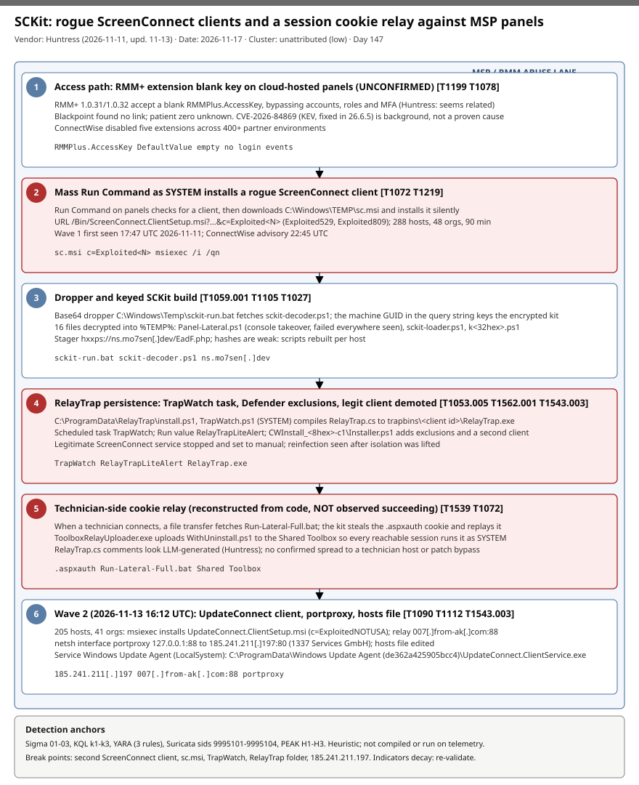

# SCKit: mass rogue ScreenConnect client installs and a session-cookie relay against MSP panels

## TL;DR

On 2026-11-11 Huntress saw an operator push commands through ScreenConnect Run Command (SYSTEM) on cloud-hosted panels and install a second, attacker-controlled ScreenConnect client on at least 288 hosts in 48 organizations within 90 minutes; a second wave on 2026-11-13 hit 205 hosts in 41 organizations. The payload, named SCKit, is a 16-file PowerShell/batch kit that also plants a "relay trap" meant to steal a technician's `.aspxauth` session cookie and take over the console. The spread-to-technician path was not observed to succeed. Initial access to the panels is unconfirmed: Huntress says the activity "seems related" to the RMM+ extension (1.0.31 and 1.0.32 accept a blank access key), while Blackpoint found no technical link. It matters today because a control plane that runs commands as SYSTEM on hundreds of endpoints turns one panel flaw into a mass intrusion with no malware download needed to start.

## Attribution and confidence

- **Cluster:** none published. Huntress refers to "the operator"; an actor label "Addmin" appears only in a model-extracted summary of the IOC section and is not verified.
- **Vendors:** Huntress (2026-11-11, updated 2026-11-11 23:34 ET and 2026-11-13 17:30 ET), Blackpoint (via The Hacker News 2026-11-12), ConnectWise (advisory 2026-11-11 22:45 UTC).
- **Confidence:** low for attribution; high for the on-host artifacts Huntress printed verbatim; medium for IOCs that came only from a model-extracted summary of the Huntress page.

| Question | Evidence | Gap |
|---|---|---|
| Is RMM+ the entry point? | Huntress: seems related; commands reached endpoints on several instances within minutes with no login events | Blackpoint: no technical link; patient zero not identified |
| Is CVE-2026-84869 the entry point? | Same product, KEV-listed 2026-09-11, fixed in 26.6.5 | No source ties it to SCKit |
| Is it a known actor? | None named | Treat as an unclustered operator |

Genealogy with earlier repo cases: the 2026-11-12 case (Ethersphere bee-js, SleepyDuck) also dropped a ScreenConnect stage 3, so ScreenConnect as an attacker control channel is a recurring pattern; the two cases are unrelated otherwise.

## Kill chain — summary table

| Stage | MITRE | Detail |
|---|---|---|
| Access to panels (unconfirmed) | T1199, T1078 | RMM+ blank access key bypasses accounts, roles and MFA; no login events |
| Mass Run Command | T1072, T1219 | SYSTEM commands push `sc.msi` and install a rogue ScreenConnect client |
| Dropper and keyed kit | T1059.001, T1105, T1027 | `sckit-run.bat`, `sckit-decoder.ps1`; kit decrypted per machine GUID |
| RelayTrap persistence | T1053.005, T1562.001, T1543.003, T1547.001 | TrapWatch task, Defender exclusions, Run value, legitimate service set to manual |
| Technician cookie relay (not observed succeeding) | T1539, T1072 | `.aspxauth` theft, Shared Toolbox upload of a SYSTEM script |
| Wave 2 | T1090, T1112, T1543.003 | UpdateConnect client, portproxy to `185.241.211.197`, hosts file edit |

MITRE IDs are the analyst's mapping: neither Huntress nor The Hacker News published technique IDs.



The single lane runs from the unconfirmed panel access to the second wave. Red boxes are the stages with the strongest detection value: the mass Run Command install and the persistence layer. Detection anchors are the second ScreenConnect client, `sc.msi`, the TrapWatch task and the `185.241.211.197` relay.

## Stage-by-stage detail

### 1. Access path (unconfirmed)

Huntress: RMM+ 1.0.31 and 1.0.32 accept a blank access key when the admin never set one (`RMMPlus.AccessKey`, empty `DefaultValue`), and RMM+ authenticates with that shared key instead of ScreenConnect accounts, roles or MFA. ConnectWise disabled five extensions (Labtech Plus, RMM Plus, RMM+, RMM Plus Password Link, RMM+ Password Link) across more than 400 partner environments. Blackpoint saw no technical link. CVE-2026-84869 (CVSS 9.9, fixed in 26.6.5 on 2026-09-08) is background only.

### 2. Mass Run Command and rogue client

Run Command on the cloud-hosted panels checks for an existing client, then downloads the attacker installer and installs it silently.

```text
C:\Windows\TEMP\sc.msi
/Bin/ScreenConnect.ClientSetup.msi?...&c=Exploited<N>     (Exploited529, Exploited809 seen)
```

All 288 wave-1 hosts were hit over 90 minutes, about one third in the first 10 minutes; Huntress first saw activity at about 17:47 UTC on 2026-11-11.

### 3. Dropper and keyed SCKit build

A base64 dropper is written to `C:\Windows\Temp\sckit-run.bat`, which downloads `C:\Windows\Temp\sckit-decoder.ps1`. The infected machine supplies its Windows machine GUID in the query string and the server returns key, IV and salt used to decrypt the kit into `%TEMP%`. Components: `Panel-Lateral.ps1` (console takeover, failed in every recovered log), `sckit-loader.ps1`, `k<32 hex>.ps1` (extracts to `C:\ProgramData\RelayTrap`) and `lab-trap-cleanup-embedded.ps1`. The stager is `hxxps://ns.mo7sen[.]dev/EadF.php`. Naming differs between sources (Huntress `Panel-Lateral.ps1`, Blackpoint via THN `SilentForceInstall-WithUninstall.ps1`); reconcile before relying on a name.

### 4. RelayTrap persistence

`C:\ProgramData\RelayTrap\install.ps1` installs the trap and lockout policies. A `CWInstall_<8 hex>-c1\Installer.ps1` adds Windows Defender exclusions and installs the second client. `TrapWatch.ps1` runs as SYSTEM, compiles `RelayTrap.cs` into `C:\ProgramData\RelayTrap\trapbins\<client id>\RelayTrap.exe`, and creates the scheduled task `TrapWatch`. The legitimate ScreenConnect service is stopped and set to manual. Huntress lists the Run value `RelayTrapLiteAlert` (HKLM Run) for cleanup and saw reinfection after isolation was lifted.

### 5. Technician-side cookie relay (reconstructed, not observed succeeding)

From the code: when a technician connects, a file transfer about 2.5 s later retrieves `Run-Lateral-Full.bat`, which fetches a loader from the stager. `Panel-Lateral.ps1` with `LabConfig.ps1` steals the `.aspxauth` cookie and replays it to enumerate sessions; `ToolboxRelayUploader.exe` uploads `WithUninstall.ps1` to the Shared Toolbox so reachable sessions run it as SYSTEM, then the item is deleted about 60 s later. Huntress says `RelayTrap.cs` comments look LLM-generated. No confirmed spread to a technician workstation.

### 6. Wave 2 (2026-11-13 16:12 UTC)

A batch script run from the ScreenConnect client directory launches `msiexec.exe`, which installs `UpdateConnect.ClientSetup.msi` with guest-session settings pointing at `007[.]from-ak[.]com` (port 88). Victims got a portproxy and a modified hosts file; one persisted as service `Windows Update Agent` (LocalSystem).

```text
netsh interface portproxy: 127.0.0.1:88 -> 185.241.211[.]197:80
C:\ProgramData\Windows Update Agent (de362a425905bcc4)\UpdateConnect.ClientService.exe
/Bin/UpdateConnect.ClientSetup.msi?e=Access&y=Guest&c=ExploitedNOTUSA
```

## Detection strategy

### Telemetry that matters

- **Windows:** Sysmon EID 1 (msiexec, netsh), 11 (file create in Windows Temp and ProgramData), 12/13 (Run key, service Start), Security 4698 (scheduled task), 7045 (service install), Defender exclusion change events.
- **Defender XDR:** `DeviceProcessEvents`, `DeviceFileEvents`, `DeviceRegistryEvents`, `DeviceNetworkEvents`.
- **ScreenConnect server:** Run Command and Toolbox history, session event log, extension inventory.

### Detection coverage

| Engine | File | Logic |
|---|---|---|
| Sigma | [01_sckit_rogue_screenconnect_msi_and_dropper_process.yml](./sigma/01_sckit_rogue_screenconnect_msi_and_dropper_process.yml) | msiexec of `sc.msi`, SCKit script names, `c=Exploited` installer, portproxy |
| Sigma | [02_sckit_relaytrap_file_artifacts.yml](./sigma/02_sckit_relaytrap_file_artifacts.yml) | files under RelayTrap, Temp dropper files, UpdateConnect service binary |
| Sigma | [03_sckit_relaytrap_run_key_persistence.yml](./sigma/03_sckit_relaytrap_run_key_persistence.yml) | `RelayTrapLiteAlert` Run value; ScreenConnect service set to manual |
| KQL | [k1](./kql/k1_mde_rogue_second_screenconnect_client_and_legit_service_stop.kql) | second client install plus legitimate service stop |
| KQL | [k2](./kql/k2_mde_relaytrap_trapwatch_defender_exclusions_portproxy.kql) | RelayTrap files, task, Run key, portproxy, exclusions |
| KQL | [k3](./kql/k3_mde_screenconnect_mass_run_command_and_sckit_infra.kql) | published network IOCs and a Run Command burst heuristic |
| YARA | [sckit_artifacts.yar](./yara/sckit_artifacts.yar) | 3 rules over script strings (medium and low confidence) |
| Suricata | [sckit_rogue_screenconnect.rules](./suricata/sckit_rogue_screenconnect.rules) | DNS, SNI, cleartext installer URL, relay IP (sids 9995101-9995104) |

YARA and Suricata were not compiled (engines not installed). The Run Command burst threshold in k3 is the analyst's heuristic, not a Huntress figure.

### Threat hunting hypotheses

- **H1:** a second ScreenConnect client exists on endpoints and the legitimate service was demoted. [peak_h1](./hunts/peak_h1_rogue_second_screenconnect_client_and_legit_service_stop.md)
- **H2:** RelayTrap persistence, Defender exclusions and portproxy are present. [peak_h2](./hunts/peak_h2_relaytrap_trapwatch_persistence_and_defender_exclusions.md)
- **H3:** the panel shows mass Run Command bursts without interactive logins, and RMM+ with a blank key. [peak_h3](./hunts/peak_h3_screenconnect_server_mass_run_command_and_rmm_plus.md)

## Incident response playbook

### First 60 minutes (triage)

1. Do not connect to suspect hosts through ScreenConnect; use WinRM or another out-of-band tool (Huntress).
2. From a clean device, terminate active ScreenConnect web sessions and rotate ScreenConnect credentials.
3. Export Run Command and Toolbox history and panel instance logs; list sessions that received commands you did not initiate.
4. Inventory ScreenConnect clients per endpoint and flag unfamiliar relay hostnames.
5. Isolate affected hosts and keep them isolated until cleanup (isolation alone does not remove persistence).
6. Treat any technician workstation that connected to an affected session as potentially exposed; revoke browser and identity-provider sessions.

### Artifacts to collect

| Artifact | Path | Tool | Why |
|---|---|---|---|
| Dropper and decoder | `C:\Windows\Temp\sckit-*`, `sc.msi` | KAPE / Velociraptor | Confirm infection and timing |
| RelayTrap folder | `C:\ProgramData\RelayTrap\` | file copy + hashes | Per-host builds, config |
| Scheduled task | `TrapWatch` | `schtasks /query /xml` | Persistence |
| Run key | `HKLM\...\Run\RelayTrapLiteAlert` | reg export | Persistence |
| Services | rogue client, legitimate client start type | `sc qc`, registry | Service demotion |
| Panel logs | ScreenConnect instance logs, Toolbox | server export | Scope and operator actions |

### IR queries and commands

```powershell
Get-ScheduledTask -TaskName TrapWatch -ErrorAction SilentlyContinue
Get-ItemProperty 'HKLM:\SOFTWARE\Microsoft\Windows\CurrentVersion\Run' | Select-Object RelayTrapLiteAlert
Get-Service | Where-Object { $_.DisplayName -like 'ScreenConnect Client*' -or $_.DisplayName -eq 'Windows Update Agent' } | Select-Object Name,DisplayName,StartType,Status
netsh interface portproxy show all
Test-Path 'C:\ProgramData\RelayTrap'
```

### Containment, eradication, recovery

Remove the rogue client service, the `TrapWatch` task, `C:\ProgramData\RelayTrap\`, the `%TEMP%` toolkit files and the `RelayTrapLiteAlert` value; verify the legitimate client first and restore its start type. Exit criteria: no second client, no RelayTrap artifacts, no portproxy or hosts-file entries, panel sessions rotated, extensions disabled or keyed, ScreenConnect at 26.6.5 or later. Do not return a host to service before reinfection is checked, and do not remote in through ScreenConnect to clean.

### Recovery validation

Re-run H1 and H2 after 7 days; confirm no further `c=Exploited` installer URLs in proxy logs and no new Run Command bursts on the panel.

## IOCs

| Type | Value | Context | Confidence | Source |
|---|---|---|---|---|
| ipv4 | 185.241.211[.]197 | Wave 2 client host and portproxy target (1337 Services GmbH) | high | Huntress |
| domain | 007[.]from-ak[.]com | Relay, port 88 | high | Huntress |
| domain | ns.mo7sen[.]dev | Stager, /EadF.php | high | Huntress, THN |
| path | C:\Windows\TEMP\sc.msi | Rogue ScreenConnect installer | high | Huntress |
| path | C:\Windows\Temp\sckit-run.bat | Dropper | high | Huntress |
| path | C:\ProgramData\RelayTrap | Toolkit directory | high | Huntress |
| string | TrapWatch | Scheduled task (SYSTEM) | high | Huntress |
| regkey | HKLM\...\Run\RelayTrapLiteAlert | Run value | high | Huntress |
| string | Windows Update Agent | Rogue service name (wave 2) | high | Huntress |
| string | c=Exploited<N> | Installer URL counter | high | Huntress |
| ipv4 | 185.99.255[.]28 | Attacker server; summary-derived | low | Huntress (summary) |
| domain | newnewnew[.]gotdns[.]org | Relay; summary-derived | low | Huntress (summary) |
| domain | sc.payproofkit[.]com | Panel; summary-derived | low | Huntress (summary) |
| cve | CVE-2026-84869 | ScreenConnect before 26.6.5; link unconfirmed | high | THN |

Full list: [iocs.csv](./iocs.csv). Hashes are omitted on purpose: Huntress says scripts are rebuilt per host and `RelayTrap.exe` is compiled per host. **KEV:** CVE-2026-84869 is on CISA KEV (added 2026-09-11, federal remediation due 2026-09-14, ransomware use unknown); a causal link to SCKit is not confirmed. See [kev.md](./kev.md).

## Secondary findings

- **n0n ransomware (SOCRadar 2026-10-28, The Register 2026-10-30):** an exposed staging server showed an operator using an AI coding agent (154 model entries, over USD 7,216 of AI spend by 2026-10-22) and credential-only access (FortiGate SSL-VPN stuffing, weak RDP/WinRM, exposed AWS keys); no CVE was exploited. Victim counts differ between sources (93 vs 108). Hashes and IPs came through a summary: not used here.
- **Earlier ScreenConnect abuse:** The Hacker News links CVE-2026-84869 exploitation in September to a VBScript chain ending in an XMRig miner; same product, different campaign, not fetched here.
- **Detection-gap lesson:** Huntress warns that file hashes are weak for SCKit; the stable indicators are behavioral (second client, TrapWatch, portproxy, Run Command bursts).

## Pedagogical anchors

- A remote-management control plane is a SYSTEM-level execution channel: its audit log (Run Command, Toolbox) is as important as endpoint telemetry.
- Extensions and integrations can bypass the platform's identity controls; inventory them like service accounts.
- Isolation is not eradication: persistence (task, service, Run key) survived and reinfected.
- Separate observed behavior from reconstructed code paths: the cookie relay was not seen succeeding, and the report says so.
- Per-host builds make hashes weak: hunt on paths, task names and process lineage.

## What's in this folder

| File | Purpose | Link |
|---|---|---|
| README.md | This analysis. | [README.md](./README.md) |
| kill_chain.svg | Single-lane kill chain diagram. | [kill_chain.svg](./kill_chain.svg) |
| sigma/ | Three atomic Sigma rules. | [sigma/](./sigma/) |
| kql/ | Three Defender XDR queries. | [kql/](./kql/) |
| yara/sckit_artifacts.yar | Three YARA rules over script strings. | [yara/](./yara/) |
| suricata/sckit_rogue_screenconnect.rules | Four network rules. | [suricata/](./suricata/) |
| hunts/ | Three PEAK hunts. | [hunts/](./hunts/) |
| iocs.csv | Full indicator list with confidence. | [iocs.csv](./iocs.csv) |
| kev.md | CISA KEV cross-reference for this case's CVEs. | [kev.md](./kev.md) |

## Sources

- [SCKit Worm Installs Rogue ScreenConnect Clients and Session Cookie Relays (Huntress)](https://www.huntress.com/blog/sckit-worm-rogue-screenconnect)
- [SCKit malware targets ScreenConnect (The Hacker News)](https://thehackernews.com/2026/11/sckit-malware-targets-screenconnect.html)
- [CVE-2026-84869 ScreenConnect (Wiz vulnerability database)](https://www.wiz.io/vulnerability-database/cve/cve-2026-84869)
- [ConnectWise security advisory AV26-903 (Canadian Centre for Cyber Security)](https://cyber.gc.ca/en/alerts-advisories/connectwise-security-advisory-av26-903)
- [n0n ransomware AI-assisted extortion (SOCRadar)](https://socradar.io/blog/n0n-ransomware-ai-assisted-extortion/)
- [Crim spent $7k on AI services in extortion attacks (The Register)](https://www.theregister.com/security/2026/10/30/crim-spent-7k-on-ai-services-in-extortion-attacks-then-left-evidence-for-all-to-see/5306754)
