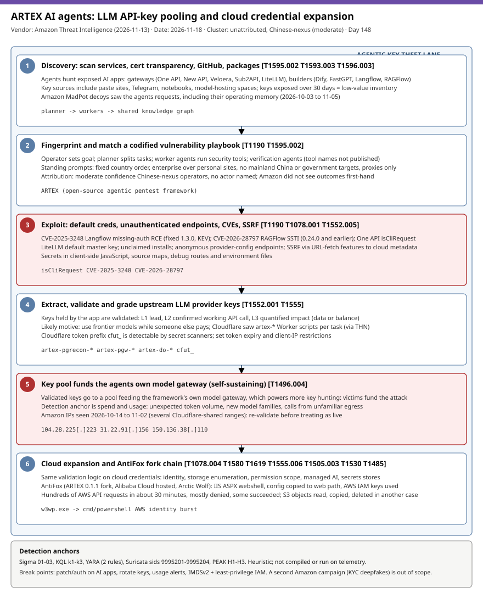

# ARTEX AI pentest agents: LLM API-key pooling against LiteLLM, Dify, Langflow and RAGFlow, then cloud credential expansion

## TL;DR

Amazon Threat Intelligence (CJ Moses, 2026-11-13) reports that operators ran the open-source agentic pentest framework ARTEX against hundreds of internet-exposed AI applications between 2026-10-03 and 2026-11-05, stealing the upstream LLM provider API keys those apps hold. Validated keys are graded, pooled, and fed into the framework's own model gateway, so the victims' inference budget pays for further key hunting. The same validation logic is then pointed at cloud credentials. Why today: it is the cleanest public description of an agent-driven credential-theft loop, and its detections are about the exposed AI app and the usage meter, not about malware. Amazon did not observe the outcomes first-hand and names no victims, LLMs or tools.

## Attribution and confidence

- **Cluster:** unattributed ARTEX operators. Confidence: **medium** that ARTEX was used (prompt references to its tooling) and **medium** that the operators are disparate Chinese-nexus groups (Amazon: Simplified Chinese in prompts, China time-zone settings, targeting consistent with Chinese interests). No actor name is published.
- **Vendor / date:** Amazon Threat Intelligence, AWS Security Blog, 2026-11-13; The Hacker News, 2026-11-16 (adds Cloudflare, FBI and Cisco Talos claims that were not verified first-hand here).
- **Related but distinct:** AntiFox, an ARTEX 0.1.1 fork (Arctic Wolf via BleepingComputer, 2026-11-11), hosted on Alibaba Cloud, used for IIS webshell to AWS intrusions. The fetched text does not say whether the operators overlap.

| Source | Claim | Status here |
|---|---|---|
| Amazon (AWS blog) | ARTEX campaign 1: AI-app key theft; campaign 2: crypto-exchange KYC bypass with real-time deepfakes | Read in full |
| The Hacker News | Cloudflare Worker names artex-*, Talos IOC set, repo pulled 2026-10-08, FBI FLASH | Read; third-party claims unverified |
| BleepingComputer | AntiFox fork chain (webshell, AWS IAM) | Read; no IOCs published |
| Microsoft (Storm-0940 uses ARTEX) | Earlier ARTEX password spray against Entra | Not re-read today |

**Genealogy in this repo:** ARTEX appeared as a secondary finding on 2026-10-28 (M365 token spray and replay) and as a tooling-class note on 2026-11-11 (agentic AI secret hunting in Entra). 2026-07-14 (JADEPUFFER) covered an agent that exploited Langflow CVE-2025-3248. This is the first case about the ARTEX framework itself and its AI-gateway target set.

## Kill chain — summary table

| Stage | MITRE | Detail |
|---|---|---|
| 1 Discovery | T1595.002, T1593.003, T1596.003 | Scan services, certificate transparency, GitHub, package tarballs, paste sites, Telegram |
| 2 Fingerprint and playbook match | T1190 | Planner and worker agents match the product to a codified playbook |
| 3 Exploit | T1190, T1078.001, T1552.005 | Default creds, unauthenticated endpoints, CVE-2025-3248, CVE-2026-28797, SSRF to metadata |
| 4 Key extraction and grading | T1552.001, T1555.006 | Validate keys; L1 lead, L2 working API call, L3 quantified impact |
| 5 Pooling and self-funding | T1496.004 | Key pool feeds the framework's own gateway |
| 6 Cloud expansion / AntiFox | T1078.004, T1580, T1619, T1505.003, T1530, T1485 | Cloud identity validation, storage and secrets enumeration; IIS webshell to AWS |

MITRE IDs are the analyst's mapping; Amazon does not publish ATT&CK IDs.



One lane runs from discovery to cloud expansion; red stages (3 and 5) are the choke points: the exploited AI app and the self-funding key pool. Detection anchors are the AI app host spawning shells or reading metadata, the published IPs, Worker names `artex-*`, and bursts of AWS identity validation.

## Stage-by-stage detail

### 1. Discovery

Agents find exposed AI apps through internet scanning services and certificate transparency, and hunt keys in GitHub repositories and event archives, npm and PyPI tarballs, container image layers, notebooks, model-hosting spaces, paste sites and Telegram channels. Keys exposed for more than 30 days are classed as low-value inventory.

### 2. Fingerprint and playbook match

The operator provides a target and goal; a planner agent splits it into tasks for worker agents that run security tools, with verification and compression agents and a shared knowledge graph. Standing prompts set a fixed country order, prefer enterprise production sites over personal projects, exclude mainland China and government domains, and force traffic through proxies. Specific tools and LLMs are not named.

### 3. Exploit

Playbook entries named by Amazon and The Hacker News:

```text
Gateways: One API, New API, Veloera, Sub2API, LiteLLM
Builders: Dify, FastGPT, Langflow, RAGFlow, Open WebUI, LobeChat, Ollama
CVE-2025-3248   Langflow missing authentication -> RCE (fixed 1.3.0)
CVE-2026-28797  RAGFlow SSTI, any logged-in user -> OS commands (0.24.0 and earlier; self-registration on by default)
One API family  authentication bypass via the isCliRequest header (no CVE, no fixed version)
LiteLLM         default master key
Generic         unclaimed installs, anonymous provider-config endpoints, default admin creds,
                SSRF via URL-fetch features to cloud metadata, secrets in client JS / source maps / debug routes / env files
```

### 4. Key extraction and grading

Upstream provider keys held by the app are validated with a real API call and graded L1 (lead), L2 (confirmed working call) or L3 (quantified impact: readable data or spendable balance).

### 5. Pooling and self-funding

Validated keys go into a managed pool that feeds the framework's own model gateway, which powers more key hunting. Amazon's stated likely motive is using the models while someone else pays. Cloudflare (via The Hacker News) saw one Worker script per task named `artex-*`, `artex-pgrecon-*`, `artex-pgw-*`, `artex-do-*`, and an incident where an unrestricted account-level API token (prefix `cfut_`) led to 400 database-dump requests in an hour.

### 6. Cloud expansion and the AntiFox fork

The same validation logic is applied to cloud credentials: identity validation through token services, storage enumeration, permission scope, managed AI model services, secrets and parameter stores. AntiFox (Arctic Wolf, via BleepingComputer) dropped an ASPX webshell on an internet-exposed IIS server, read application settings and connection strings, copied config and log files into a web-accessible directory, then used valid AWS IAM keys or assumed EC2 roles; one intrusion cycled identities with hundreds of API requests in about 30 minutes, mostly denied, some succeeding against production secrets. No CVEs, IOCs or API names are published for AntiFox.

## Detection strategy

### Telemetry that matters

- Web or WAF logs for AI gateways and builders (header fields only if your proxy records them), Linux process creation (auditd, Sysmon for Linux, Defender for Endpoint on Linux), egress network logs.
- Provider usage meters (LLM spend, tokens, model families, source IPs), secret scanners on repos and CI.
- AWS CloudTrail (Sentinel `AWSCloudTrail`), GuardDuty, IIS `w3wp.exe` process and file events (Defender XDR).

### Detection coverage

| Engine | File | Logic |
|---|---|---|
| Sigma | [01](./sigma/01_artex_ai_gateway_playbook_web_requests.yml) | isCliRequest header or Langflow validate/code POST (needs header logging or a WAF mapping) |
| Sigma | [02](./sigma/02_artex_ai_app_process_shell_metadata_or_env_read.yml) | AI app parent spawning a shell that reads metadata or environment (heuristic) |
| Sigma | [03](./sigma/03_artex_amazon_published_ip_connection.yml) | Connection to the 11 published IPs (low, decays) |
| KQL | [k1](./kql/k1_mde_artex_amazon_ip_retrohunt.kql) | 60-day retrohunt of the published IPs, both directions |
| KQL | [k2](./kql/k2_sentinel_aws_identity_validation_then_secrets_enumeration.kql) | AWS identity check then storage/secrets enumeration (analyst inference) |
| KQL | [k3](./kql/k3_mde_antifox_iis_webshell_config_staging.kql) | w3wp.exe child process then config files staged under a web root |
| YARA | [artex_artifacts.yar](./yara/artex_artifacts.yar) | Worker name prefixes; cfut_ or norma with an artex marker (untested) |
| Suricata | [artex_ai_gateway.rules](./suricata/artex_ai_gateway.rules) | Sids 9995201-9995204: isCliRequest, published IPs, Ollama exposure, Langflow validate/code |

Nothing was compiled or run against telemetry. Only the IPs, Worker names, `cfut_`, `isCliRequest` and the two CVEs are published indicators; everything else is a generic heuristic with low confidence.

### Threat hunting hypotheses

- **H1** Exposed AI gateways and builders with default credentials or unpatched CVEs: [hunt](./hunts/peak_h1_exposed_ai_gateways_default_creds_and_patch_state.md).
- **H2** Stolen LLM API-key abuse visible as spend or usage anomalies: [hunt](./hunts/peak_h2_stolen_llm_api_key_abuse_and_rotation.md).
- **H3** Cloud credential validation and secrets enumeration after an app host compromise: [hunt](./hunts/peak_h3_cloud_credential_validation_and_secrets_enumeration.md).

## Incident response playbook

### First 60 minutes (triage)

1. Inventory every AI gateway, builder and inference endpoint reachable from the internet; take exposed ones offline or behind authentication.
2. Rotate every provider API key stored in those apps and any key found in their configs, environment files, CI and repos.
3. Check provider usage dashboards for the last 60 days: new IPs, new model families, token spikes.
4. Check the patch state: Langflow 1.3.0 or later, RAGFlow 0.25.0 or later; replace default LiteLLM master keys.
5. Retrohunt the 11 published IPs (they are short-lived; a hit is a lead, not proof).

### Artifacts to collect

| Artifact | Path | Tool | Why |
|---|---|---|---|
| App configs and env files | deployment dirs, container env, `.env` | shell, EDR live response | Which keys were exposed |
| Reverse proxy / WAF logs | proxy log dir | grep, SIEM | Management-endpoint access, header abuse |
| Provider usage and key audit | provider console | console export | Spend and caller anomalies |
| CloudTrail | org trail bucket | Athena, Sentinel | Identity validation and enumeration bursts |
| IIS logs and web roots | `C:\inetpub\` | Velociraptor, EDR | Webshell and staged configs |

### IR queries and commands

```bash
# Author: Jarmi
# Find provider keys sitting in an AI app deployment (review hits manually, do not paste them anywhere)
grep -rIlE 'sk-[A-Za-z0-9_-]{20,}|LITELLM_MASTER_KEY|OPENAI_API_KEY|ANTHROPIC_API_KEY' /opt /srv /etc 2>/dev/null
docker ps --format '{{.Names}}' | grep -iE 'litellm|langflow|dify|ragflow|oneapi|open-webui'
pip show langflow 2>/dev/null | grep -i '^version'
```

### Containment, eradication, recovery

Exit criteria: exposed apps authenticated or removed, all stored keys rotated and old ones revoked at the provider, no unexplained usage for 7 days, cloud sessions revoked where identities were exposed. Do NOT only rotate keys while leaving the vulnerable app online: the agents will re-extract them. Do NOT treat an absent CVE on a vendor list as proof the product is safe; several playbook entries have no CVE.

### Recovery validation

Confirm the apps require authentication from the internet, confirm provider-side key inventories contain only the new keys, enable spend alerts and token-prefix secret scanning, and require IMDSv2 and least-privilege IAM on hosts that run AI apps.

## IOCs

Top rows (full list: [iocs.csv](./iocs.csv)). All network indicators are from Amazon decoy sensors, 2026-10-14 to 2026-11-02, and have likely decayed.

| Type | Value | Context | Confidence | Source |
|---|---|---|---|---|
| ipv4 | 104.28.225.223 | Campaign 1, Cloudflare-shared range | low | AWS blog |
| ipv4 | 31.22.91.156 | Campaign 1 | low | AWS blog |
| ipv4 | 150.136.38.110 | Campaign 1 | low | AWS blog |
| ipv4 | 128.242.115.131 | Campaign 1 | low | AWS blog |
| ipv4 | 216.176.239.231 | Campaign 1 | low | AWS blog |
| ipv4 | 212.107.28.51 | Campaign 2 (KYC deepfakes) | low | AWS blog |
| ipv4 | 103.142.140.158 | Campaign 2 | low | AWS blog |
| ipv4 | 125.103.213.41 | Campaign 2 | low | AWS blog |
| string | artex-pgrecon-* / artex-pgw-* / artex-do-* | Cloudflare Worker names (via THN) | medium | The Hacker News |
| string | cfut_ | Cloudflare API token prefix | low | The Hacker News |
| string | isCliRequest | One API auth-bypass header | low | The Hacker News |
| cve | CVE-2025-3248 | Langflow missing-auth RCE | medium | The Hacker News |
| cve | CVE-2026-28797 | RAGFlow SSTI | medium | The Hacker News |

**KEV:** CVE-2025-3248 is on CISA KEV (added 2025-05-05 per The Hacker News; known ransomware use flagged); see [kev.md](./kev.md). CVE-2026-28797 is not confirmed on KEV; analyst note: it was not checked against the live catalog and absence from KEV does not mean it is unexploited.

## Secondary findings

- **Campaign 2 (Amazon):** two crypto exchanges were targeted for KYC bypass with real-time deepfake video on a single consumer GPU (about 11.5 fps) and forged ID photos; the vendor server rejected the deepfake in every recorded attempt, and it is unknown whether the forged IDs passed document checks.
- **Source takedown does not end a tool:** the ARTEX repository was made unavailable on 2026-10-08 (The Hacker News), yet forks, archived copies and a commercial variant remain, and AntiFox forked it.
- **Third-party scale claims (via The Hacker News, unverified here):** Cloudflare saw 50+ AI-pentest framework families scanning customers in three days; the FBI links earlier ARTEX activity to South Korean financial institutions.

## Pedagogical anchors

- An AI application is a credential vault with a web UI: its threat model is the sum of every key it stores.
- The usage meter is a detection sensor: self-funding attacks surface as spend, new model families and unfamiliar egress.
- Patching is necessary but insufficient: the playbook mixes CVEs with default credentials, unclaimed installs and secrets in client-side code.
- Treat vendor "moderate confidence" literally: attribution and outcomes are unverified, so write detections on behavior, not on actor names.
- Network IOCs from decoys decay in days; durable controls are authentication, rotation and metering.

## What's in this folder

| File | Purpose | Link |
|---|---|---|
| README.md | This analysis. | [README.md](./README.md) |
| kill_chain.svg | Six-stage kill chain diagram (template C). | [kill_chain.svg](./kill_chain.svg) |
| sigma/ | Three Sigma rules (web, process, network). | [sigma/](./sigma/) |
| kql/ | Three KQL queries (IP retrohunt, AWS burst, IIS staging). | [kql/](./kql/) |
| yara/artex_artifacts.yar | Two YARA rules on published literals. | [yara/artex_artifacts.yar](./yara/artex_artifacts.yar) |
| suricata/artex_ai_gateway.rules | Four Suricata rules, sids 9995201-9995204. | [suricata/artex_ai_gateway.rules](./suricata/artex_ai_gateway.rules) |
| hunts/ | Three PEAK hunts H1-H3. | [hunts/](./hunts/) |
| iocs.csv | Full indicator list. | [iocs.csv](./iocs.csv) |
| kev.md | CISA KEV cross-reference for this case's CVEs. | [kev.md](./kev.md) |

## Sources

- [Amazon Threat Intelligence observes threat actors running cybercrime campaigns with ARTEX AI agents (AWS Security Blog, 2026-11-13)](https://aws.amazon.com/blogs/security/amazon-threat-intelligence-observes-threat-actors-running-cybercrime-campaigns-with-artex-ai-agents/)
- [Amazon Uncovers AI Agent Campaign Targeting LiteLLM, Dify, and Other Apps for API Keys (The Hacker News, 2026-11-16)](https://thehackernews.com/2026/11/amazon-uncovers-ai-agent-campaign.html)
- [Hackers use AntiFox AI agents in AWS credential-theft attacks (BleepingComputer, 2026-11-11)](https://www.bleepingcomputer.com/news/security/hackers-use-antifox-ai-agents-in-aws-credential-theft-attacks/)
- [AI agents stole API keys to bankroll a month of autonomous cybercrime (Cybernews)](https://cybernews.com/security/amazon-autonomous-cybercrime-artex-framework/)
