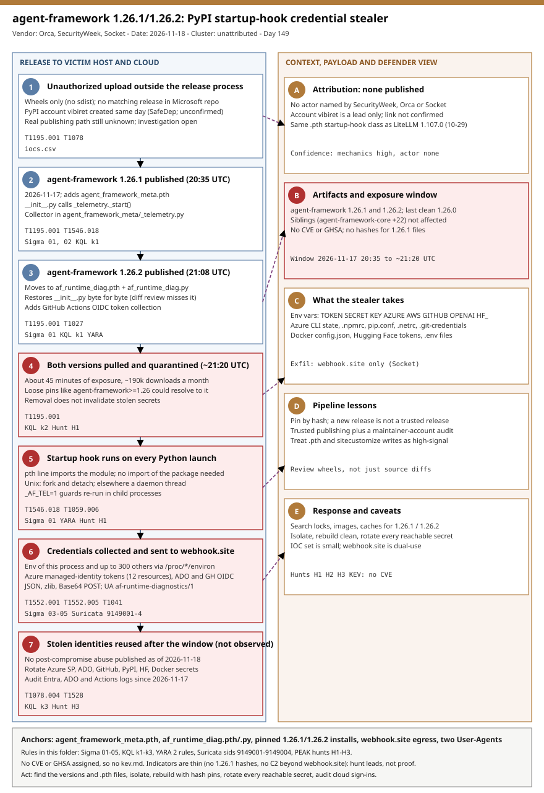

# Microsoft agent-framework 1.26.1 and 1.26.2: poisoned PyPI releases drop a .pth startup hook that steals cloud and CI credentials

## TL;DR

On 2026-11-17 between 20:35 and 21:08 UTC two releases of the PyPI package `agent-framework` (Microsoft Agent Framework, about 190,000 downloads a month), versions 1.26.1 and 1.26.2, were uploaded about 33 minutes apart and removed by roughly 21:20 UTC. Each adds a `.pth` startup hook, so a credential collector runs at every Python launch even if the package is never imported, and it posts environment variables, Azure managed-identity and Azure DevOps tokens, GitHub Actions OIDC tokens and credential files to a webhook.site URL. The publishing path is still unknown (the builds are wheel-only and no matching release exists in Microsoft's repository), and no actor is named. It matters today because the exposure window was short but loose pins such as `agent-framework>=1.26` would have resolved to it, and removal from PyPI does not invalidate secrets already taken.

## Attribution and confidence

- **Cluster:** none. SecurityWeek, Orca and Socket (via GBHackers) name no actor.
- **Vendor and date:** Orca Research Pod (2026-11-18), SecurityWeek (2026-11-18), Socket analysis as reported by GBHackers (2026-11-18); SafeDep identified a suspect PyPI account, as reported by SecurityWeek. The secnews.gr article could not be read.
- **Confidence:** mechanics **high** for versions, file names and behaviour (three sources agree); attribution **none**; the link between the suspect account and the uploads is **unconfirmed**.

| Attribute | Observation |
|---|---|
| Package | `agent-framework` on PyPI; clean 1.26.0, malicious 1.26.1 and 1.26.2 |
| Not affected | `agent-framework-core` and 22 other sibling packages (Orca) |
| Upload anomaly | Wheel-only distributions; legitimate releases ship wheel and sdist; Wiz found no matching release or code in Microsoft's main GitHub repository (SecurityWeek) |
| Suspect account | PyPI user `vibiret`, created the day of the attack, publish rights to the package and five related projects (SafeDep; involvement not confirmed) |
| Vendor response | A maintainer confirmed removal and an open investigation in GitHub issue #10411; Orca says the Microsoft publisher account has been secured |

**Genealogy in this repo:** the 2026-10-29 LiteLLM 1.107.0 case used the same technique class (Python `.pth` startup hook, credential stealer, webhook.site in the attacker's CI tradecraft). Only the technique is shared; no infrastructure, hash or actor overlap is claimed. The 2026-05-13 Semantic Kernel case covered a different Microsoft agent framework bug (prompt-to-RCE), not a package compromise.

## Kill chain — summary table

| Stage | MITRE | Detail |
|---|---|---|
| 1. Unauthorized upload | T1195.001, T1078 | Built-only wheels published outside the normal release process; method unknown |
| 2. Version 1.26.1 | T1195.001, T1546.018 | `agent_framework_meta.pth` imports `agent_framework_meta`; `__init__.py` calls `_telemetry._start()` |
| 3. Version 1.26.2 | T1027, T1546.018 | Moves to `af_runtime_diag.pth` + `af_runtime_diag.py`; original `__init__.py` restored byte for byte |
| 4. Pull and quarantine | T1195.001 | Both versions removed by about 21:20 UTC; PyPI quarantine |
| 5. Hook execution | T1546.018, T1059.006 | Runs at every interpreter start; fork and detach on Unix, daemon thread elsewhere; `_AF_TEL=1` guard |
| 6. Collection and exfiltration | T1552.001, T1552.005, T1528, T1041 | Env vars, IMDS tokens, DevOps and OIDC tokens, credential files; JSON, zlib, Base64 POST to webhook.site |
| 7. Reuse of stolen identities | T1078.004 | Not observed in public reporting; to be hunted |



The left lane follows the poisoned releases from upload to credential theft and the expected reuse of stolen identities; the right lane holds attribution, artifacts and window, what is collected, pipeline lessons and the response order. Detection anchors are the two `.pth` file names, pinned installs of the two versions, egress to webhook.site and the two User-Agent strings, and unexpected Python access to the Azure metadata service.

## Stage-by-stage detail

### 1. Unauthorized upload (T1195.001, T1078)

Both malicious versions were built-only distributions, whereas legitimate releases ship wheel and sdist. Wiz found no matching release or malicious code in Microsoft's main repository, which points to an upload outside the normal release process. SafeDep flagged PyPI account `vibiret`, created the day of the attack with publish rights to the package and five related projects; SecurityWeek stresses its role is not confirmed. How the publishing rights were obtained is not published.

### 2. Version 1.26.1 (T1195.001, T1546.018)

```text
site-packages/agent_framework_meta.pth             -> imports agent_framework_meta
site-packages/agent_framework_meta/__init__.py     -> modified, calls _telemetry._start()
site-packages/agent_framework_meta/_telemetry.py   -> credential collector
```

No change to Agent Framework code and no rogue dependency was reported. The exact content of the `.pth` line was not published; "imports the module" is what the sources state.

### 3. Version 1.26.2 (T1027, T1546.018)

```text
site-packages/af_runtime_diag.pth    -> startup hook
site-packages/af_runtime_diag.py     -> collector
agent_framework_meta/__init__.py     -> restored byte for byte (a diff review of this file shows nothing)
```

Per GBHackers 1.26.2 widens collection to GitHub Actions identity endpoints and runner directories; Orca adds that Actions OIDC tokens are requested when a workflow has `id-token: write`.

### 4. Pull and quarantine (T1195.001)

Both versions were removed by about 21:20 UTC and quarantined by PyPI. The exposure window is therefore about 45 minutes, but any environment that resolved `agent-framework>=1.26` or an unpinned install inside it received a poisoned wheel. Lockfiles and caches keep the artifact after PyPI removal.

### 5. Hook execution (T1546.018, T1059.006)

Python processes `.pth` lines that begin with `import` during site initialization, so the collector runs on every interpreter launch, including `pip` itself. On Unix the collector forks and detaches; platforms without fork use a daemon thread. The environment variable `_AF_TEL=1` stops repeat runs in child processes, but fresh process trees run it again. Errors are suppressed. No second stage and no persistence beyond the hook were seen.

### 6. Collection and exfiltration (T1552.001, T1552.005, T1552.004, T1528, T1041)

- Environment variables matching TOKEN, SECRET, KEY, AZURE, AWS, GITHUB, OPENAI and HF_ from the current process and up to 300 other processes via `/proc/*/environ`.
- Azure managed-identity tokens for 12 resources (ARM, Microsoft Graph, Key Vault, Storage, ML, AI Foundry, Container Registry, Azure DevOps) through IMDS and identity endpoints; `SYSTEM_ACCESSTOKEN` and OIDC tokens in Azure DevOps.
- Files: Azure CLI state, `.npmrc`, `pip.conf`, `.netrc`, `.git-credentials`, Docker `config.json`, Hugging Face tokens and `.env` files.
- Exfiltration: JSON, zlib, Base64, HTTPS POST to `hxxps://webhook[.]site/d381fd80-ec62-42ad-8f5c-d1b15103c9bb?t=telemetry` with User-Agent `af-runtime-diagnostics/1` or `runtime-diagnostics/1`. Socket reported no other channel.

### 7. Reuse of stolen identities (T1078.004)

No abuse of stolen credentials was published as of 2026-11-18. That is an absence of reporting, not of risk: removal of the package does not invalidate secrets already exfiltrated, and cloud identity use has to be investigated separately.

## RE notes

No sample was analysed by the author; hashes come from GBHackers citing Socket and no hashes are published for the 1.26.1 files.

| Component | SHA256 | Lang | Packer | Notes |
|---|---|---|---|---|
| agent_framework-1.26.2-py3-none-any.whl | 3d20a8bc91351a9a16b6db243b848ceca0206b7a8623b02d2af553a9c9f7e0a9 | Python | none reported | Malicious wheel |
| af_runtime_diag.py | 54d885b7d7161c9ed96489c66364c4bfbf635929166843bba10d97d46b5a2e1f | Python | none reported | 1.26.2 collector |
| af_runtime_diag.pth | 325e7e9f0ec94e41ad1a1b7a3f18a6b8b5bffece2e2b97b8d3369eb967452f93 | Python .pth | none | 1.26.2 startup hook |

The rules in this folder are built from the public write-ups, not from the files, so the YARA rules are confidence low.

## Detection strategy

### Telemetry that matters

- File events: creation of `agent_framework_meta.pth`, `af_runtime_diag.pth` or `af_runtime_diag.py` under `site-packages` (Sysmon EID 11, Defender `DeviceFileEvents`, auditd watches).
- Process events: `pip`, `uv` or `poetry` installs of `agent-framework` (Sysmon EID 1, `DeviceProcessEvents`), plus package-manager and CI build logs.
- Network: egress to webhook.site (DNS, TLS SNI, proxy), the two User-Agent strings behind a TLS-inspecting proxy, Python connections to 169.254.169.254.
- Identity: Entra `SigninLogs` and `AuditLogs` for service principals and managed identities, Azure DevOps audit log, GitHub Actions runs and OIDC token requests, PyPI and Hugging Face token use.

### Detection coverage

| Engine | File | Logic |
|---|---|---|
| Sigma | [01_agent_framework_startup_hook_pth_in_site_packages.yml](./sigma/01_agent_framework_startup_hook_pth_in_site_packages.yml) | The three campaign file names written to site-packages |
| Sigma | [02_pip_uv_poetry_install_of_agent_framework_1_26_1_or_1_26_2.yml](./sigma/02_pip_uv_poetry_install_of_agent_framework_1_26_1_or_1_26_2.yml) | Installer command line pinned to a malicious version |
| Sigma | [03_python_network_connection_to_webhook_site.yml](./sigma/03_python_network_connection_to_webhook_site.yml) | Python process connecting to webhook.site (needs allow-listing) |
| Sigma | [04_proxy_user_agent_af_runtime_diagnostics.yml](./sigma/04_proxy_user_agent_af_runtime_diagnostics.yml) | Proxy log match on the two collector User-Agents |
| Sigma | [05_python_connection_to_azure_imds_unexpected_host.yml](./sigma/05_python_connection_to_azure_imds_unexpected_host.yml) | Python reaching Azure IMDS on hosts that should not (low confidence) |
| KQL | [k1](./kql/k1_agent_framework_startup_hook_files_and_known_hashes.kql) | Hook file names and the three published SHA-256 values |
| KQL | [k2](./kql/k2_agent_framework_install_and_python_egress.kql) | Installs joined with webhook.site or IMDS egress per device |
| KQL | [k3](./kql/k3_entra_signins_from_unknown_ranges_after_exposure.kql) | Identity sign-ins from unknown ranges after the window (placeholder for known ranges) |
| YARA | [af_runtime_diag.yar](./yara/af_runtime_diag.yar) | Two rules: the small .pth hook and the collector (confidence low) |
| Suricata | [agent_framework_pypi.rules](./suricata/agent_framework_pypi.rules) | sids 9149001-9149004: SNI, two User-Agents, DNS (hunting leads) |

### Threat hunting hypotheses

- **H1** — startup-hook files and poisoned installs on hosts, runners and images: [peak_h1_startup_hook_files.md](./hunts/peak_h1_startup_hook_files.md)
- **H2** — credential exposure on CI runners that ran Python in the window: [peak_h2_ci_runner_credential_exposure.md](./hunts/peak_h2_ci_runner_credential_exposure.md)
- **H3** — use of potentially stolen Azure, DevOps, GitHub and registry credentials after the window: [peak_h3_stolen_credential_use_after_window.md](./hunts/peak_h3_stolen_credential_use_after_window.md)

## Incident response playbook

### First 60 minutes (triage)

1. From a clean machine, search lockfiles, build logs, container images and CI caches for `agent-framework` 1.26.1 or 1.26.2.
2. Isolate any host or runner that has `agent_framework_meta.pth` or `af_runtime_diag.pth`; do not run `python` or `pip` inside it.
3. Snapshot the host or image before rebuilding.
4. Rotate first the secrets with the widest reach: Azure service principals and managed-identity role assignments, Azure DevOps PATs and service connections, GitHub tokens, then package-registry, Hugging Face and Docker credentials.
5. Review Entra sign-ins, Azure DevOps audit and GitHub Actions runs since 2026-11-17 20:35 UTC.
6. Pin `agent-framework==1.26.0` with hash verification and block 1.26.1 and 1.26.2 at the package proxy.

### Artifacts to collect

| Artifact | Path | Tool | Why |
|---|---|---|---|
| Startup-hook files | `<venv or system>/lib/python3.*/site-packages/{agent_framework_meta.pth,af_runtime_diag.pth,af_runtime_diag.py}` | `sha256sum`, read-only copy | Prove the poisoned wheel installed; match published hashes for 1.26.2 |
| Package metadata | `site-packages/agent_framework-*.dist-info/` | `cat METADATA`, `RECORD` | Exact version and installed file list |
| pip / uv caches and logs | `~/.cache/pip`, `~/.cache/uv`, CI build logs | `grep` | Which version, when |
| Container image layers | local image store, registry pull logs | `docker history`, `crane digest` | Which images baked in the wheel |
| Credential files on the host | `~/.azure`, `~/.npmrc`, `~/.netrc`, `~/.git-credentials`, `~/.docker/config.json`, `.env` | inventory only | Scope what to rotate |
| Identity and CI logs | Entra, Azure DevOps, GitHub audit | KQL, `gh api` | Reuse of stolen tokens |

### IR queries and commands

```bash
# Author: Jarmi
# Read-only exposure sweep; run from a clean host or against a mounted image.
grep -rnE 'agent[-_]framework(==|~=|>=)?1\.26\.[12]' --include='*requirements*.txt' --include='*.lock' --include='*.toml' .
find / \( -name agent_framework_meta.pth -o -name af_runtime_diag.pth -o -name af_runtime_diag.py \) 2>/dev/null | xargs -r sha256sum
pip download agent-framework==1.26.0 --no-deps -d /tmp/clean && pip hash /tmp/clean/*.whl
```

```powershell
# Author: Jarmi
Get-ChildItem -Path C:\ -Recurse -Include agent_framework_meta.pth,af_runtime_diag.pth,af_runtime_diag.py -ErrorAction SilentlyContinue |
  Where-Object { $_.FullName -match 'site-packages' } |
  Select-Object FullName, Length, @{n='SHA256';e={(Get-FileHash $_.FullName -Algorithm SHA256).Hash}}
```

```kql
// Author: Jarmi
DeviceNetworkEvents
| where Timestamp > datetime(2026-11-17T20:35:00Z) and RemoteUrl has "webhook.site"
| project Timestamp, DeviceName, InitiatingProcessFileName, InitiatingProcessCommandLine, RemoteUrl
```

### Containment, eradication, recovery

- **Exit criteria:** no host, image or cache carries the versions or the two hook files; every secret reachable by an exposed identity is rotated from a clean machine; sign-in and audit review since the window is complete; builds install from a hash-pinned lockfile.
- **Hardening:** pin by hash, use an internal mirror with a cooldown for new releases, scope CI tokens and OIDC subjects to one repository and environment, deny `id-token: write` where unused.
- **Do not:** uninstall the package and stop (secrets are already gone); run `pip` or `python` in the suspect environment; treat the short window as proof of safety when lax pins exist.

### Recovery validation

Re-run H1 to H3 for 30 days. Confirm no new webhook.site egress from build systems, no sign-ins with rotated credentials from old addresses, and that every production image resolves to a rebuilt, digest-pinned artifact.

## IOCs

Top rows below; full list in [iocs.csv](./iocs.csv). This case has no CVE or GHSA assigned (Orca), so no KEV status applies; a CVE-less supply-chain compromise is never "not exploited" because it is absent from KEV.

| Type | Value | Context | Confidence | Source |
|---|---|---|---|---|
| string | agent-framework==1.26.1 | Malicious PyPI release | high | SecurityWeek; Orca |
| string | agent-framework==1.26.2 | Malicious PyPI release | high | SecurityWeek; Orca |
| path | site-packages/agent_framework_meta.pth | 1.26.1 startup hook | high | Orca |
| path | site-packages/af_runtime_diag.pth | 1.26.2 startup hook | high | Orca; GBHackers |
| path | site-packages/af_runtime_diag.py | 1.26.2 collector | high | Orca; GBHackers |
| sha256 | 3d20a8bc91351a9a16b6db243b848ceca0206b7a8623b02d2af553a9c9f7e0a9 | 1.26.2 wheel | medium | GBHackers (Socket) |
| sha256 | 54d885b7d7161c9ed96489c66364c4bfbf635929166843bba10d97d46b5a2e1f | af_runtime_diag.py | medium | GBHackers (Socket) |
| sha256 | 325e7e9f0ec94e41ad1a1b7a3f18a6b8b5bffece2e2b97b8d3369eb967452f93 | af_runtime_diag.pth | medium | GBHackers (Socket) |
| domain | webhook.site | Exfiltration service (dual-use) | medium | GBHackers; Orca |
| url | hxxps://webhook[.]site/d381fd80-ec62-42ad-8f5c-d1b15103c9bb?t=telemetry | Exfiltration endpoint, defanged | medium | GBHackers (Socket) |
| string | af-runtime-diagnostics/1 | Collector User-Agent | medium | GBHackers |
| string | runtime-diagnostics/1 | Collector User-Agent | medium | GBHackers |
| string | _AF_TEL=1 | Re-execution guard variable | medium | GBHackers |
| string | vibiret | Suspect PyPI account, unconfirmed | low | SafeDep via SecurityWeek |

KEV: no CVE in scope, so no `kev.md` was generated. Indicators are from 2026-11-17 to 18 and thin: there are no hashes for 1.26.1 and no C2 beyond webhook.site, so treat network rules as hunting leads.

## Secondary findings

- **Microsoft repository outage:** SecurityWeek reports the Agent Framework GitHub repository was inaccessible when it wrote, and that other Microsoft repositories (including ONNX Runtime projects) had also disappeared, with no confirmed link to this incident. Check the vendor statement before drawing any conclusion.
- **Account with sibling projects:** the suspect `vibiret` account holds publish rights to five related projects. Review any dependency of yours owned by recently created maintainers of the same family until the vendor says otherwise.
- **Related campaign lead, not read:** a search result headline attributes a 2026 wave of 4,837 hijacked GitHub accounts used to steal CI secrets across 1,806 repositories to Aviatrix research. The page was not read, so nothing from it is used in this case; verify before relying on it.

## Pedagogical anchors

- A `.pth` line that starts with `import` is code that runs at every Python start; `site-packages` root writes and new `.pth` files are high-signal events.
- Diff the wheel, not the repository: 1.26.2 restored `__init__.py` byte for byte, and the real change sat in two added files that were never in source control.
- Removal from the registry ends new infections but does not revoke what was stolen; rotation and log review are the real recovery.
- Loose version ranges turn a 45-minute registry incident into a fleet-wide one; hash-pinned lockfiles and a release cooldown shrink the window.
- Wheel-only uploads with no matching source release are a cheap, checkable provenance signal.

## What's in this folder

| File | Purpose | Link |
|---|---|---|
| README.md | This case write-up. | [README.md](./README.md) |
| kill_chain.svg | Two-lane kill chain diagram (template A). | [kill_chain.svg](./kill_chain.svg) |
| sigma/ | Five Sigma rules for hook files, pinned installs, webhook.site, User-Agents and IMDS. | [sigma/](./sigma/) |
| kql/ | Three Defender XDR and Entra queries. | [kql/](./kql/) |
| yara/ | Two rules for the hook and the collector (confidence low). | [yara/](./yara/) |
| suricata/ | Four network rules (sids 9149001-9149004). | [suricata/](./suricata/) |
| hunts/ | Three PEAK hunts H1-H3. | [hunts/](./hunts/) |
| iocs.csv | Full indicator list (22 rows). | [iocs.csv](./iocs.csv) |

## Sources

- [SecurityWeek - Microsoft Agent Framework Releases Poisoned With Credential Stealer](https://www.securityweek.com/microsoft-agent-framework-releases-poisoned-with-credential-stealer/)
- [Orca Security - Microsoft Agent Framework PyPI supply-chain attack: versions 1.26.1 and 1.26.2](https://orca.security/resources/research/microsoft-agent-framework-pypi-supply-chain-attack-versions-1-26-1-and-1-26-2-steal-cloud-credentials/)
- [GBHackers - Microsoft's AI Agent Framework package compromised on PyPI](https://gbhackers.com/microsofts-ai-agent-framework-package-compromised-on-pypi/)
- [GitHub issue #10411 - maintainer confirmation of removal](https://github.com/microsoft/agent-framework/issues/10411)
- [PyPI - agent-framework project page](https://pypi.org/project/agent-framework/)
